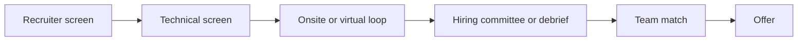

Front end loops look different from company to company, but nearly all of them are built from the same small set of round types. If you know what each round is *for*, you can prepare for the signal it's meant to capture instead of just memorizing questions. This chapter covers each format, how long it usually runs, what the interviewer writes in their feedback, and how the mix shifts as you go from mid-level to senior and lead.

## The typical pipeline



Most companies take three to six weeks from the first recruiter call to an offer. Large companies sometimes add team matching *after* the hiring decision, while smaller companies usually hire for one specific team from the start. The one thing nearly everyone does is a **debrief**, where each interviewer's written feedback is read side by side. That means every round is really producing a written artifact about you, and your job is to make that write-up easy and specific.

## Round-by-round breakdown

| Round | Typical length | What it measures | Common at |
| --- | --- | --- | --- |
| Recruiter screen | 20–30 min | Motivation, level fit, logistics, compensation band | Everywhere |
| Take-home | 2–6 hours (async) | Code quality, product sense, testing, written communication | Startups, agencies, some scale-ups |
| JavaScript coding | 45–60 min | Language fluency, async, closures, implementing utilities | Most product companies |
| UI coding (machine coding) | 45–90 min | Building a working component with state, events, a11y | Most product companies |
| Algorithmic coding | 45 min | Data structures, complexity, problem decomposition | Big tech, some fintech |
| Quiz / trivia | 15–30 min (often inside another round) | Breadth of web platform knowledge | Agencies, early screens |
| Front end system design | 45–60 min | Architecture, trade-offs, scoping, depth | Senior and above, almost always |
| Behavioral | 45–60 min | Ownership, collaboration, conflict, growth | Everywhere |
| Leadership / cross-functional | 45–60 min | Influence, strategy, people development | Lead, staff, manager tracks |
| Hiring manager | 30–60 min | Team fit, scope, motivation, mutual sell | Everywhere |
| Code review / debugging | 45 min | Reading unfamiliar code, judgment, communication | Increasingly common at senior+ |

### Recruiter screen

This is not a formality. Recruiters often decide the *level* you get interviewed for, and that is hard to change later. Have a two-minute summary ready that names your current scope ("I lead the front end for our checkout platform, four engineers, roughly 30% of revenue flows through it"), why you're looking, and the level you're targeting. If you're asked for salary expectations this early, it's fine to deflect with "I'd like to understand the level and full package first" (see the negotiation chapter).

### Technical screen

Usually one 45–60 minute session in a shared editor. Expect one JavaScript problem (implement `debounce`, `Promise.all`, a deep-clone, an event emitter) or one small UI task (a star rating, an accordion, tabs). The bar here is *competence without hand-holding*. Screens mostly fail candidates for things like:

- Not finishing a working solution in time.
- Silent coding with no narration.
- Ignoring obvious edge cases (empty input, rejection, cleanup on unmount).

### Take-home assignments

Take-homes reward people who treat them like real pull requests. Reviewers usually score:

1. Does it run on the first try from the README?
2. Is the structure sensible for the size of the problem (not over-engineered)?
3. Are there tests for the riskiest logic?
4. Is there a short write-up covering trade-offs, what you'd do with more time, and known gaps?

Respect the stated time box. A note like "I spent ~4 hours; I deliberately skipped X and Y because…" reads as senior judgment, while a 20-hour masterpiece often reads as an inability to scope.

### JavaScript coding

Expect to implement a utility from scratch, fix a broken one, or extend one. Interviewers care about correctness under async conditions (ordering, cancellation, errors), clean closures, and whether you know the platform (`AbortController`, `queueMicrotask`, `structuredClone`). A typical follow-up ladder looks like this:

```ts
// Level 1: basic debounce
// Level 2: add leading/trailing options
// Level 3: add cancel() and flush()
// Level 4: preserve `this` and return value semantics
function debounce<T extends (...args: any[]) => void>(fn: T, wait: number) {
  let timer: ReturnType<typeof setTimeout> | undefined;
  const debounced = function (this: unknown, ...args: Parameters<T>) {
    clearTimeout(timer);
    timer = setTimeout(() => fn.apply(this, args), wait);
  };
  debounced.cancel = () => clearTimeout(timer);
  return debounced;
}
```

The ladder exists so the interviewer can tell levels apart. Finishing level 1 quickly and talking through levels 2–4 counts for more than getting halfway through level 3 in silence.

### UI coding

You'll build something interactive, usually in React and sometimes in vanilla JS. The rubric nearly always includes: a working feature, sensible state shape, component decomposition, accessibility (keyboard, roles, labels), and how you handle edge cases. Senior candidates are expected to bring up a11y and loading/error states *without being asked*. The React UI coding checklist in the React playbook covers this round in detail.

### System design

This is the round that most separates mid from senior. You'll be asked to design a product (news feed, chat, photo gallery, collaborative editor) or a component (autocomplete, data table, modal). There is no single right answer. The interviewer is grading the *process*: clarifying requirements, choosing an architecture, modeling data, defining interfaces, and going deep on two or three areas. See the RADIO framework chapter.

### Behavioral and leadership

Behavioral rounds test whether your past behavior predicts success at the target level. For senior roles, the bar is ownership and cross-team collaboration. For lead and staff roles, the bar moves to influence without authority, setting direction, and growing other people. Come with a prepared story bank (see the behavioral playbook).

### Code review and debugging rounds

More companies now hand you a 200–400 line pull request or a buggy app and ask you to review or fix it. Their reasoning is that this is a better proxy for senior work than greenfield coding. What scores well:

- Triage by severity: correctness and security first, then performance, then style.
- Explain the *why* behind each comment and suggest a concrete fix.
- Notice what's missing (tests, error handling, a11y), not only what's wrong.
- Keep the tone collaborative, the way you'd actually write it to a teammate.

## How the mix changes by level

| Level | Coding share | System design | Behavioral / leadership | What tips the decision |
| --- | --- | --- | --- | --- |
| Mid (L4 / SDE II) | ~60% | 0–1 round, often component-level | 1 round | Clean, working code delivered quickly |
| Senior (L5) | ~40% | 1 round, application-level | 1 round | Design depth plus coding with no gaps |
| Staff / Lead (L6+) | ~25% | 1–2 rounds, sometimes ambiguous or org-wide | 1–2 rounds incl. leadership | Judgment, scope, influence, and system design |

At lead level you can still be rejected for weak coding, but strong coding alone won't get you hired. The deciding signal is usually system design plus the leadership round.

## Company archetypes

- **Big tech:** a standardized loop and a separate hiring committee, with leveling decided from written feedback. Algorithms show up more often. Expect a "front end domain" round at companies with dedicated FE ladders.
- **Scale-ups:** product-heavy UI coding, a practical system design round (often about their actual product), and a strong behavioral focus on ownership and pace.
- **Startups:** take-home or pairing on a real codebase, plus founder or CTO conversations about breadth. Leveling is fuzzy, so negotiate scope as well as title.
- **Agencies and consultancies:** more trivia and framework breadth, plus client-facing communication.

## Remote and virtual specifics

- Test your audio, camera, and screen share 15 minutes before the call. Close notifications.
- Ask which editor you'll use. Some (CoderPad, plain shared docs) have no preview, so practice working without one.
- Narrate more than you would in person. Interviewers can't see where you're looking.
- Keep a physical notepad for sketching. For system design, ask early whether they want you to use a whiteboard tool (Excalidraw, FigJam, Miro).

## Questions to ask your recruiter before the loop

- How many rounds, how long is each, and what type is each?
- Which language or framework is expected for coding, and can I choose?
- Is the system design round product-level or component-level?
- What level am I being considered for, and is that fixed before the loop?
- Who are the interviewers (roles, not names), and is there a bar raiser?
- Is there anything in the loop that past candidates found surprising?

Recruiters *want* you to pass, since their metrics depend on it. Most will share far more than you'd expect if you ask directly.

## Preparation checklist

- [ ] I know the number, type, and length of every round.
- [ ] I've practiced at least five JS utilities and five UI components under a timer.
- [ ] I can run a 45-minute system design with a framework and leave time for deep dives.
- [ ] I have 8–10 behavioral stories mapped to common themes.
- [ ] I have a crisp two-minute career summary and a clear "why this company".
- [ ] I've confirmed the tooling (editor, whiteboard, language) for each round.
