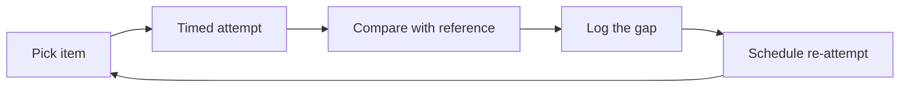

Most candidates prepare by reading. Reading builds recognition, but interviews test *production*: writing working code and talking through decisions under time pressure while someone watches. This chapter turns preparation into deliberate practice with short feedback loops, measurable progress, and realistic rehearsal.

## Principles of effective practice

1. **Produce, don't consume.** For every hour spent reading solutions, spend at least two writing code or speaking answers out loud.
2. **Time-box everything.** An interview is a timed performance. Practicing without a clock trains the wrong skill.
3. **Review immediately.** The ten minutes after an attempt teach more than the attempt itself.
4. **Space it out.** Revisit problems after 3, 7, and 21 days. Solving something once doesn't mean you can solve it under stress.
5. **Simulate the environment.** Practice in a plain editor with no autocomplete or AI assistance if that's what the interview uses.

## Build a practice inventory

Sort your practice into categories that match the rounds you'll face, and track each attempt.

| Category | Target count before interviews | Example items |
| --- | --- | --- |
| JS utilities | 20–30 | debounce, throttle, `Promise.all/any/allSettled`, `curry`, deep equal, event emitter, `classnames`, LRU cache |
| UI components | 15–20 | tabs, accordion, modal, autocomplete, star rating, data table with sort/filter, infinite list, file tree |
| DOM / browser APIs | 10 | `getElementsByClassName` polyfill, event delegation, `IntersectionObserver` lazy load |
| Algorithms (if relevant) | 30–50 | arrays/strings, hash maps, trees and DOM traversal, BFS/DFS, intervals |
| System design | 8–10 full designs | news feed, chat, autocomplete, photo gallery, e-commerce PDP, collaborative doc, video player, dashboard |
| Behavioral | 8–12 stories | conflict, failure, influence, ambiguity, mentoring, incident |
| Quiz | ~100 short answers | event loop, CSS specificity, CORS, caching headers, rendering pipeline |

A simple spreadsheet works fine. Use columns: item, date, time taken, result (solved / partial / failed), what went wrong, next review date.

## The attempt-review loop



### During the attempt

- Start a timer: 25 minutes for a JS utility, 45 for a UI component, 45–60 for system design.
- Talk out loud the whole time, even when alone. If that feels awkward, that awkwardness is exactly what you're practicing away.
- When you get stuck, write down *where* and *why* before you look anything up.

### During review

Ask four questions:

1. **Correctness:** Which edge cases did I miss? (Empty input, duplicates, rejection, unmount during async, rapid repeated events.)
2. **Speed:** Where did the time go? Usually it's setup, re-reading the prompt, or debugging typos.
3. **Communication:** Would a listener have understood my plan within the first two minutes?
4. **Level signal:** What would a senior candidate have mentioned that I didn't? (a11y, performance, testing, API ergonomics.)

Log the *pattern*, not the problem. "I forget to clean up timers and listeners" is useful. "I failed throttle" isn't.

## Drilling each round type

### JavaScript utilities

Implement each one in three passes:

1. The minimal correct version.
2. Edge cases and options (leading/trailing, cancellation, `this` binding).
3. A tiny test harness, so you build the habit of verifying.

```ts
function assertEqual(actual: unknown, expected: unknown, label: string) {
  const ok = JSON.stringify(actual) === JSON.stringify(expected);
  console.log(`${ok ? 'PASS' : 'FAIL'} ${label}`, ok ? '' : { actual, expected });
}

assertEqual(flatten([1, [2, [3, [4]]]]), [1, 2, 3, 4], 'deeply nested');
assertEqual(flatten([]), [], 'empty');
```

Writing your own quick asserts in an interview is a strong signal. It shows you verify instead of hoping.

### UI components

Use a fixed skeleton so the first five minutes are on autopilot:

1. Clarify: inputs (props), behaviors, keyboard support, and whether it's controlled or uncontrolled.
2. Sketch the state shape in a comment.
3. Render static markup with the correct semantic elements and ARIA.
4. Wire up state and events.
5. Handle loading, empty, and error states.
6. Polish: focus management, styles, and a quick manual test pass.

Do each component once in React and occasionally in vanilla JS. The vanilla version shows whether you understand the DOM or only the framework.

### System design

Practice on paper or a whiteboard tool, out loud, with a clock. After each session, compare your design against a reference write-up and against the RADIO framework checklist. Track whether you:

- Spent no more than about 15% of the time on requirements.
- Drew a component architecture diagram with clear data flow.
- Defined the data model and at least one API with real fields.
- Went deep on at least two areas (performance, offline, a11y, real-time, pagination).

### Behavioral

Write each story in bullet form (not as a script), then tell it out loud to a timer. Aim for 2–3 minutes per story. Record yourself. Most people find on playback that they spend 60% of the time on context and almost none on their own actions and results.

## Mock interviews

Self-practice gets you about 70% of the way. The last 30% (composure, pacing, reading the interviewer) only comes from being watched.

| Mock source | Pros | Cons |
| --- | --- | --- |
| Peer at your level | Free, easy to repeat | May not spot level-specific gaps |
| Senior colleague or ex-colleague | Realistic bar, honest | Limited availability |
| Paid mock platforms | Interviewers from target companies, structured feedback | Cost |
| Recording yourself | Unlimited, exposes verbal tics | No outside judgment |

Ask mock interviewers for feedback in a specific format: "Would you hire at senior? What's the single biggest thing holding the decision back?" Vague praise doesn't help you.

## A six-week plan for a working senior engineer

| Week | Focus | Weekly volume (≈8–10 h) |
| --- | --- | --- |
| 1 | Baseline: one timed attempt in each category, find weaknesses | 6 JS, 2 UI, 1 design, 3 stories |
| 2 | JS fundamentals and async utilities | 10 JS, 2 UI, quiz review |
| 3 | UI components and accessibility | 2 JS, 5 UI, 1 design |
| 4 | System design depth | 2 UI, 3 designs, 4 stories |
| 5 | Mocks: 2 coding, 1 design, 1 behavioral | Re-attempt every failed item |
| 6 | Taper: light review, sleep, logistics | Re-run 5 favorite problems, rehearse intro |

If you're targeting lead or staff roles, shift weeks 3–4 toward system design and leadership stories, and add one mock focused on technical strategy ("How would you migrate our app from X to Y?").

## Using AI tools well in prep

AI assistants are useful *reviewers* and poor *substitutes*:

- **Good uses:** ask for edge cases you missed, generate follow-up questions for a design, critique a behavioral story for vagueness, or quiz you on concepts.
- **Bad uses:** generating solutions before you've attempted the problem, or polishing stories until they no longer sound like you.
- Check whether your target company allows AI tools during interviews. Some now do, and they assess how you prompt, verify, and correct output. If so, practice that workflow explicitly.

## Signs you're ready

- You solve 80% of fresh medium JS/UI problems within the time box on the first try.
- You can run a full system design session and still have 15 minutes left for deep dives.
- You tell every core story in under three minutes with a quantified result.
- Mock interviewers say "hire" at your target level, and their feedback is about polish, not gaps.

## Common practice mistakes

- Only practicing problems you already enjoy.
- Reading a solution after two minutes of struggle. Give it ten.
- Practicing in your fully configured IDE when the interview uses a bare editor.
- Skipping behavioral prep because it "comes naturally".
- Cramming the night before instead of tapering.
