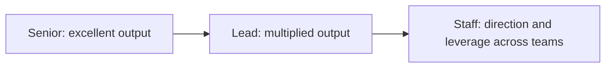

"Senior" and "lead" are often used loosely, but interview loops calibrate them precisely. A senior engineer is trusted to deliver complex features well and on their own. A lead or staff engineer is trusted to make *other people and other teams* more effective, and to make decisions whose effects last for years. Same questions, different bar. This chapter spells out what that difference looks like in practice.

## Titles vs levels

Titles vary a lot between companies, so think in terms of scope:

| Level (typical) | Common titles | Scope of impact | Time horizon |
| --- | --- | --- | --- |
| Mid | Software Engineer II, Frontend Engineer | A feature or component | Weeks |
| Senior | Senior Engineer, SDE III | A product area or major feature set | Quarters |
| Lead / Staff | Tech Lead, Staff Engineer, Lead Frontend | Multiple teams or a platform | 1–2 years |
| Principal | Principal, Senior Staff | An organization or company-wide domain | Multi-year |

"Tech lead" is sometimes a *role* that a senior engineer holds on one team, and sometimes a *level* equivalent to staff. Ask the recruiter which it is. The answer changes how you should pitch your stories.

## The core shift: from output to leverage

- **Senior:** "I built the checkout redesign and improved conversion by 4%."
- **Lead:** "I set the architecture for checkout, split it into workstreams for five engineers, unblocked two dependencies on the payments team, and grew one engineer into owning the payment-method module."
- **Staff:** "I noticed every product team was rebuilding forms differently, wrote an RFC for a shared form platform, got buy-in from four teams, and cut form-related bugs by 60% org-wide."

## Round-by-round expectations

### Coding

| Dimension | Senior bar | Lead bar |
| --- | --- | --- |
| Correctness | Complete, working, tested by hand | Same. This bar doesn't drop. |
| Code quality | Clean, idiomatic, well-named | Also explains *why* the structure scales or doesn't |
| Edge cases | Brings up most of them unprompted | Ranks them by risk and handles the important ones first |
| Communication | Clear narration | Teaches as they go, the way a good pairing partner would |
| Extensions | Handles follow-ups | Anticipates follow-ups and designs the API to accommodate them |

Lead candidates are often surprised to be rejected on coding. The coding bar at lead level is "senior, with no slips". Rusty fundamentals are a real risk if you've spent years mostly reviewing code.

### System design

| Dimension | Senior bar | Lead bar |
| --- | --- | --- |
| Requirements | Asks good clarifying questions | Pushes back on scope, names the non-functional requirements that drive the design, and states assumptions as decisions |
| Architecture | Sound component and data-flow design | Compares 2–3 options with explicit trade-offs, and picks based on team and org constraints |
| Depth | Goes deep where asked | Chooses the riskiest areas to go deep on without being prompted |
| Breadth | Front end focused | Covers the API contract, CDN and edge, observability, rollout, and migration path |
| Operability | Mentions error handling | Covers monitoring, feature flags, gradual rollout, and on-call implications |
| People and org | Rarely discussed | "This boundary matches our team structure, so each team can ship on its own" |

### Behavioral and leadership

| Theme | Senior story | Lead / staff story |
| --- | --- | --- |
| Ownership | Owned a feature end to end, including a production issue | Owned an outcome across teams, including things nobody was assigned |
| Conflict | Resolved a disagreement with a peer | Resolved a disagreement between teams or leads, with a decision record |
| Influence | Convinced the team to adopt a tool | Changed direction for several teams without line authority |
| Mentoring | Helped a junior engineer ramp up | Grew someone to senior, built a mentoring system, raised the hiring bar |
| Ambiguity | Clarified unclear requirements | Defined the problem itself and turned a vague goal into a roadmap |
| Failure | A bug or missed estimate | A strategic bet that didn't pay off, and what changed in the org as a result |

## Signals that read as "lead"

- **Framing decisions as trade-offs.** "We chose X; it costs us Y, and we accepted that because Z."
- **Thinking in second-order effects.** "If we add a global store, every team starts putting things in it. We'd need ownership rules."
- **Naming the people and process side.** Migrations, team boundaries, review load, onboarding.
- **Using metrics.** Core Web Vitals, error rates, deploy frequency, lead time, adoption percentages.
- **Writing things down.** RFCs, ADRs, runbooks, and team charters show up naturally in your stories.
- **Making others succeed.** Your stories include other people's growth and wins.

## Signals that read as "senior, not yet lead"

- Every story ends with "and then I implemented it".
- Design answers that are technically excellent but ignore rollout, migration, or team boundaries.
- No examples of disagreeing with a manager or product partner and changing the outcome.
- Mentoring described as "answering questions" rather than deliberately developing someone.
- Treating "lead" as "the best coder on the team".

## Signals that hurt at any level

- Blaming others in failure stories.
- Pushing one favorite technology regardless of context.
- Over-engineering a simple prompt to look sophisticated.
- Not listening. Steamrolling the interviewer's hints is read as how you'd treat teammates.

## How to calibrate your stories upward

Take a senior-level story and ask four questions to find the lead-level version inside it:

1. **Who else was affected?** Other teams, support, design, customers.
2. **What did you decide, not just do?** Which options did you reject, and why?
3. **What lasted?** A pattern, document, tool, or process that outlived the project.
4. **Who grew?** Did anyone take on more scope because of how you ran it?

Example rewrite:

> **Before:** "I migrated our app from Webpack to Vite, cutting build times from 4 minutes to 40 seconds."
>
> **After:** "Our CI times were hurting deploy frequency for three teams. I benchmarked Vite and Turbopack against our setup, wrote a one-page ADR recommending Vite with a two-week incremental migration, paired with an engineer from each team on their package, and published a migration guide. Builds dropped from 4 minutes to 40 seconds, deploys went from 3 to 8 per day, and one of the engineers I paired with now owns our build tooling."

## Questions that reveal which level they really want

Ask these during the hiring manager conversation:

- "What does the first six months look like for someone who's very successful in this role?"
- "How many engineers would this person influence day to day?"
- "Is there an existing tech lead or architect, and how would we split responsibilities?"
- "What's a decision this role would own that nobody owns today?"

If the answers describe shipping features, it's a senior role whatever the title. If they describe direction, standards, and cross-team problems, pitch at lead.

## Self-assessment

Rate yourself 1–5 on each statement:

- I can describe a technical decision I made that affected more than one team.
- I have written a design doc or RFC that others used to make a decision.
- I have grown someone's scope measurably.
- I can explain our front end architecture's biggest weakness and a plan to fix it.
- I've led an incident or migration from start to finish.
- I can talk about performance, a11y, and reliability using real metrics.

Anything below 3 shows you where to focus your story bank and practice.
