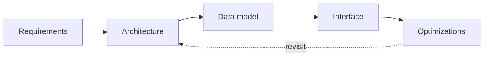
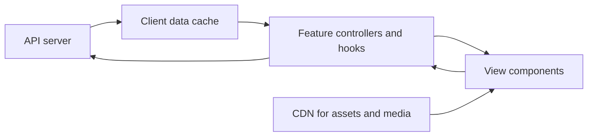

Front end system design interviews are open-ended on purpose. Without a structure, candidates tend to either ramble through requirements for 20 minutes or jump straight to drawing components and miss what the interviewer actually cares about. **RADIO** is a five-step structure that keeps the conversation moving and makes sure you cover what interviewers score.

## What RADIO stands for

| Letter | Step | Core question | Main output |
| --- | --- | --- | --- |
| **R** | Requirements exploration | What exactly are we building, for whom, and under what constraints? | Functional and non-functional requirements, explicit scope |
| **A** | Architecture (high-level design) | What are the major pieces and how do they talk to each other? | Component diagram with data flow (client, server, CDN, stores) |
| **D** | Data model | What data exists on the client, where does it live, and who owns it? | Entities, fields, client state shape, server vs client vs URL state |
| **I** | Interface definition (API) | How do the pieces communicate? | Server API endpoints and payloads, plus key component APIs and props |
| **O** | Optimizations and deep dives | What makes this fast, robust, accessible, and scalable? | 2–4 deep dives with trade-offs |

Each step builds on the one before. Requirements decide the architecture, the architecture decides where data lives, the data model shapes the API, and the API and constraints decide which optimizations matter.



## Time allocation

### 45-minute round (about 40 minutes of design)

| Step | Minutes | % | Notes |
| --- | --- | --- | --- |
| Intro and prompt | 2–3 | — | Restate the problem |
| Requirements | 5–6 | ~15% | Get to agreed scope quickly |
| Architecture | 8–10 | ~22% | Diagram by minute 10 |
| Data model | 5–6 | ~13% | Entities plus client store shape |
| Interface | 6–8 | ~17% | 1–2 key endpoints, 1–2 key component APIs |
| Optimizations | 10–12 | ~28% | This is where levels get separated |
| Wrap-up | 1–2 | — | Summarize trade-offs and what's next |

### 60-minute round (about 52 minutes of design)

| Step | Minutes | Notes |
| --- | --- | --- |
| Intro and prompt | 3 | |
| Requirements | 6–8 | Room for one or two non-obvious constraints |
| Architecture | 10–12 | Compare alternatives explicitly |
| Data model | 6–8 | Include normalization and caching keys |
| Interface | 8–10 | Pagination, real-time channel, error shapes |
| Optimizations | 15–18 | 3–4 deep dives |
| Wrap-up and questions | 3–5 | |

The most common failure is running out of time before **O**. Keep a visible timer, and if you're behind, tell the interviewer you're compressing: "I'll keep the API brief so we have time for performance."

## R: Requirements exploration

Goal: turn a one-line prompt into a scoped problem in five minutes.

**Functional requirements:** which user actions must work? List them, then agree on the 3–5 core ones.

**Non-functional requirements:** these drive most of the architecture:

- Scale: number of items, users, update frequency.
- Devices and network: mobile-first? low-end Android? offline?
- Performance targets: LCP, INP, time to first message.
- Accessibility and internationalization needs (RTL, locales).
- SEO: does it matter? (Decides between SSR and CSR.)
- Real-time needs: is polling fine, or is push required?

**Template to say out loud:**

> "So the core is: view a feed, create a post, like and comment. Out of scope: ads, stories, DMs. Mostly mobile web, global users, so variable networks. Feed must be fast on first load and smooth when scrolling; new posts can appear within a few seconds rather than instantly. Accessibility to WCAG AA. Does that match what you had in mind?"

## A: Architecture

Draw the major modules and the direction of data flow. For a typical application:



Describe each box in one sentence. Then make the rendering decision explicit:

| Strategy | Choose when |
| --- | --- |
| CSR (SPA) | Logged-in app, SEO irrelevant, heavy interactivity |
| SSR / streaming SSR | First paint matters, SEO matters, personalized content |
| SSG / ISR | Content changes rarely or on a schedule |
| React Server Components | Large static-ish trees with small interactive islands, and you're on a framework that supports them |

## D: Data model

List the entities with their key fields, then say where each piece of state lives:

```ts
type User = { id: string; name: string; avatarUrl: string };
type Post = {
  id: string;
  author: User['id'];
  text: string;
  media: { url: string; width: number; height: number; alt: string }[];
  createdAt: string; // ISO
  likeCount: number;
  viewerHasLiked: boolean;
};
type FeedPage = { items: Post['id'][]; nextCursor: string | null };
```

| State kind | Examples | Where it lives |
| --- | --- | --- |
| Server cache | posts, users, feed pages | Normalized query cache (TanStack Query, Apollo, RTK Query) |
| Client UI state | open modals, composer draft | Component state or a small store |
| URL state | filters, selected tab, search query | Router search params |
| Persistent local | drafts, offline queue | IndexedDB / localStorage |

Bring up **normalization** (store entities by id so a like updates everywhere) and **derived state** (don't store what you can compute).

## I: Interface definition

Define the contracts that matter, both server and component:

```http
GET /api/feed?cursor=abc&limit=20
200 { "items": [Post], "nextCursor": "def" }

POST /api/posts/{id}/like
200 { "likeCount": 42, "viewerHasLiked": true }
```

```tsx
<Feed
  queryKey={['feed', userId]}
  renderItem={(post) => <PostCard post={post} />}
  onEndReached={fetchNextPage}
/>
```

Choices worth calling out: cursor vs offset pagination, REST vs GraphQL, the real-time transport (SSE vs WebSocket vs polling), error shapes, and idempotency for mutations.

## O: Optimizations and deep dives

Pick the 2–4 areas that matter most *for this product*, and say why you picked them:

- **Performance:** code splitting, image optimization, virtualization, prefetching, caching.
- **Network:** request dedupe, retries with backoff, optimistic updates, offline queue.
- **Rendering:** SSR and streaming, hydration cost, avoiding layout shift.
- **Accessibility:** keyboard navigation, focus management, live regions for new content.
- **Internationalization:** RTL, pluralization, date and number formatting.
- **Security:** XSS from user content, CSP, token storage.
- **Observability:** RUM, error tracking, feature flags for rollout.

For each one, use **problem, options, choice, cost**: "Feed items have variable heights, so naive virtualization causes jumps. Options are fixed heights, measuring with ResizeObserver, or skipping virtualization and capping the DOM. I'd measure and cache heights; the cost is complexity in scroll restoration."

## Navigating the conversation

- **Signpost each transition:** "Requirements are set; moving to architecture."
- **Check in:** "Is there an area you'd like me to focus on?" Interviewers often have a deep dive in mind.
- **Revisit when needed:** if a deep dive changes an earlier decision, say so. That shows good judgment.
- **Don't recite the framework mechanically.** RADIO is a scaffold, not a script. If the interviewer jumps to the API, follow them and come back later.

## Adapting RADIO to component questions

For component-level prompts (autocomplete, modal, data grid), the weighting changes:

| Step | Application question | Component question |
| --- | --- | --- |
| Requirements | Product scope, scale | Use cases, configurability, a11y requirements |
| Architecture | Client and server modules | Internal subcomponents, controller vs view |
| Data model | Entities, stores | Internal state, props vs state |
| Interface | HTTP APIs | **Component props/API is the centerpiece** |
| Optimizations | Network, rendering, scale | Keyboard and screen reader support, performance with large data, theming |

## One-page checklist

- [ ] Restated the prompt and agreed on 3–5 core features
- [ ] Listed non-functional requirements that drive the design
- [ ] Diagram drawn by about minute 10, with data flow arrows
- [ ] Made the rendering strategy explicit and justified it
- [ ] Defined entities and where each kind of state lives
- [ ] Defined at least one server API and one component API with real fields
- [ ] Went deep on 2–4 areas using problem, options, choice, cost
- [ ] Summarized the trade-offs at the end
