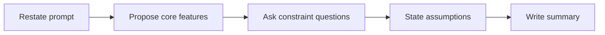

The requirements step is short, but it shapes everything after it. Two candidates given "Design a chat app" can produce completely different (and equally valid) designs depending on what they establish in the first five minutes. Interviewers watch this step closely because it mirrors real work: senior engineers are paid to work out *what* to build before deciding *how*.

## Goals of the requirements step

1. **Agree on the core use cases.** Usually 3–5 user-facing capabilities.
2. **Set explicit scope.** Name what you're *not* building.
3. **Surface the non-functional requirements** that drive architecture: scale, performance, devices, real-time, offline, a11y, i18n, SEO.
4. **Turn unknowns into stated assumptions** so you don't stall.

You're done when you could write a one-paragraph problem statement that the interviewer would sign off on.

## Functional vs non-functional

| Type | Question it answers | Examples |
| --- | --- | --- |
| Functional | What can the user do? | Send a message, search products, upload a photo, filter results |
| Non-functional | How well, how fast, for whom, under what conditions? | Loads in under 2.5s on 4G, works offline, supports screen readers, 10k items in a list |

Junior answers list functional requirements only. Senior answers put most of their energy into non-functional ones, because those are what make the problem *interesting*.

## The question bank

Don't ask all of these. Pick the 6–8 that matter most for the prompt.

### Users and context

- Who are the users? Consumers, internal staff, power users?
- Which devices dominate? Desktop, mobile web, low-end Android, embedded webviews?
- What network conditions? Global users on 3G, or office Wi-Fi?
- Logged-in only, or public pages too?

### Scale and data shape

- How many items does a typical user see? 20, 2,000, 2 million?
- How often does data change? Static, minutes, real-time?
- How large is each item? Text, images, video?
- Is there user-generated content? (Implications: XSS, moderation, variable sizes.)

### Performance

- Which moment matters most: first load, interaction latency, or scroll smoothness?
- Are there explicit targets (Core Web Vitals, time to first message)?
- Is SEO important? (This decides SSR vs CSR.)

### Real-time and collaboration

- Do other users' changes need to appear live? With what latency tolerance?
- Can multiple users edit the same thing at once?

### Reliability and offline

- Should it work offline or on flaky connections?
- What happens when a mutation fails? Retry, queue, or show an error?

### Accessibility and internationalization

- What a11y level is required (WCAG 2.2 AA is a common baseline)?
- Which locales? Any RTL languages? Locale-specific formatting?

### Product and business

- Are there experiments or feature flags to support?
- Analytics requirements?
- Any constraints from existing systems (design system, API already exists)?

## How to run the conversation

A good sequence:

1. **Restate** the prompt in one sentence.
2. **Propose** a set of core features rather than asking an open question. ("I'm thinking the core is X, Y, Z. Is that right?") Proposing is faster and shows product sense.
3. **Ask targeted constraint questions**, two or three at a time.
4. **State assumptions** for anything the interviewer leaves open: "I'll assume up to 10k contacts per user and mobile-first."
5. **Summarize** in a short list you can point back to later.

Write the summary somewhere visible (a corner of the whiteboard, or a text box). It keeps you honest and helps the interviewer score you.

## Worked example: "Design an autocomplete component"

**Restate:** "A reusable search input that suggests results as the user types."

**Propose features:** suggestions as you type, keyboard navigation, select to fill or navigate, recent searches when focused and empty.

**Constraint questions and answers:**

| Question | Answer (from interviewer or assumed) | Design impact |
| --- | --- | --- |
| Data source: local list or server? | Server, millions of entries | Debounce, caching, request cancellation |
| Used in multiple products? | Yes, as a design system component | Flexible API, render props or slots, theming |
| Mobile? | Yes | Touch targets, virtual keyboard, viewport space |
| A11y? | Must meet WCAG AA | ARIA combobox pattern, live region for result count |
| Result types? | Text, plus some with images | Custom item rendering |
| Latency target? | Suggestions within ~150ms of pausing | Debounce ~150–250ms, cache, maybe prefetch popular prefixes |

**Summary:** "Generic server-backed autocomplete for the design system. Keyboard and screen reader accessible, mobile friendly, custom item rendering, results feel near-instant. Out of scope: spell correction (server concern) and multi-select."

## Worked example: "Design a news feed"

| Category | Decision |
| --- | --- |
| Core features | View an infinite feed, create a text and image post, like, comment (count plus top comments) |
| Out of scope | Stories, ads, DMs, notifications page |
| Users and devices | Global, about 70% mobile web |
| Scale | Effectively infinite feed; posts include images; users scroll 50–200 items per session |
| Freshness | New posts can show as a "new posts" pill; no need to inject live |
| Performance | Fast first paint (SSR first page), smooth scrolling on mid-range phones |
| A11y | Feed landmark, keyboard navigation between posts, announcements for new content |
| SEO | Not needed (logged-in) |

From this table you can already see the architecture taking shape: SSR the first page, cursor pagination, virtualization or DOM capping, image optimization, and an optimistic like.

## Prioritizing requirements

When there are too many requirements, sort them explicitly:

| Priority | Meaning | Example (chat app) |
| --- | --- | --- |
| P0 | Must design in detail | Send and receive messages, conversation list, real-time delivery |
| P1 | Mention the approach, light detail | Typing indicators, read receipts, attachments |
| P2 | Acknowledge only | Reactions, message search, theming |

Saying "I'll design P0 in depth and touch on P1 if time allows" is a strong scoping signal.

## Anti-patterns

- **Interrogation mode:** asking 20 questions without proposing anything. It looks indecisive.
- **Skipping it entirely:** drawing boxes in the first minute. Interviewers flag this as "didn't clarify".
- **Over-scoping:** promising offline, real-time, collaboration, and i18n, then not having time to design any of them.
- **Backend drift:** spending the step on database sharding. Unless asked, keep the backend a black box with a clear API.
- **Not writing anything down:** you'll forget what was agreed, and so will the interviewer.

## What lead candidates add

- **Business framing:** "Since this is checkout, conversion and reliability beat fancy UX. I'll prioritize resilience."
- **Constraints from the org:** "Do we have an existing design system and API gateway? I'd reuse them rather than invent new ones."
- **Measurable success criteria:** "Success means p75 LCP under 2.5s and checkout errors below 0.1%."
- **Risk identification:** "The biggest risk is the real-time sync. I'll spend the deep dive there."
- **Phasing:** "V1 without offline, V2 adds an offline queue once we see usage data."

## Checklist

- [ ] Restated the problem in one sentence
- [ ] Proposed 3–5 core features and got agreement
- [ ] Named out-of-scope items
- [ ] Covered devices, scale, freshness, performance, a11y, and SEO
- [ ] Turned open questions into stated assumptions
- [ ] Prioritized into P0/P1/P2
- [ ] Wrote a visible summary
- [ ] Finished in about 5–8 minutes
