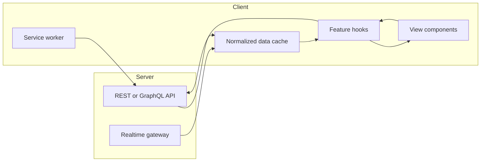

Once requirements are set, the next 15–20 minutes go to the **A** and **D** of RADIO: the high-level structure of the application, and the data that moves through it. These two steps are closely linked. Where you put a piece of state depends on which component reads it, and how you split components depends on what data they own.

## What a good architecture diagram contains

A front end architecture diagram is not a list of every component. It shows:

- **Major modules** (5–8 boxes): server/API, client cache/store, controllers or feature hooks, view components, and infrastructure like CDN, service worker, or real-time channel.
- **Data flow direction:** arrows labeled with what moves ("feed pages", "mutations", "events").
- **Boundaries:** what runs on the server vs the client, and what's cached where.



Walk through one user action end to end using the diagram: "User taps like, the hook optimistically updates the cache, the UI re-renders, the hook sends POST, and on failure the cache rolls back and we show a toast." This one narrative shows that the boxes actually work together.

## Rendering strategy decision

Make this explicit early. It affects data fetching, caching, and performance.

| Strategy | First paint | Interactivity | SEO | Server cost | Good fit |
| --- | --- | --- | --- | --- | --- |
| CSR | Slow (JS first) | Fast once loaded | Weak | Low | Dashboards, internal tools, logged-in apps |
| SSR (streaming) | Fast | Needs hydration | Strong | Medium–high | Personalized public pages, feeds |
| SSG | Fastest | Needs hydration | Strong | Lowest | Docs, marketing, blogs |
| ISR / revalidation | Fast | Needs hydration | Strong | Low | Product catalogs, content that updates periodically |
| Server Components plus islands | Fast | Only interactive parts hydrate | Strong | Medium | Content-heavy apps with targeted interactivity |

A reasonable answer for a social feed: "SSR the shell and first page of the feed with streaming so content appears quickly, hydrate the interactive parts, then switch to client-side fetching for pagination." Saying *why* matters more than the choice itself.

## Component architecture

Split the view layer by responsibility:

| Layer | Responsibility | Example |
| --- | --- | --- |
| Route / page | Data requirements, layout, code-split boundary | `FeedPage` |
| Container / controller | Connects data hooks to presentational components | `FeedController` uses `useFeed()` |
| Presentational | Pure rendering from props, reusable | `PostCard`, `Avatar`, `LikeButton` |
| Primitives | Design system components | `Button`, `Dialog`, `Menu` |

With hooks, "containers" are usually just custom hooks. You don't need a separate component layer to justify the split, but the separation of concerns still applies.

```tsx
function FeedPage() {
  const { pages, fetchNextPage, hasNextPage, status } = useFeed();
  if (status === 'pending') return <FeedSkeleton />;
  if (status === 'error') return <FeedError />;
  return (
    <Feed
      posts={pages.flatMap((p) => p.items)}
      onEndReached={hasNextPage ? fetchNextPage : undefined}
    />
  );
}
```

## Where state lives

The most useful habit in front end design is classifying every piece of state:

| Category | Description | Tooling | Example |
| --- | --- | --- | --- |
| Server state | Owned by the server, cached on the client, can go stale | TanStack Query, SWR, RTK Query, Apollo, Relay | posts, users, products |
| URL state | Should survive reload and be shareable | Router params and search params | filters, sort, page, selected tab |
| Local UI state | Ephemeral, belongs to one component | `useState`, `useReducer` | dropdown open, input value |
| Shared client state | Cross-cutting UI state with no server owner | Context, Zustand, Redux | theme, sidebar collapsed, multi-step form |
| Persistent client state | Must survive reload or work offline | localStorage, IndexedDB | drafts, offline mutation queue |
| Form state | Validation and dirty tracking | React Hook Form, native forms, actions | checkout form |

**Rule of thumb:** server state doesn't belong in a general client store. Treating server data as a cache (with staleness, refetching, dedupe) removes most of the complexity that global stores used to hold.

## Designing the data model

### Entities and relationships

List entities with id, key fields, and relationships. Note which fields are display-only and which drive behavior.

```ts
type Conversation = {
  id: string;
  participantIds: string[];
  lastMessageId: string | null;
  unreadCount: number;
  updatedAt: string;
};

type Message = {
  id: string;            // server id
  clientId: string;      // temporary id for optimistic sends
  conversationId: string;
  senderId: string;
  body: string;
  status: 'sending' | 'sent' | 'delivered' | 'read' | 'failed';
  createdAt: string;
};
```

The `clientId` and `status` fields show you've thought about optimistic updates and failure, which is a typical senior detail.

### Normalization

Store entities once, keyed by id, and reference them from lists:

```ts
type ClientCache = {
  users: Record<string, User>;
  messages: Record<string, Message>;
  conversations: Record<string, Conversation>;
  messageIdsByConversation: Record<string, string[]>;
};
```

| Approach | Pros | Cons |
| --- | --- | --- |
| Normalized | One source of truth; updates propagate everywhere; cheap lookups | More code to read and write; needs selectors |
| Denormalized (nested responses) | Simple; matches the API | Duplicated data goes stale; updates must touch many places |
| Query-keyed cache (TanStack Query) | Simple per-query caching | Cross-query consistency needs manual updates or invalidation |

Pick based on how much data is shared across views. Chat and social apps benefit from normalization. Dashboards with independent widgets often don't.

### Derived state

Don't store what you can compute. Compute `unreadTotal` from conversations, and visible items from data plus filters. Memoize only when the computation is expensive.

### Pagination model

```ts
type Page<T> = { items: T[]; nextCursor: string | null; prevCursor?: string | null };
```

Cursor-based pagination is the default for feeds and chats because inserts don't shift positions the way they do with offsets.

## Architecture patterns to name-drop (correctly)

- **Unidirectional data flow:** state flows down, events flow up. This is the default mental model.
- **Optimistic UI with rollback:** apply the change locally, reconcile with the server response.
- **Stale-while-revalidate:** show cached data immediately, refresh in the background.
- **Event-sourced local state:** for collaborative editing, store operations rather than snapshots (CRDT or OT).
- **Feature-sliced structure:** organize code by feature, not by type, so teams can own vertical slices.
- **Backend for frontend (BFF):** a thin server layer that shapes APIs for one client, which cuts over-fetching and round trips.

## Common mistakes

- A diagram with 25 boxes and no arrows.
- Putting all server data in Redux "because it's global".
- Forgetting URL state, so filters are lost on refresh and links can't be shared.
- Not deciding a rendering strategy, then being surprised by SEO or first-load questions.
- A data model with no ids, timestamps, or status fields.

## What lead candidates add

- **Team boundaries:** "Each feature folder can be owned and deployed by a different team. Shared state goes through a typed event bus or the URL, not direct imports."
- **Evolution path:** "Start with query-keyed caching; if cross-view consistency issues grow, move hot entities to a normalized store."
- **Contracts as code:** generated TypeScript types from OpenAPI or GraphQL schemas, and contract tests.
- **Cost awareness:** SSR adds server cost and on-call load. Is the latency gain worth it for this product?

## Checklist

- [ ] 5–8 boxes with labeled arrows; client vs server boundary shown
- [ ] Rendering strategy chosen and justified
- [ ] One user action walked through end to end
- [ ] Every important piece of state classified (server, URL, local, shared, persistent)
- [ ] Entities defined with ids, timestamps, and status fields
- [ ] Normalization decision explained
- [ ] Pagination model chosen
