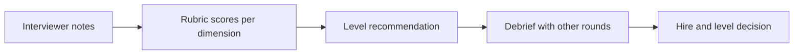

System design interviews feel subjective, but most companies score them against a written rubric. Interviewers take notes during the session, then map what they saw to dimensions and a level recommendation. Knowing the rubric lets you *deliberately produce evidence* for each dimension, instead of hoping the interviewer notices.

## The scoring dimensions

Exact wording varies, but nearly every rubric covers these six areas:

| Dimension | What it captures |
| --- | --- |
| Problem exploration | Clarifying scope, identifying constraints, prioritizing |
| Architecture | Sound decomposition, data flow, rendering strategy |
| Data and APIs | State modeling, entities, contracts between client, server, and components |
| Technical depth | Going deep on the hard parts with real knowledge |
| Trade-offs and judgment | Comparing options and choosing based on context |
| Communication | Structure, clarity, collaboration, time management |

Many companies also score **operational maturity** (monitoring, rollout, failure handling) and **user focus** (a11y, UX, performance as felt by users) separately at senior and above.

## Mid vs senior vs staff/lead signals

### Problem exploration

| Mid | Senior | Staff / Lead |
| --- | --- | --- |
| Asks some clarifying questions, mostly functional | Covers functional and non-functional requirements; states assumptions; scopes to P0 | Reframes the problem around user and business goals; finds the requirement that drives the design; proposes phasing (V1/V2) |
| Sometimes starts designing before scope is clear | Finishes in about 5–8 minutes with a written summary | Spots risks and unknowns early and says how they'd de-risk them |

### Architecture

| Mid | Senior | Staff / Lead |
| --- | --- | --- |
| Lists components; the diagram may lack data flow | Clear modules with directional data flow; justified rendering strategy | Compares 2–3 architectures; chooses based on team structure, scale, and cost; plans how it evolves |
| Puts most state in one global store | Separates server, URL, and local state | Defines ownership boundaries for multiple teams and integration contracts |

### Data and APIs

| Mid | Senior | Staff / Lead |
| --- | --- | --- |
| Basic entities; vague API ("call the backend") | Concrete payloads, pagination choice, error handling, optimistic updates | Contract governance: versioning, schema types, BFF ownership, idempotency, backwards compatibility |
| Component props listed loosely | Typed component API with defaults and a11y requirements | Component API designed as a platform: composition, theming, extension points, deprecation strategy |

### Technical depth

| Mid | Senior | Staff / Lead |
| --- | --- | --- |
| Names techniques (lazy load, memoize) | Explains how and why techniques work; ties them to metrics | Chooses the riskiest areas to go deep on unprompted; knows the failure modes of each technique |
| Depth in one area when prompted | Depth in 2–3 areas: performance, a11y, real-time, offline | Depth plus breadth: observability, security, rollout, cost |

### Trade-offs and judgment

| Mid | Senior | Staff / Lead |
| --- | --- | --- |
| Presents one solution as "the" answer | States trade-offs for major decisions | Makes trade-offs explicit and reversible where possible; explains what would change the decision |
| May over-engineer to impress | Right-sizes the solution to the requirements | Simplifies boldly ("we don't need real-time for V1"), and defends it with data |

### Communication

| Mid | Senior | Staff / Lead |
| --- | --- | --- |
| Needs prompting to move forward | Drives the session with a clear structure; checks in | Runs it like a design review: signposts, invites challenge, summarizes decisions |
| May run out of time before deep dives | Manages time; reaches the deep dives | Adjusts depth to the interviewer's interests; leaves time for discussion |

## Level-defining moments

Interviewers often point to one or two specific moments when they justify a level. Examples:

**Mid-level moments**
- "Implemented a good component structure once I pointed out the data flow."
- "Mentioned virtualization when I asked about long lists."

**Senior moments**
- "Unprompted, separated server cache from client UI state and explained stale-while-revalidate."
- "Designed an optimistic like with rollback and an idempotency key."
- "Brought up keyboard and screen reader support for the autocomplete without being asked."

**Staff/lead moments**
- "Challenged the requirement for real-time updates, proposed a 'new posts' pill, and explained the cost savings."
- "Designed the module boundaries so three teams could ship independently, with a contract-testing strategy."
- "Included a rollout plan (feature flag, 1% → 10% → 100%, RUM guardrails on INP) and a rollback trigger."

## How the debrief works

- Each dimension is usually scored on a 1–4 or 1–5 scale, with anchors per level.
- Interviewers are asked for **evidence** ("said X", "drew Y"), not impressions. Give them quotable moments.
- At lead and staff level, a strong design round can make up for a slightly weaker coding round, but rarely the other way around.
- "Mixed" signals often lead to a down-level offer (senior instead of staff) rather than a rejection.

## A sample scoring sheet

| Dimension | Score (1–4) | Evidence |
| --- | --- | --- |
| Problem exploration | 4 | Prioritized P0 features, set non-functional requirements (mobile, 3G), proposed phasing |
| Architecture | 3 | Solid SSR plus client cache; didn't discuss team ownership |
| Data and APIs | 4 | Cursor pagination, normalized cache, typed component API, error contract |
| Technical depth | 3 | Strong on virtualization; light on a11y for virtual lists |
| Trade-offs | 4 | Compared SSE vs WebSocket and picked SSE for one-way updates, citing infra cost |
| Communication | 4 | Signposted each step, finished deep dives with 5 min left |
| **Recommendation** | **Senior, strong; borderline staff** | Would need more cross-team and operational thinking for staff |

## How to produce evidence on purpose

1. **Say the dimension's keyword out loud** at the right moment: "The trade-off here is…", "The non-functional requirement that drives this is…".
2. **Write decisions down** on the board. Interviewers copy them into notes.
3. **Ask to go deep** in areas that show your level: "Would you like me to go deeper on rollout and monitoring?"
4. **Summarize at the end** with the 3–4 key decisions and their trade-offs. This hands the interviewer their write-up.

## Common reasons for down-leveling

- Great technical depth, but no trade-offs: "knows a lot, but every answer was the same pattern".
- Strong architecture, but never got to optimizations because of time.
- Silence about users: no mention of a11y, error states, or slow networks.
- Treating the interviewer as an examiner rather than a collaborator.
- At staff level: no mention of rollout, migration, team boundaries, or operability.

## Self-review after a mock

Score yourself honestly on each dimension using the tables above, and write down one piece of evidence per score. If you can't name any evidence, the interviewer couldn't either.

## Checklist

- [ ] I can name the six rubric dimensions
- [ ] I deliberately created at least one quotable moment per dimension
- [ ] I compared alternatives for at least two major decisions
- [ ] I covered user-facing quality (a11y, error states, slow networks)
- [ ] At lead level: I covered rollout, observability, and team boundaries
- [ ] I closed with a summary of decisions and trade-offs
