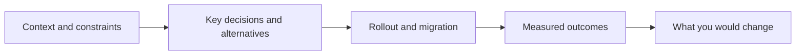

A lead or staff front end loop isn't a harder senior loop. It measures something different. Senior loops ask "can this person deliver complex work independently?" Lead loops ask "will this person make an organization's front end better over the next two years, through decisions, systems, and other people?" If you prepare for a lead loop the way you prepared for senior, you'll probably end up down-leveled.

## The competency model

Most companies' lead/staff rubrics reduce to five competencies. The names vary; the substance doesn't.

| Competency | What they want to see | Where it's assessed |
| --- | --- | --- |
| **Technical depth** | You're still an excellent engineer who can go deep in front end | Coding, system design deep dives |
| **Architecture and judgment** | You make sound, durable decisions under constraints and explain trade-offs | System design, architecture deep dive, past-project review |
| **Scope and impact** | Your work changed outcomes beyond one team | Behavioral, past-project review, hiring manager |
| **Influence and collaboration** | You align people you don't manage: other teams, product, design, leadership | Behavioral, cross-functional round |
| **Growing others** | You raise the level of engineers around you | Behavioral, leadership round |

Lead roles that include people management (an "engineering lead" or "EM-lite") add **execution management**: planning, staffing, delivery, and performance conversations.

## A typical loop

| Round | Length | Lead-specific twist |
| --- | --- | --- |
| Coding (1–2) | 45–60 min | Same bar as senior; clean, complete, communicative |
| Front end system design | 60 min | Ambiguous prompts; rollout, ownership, and evolution expected |
| Architecture / past project deep dive | 60 min | You present a system you shaped; they probe decisions and alternatives |
| Behavioral / leadership | 45–60 min | Cross-team influence, conflict, mentoring, strategy |
| Cross-functional partner | 30–45 min | Product or design manager assesses collaboration |
| Hiring manager / skip-level | 45 min | Scope fit, motivation, operating style |

Some companies add a **written exercise**: an RFC critique or a take-home strategy doc. It tests a core lead skill directly: clear technical writing.

## What "staff-level scope" means concretely

Interviewers listen for the **blast radius** of your work:

| Scope | Example | Signal |
| --- | --- | --- |
| Feature | Built the new search UI | Senior |
| Product area | Owned search front end architecture for two quarters | Senior+ |
| Multi-team | Defined the shared data-fetching layer used by six teams | Lead / Staff |
| Org-wide | Set front end performance strategy; budgets enforced across 40 repos | Staff+ |
| Company / industry | Open-source library adopted widely; company-wide platform migration | Principal |

Make the scope explicit in every story: number of teams, engineers, users, revenue, or repos affected.

## The architecture deep dive round

Increasingly common, and where many lead candidates win or lose. You'll be asked to walk through a system you significantly shaped.

**Prepare one system thoroughly:**

1. **Context:** the business problem, constraints, and team setup.
2. **Architecture:** a diagram you can redraw from memory in five minutes.
3. **Key decisions:** three or four decisions, each with alternatives and why you chose as you did.
4. **What went wrong:** at least one decision you'd change, and what you learned.
5. **Outcomes:** metrics before and after (performance, reliability, velocity, adoption).
6. **Your role:** precisely what *you* did vs the team.

Interviewers will push on alternatives ("Why not micro-frontends?"), scaling ("What breaks at 10x?"), and people ("How did you get the other teams to adopt it?"). Rehearse those answers.

## Signals by round

### Coding
- Finish cleanly. Name trade-offs as you go. Write a quick test.
- Talk like a reviewer: "In production I'd extract this, but for time I'll inline it."

### System design
- Drive the session; set the scope confidently.
- Cover rollout (flags, phased release), observability (RUM, error tracking), and ownership (which team owns which module).
- Explain how the design evolves: V1 now, what triggers V2.

### Behavioral
- Stories with multi-team scope, explicit decisions, and lasting artifacts (RFCs, standards, tools).
- At least one story where you were wrong and changed course.
- At least one story where someone else's growth was the outcome.

### Cross-functional
- Show how you turn product goals into technical plans and trade-offs that partners can understand.
- Show that you push back with data and offer options rather than flat "no"s.

## Lead archetypes

Staff-plus engineers often fit one of several archetypes. Knowing which one you are helps you pick stories:

| Archetype | Focus | Typical stories |
| --- | --- | --- |
| Tech lead | Guides one team's technical direction and execution | Delivery of a complex project, team practices |
| Architect | Direction and quality across a broad area | Cross-team architecture, standards, RFC process |
| Solver | Goes deep on the hardest problems wherever they are | Performance crisis, critical migration, incident |
| Right hand | Extends a senior leader's reach across the org | Org-wide initiatives, operational programs |

Pitch the archetype that matches the role. Ask the hiring manager which one they need.

## Common reasons lead candidates are down-leveled

1. **"I" stories with team-sized scope.** Excellent execution, no evidence of leverage.
2. **No trade-off language.** Decisions presented as obvious.
3. **No failures.** Interviewers don't trust a track record with no mistakes.
4. **Weak coding.** Years of not coding show. Practice.
5. **Technology evangelism.** One answer for every problem.
6. **Vague metrics.** "Performance improved a lot" instead of "p75 LCP 4.1s → 2.3s on mobile".
7. **No people dimension.** Never mentions mentoring, hiring, or team health.

## Preparation plan (four weeks)

| Week | Focus |
| --- | --- |
| 1 | Write the architecture deep dive: diagram, decisions, metrics. Refresh coding (10 problems). |
| 2 | Story bank: 10–12 lead-level stories mapped to competencies; quantify each. |
| 3 | System design: 4–5 practice sessions emphasizing rollout, ownership, and evolution. |
| 4 | Mocks with staff-level engineers; refine the deep dive; prepare questions for interviewers. |

## Questions that show lead thinking (to ask them)

- "What's the biggest technical risk in the front end over the next year?"
- "How are cross-team technical decisions made and recorded?"
- "What does the staff engineer here own that nobody else does?"
- "How is front end platform work prioritized against product work?"

## Checklist

- [ ] I can state my scope in teams, users, or revenue for each major story
- [ ] My architecture deep dive covers decisions, alternatives, failures, and metrics
- [ ] I have stories for influence, conflict, mentoring, strategy, and failure
- [ ] My coding is sharp enough to finish medium problems cleanly
- [ ] My system design answers include rollout, observability, and ownership
- [ ] I know which lead archetype this role needs
