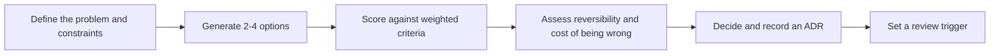

Leads are judged less on knowing every technology and more on making **good decisions under uncertainty** and leaving a trail others can follow. This chapter gives you a framework for front end architecture decisions, the trade-offs behind the most common ones, and how to talk about them in interviews.

## A decision framework

### 1. Define the problem, not the solution

"We need micro-frontends" is a solution. "Five teams block each other on a single release train, and deploys happen weekly" is a problem. Start there.

### 2. Make the constraints explicit

- **Team:** size, skills, hiring market, turnover.
- **Product:** SEO, interactivity, devices, scale, offline needs.
- **Organization:** number of teams, ownership model, release cadence.
- **Existing investment:** code volume, libraries, infrastructure.
- **Timeline and risk tolerance.**

### 3. Use weighted criteria

| Criterion | Weight | Option A | Option B | Option C |
| --- | --- | --- | --- | --- |
| User performance (LCP/INP) | 3 | 4 | 3 | 5 |
| Developer velocity | 3 | 4 | 5 | 2 |
| Migration cost | 2 | 2 | 4 | 1 |
| Hiring / ecosystem | 2 | 5 | 4 | 3 |
| Operational complexity | 2 | 3 | 4 | 2 |
| **Weighted total** | | **43** | **49** | **31** |

The numbers aren't the point. What matters is that the team agrees on what's important *before* arguing for its favorite option.

### 4. Classify reversibility

| Type | Examples | Approach |
| --- | --- | --- |
| One-way door (hard to reverse) | Framework, monorepo vs polyrepo, rendering architecture, public API contracts | Slow down: RFC, prototype, wide review |
| Two-way door (easy to reverse) | A charting library, a lint rule, folder conventions inside one feature | Decide quickly, let the team own it |

A common lead failure is treating every decision as a one-way door and slowing the team down. The opposite failure is rushing one-way doors.

### 5. Record and revisit

Write an ADR (see the RFCs and ADRs chapter) and set a **review trigger**: a date, a metric threshold, or an event ("when we have more than eight teams").

## The big decisions and their trade-offs

### Framework / meta-framework

| Option | Strengths | Trade-offs |
| --- | --- | --- |
| Next.js (App Router) | RSC, streaming, mature ecosystem, Vercel or self-host | Complexity of caching and server boundary; tied to framework release cadence |
| React Router v7 (framework mode) / Remix lineage | Web-standards loaders and actions, progressive enhancement | Smaller RSC story (evolving), fewer integrated hosting features |
| TanStack Start / Router | Type-safe routing, client-first with SSR | Newer; smaller ecosystem |
| Vite SPA | Simple, fast builds, static hosting | No SSR by default; SEO and first-load trade-offs |
| Astro | Content sites, islands, multi-framework | Not suited to app-like interactivity everywhere |
| Angular / Vue / Svelte | Integrated tooling (Angular), approachability (Vue), compiled output (Svelte) | Team skills, hiring, ecosystem fit |

**Lead framing:** "For our logged-in analytics app, SEO is irrelevant and interactivity is everything, so a Vite SPA with TanStack Router and Query keeps operations simple. For the marketing and docs sites, Astro or Next.js static generation fits better. Two stacks is acceptable because the teams and goals differ."

### Rendering strategy

| Requirement | Lean towards |
| --- | --- |
| SEO plus personalized content | SSR / RSC with streaming |
| Mostly static content | SSG / ISR |
| Heavy interactivity behind login | CSR SPA |
| Mixed | Per-route choice in a framework that supports it |

### State and data

Default stack in 2025: server cache library (TanStack Query, RTK Query, or framework loaders/RSC) + URL state + local state, with a small client store where needed. Choose Redux Toolkit for large teams with complex client-side logic and existing investment. See the React state chapter.

### Styling

| Option | Pros | Cons |
| --- | --- | --- |
| CSS Modules | Zero runtime, scoped, standard CSS | Theming needs CSS variables; no co-located variants API |
| Tailwind CSS | Speed, consistency through tokens, tiny CSS output | Verbose markup; requires discipline for design-system components |
| Zero-runtime CSS-in-JS (vanilla-extract, Panda, StyleX) | Type-safe, tokens, RSC-friendly | Build tooling complexity |
| Runtime CSS-in-JS (styled-components, Emotion) | Dynamic styling, mature | Runtime cost, RSC friction; styled-components is in maintenance mode |

**Trend:** teams are moving away from runtime CSS-in-JS toward zero-runtime solutions and CSS variables, driven by RSC compatibility and performance.

### Code organization

| Approach | Description | Fits |
| --- | --- | --- |
| By type | `components/`, `hooks/`, `utils/` | Small apps |
| By feature | `features/checkout/{components,hooks,api}` | Most product apps |
| Feature-sliced design | Layered: app, pages, widgets, features, entities, shared | Large apps wanting strict dependency rules |
| Packages in a monorepo | Each domain or shared lib is a package | Multiple apps, many teams |

Enforce boundaries with tooling (ESLint `import/no-restricted-paths`, dependency-cruiser, Nx module boundaries), not only conventions.

### Build tooling

| Tool | Notes |
| --- | --- |
| Vite | Default for SPAs and many frameworks; Rolldown (Rust bundler) integration in progress |
| Turbopack | Next.js bundler; default for dev and production builds in recent Next versions |
| Rspack / Rsbuild | Webpack-compatible API in Rust; good migration path from webpack |
| webpack | Mature, huge plugin ecosystem; slower |

Migration value is usually build speed and developer experience. Quantify it: CI minutes, local HMR times, and developer survey results.

### TypeScript strictness

Use `strict: true` for new code. For legacy code, take an incremental path: `allowJs`, per-folder `strict` via project references, and track the `any` count as a metric.

## Architecture quality attributes

When evaluating any architecture, check the attributes that matter to the org:

| Attribute | Question | Metric |
| --- | --- | --- |
| Performance | Is it fast for real users? | p75 LCP, INP, CLS by device |
| Scalability (team) | Can more teams work without collisions? | Merge conflicts, cross-team PR reviews needed, deploy queue time |
| Reliability | Does it fail gracefully? | Error rate, crash-free sessions |
| Evolvability | Can we change it cheaply? | Lead time for changes, size of typical migration |
| Operability | Can we see and fix problems quickly? | MTTR, alert quality |
| Security | Is the attack surface controlled? | Dependency vulnerabilities, CSP violations |
| Accessibility | Can everyone use it? | Automated violations, audit findings |

## Avoiding common architecture failures

- **Résumé-driven architecture:** choosing tech because it's exciting. Counter it with written criteria.
- **Big-bang rewrites:** prefer the strangler-fig pattern: route by route, module by module.
- **Ignoring Conway's law:** architecture that fights team structure loses. Align module boundaries with team ownership.
- **Over-abstracting early:** wait for the third use case before building a platform.
- **No exit strategy:** wrap critical third-party libraries behind your own interfaces when switching cost is high.

## Interview usage

When asked "How would you choose X?":

1. Restate the problem and constraints.
2. Name two or three options.
3. Give criteria and the trade-offs that decide it.
4. Make a recommendation and say what would change your mind.
5. Mention how you'd roll it out and record it.

> "I'd pick Vite with TanStack Router over Next.js here because the app is behind login, our team has no SSR operations experience, and the main pain is slow builds. We'd lose SSR, which doesn't matter for this product. If we later add public pages that need SEO, we'd revisit, probably with a separate Next.js app for those routes rather than migrating the whole thing."
