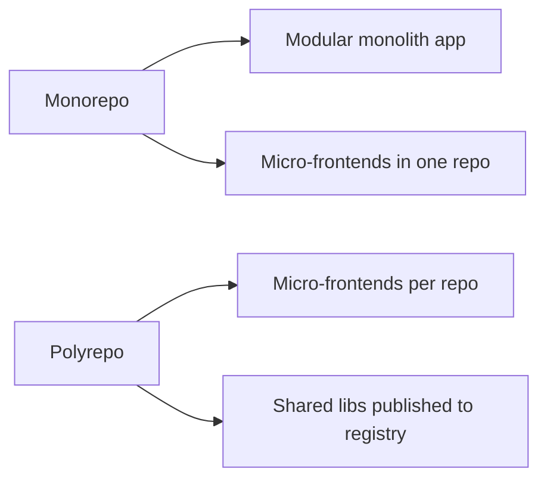

Two of the most common lead interview prompts are "How would you structure the front end for 10 teams?" and "Should we adopt micro-frontends?". Both are mostly **organizational** questions disguised as technical ones. Strong answers start from team structure and deployment pain, not from tools.

## Separate the two axes

People often blur these together. They're independent:

| Axis | Options |
| --- | --- |
| **Code repository** | Monorepo (one repo, many packages) or polyrepo (many repos) |
| **Runtime and deployment** | Monolith (one deployable app) or micro-frontends (independently deployed pieces composed at runtime or at the edge) |

All four combinations exist. A **monorepo with a modular monolith** is the most common healthy setup for a single product with several teams.



## Monorepos

### Benefits
- **Atomic changes:** update a shared component and every consumer in one PR.
- **Single version policy:** one React and one TypeScript version, which cuts out "dependency hell".
- **Code sharing and discoverability.**
- **Unified tooling:** lint, test, and build configuration in one place.

### Costs
- CI must be **incremental** (only build and test what changed) or it becomes unbearably slow.
- Requires ownership rules (CODEOWNERS) and boundary enforcement.
- Large repos need tooling investment: remote caching, sparse checkouts at very large scale.
- A shared upgrade means *everyone* upgrades. That's both a blessing and a burden.

### Tooling

| Tool | Strengths |
| --- | --- |
| pnpm workspaces | Fast, strict dependency isolation, the foundation for most JS monorepos |
| Turborepo | Simple task pipelines, local and remote caching |
| Nx | Project graph, affected commands, generators, module boundary lint rules, remote caching |
| Bazel / Buck2 | Polyglot, hermetic builds at very large scale; high setup cost |
| Changesets | Versioning and changelogs for published packages |

### A healthy monorepo layout

```text
apps/
  web/            # main product (modular monolith)
  admin/
  marketing/
packages/
  ui/             # design system
  tokens/
  data-client/    # generated API client + query hooks
  config-eslint/
  config-ts/
  feature-checkout/
  feature-search/
```

Rules worth enforcing:
- `feature-*` packages can depend on `ui`, `data-client`, and `shared`, never on other features.
- Apps compose features. Features don't import apps.
- Every package has a CODEOWNERS entry.

## Micro-frontends

**Definition:** independently developed, tested, and **deployed** front end pieces owned by autonomous teams, composed into one user experience.

### When they make sense

- Many teams (often 5–10+) that are blocked by a shared release train.
- Clear domain boundaries that map to pages or large regions (e.g. search, checkout, account).
- A need for independent deployment cadence or tech-stack migration (strangling a legacy app).
- Organizational autonomy is a deliberate goal.

### When they don't

- Fewer than about four teams, or teams that share most screens.
- Performance-critical consumer experiences where duplicated runtime code hurts.
- The real problem is slow CI or poor modularity. Fix those first.

### Composition techniques

| Technique | How | Pros | Cons |
| --- | --- | --- | --- |
| Route-level split (server or edge) | Different paths served by different apps (`/checkout` → checkout app) | Simple, strong isolation, independent stacks | Full page loads between apps; shared layout duplication |
| Build-time composition | Packages imported at build | Simple, optimized bundles | Not independently deployable (that's a modular monolith) |
| Runtime: Module Federation | Host loads remote modules at runtime, sharing dependencies | Independent deploys, shared React singleton | Version skew, runtime failures, complex debugging |
| Runtime: Web Components / iframes | Framework-agnostic widgets / full isolation | Strong isolation | Styling, a11y, and performance challenges (iframes) |
| Server/edge composition | Fragments assembled into HTML (SSI/ESI, edge workers) | Fast first paint, cacheable fragments | Infrastructure complexity, interactivity coordination |

Module Federation 2.0 (and its Rspack/Vite support) adds type sharing and a runtime plugin system. It's the most common runtime option for React-based micro-frontends.

### Cross-cutting concerns you must solve

| Concern | Approach |
| --- | --- |
| Shared dependencies | Singleton React; agreed version ranges; a platform team owns upgrades |
| Design consistency | Shared design system package and tokens; visual regression |
| Routing | Shell owns top-level routes; MFEs own nested routes |
| Communication | URL, custom events, or a small typed event bus. Avoid shared global stores. |
| Auth and session | Shell owns auth; passes a token getter or user context |
| Performance | Budget per MFE; shared vendor chunks; avoid loading the same library twice |
| Observability | Tag errors and RUM by MFE so you can tell who owns a regression |
| Failure isolation | Error boundaries around each remote; fallback UI when a remote fails to load |
| Testing | Contract tests for the shell/remote interface; E2E on composed environments |

## The middle path: modular monolith

For most organizations, a **modular monolith in a monorepo** delivers 80% of the benefits:

- Teams own feature packages with enforced boundaries.
- One deployable app, with **trunk-based development, feature flags, and automated deploys** removing the release-train bottleneck.
- Affected-only CI with remote caching keeps builds fast.
- If a domain later needs independent deployment, its package is already isolated and can be extracted.

## Decision table

| Situation | Recommendation |
| --- | --- |
| 1–3 teams, one product | Single app; feature folders; maybe a monorepo for shared packages |
| 4–10 teams, one product, shared release pain | Monorepo + modular monolith + flags + affected CI |
| Multiple products sharing a design system | Monorepo or published packages; separate apps |
| 10+ autonomous teams, distinct domains, independent cadence | Micro-frontends (start with route-level split) |
| Migrating legacy app (e.g. AngularJS → React) | Strangler pattern: route-level split or runtime embedding, retire legacy incrementally |
| Acquisitions with different stacks | Route-level or edge composition while converging |

## How to answer in an interview

> "Before choosing micro-frontends I'd look at what's actually hurting. If it's slow CI and merge conflicts, a monorepo with Nx or Turborepo, affected builds, CODEOWNERS, and enforced module boundaries usually solves it with much less runtime complexity. If teams genuinely need to deploy independently because, say, checkout ships ten times a day while the catalog ships weekly, I'd start with route-level micro-frontends behind the edge, since that gives strong isolation with simple failure modes. I'd only add runtime Module Federation for shared regions like the header if there's a clear need, and with a platform team owning the shell, shared dependency versions, and the design system. Success metrics would be deploy frequency per team, lead time, change failure rate, and p75 LCP to make sure we don't regress users."

## Migration playbook (strangler fig)

1. Put a routing layer in front (edge or reverse proxy).
2. Build new routes in the new stack. Proxy the rest to legacy.
3. Share auth and design tokens across both.
4. Migrate route by route, prioritized by business value and change frequency.
5. Track the percentage of traffic served by the new stack, and make it visible.
6. Delete legacy code as routes move. Don't let the "temporary" bridge become permanent.

## Metrics to track

- Deploy frequency per team and lead time for changes (DORA)
- CI duration (p50/p95) and cache hit rate
- Number of cross-team PRs required for typical features
- Duplicate dependency bytes across bundles
- p75 LCP and INP per route or MFE
- Incidents attributed to integration issues
