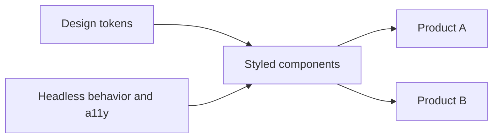

"Tell me about a design system you built or improved" is one of the most common lead-level prompts, and "Design a component library for multiple products" is a common system design question. Both test whether you see a design system as a **product with users** (engineers and designers), not just a folder of components.

## What a design system contains

| Layer | Contents | Owner |
| --- | --- | --- |
| Foundations | Design tokens: color, typography, spacing, radius, elevation, motion | Design + engineering |
| Primitives | Button, Input, Checkbox, Dialog, Menu, Tooltip, Popover | DS team |
| Patterns | Forms, data tables, empty states, navigation, notifications | DS team + product teams |
| Guidelines | Usage, content, accessibility, do/don't | Design |
| Tooling | Figma library, Storybook docs, lint rules, codemods, templates | DS team |
| Process | Contribution model, versioning, support, roadmap | DS lead |

## Design tokens

Tokens are the contract between design and code. Use **tiers**:

```json
{
  "color": {
    "blue": { "600": { "$value": "#2563eb", "$type": "color" } },
    "action": {
      "primary": {
        "bg": { "$value": "{color.blue.600}", "$type": "color" }
      }
    }
  }
}
```

| Tier | Example | Purpose |
| --- | --- | --- |
| Primitive / reference | `blue-600` | Raw palette |
| Semantic / system | `action-primary-bg`, `text-muted`, `surface-raised` | Meaning; theme-switchable |
| Component | `button-primary-bg` | Optional; component-level overrides |

- Store tokens in a format based on the **W3C Design Tokens Community Group spec** (its first stable version was published in 2025) and transform them with Style Dictionary or similar into CSS variables, TS constants, and native platforms.
- Theming (dark mode, brands, density) means swapping semantic token values. Components only reference semantic tokens.
- Sync with Figma variables to cut drift.

```css
:root { --color-action-primary-bg: #2563eb; }
[data-theme="dark"] { --color-action-primary-bg: #60a5fa; }
.button-primary { background: var(--color-action-primary-bg); }
```

## Component architecture

### Headless core + styled layer



- Build or adopt headless primitives (React Aria, Radix, Ark UI) for complex widgets: combobox, menu, dialog, date picker. Getting the a11y right is expensive and already solved there.
- Wrap them in your own API so you can swap the underlying library later.

### API design principles

| Principle | Example |
| --- | --- |
| Composition over configuration | `<Card><Card.Header/><Card.Body/></Card>` instead of 20 props |
| Consistent naming | `size`, `variant`, `tone` used identically everywhere |
| Controlled + uncontrolled | `value`/`defaultValue`/`onValueChange` |
| Polymorphism with care | `asChild` or `as` for semantic flexibility |
| Accessible by default | Required `label` props, correct roles, focus management built in |
| Escape hatches | `className` merging, `style`, slot props, forwarded refs |
| Typed variants | Union types (`variant: 'primary' \| 'secondary' \| 'ghost'`) |

```tsx
type ButtonProps = React.ComponentProps<'button'> & {
  variant?: 'primary' | 'secondary' | 'ghost' | 'danger';
  size?: 'sm' | 'md' | 'lg';
  loading?: boolean;
};

export function Button({ variant = 'primary', size = 'md', loading, disabled, children, className, ...rest }: ButtonProps) {
  return (
    <button
      {...rest}
      className={cx('btn', `btn--${variant}`, `btn--${size}`, className)}
      disabled={disabled || loading}
      aria-busy={loading || undefined}
    >
      {loading ? <Spinner aria-hidden /> : null}
      <span className={loading ? 'visually-hidden' : undefined}>{children}</span>
    </button>
  );
}
```

## Accessibility as a feature of the system

The design system is the **biggest a11y lever** in an organization: fix it once and every product benefits.

- WCAG 2.2 AA as the baseline. Document the keyboard and screen reader behavior for each component.
- Automated checks (axe) in Storybook and CI. Manual screen reader testing (NVDA, JAWS, VoiceOver) on each release of complex components.
- Color tokens validated for contrast. Focus-visible styles built into tokens.
- Respect `prefers-reduced-motion` in motion tokens.

## Distribution and versioning

| Decision | Options | Guidance |
| --- | --- | --- |
| Packaging | One package vs per-component packages | One package with tree-shakeable ESM exports is simplest; split only for very large systems |
| Versioning | SemVer with changesets | Breaking changes in majors only; publish a migration guide + codemod |
| Release cadence | Continuous vs scheduled | Continuous patch/minor; majors at most 1–2 per year |
| Deprecation | Warnings, lint rules, codemods | Deprecate → warn in dev → lint error → remove in next major |
| Source distribution | Copy-in (shadcn/ui-style) vs installed package | Copy-in gives teams full control but loses central upgrades; installed packages keep consistency |

**Measure upgrade lag:** the percentage of apps on the latest major. If it's low, your upgrade cost is too high.

## Governance and contribution

| Model | Description | Works when |
| --- | --- | --- |
| Centralized | DS team builds everything | Small org, early system |
| Federated | Product teams contribute with DS review | Larger org, mature system |
| Hybrid | DS owns primitives; product teams own patterns with DS standards | Most mid-to-large orgs |

**Contribution process:**
1. Proposal (issue/RFC) with use cases from at least two teams.
2. Design review (Figma) and API review.
3. Build with docs, tests, a11y checks, and visual regression baselines.
4. Release with a changelog and announcement.

## Adoption: the real measure of success

A design system nobody uses is a cost center. Track:

| Metric | How |
| --- | --- |
| Coverage | % of UI components in product code that come from the DS (static analysis of imports; tools like Omlet or custom scripts) |
| Detachment rate | Figma instances detached from library components |
| Version currency | % of apps on latest major/minor |
| Time to build a new screen | Survey or task timing |
| A11y defects | Bugs in DS components vs custom components |
| Satisfaction | Quarterly survey (NPS-style) of engineers and designers |
| Support load | Questions per week, time to answer |

Drive adoption through **pull, not push**: make the DS the easiest path. Good docs, fast fixes, templates, codemods, and office hours. Lint rules that flag raw `<button>` usage nudge without blocking.

## Common pitfalls

- **Building for imagined use cases** instead of extracting proven patterns.
- **Too rigid:** no escape hatches, so teams fork.
- **Too flexible:** 40 props, inconsistent outcomes.
- **No dedicated ownership:** a side project gets abandoned after the first push.
- **Ignoring designers:** Figma and code drift apart.
- **Big-bang migrations:** forcing every team to adopt at once.

## A sample RFC outline: "Unified design system v2"

1. **Problem:** three diverging component libraries; 18% of UI bugs are inconsistencies; dark mode impossible.
2. **Goals / non-goals:** semantic tokens and theming, accessible primitives; *not* redesigning brand visuals.
3. **Proposal:** token pipeline, headless core (React Aria), styled layer with CSS variables, Storybook docs.
4. **Alternatives:** adopt MUI/Chakra wholesale; keep libraries and share tokens only.
5. **Migration:** codemods for Button/Input; per-team adoption plan; legacy wrappers.
6. **Operating model:** a team of 3 engineers + 1 designer; hybrid contribution.
7. **Metrics:** coverage from 40% to 80% in 12 months; a11y bugs −50%; upgrade lag < 1 major.
8. **Risks:** adoption stalls → mitigated with exec sponsorship and embedded DS engineers.

## Interview story structure

> "We had three teams each building their own buttons and modals. I wrote an RFC for a shared system with semantic tokens and headless primitives, got design leadership to co-own it, and staffed a small team. We prioritized the ten components covering 70% of usage, shipped codemods, and embedded one engineer with each product team for a sprint. Coverage went from 30% to 85% in three quarters, dark mode shipped in two weeks instead of an estimated two months, and a11y audit findings fell by 60%."
