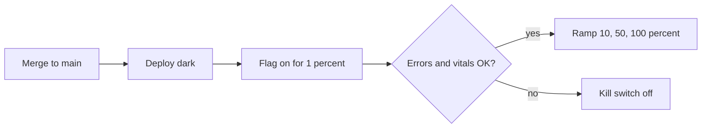

Back-end teams have long had dashboards, SLOs, and on-call. Front ends often have none of these, even though the browser is where users actually experience failures. Leads are expected to close that gap: **know when the product is broken for users before they tell you, and limit the blast radius when it is**.

## The four pillars of front end observability

| Pillar | What it answers | Tools |
| --- | --- | --- |
| Errors | What's throwing, for whom, since which release? | Sentry, Bugsnag, Datadog RUM, Rollbar |
| Performance | How fast is it for real users? | `web-vitals` RUM, vendor RUM, CrUX |
| User journeys / business events | Can users complete key tasks? | Product analytics (Amplitude, Mixpanel), custom funnel events |
| Network / API health from the client | Which calls fail or are slow from users' perspective? | RUM resource timing, fetch instrumentation, OpenTelemetry browser SDK |

Logs and traces from the browser are increasingly connected to back-end traces through **OpenTelemetry** and W3C `traceparent` headers, so you can follow one slow click all the way through the stack.

## Error monitoring done well

### Capture

- Global handlers: `window.onerror`, `unhandledrejection`.
- React error boundaries at route and widget level, reporting through the boundary or (React 19) `createRoot` options: `onCaughtError`, `onUncaughtError`, `onRecoverableError`.
- Network errors: wrap your fetch client to report non-2xx responses with endpoint templates, not raw URLs.

```tsx
const root = createRoot(container, {
  onUncaughtError: (error, info) => report(error, { componentStack: info.componentStack, severity: 'fatal' }),
  onCaughtError: (error, info) => report(error, { componentStack: info.componentStack, severity: 'error' }),
});
```

### Context

Every event should include: release version (git SHA), route template, feature flags active, user segment (not PII), browser/OS, and breadcrumbs (recent clicks, navigations, requests).

### Source maps

Upload source maps to your error tool in CI, and **don't serve them publicly** unless you've decided to. Tie them to the release.

### Noise control

- Filter browser-extension and third-party script errors (check stack frames for your own origins).
- Group by root cause and fingerprint carefully.
- Ignore known benign errors (`ResizeObserver loop` warnings, aborted fetches).
- Rate-limit per session to protect quotas.

## Front end SLIs and SLOs

An **SLI** is a measurement. An **SLO** is a target for it over a window.

| SLI | Example SLO (28-day window) |
| --- | --- |
| Crash-free sessions (no uncaught error that breaks the page) | ≥ 99.5% |
| Successful page loads (app shell rendered, no fatal error) | ≥ 99.9% |
| Key journey success rate (checkout started → order placed, excluding user abandonment signals like validation errors) | ≥ 98% of attempts that reach payment |
| p75 LCP on key routes | ≤ 2.5 s |
| p75 INP on key routes | ≤ 200 ms |
| Client-observed API success rate for critical endpoints | ≥ 99.5% |

**Error budgets:** if crash-free sessions drop below the SLO, the budget is spent, and the team prioritizes reliability work over features until it recovers. This turns reliability into an explicit, negotiated trade-off rather than a vague aspiration.

## Alerting without noise

| Do | Don't |
| --- | --- |
| Alert on symptoms users feel (crash rate spike, journey success drop) | Alert on every new error type |
| Use rate-of-change and burn-rate alerts against SLOs | Use static thresholds on raw counts that scale with traffic |
| Route alerts to owning teams by route/feature tags | Send everything to one channel |
| Attach runbook links to every alert | Page someone for things they can't act on |
| Review alert quality monthly (precision, actionability) | Let ignored alerts pile up |

A useful pattern: **new-release regression alerts** that compare error rate and vitals of release N vs N−1 within the first hour of rollout.

## Resilient UI patterns

| Failure | Pattern |
| --- | --- |
| Component throws | Granular error boundaries; widget-level fallback, page still usable |
| API down or slow | Timeouts, retries with backoff and jitter for idempotent calls, cached/stale data with a banner |
| Chunk load failure after deploy | Retry the import once; on failure prompt a reload; keep old assets available for a grace period |
| Third-party script fails | Load async; never block render; wrap integrations in try/catch |
| Offline | Detect `navigator.onLine` + failed requests; queue mutations; clear messaging |
| Partial data | Render what you have; skeletons for missing pieces; avoid all-or-nothing pages |

```ts
function lazyWithRetry<T extends React.ComponentType<any>>(factory: () => Promise<{ default: T }>) {
  return React.lazy(async () => {
    try {
      return await factory();
    } catch {
      await new Promise((r) => setTimeout(r, 500));
      return factory(); // second failure propagates to the error boundary, which offers reload
    }
  });
}
```

## Safe delivery

Reliability is mostly decided at deploy time:



- **Feature flags** decouple deploy from release and give you instant kill switches.
- **Progressive rollouts** with automated guardrails (error rate, vitals, journey success).
- **Immutable, versioned assets** with long cache, plus a short-cached HTML entry point, so rollbacks are a pointer change.
- **Skew protection:** keep previous asset versions available so open tabs don't break mid-session.

## Dashboards

A front end health dashboard per product area:

1. Crash-free sessions (trend + by release)
2. Top 10 errors by affected users (not raw count)
3. p75 LCP/INP/CLS by key route and device
4. Key journey funnels with success rate
5. Client-observed API error rate and latency for critical endpoints
6. Current rollouts and flag changes (annotated on charts)

## Privacy and compliance

- Never log PII (emails, names, tokens) in errors or breadcrumbs. Scrub on the client and the server.
- Session replay tools need masking by default and consent where required (GDPR/CCPA).
- Sample high-volume telemetry. You rarely need 100% of RUM events.

## Maturity model

Use this to assess where an organization is and what to do next:

| Stage | Characteristics | Next step |
| --- | --- | --- |
| 0: Blind | Learn about breakage from customers or support | Add error tracking with releases and source maps |
| 1: Reactive | Errors captured, nobody reviews them regularly | Assign ownership by route; weekly triage of top errors by affected users |
| 2: Measured | RUM vitals and error dashboards per team | Define SLOs for crash-free sessions and key journeys |
| 3: Managed | SLOs with burn-rate alerts and runbooks | Automate rollout guardrails tied to SLOs |
| 4: Proactive | Releases auto-halt on regressions; error budgets shape planning | Game days, chaos testing of third-party failures |

Most teams are at stage 1 or 2. Moving up one stage in a quarter is a credible lead-level goal, and a good interview story.

## Interview framing

> "When I joined, we learned about front end outages from customer support. I set up Sentry with release tagging and source maps, added route-level error boundaries, and instrumented web-vitals with attribution. We defined two SLOs: 99.5% crash-free sessions and 98% checkout journey success. Alerts went to the owning team with runbooks. Combined with flag-based progressive rollouts that auto-halt on error spikes, our mean time to detect went from hours to under ten minutes, and two potential incidents were rolled back at 5% exposure before most users saw them."
