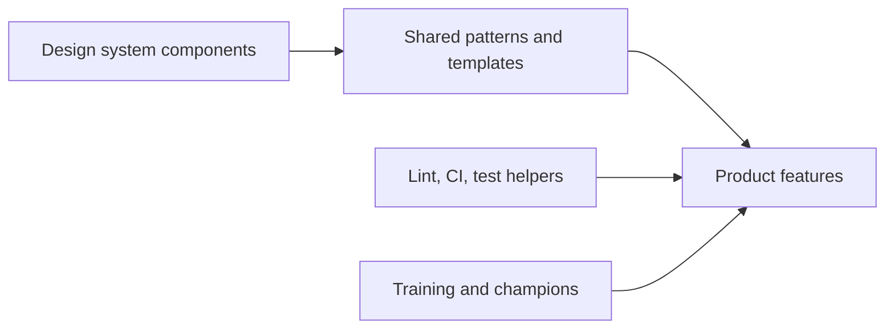

Individual engineers can build accessible components. Leads have to make an organization **reliably** ship accessible products: across dozens of teams, through deadlines, and over time. Doing that needs standards, tooling, training, and accountability, not heroics.

## Why it matters (and how to frame it)

| Lens | Argument |
| --- | --- |
| Users | Disability affects a large share of the population (permanent, temporary, situational); everyone benefits from keyboard support, captions, clear focus, and good contrast |
| Legal | ADA lawsuits in the US; the **European Accessibility Act** applies to many products and services from June 2025; public-sector rules (Section 508, EN 301 549) |
| Business | Larger market, better SEO and usability, procurement requirements (VPAT/ACR) for B2B sales |
| Engineering quality | Semantic, accessible markup is more testable and robust |

Use whichever lens moves your stakeholders. With executives, legal risk and market access usually land fastest. With engineers, quality and users.

## The standard

- **WCAG 2.2 Level AA** is the common target (WCAG 2.2 became a W3C Recommendation in October 2023).
- New criteria in 2.2 relevant to front ends: Focus Not Obscured (minimum), Dragging Movements (provide single-pointer alternatives), Target Size (minimum 24×24 CSS px), Consistent Help, Redundant Entry, Accessible Authentication (no cognitive tests like puzzles without alternatives).
- WCAG 3 is in development and not yet a compliance target.

## Where to invest: the leverage pyramid



| Layer | Leverage | Actions |
| --- | --- | --- |
| Design system | Highest: fix once, fix everywhere | Accessible primitives (headless libraries), focus styles, contrast-safe tokens, documented keyboard behavior |
| Design process | High | Annotate designs with headings, landmarks, focus order, labels; contrast checks in Figma |
| Tooling | High | `jsx-a11y` lint, axe in tests and CI, Storybook a11y addon |
| Team practices | Medium | Definition of done includes a11y; PR checklist; champions |
| Audits | Necessary but lagging | Periodic expert audits and user testing with disabled participants |

## Testing strategy

| Method | Catches | Limits | Cadence |
| --- | --- | --- | --- |
| Lint (`eslint-plugin-jsx-a11y`) | Missing alt, invalid ARIA, click handlers on non-interactive elements | Static only | Every save/PR |
| Automated runtime (axe-core in RTL/Playwright/Storybook) | Contrast, missing labels, ARIA misuse, landmark issues | Roughly a third to half of WCAG issues are automatable | Every PR |
| Keyboard-only walkthrough | Focus order, traps, visible focus, operability | Manual | Every feature before release |
| Screen reader testing | Announcements, names/roles/states, live regions | Manual; requires skill | Complex components each release; key journeys quarterly |
| Zoom/reflow and text spacing | 200–400% zoom, 320px reflow | Manual | Per feature |
| Expert audit | Full WCAG conformance | Expensive, periodic | Annually or before major launches |
| Usability testing with disabled users | Real-world barriers | Recruiting effort | 1–2× per year on key flows |

Screen reader matrix to cover most users: **NVDA + Chrome/Firefox (Windows), JAWS + Chrome (Windows), VoiceOver + Safari (macOS/iOS), TalkBack + Chrome (Android).**

```ts
// Playwright + axe: block new serious violations on key routes
import AxeBuilder from '@axe-core/playwright';

test('checkout has no serious a11y violations', async ({ page }) => {
  await page.goto('/checkout');
  const results = await new AxeBuilder({ page }).withTags(['wcag2a', 'wcag2aa', 'wcag22aa']).analyze();
  const serious = results.violations.filter((v) => ['serious', 'critical'].includes(v.impact ?? ''));
  expect(serious).toEqual([]);
});
```

## Common high-impact issues

| Issue | Fix |
| --- | --- |
| Custom controls built from `div`s | Native elements, or full ARIA pattern + keyboard support |
| Missing or poor focus management in SPAs | Move focus to main heading on route change; return focus after dialogs |
| Modals without focus trap / Escape | Use `<dialog>` with `showModal()` or a proven library |
| Form errors not announced or linked | `aria-describedby`, `aria-invalid`, error summary with focus |
| Insufficient contrast | Token-level fixes; contrast checks in design |
| Icon-only buttons without names | `aria-label` or visually hidden text |
| Dynamic content not announced | Live regions (`role="status"`), used sparingly |
| Drag-and-drop only interactions | Provide button/menu alternatives (WCAG 2.2 Dragging Movements) |
| Motion without control | Respect `prefers-reduced-motion` |

## Ownership and process

- **Accessibility is in the definition of done.** Stories include acceptance criteria for keyboard and screen reader behavior.
- **Champions network:** one trained engineer per team, monthly sync, shared office hours.
- **Bug severity model** aligned to user impact (a blocker prevents task completion for a group of users; treat it like a P1).
- **Central expertise:** a small a11y team or specialist who supports, trains, and audits, but doesn't fix everything for everyone.
- **Procurement:** require accessibility conformance reports from vendors whose components or widgets you embed.

## Metrics

| Metric | Why |
| --- | --- |
| Automated violations per route (trend) | Regression signal |
| Open a11y bugs by severity and age | Debt and responsiveness |
| % of DS components with documented and tested keyboard/SR behavior | Leverage health |
| % of key journeys passing manual audit | Real-world conformance |
| Time to fix blocker a11y bugs | Accountability |
| Training coverage (% engineers trained) | Capability |

## Remediation of a legacy product

1. **Audit** key journeys (sign-up, login, search, checkout, account) against WCAG 2.2 AA.
2. **Prioritize** by user impact × traffic: blockers on high-traffic journeys first.
3. **Fix at the source:** if 200 issues trace back to 5 DS components, fix those components.
4. **Prevent regressions:** baseline current automated violations and block new ones in CI.
5. **Publish** an accessibility statement with known issues and a contact for feedback.
6. **Re-audit** and report progress quarterly.

## Sample ADR: accessibility as a release gate

- **Context:** An external audit found 180 WCAG 2.2 AA issues. 60% traced to six design-system components, and the European Accessibility Act applies to our consumer checkout.
- **Decision:** (1) Design-system components must document keyboard and screen reader behavior and pass manual SR testing before release. (2) CI blocks new serious or critical axe violations on key routes, with existing ones baselined. (3) Blocker-severity a11y bugs carry a P1 SLA.
- **Consequences:** About 1–2 extra days per complex component; roughly 90 seconds of extra CI time; fewer regressions reaching production; clear accountability.
- **Alternatives considered:** periodic audits only (lagging, expensive fixes); an overlay widget (rejected as ineffective).
- **Review trigger:** if the baseline hasn't fallen 50% within two quarters, revisit staffing.

## Interview framing

> "I treat accessibility as a quality attribute with owners and metrics. The biggest lever was our design system. We rebuilt the eight most-used interactive components on React Aria, added documented keyboard behavior, and fixed contrast at the token level. That alone resolved about 60% of audit findings across products. We added jsx-a11y and axe checks to CI, baselined existing violations and blocked new serious ones, and trained a champion in each team. With the European Accessibility Act coming in, we prioritized checkout and account journeys, passed an external audit, and published an accessibility statement."

## Lead-level pitfalls to avoid

- Treating automated scores as conformance. A Lighthouse a11y score of 100 doesn't mean the site is accessible.
- Overlays and "one-line" a11y widgets. They don't fix underlying issues and are widely criticized by disabled users and experts.
- Last-minute audits before launch, when fixes are most expensive.
- Making one specialist responsible for everything.
