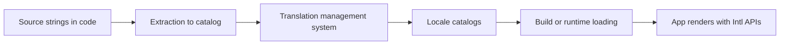

Internationalization is a classic example of a cross-cutting concern that's cheap to design in early and expensive to retrofit. Leads get asked about it in system design ("How would you support 30 locales?") and in behavioral rounds ("Tell me about expanding into a new market"). This chapter covers the architecture, the common pitfalls, and the process.

## Terms

| Term | Meaning |
| --- | --- |
| i18n (internationalization) | Engineering the product so it *can* be adapted to locales |
| l10n (localization) | Adapting it for a specific locale: translations, formats, imagery |
| Locale | Language + region (+ script) identifier, e.g. `en-US`, `pt-BR`, `zh-Hant-TW` (BCP 47) |
| g11n (globalization) | The overall business process of going global |

## What changes across locales

| Aspect | Examples |
| --- | --- |
| Text | Translations, length (German ~30% longer than English; some CJK shorter) |
| Plurals | English: one/other; Arabic: six categories; Japanese: one form |
| Gender and grammatical case | Polish, Russian, Arabic agreement rules |
| Numbers | `1,234.5` vs `1.234,5` vs `1 234,5`; Indian grouping `12,34,567` |
| Currency | Symbol position, decimals (JPY has none) |
| Dates/times | Order, calendars, week start, 12/24h, time zones |
| Direction | RTL scripts (Arabic, Hebrew, Persian, Urdu) |
| Sorting | Locale collation (`ä` placement differs between German and Swedish) |
| Names and addresses | Field order, required fields, postal formats |
| Content and imagery | Cultural appropriateness, legal text |

## Architecture



### Message format

Use **ICU MessageFormat** (supported by FormatJS/react-intl, i18next with ICU plugin, Lingui, and others). It handles plurals, select (gender), and nested formatting in the *message*, so translators can handle grammar:

```text
{count, plural,
  =0 {No messages}
  one {# message}
  other {# messages}
}

{gender, select,
  female {She replied}
  male {He replied}
  other {They replied}
}
```

**Never concatenate strings** to build sentences. Word order differs across languages.

```tsx
// Bad
<p>{t('you_have')} {count} {t('messages')}</p>

// Good
<p>{t('inbox.count', { count })}</p>
```

### Message keys and IDs

| Approach | Pros | Cons |
| --- | --- | --- |
| Semantic keys (`checkout.pay_button`) | Stable, context in key | Developers must manage keys |
| Source-string as ID (Lingui/gettext style) | Natural to write; extraction | Changing source text changes ID |
| Auto-generated IDs with descriptions | No key bikeshedding | Need tooling |

Always provide **context/descriptions** for translators ("Button label on payment step, max 20 chars").

### Library options (React)

| Library | Notes |
| --- | --- |
| react-intl (FormatJS) | ICU-native, mature, compile-time message extraction |
| i18next / react-i18next | Huge ecosystem, flexible backends, ICU via plugin |
| Lingui | Compile-time extraction and compilation, small runtime, macros |
| next-intl | Next.js App Router integration, RSC support |
| Paraglide (inlang) | Compiler-based, tree-shakeable typed message functions |

## Intl APIs: use the platform

```ts
const price = new Intl.NumberFormat('de-DE', { style: 'currency', currency: 'EUR' }).format(1234.5);
// "1.234,50 €"

const date = new Intl.DateTimeFormat('ja-JP', { dateStyle: 'long', timeZone: 'Asia/Tokyo' })
  .format(new Date('2025-03-02T10:00:00Z'));

const rel = new Intl.RelativeTimeFormat('es', { numeric: 'auto' }).format(-1, 'day'); // "ayer"

const list = new Intl.ListFormat('en', { type: 'conjunction' }).format(['Ana', 'Bo', 'Cy']);
// "Ana, Bo, and Cy"

const sorted = names.sort(new Intl.Collator('sv').compare);

const plural = new Intl.PluralRules('ar').select(3); // "few"
```

Also: `Intl.DisplayNames` (language/region names), `Intl.Segmenter` (word/grapheme segmentation for CJK and emoji-safe truncation). Cache formatter instances, because creating them repeatedly is expensive.

**Time zones:** store UTC on the server; format in the user's time zone on the client. Be careful with SSR: the server's time zone differs from the user's, which causes hydration mismatches. Pass the user's time zone explicitly, or format on the client.

## RTL support

- Set `<html lang="ar" dir="rtl">`.
- Use **CSS logical properties**: `margin-inline-start`, `padding-inline-end`, `inset-inline-start`, `text-align: start`. Then most layouts flip automatically.
- Mirror directional icons (arrows, progress), but not icons with inherent direction (clocks, media play in some conventions, logos).
- Handle bidirectional text (user names in Latin inside Arabic sentences) with `<bdi>` or `dir="auto"`.
- Test with real RTL content, not just a mirrored layout.

```css
.card { padding-inline-start: 1rem; border-inline-start: 4px solid var(--accent); }
.icon-forward:dir(rtl) { transform: scaleX(-1); }
```

## Locale detection and routing

| Strategy | Example | Notes |
| --- | --- | --- |
| Path prefix | `/fr/produits` | SEO-friendly, shareable; most common |
| Subdomain | `fr.example.com` | Works for regional sites |
| ccTLD | `example.fr` | Strong regional signal; operationally heavy |
| Cookie/user setting only | — | Not crawlable; fine for logged-in apps |

- Detect from `Accept-Language` on first visit, then **let users choose** and remember the choice. Never force-redirect based on IP alone.
- Add `hreflang` alternates for SEO, and set `lang` correctly for screen readers.
- Localize slugs only if you have the process to maintain them.

## Performance

- **Split catalogs by locale and route.** Don't ship all 30 languages to everyone.
- Load the active locale's messages with the initial HTML (SSR) to avoid a flash of untranslated keys.
- Precompile ICU messages at build time (FormatJS/Lingui) to cut runtime parsing.
- Fonts: subset per script; CJK fonts are huge, so use system fonts or `unicode-range` splitting.

## Translation workflow


- Use a TMS (Crowdin, Lokalise, Phrase, Smartling) integrated with CI.
- Decide the policy for missing translations: fall back to the default language, block release for critical locales, or ship behind a flag.
- Provide **screenshots or in-context editing** to translators. Context cuts errors dramatically.
- Machine translation + human review is common for long-tail locales. Legal and marketing content needs professional review.
- Track **translation lag** (time from string creation to all locales translated).

## Testing

- **Pseudo-localization:** transform English into accented, padded text (`[Ŝéţţîñĝš ~~~~]`) to catch hard-coded strings, truncation, and concatenation, before real translations exist.
- RTL snapshot and visual tests.
- Unit tests for formatting helpers with several locales.
- Lint rule against hard-coded user-facing strings in JSX (e.g. `eslint-plugin-i18next`/FormatJS rules).
- Linguistic QA on staging for launch locales.

## Common pitfalls

| Pitfall | Consequence |
| --- | --- |
| String concatenation | Ungrammatical translations |
| Hard-coded formats (`MM/DD/YYYY`) | Confusing dates |
| Fixed-width UI | Truncation in German, Finnish |
| Text in images | Untranslatable |
| Assuming one plural form | Wrong grammar in most languages |
| Locale = country | `es-US`, `fr-CA`, `en-IN` exist; language and region are separate concerns |
| Ignoring sorting/search normalization | Diacritics and case break search |

## Lead-level framing

> "When we expanded from English to 12 locales including Arabic, I wrote an RFC covering ICU messages with FormatJS, path-prefixed locale routing with hreflang, CSS logical properties for RTL, and per-locale code-split catalogs. We ran pseudo-localization in CI for a month before translators started, which caught over 400 hard-coded strings and 30 truncation bugs. We integrated Lokalise so translations arrived as automated PRs, with English fallback for long-tail locales and blocking checks for the top five markets. Launch hit the deadline, and the localized markets grew to 22% of sign-ups within two quarters."
