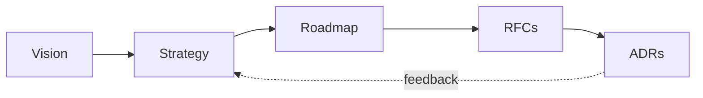

At lead and staff level, a large share of your impact flows through **writing**. Strategy documents set direction, RFCs turn proposals into decisions, and ADRs keep the reasoning so future engineers don't repeat old debates. Interviewers often ask "Tell me about a technical vision you set" or "Walk me through an RFC you wrote." This chapter gives you the structures and the judgment behind them.

## The hierarchy of technical documents

| Document | Question it answers | Time horizon | Length |
| --- | --- | --- | --- |
| Technical vision | Where should we be in 2–3 years, and why? | Years | 2–6 pages |
| Technical strategy | What's our approach to get there, given constraints? What will we *not* do? | 1–2 years | 3–8 pages |
| Roadmap | What will we do, in what order? | Quarters | 1–2 pages + tracker |
| RFC / design doc | How should we solve this specific problem? | Weeks to months | 3–10 pages |
| ADR | What did we decide, and why? | Permanent record | 1 page |



## Writing a front end technical strategy

A good strategy has three parts:

1. **Diagnosis:** an honest assessment of the current situation and its *key challenge*.
2. **Guiding policies:** the approach you'll take, including what you'll deliberately not do.
3. **Coherent actions:** concrete initiatives that follow from the policies.

### Example: condensed front end strategy

**Diagnosis**
- Four product teams, one React 16 SPA (420k LOC), 25-min CI, weekly releases.
- p75 mobile LCP 4.2s on product pages; SEO traffic flat for 3 quarters.
- Three competing component libraries; a11y audit found 180 issues.
- Key challenge: *the architecture forces every team onto the same slow release train and makes performance improvements expensive.*

**Guiding policies**
- Optimize for **team autonomy within one repo** (modular monolith), not micro-frontends.
- **Server-render public pages**; keep logged-in app client-rendered.
- **One design system**, accessibility built in.
- Prefer **incremental migration** over rewrites; every step must ship value.
- We will *not* adopt new state libraries this year; server-state migration only.

**Coherent actions**
| Quarter | Initiative | Success metric |
| --- | --- | --- |
| Q1 | Monorepo + Turborepo, affected CI; React 18 → 19 upgrade | CI p95 < 10 min |
| Q2 | Product pages to Next.js via route-level split | p75 LCP < 2.5 s on product pages |
| Q2–Q3 | Design system v2: tokens + 12 core components | 70% coverage; a11y issues −50% |
| Q3–Q4 | Trunk-based dev + flags; daily deploys | Deploy freq ≥ 1/day/team |

## RFCs

### When to write one

Write an RFC when a decision is **hard to reverse, affects multiple teams, or has significant cost or risk**. Don't write one for a two-way door a single team owns.

### RFC template

```markdown
# RFC: <title>
Status: Draft | In review | Accepted | Rejected | Superseded
Author(s), Reviewers, Decision maker, Date, Review deadline

## Summary (3–5 sentences)
## Problem and context
- What's broken, for whom, with data
## Goals and non-goals
## Proposal
- Architecture, diagrams, APIs, data flow
## Alternatives considered
- Option B, Option C, do nothing (each with pros/cons and why rejected)
## Trade-offs and risks
- What gets worse; mitigations
## Migration and rollout plan
- Phases, flags, rollback, ownership
## Metrics and success criteria
## Cost and staffing
## Security, privacy, accessibility, performance considerations
## Open questions
## Appendix: benchmarks, prototypes
```

### Running the process

| Stage | Practice |
| --- | --- |
| Pre-socialize | Talk to 3–5 key stakeholders *before* publishing. Surprises in review kill proposals. |
| Publish | Set a review deadline (1–2 weeks) and name the decision maker. |
| Review | Async comments + one synchronous review meeting for contentious points. |
| Decide | The decision maker decides; record dissent. "Disagree and commit" is explicit. |
| Record | Write the ADR; link from code (README, CODEOWNERS docs). |
| Follow up | Revisit at the review trigger; mark superseded when replaced. |

**Anti-patterns:** RFCs as rubber stamps (decision already made), endless review with no decision maker, RFCs nobody reads (too long, no summary), and RFC processes so heavy that people avoid them.

## ADRs

Lightweight, permanent records stored near the code (`docs/adr/0007-use-tanstack-query.md`).

```markdown
# ADR 0007: Use TanStack Query for server state

Status: Accepted (2025-02-10)
Deciders: FE platform lead, team leads (Search, Checkout, Account)

## Context
Server data is stored in Redux with hand-written loading/caching logic across 140 slices.
Bugs from stale data account for ~20% of FE defects. Teams duplicate fetching logic.

## Decision
Adopt TanStack Query v5 for all new server-state code. Existing Redux slices migrate
opportunistically when touched. Redux remains for complex client-only state.

## Consequences
+ Caching, dedupe, retries, devtools out of the box
+ Less code (pilot: −38% LOC in Search data layer)
− Two paradigms during migration; documented conventions required
− Team training needed (2 workshops scheduled)

## Alternatives
RTK Query (close second; rejected because 2 teams plan to leave Redux entirely),
SWR (fewer mutation features), status quo.

## Review trigger
Revisit if migration < 30% by end of Q4 or if RSC adoption changes data-fetching needs.
```

Good ADRs are **short, dated, immutable** (supersede instead of editing the decision), and include **alternatives and consequences**, especially the negative ones.

## Building alignment

| Technique | How |
| --- | --- |
| Start from shared pain | Use data stakeholders already care about (incidents, velocity, conversion) |
| Co-author | Invite skeptics to write the alternatives section |
| Prototype | A working spike beats 10 pages of argument |
| Pilot | One team, measured results, then expand |
| Make the cost of inaction visible | "Staying on React 16 blocks the RSC migration and costs ~3 eng-weeks/quarter in workarounds" |
| Escalate cleanly | If consensus fails, frame the decision with options for the decision maker, not complaints |

## Metrics for strategy

Choose a small set you report on regularly:

- **Delivery:** DORA metrics, CI time.
- **Quality:** crash-free sessions, defect escape rate, a11y violations.
- **User experience:** p75 LCP/INP/CLS by key route.
- **Platform health:** design-system coverage, dependency freshness, TypeScript strictness coverage.
- **Developer experience:** quarterly survey (satisfaction, perceived productivity, top pain points).

## Interview framing: "Tell me about a technical vision you set"

Structure:
1. **Diagnosis** with data.
2. **The bet** you made and the alternatives you rejected.
3. **How you aligned people** (RFC, pilot, sponsorship).
4. **Execution** in phases with metrics.
5. **Outcome** and what you'd change.

> "Our SPA's mobile LCP was 4.2 seconds and organic traffic was flat. I wrote a strategy doc that diagnosed the core issue as client-only rendering for public pages combined with one release train. Rather than a rewrite, I proposed a route-level split: public pages on Next.js, the app staying as an SPA, both in one monorepo. I pre-socialized it with the SEO lead and two skeptical team leads, ran a two-week pilot on product pages that cut LCP to 2.1s, and then the RFC was accepted in one review. Over three quarters we moved 85% of public traffic, organic sessions grew 18%, and the ADRs we wrote are still how new engineers learn why things are the way they are. In hindsight, I'd have involved the platform/SRE team earlier, since server costs surprised us."
