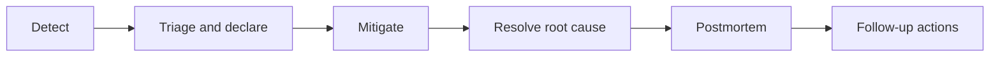

Every lead will eventually be in the middle of a production incident: a blank checkout page after a deploy, a third-party script breaking login, a CDN misconfiguration serving stale bundles. How you lead in those moments, and what the organization learns afterwards, is a strong signal in lead interviews ("Tell me about a production incident you owned").

## Front end incident patterns

| Pattern | Typical cause | Typical mitigation |
| --- | --- | --- |
| White screen / app crash | Uncaught error in a root component; bad deploy | Roll back; kill switch the feature flag |
| Chunk load failures | Deploy removed old assets while users had old HTML | Restore previous assets; add skew protection |
| Broken third-party script | Vendor change, CSP mismatch | Disable via tag manager/flag; block domain |
| API contract change | Back end changed a field shape | Roll back API or ship defensive parse; coordinate |
| Stale/incorrect caching | CDN cache key or header mistake | Purge cache; fix headers |
| Performance collapse | Infinite render loop, huge payload | Roll back; flag off |
| Auth loop/logout storms | Token refresh bug, cookie attributes | Roll back; hotfix; communicate |
| Browser-specific break | New browser version, unsupported API | Polyfill/feature-detect; targeted hotfix |

## Roles during an incident

| Role | Responsibility |
| --- | --- |
| Incident commander (IC) | Coordinates, decides, keeps the timeline; **doesn't debug** |
| Technical lead / responders | Investigate and implement mitigation |
| Communications lead | Updates stakeholders, status page, support |
| Scribe | Records timeline, actions, decisions |

In smaller orgs one person may hold several roles, but **separating coordination from debugging** is the most important principle. A lead's instinct to dive into the code is often wrong when they're the most senior person in the room.

## The incident lifecycle



### 1. Detect

Ideally via alerts (crash rate spike, journey success drop, RUM regression after release), not customer complaints. Track **time to detect**.

### 2. Triage and declare

Ask quickly:
- **Who's affected?** All users, a browser, a region, a segment?
- **How badly?** Blocked from core tasks vs degraded experience.
- **Since when?** Correlate with deploys, flag changes, vendor changes.

Declare a severity level:

| Severity | Definition (example) | Response |
| --- | --- | --- |
| SEV1 | Core journey broken for many users (checkout, login) | All hands, IC assigned, exec comms, status page |
| SEV2 | Major feature broken or significant degradation for a segment | IC + team, stakeholder updates |
| SEV3 | Minor feature broken, workaround exists | Normal priority fix, tracked |

**Declare early.** Downgrading later is cheap; under-reacting is expensive.

### 3. Mitigate first

**Stop the bleeding before finding the root cause.** Front end mitigation options, fastest first:

1. Turn off the feature flag.
2. Roll back to the previous release (pointer swap for immutable assets).
3. Disable a third-party script via tag manager or config.
4. Purge or fix CDN caches.
5. Hotfix forward (only if rollback is impossible or riskier).

A common mistake: spending 40 minutes debugging when a two-minute rollback would have restored service.

### 4. Communicate

Regular cadence (e.g. every 30 minutes for SEV1), even if there's no news.

```markdown
**[SEV1] Checkout failing for Safari users** (update #3, 14:30 UTC)
**Impact:** ~18% of checkout attempts failing (Safari 17+, iOS and macOS) since 13:52.
**Status:** Mitigating. Rolled back release 2025.03.02-4 at 14:21; error rate dropping.
**Next update:** 15:00 UTC or sooner if status changes.
**IC:** @name | **Channel:** #inc-2025-03-02-checkout
```

Tell support exactly what to say to customers. Update the status page for customer-facing impact.

### 5. Resolve

Once mitigated, find and fix the root cause properly, with tests that would have caught it. Re-release behind a flag with a canary.

## Blameless postmortems

The purpose is **learning and system improvement**, not blame. People make mistakes; systems should make mistakes hard and cheap.

### Postmortem template

```markdown
# Postmortem: Safari checkout failures (2025-03-02)
Severity: SEV1 | Duration: 13:52–14:35 UTC (43 min) | Author | Reviewers

## Summary
## Impact
- Users affected, failed orders (est.), revenue impact, support tickets
## Timeline (UTC)
- 13:40 Release deployed to 100%
- 13:52 First errors; 14:04 alert fired; 14:08 IC declared SEV1; 14:21 rollback ...
## Root cause
- Payment step called a browser API with incomplete Safari support, without feature detection ...
## Contributing factors
- No Safari in smoke E2E matrix; release went 0→100% without canary
## What went well
- Rollback took 2 minutes; comms cadence held
## What went poorly
- Detection took 12 minutes; alert threshold too high
## Action items
| Action | Owner | Priority | Due |
| Add WebKit to Playwright smoke suite | @a | P1 | Mar 9 |
| Progressive rollout with auto-halt on error rate | @b | P1 | Mar 23 |
| Lower checkout error alert threshold | @c | P2 | Mar 6 |
```

Ask "why" several times, and look at **contributing factors** (testing gaps, rollout process, alerting), not just the triggering bug. Use neutral language: "the release included…" rather than "X broke…".

### Making follow-ups happen

- Assign every action an owner and a due date. Track completion rate.
- Review open postmortem actions in a regular operational review.
- Prioritize actions that prevent a **class** of incidents (e.g. canary releases) over one-off fixes.

## Metrics

| Metric | Meaning |
| --- | --- |
| Time to detect (TTD) | Start of impact → alert/awareness |
| Time to mitigate (TTM) | Awareness → user impact stopped |
| Time to resolve | Full fix deployed |
| Change failure rate | % of releases causing incidents (DORA) |
| Repeat incidents | Same root cause class recurring |
| Postmortem action completion | % completed by due date |

## Building resilience after incidents

- Progressive delivery with automated guardrails.
- Feature flags as kill switches for every significant feature.
- Skew protection and chunk-load retry.
- Browser matrix in CI that matches your real traffic.
- Runbooks for common front end failures (rollback, cache purge, disabling vendors).
- Game days: practice a rollback and a vendor outage drill quarterly.

## Interview story structure

> "Thirty minutes after a release, our checkout error alert fired. Safari users were failing at the payment step. I declared a SEV1, took the incident commander role, and asked another senior engineer to lead the investigation, since my job was coordination. We rolled back within nine minutes of declaring, and errors dropped to baseline. I posted updates every 15 minutes and gave support a customer script. The root cause was an API path Safari didn't support, which our Chrome-only smoke tests missed. In the blameless postmortem, we focused on contributing factors: no WebKit coverage, and a 0-to-100% rollout. We added WebKit to the smoke suite and built progressive rollouts that auto-halt on error spikes. In the following two quarters, two bad releases were halted at 5% exposure with no customer-visible impact."

## Checklist

- [ ] Roles are separated: coordination vs investigation
- [ ] Mitigate first (flags, rollback) before root-causing
- [ ] Communication on a fixed cadence with impact, status, next update
- [ ] Blameless postmortem with contributing factors and owned actions
- [ ] Systemic improvements that prevent a class of incidents
- [ ] Metrics tracked: TTD, TTM, change failure rate, action completion
