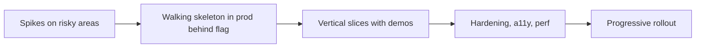

"How do you estimate a large project?" and "Tell me about a project that slipped" are standard lead-level questions. They test whether you can turn ambiguity into a credible plan, find risk early, and communicate honestly. Leads aren't expected to estimate perfectly. They're expected to be **calibrated, transparent, and adaptive**.

## Why front end estimates go wrong

| Underestimated area | Examples |
| --- | --- |
| States and edge cases | Loading, empty, error, partial data, permissions, offline |
| Accessibility | Keyboard support, focus management, screen reader testing for complex widgets |
| Cross-browser/device | Safari quirks, mobile viewport issues, low-end performance |
| Integration | API contract changes, auth, analytics, feature flags |
| Design iteration | Review cycles, late changes, responsive variants |
| i18n | Text expansion, RTL, translation lag |
| Testing and hardening | E2E, visual regressions, bug bash fixes |
| Rollout | Flags, migration of existing users, monitoring, docs |
| Coordination | Waiting on other teams, reviews, approvals |

A useful habit is to estimate the **"last 20%"** (hardening, a11y, rollout) explicitly instead of hiding it inside feature estimates.

## Estimation techniques

| Technique | How | Best for |
| --- | --- | --- |
| Decomposition | Break into tasks ≤ 2–3 days; sum with buffers | Well-understood work |
| Three-point (PERT) | (Optimistic + 4 × Most likely + Pessimistic) / 6 | Communicating uncertainty |
| Reference class | Compare with similar past projects' actual durations | Large or novel projects |
| Spikes | Time-boxed investigation to reduce unknowns before estimating | High-uncertainty areas |
| T-shirt sizing | S/M/L/XL for roadmap-level planning | Early prioritization |
| Throughput forecasting | Use historical items/week and Monte Carlo simulation | Teams with steady flow |

### Ranges, not points

> "Our estimate is 6–9 weeks, with 6 weeks most likely if the payment API lands by week 3. The biggest uncertainty is the address autocomplete vendor integration. We'll do a 3-day spike next week and narrow the range afterwards."

Narrow the range as you learn ("cone of uncertainty") and re-communicate at milestones.

### A worked breakdown

| Workstream | Tasks | Estimate (days) | Confidence |
| --- | --- | --- | --- |
| Foundations | Routing, data hooks, flag setup, API mocks | 3–4 | High |
| Search results | List, card, pagination, empty/error states | 5–7 | High |
| Filters | Facets UI, URL state, mobile drawer | 6–9 | Medium |
| Autocomplete | Combobox a11y, debounced requests, caching | 4–7 | Medium |
| Performance | Virtualization, image optimization, budgets | 3–5 | Medium |
| A11y + cross-browser | Keyboard/SR testing, Safari fixes | 3–5 | Medium |
| Analytics + rollout | Events, dashboards, progressive rollout | 2–3 | High |
| Buffer (integration, review cycles) | | 15–20% | — |
| **Total** | | **~31–48 days of effort** | |

Then convert effort to calendar time using **team capacity** (people × focus factor, typically 60–70% after meetings, support, and reviews), and parallelization limits.

## Planning and sequencing

1. **De-risk first:** schedule the most uncertain work (new vendor, novel interaction, performance-critical piece) early.
2. **Walking skeleton:** build a thin end-to-end slice (real routing, real API, deployed behind a flag) in the first sprint.
3. **Parallelize via contracts:** agree on API schemas and component interfaces so work can proceed independently, using mocks.
4. **Milestones with demos:** every 2 weeks, something demoable to stakeholders.
5. **Feature-flag everything:** ship incrementally to production; reveal when ready.

## Risk management

Keep a simple risk register:

| Risk | Likelihood | Impact | Mitigation | Owner | Trigger |
| --- | --- | --- | --- | --- | --- |
| Payment API late | Medium | High | Mock contract; weekly sync with Payments | Lead | Not in staging by week 3 |
| Combobox a11y complexity | Medium | Medium | Use React Aria primitive | Engineer A | Spike exceeds 3 days |
| Safari performance | Low | High | Test on real devices from week 2 | Engineer B | INP > 200ms on test devices |

Review it weekly. Each risk has a **trigger**, the point at which you act or escalate.

## Tracking delivery

| Signal | What it tells you |
| --- | --- |
| Burn-up chart (scope vs completed) | Whether scope is growing faster than progress |
| Cycle time per item | Whether work is getting stuck |
| Work in progress | Too much WIP slows everything |
| Blocked items and age | Dependency problems |
| Milestone dates vs plan | Overall schedule health |

Watch **scope growth** especially. Most "slips" are actually scope additions nobody re-estimated. Make scope changes visible: "Since kickoff, scope grew by 22%. Here's what we added and the date impact."

## When a project is slipping

1. **Detect early:** compare progress to milestones weekly, not at the deadline.
2. **Diagnose:** underestimation, scope growth, dependency delay, or capacity loss?
3. **Present options** to stakeholders:
   - Cut or defer scope (preferred, usually)
   - Move the date
   - Add people (rarely helps late in a project; Brooks's law)
   - Accept more risk (less testing). Make this explicit and usually reject it.
4. **Decide, communicate, re-plan.**
5. **Learn:** what would have caught this earlier? Feed it into future estimates.

## Communicating confidence

Use **confidence levels** alongside dates:

| Confidence | Meaning |
| --- | --- |
| Low (< 50%) | Early estimate; major unknowns; range will narrow after spikes |
| Medium (50–80%) | Main risks identified; dependencies agreed |
| High (> 80%) | Work largely understood; remaining risks have mitigations |

> "We're at medium confidence for May 20. We'll reach high confidence after the payments integration is in staging, expected April 25."

## Estimation culture as a lead

- **Estimates aren't commitments** until the team has enough information. Separate "estimate" from "target date".
- **Protect the team from pressure-driven estimates.** Don't let a stakeholder's preferred date become the estimate.
- **Track estimate accuracy** (planned vs actual) over time to calibrate. The aim is to learn, not to punish.
- **Reserve capacity** for unplanned work (support, incidents, tech debt). 15–25% is common.
- Prefer **small batches**: smaller PRs, smaller releases, and smaller milestones all reduce estimation error.

## Delivery metrics leads report

- On-time milestone rate (with honest re-baselining)
- Cycle time and throughput trends
- Predictability: % of committed sprint/iteration goals met
- Quality alongside speed: change failure rate, escaped defects
- Team health: survey signals on sustainable pace

## Interview story structure: "A project that slipped"

> "We committed to shipping the new search experience in eight weeks. By week four, our burn-up showed scope had grown 30% from design iterations on filters, and the facets API was two weeks late. I raised it at week four, not week seven. I showed the PM and director the burn-up, the dependency delay, and three options. We chose to launch with core filters on the original date and add advanced filters and saved searches four weeks later behind a flag. We launched on time, the deferred features shipped three and a half weeks later, and search conversion rose 6%. The lesson I took was to estimate design iteration explicitly. Now every project plan I write has a design-review buffer and a weekly scope-change log."

## Checklist

- [ ] Estimates are ranges with confidence and named uncertainties
- [ ] Hardening, a11y, cross-browser, and rollout are estimated explicitly
- [ ] Risky work is scheduled first; spikes reduce unknowns
- [ ] Walking skeleton in production early, behind a flag
- [ ] Risk register with triggers, reviewed weekly
- [ ] Scope changes are visible and re-estimated
- [ ] Slips are raised early, with options
