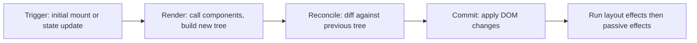

"What happens when you call `setState`?" is one of the most revealing React interview questions. A precise answer shows you understand the model the whole library is built on. This chapter walks through that model step by step, with the details interviewers probe.

## The three steps: trigger, render, commit



1. **Trigger.** A render is triggered by the initial `root.render()`, or by a state update (`setState`, `dispatch`, a store change via `useSyncExternalStore`, or a context value change).
2. **Render.** React calls your component functions to compute what the UI *should* look like. This must be **pure**: no side effects, same inputs give the same output.
3. **Commit.** React applies the minimal set of changes to the DOM, then runs `useLayoutEffect` callbacks synchronously, the browser paints, and React runs `useEffect` callbacks (usually after paint).

"Rendering" in React means *calling your component*, not updating the DOM. A component can render without any DOM change if the output is the same.

## What causes a component to re-render?

| Cause | Notes |
| --- | --- |
| Its own state changed | Via `useState` / `useReducer`. If the new value is `Object.is`-equal to the current one, React bails out (it may still call the component once before bailing). |
| Its parent re-rendered | By default all children re-render, **regardless of whether props changed**. `React.memo` opts out when props are shallowly equal. |
| A context it reads changed | Every consumer of that context re-renders when the provider's `value` changes identity. |
| An external store it subscribes to changed | Via `useSyncExternalStore` (used by Redux, Zustand, and others). |

A common misconception is that "props changing causes re-renders". Props change *because* the parent re-rendered. The parent rendering is the cause.

## Reconciliation: how React diffs

React compares the new element tree with the previous one using two heuristics that make the diff O(n):

1. **Different element types produce different trees.** If `<div>` becomes `<section>`, or `<ProfileA>` becomes `<ProfileB>`, React unmounts the old subtree (destroying its state) and mounts a new one.
2. **Keys identify children across renders** within a list.

### Same position, same type means state is preserved

```jsx
function App({ isEditing }) {
  return isEditing ? <Input placeholder="Edit" /> : <Input placeholder="View" />;
}
```

Both branches render `<Input>` at the same position, so React keeps the same instance and its state. Only props update. This surprises many people.

### Resetting state with a key

```jsx
<ProfileForm key={userId} userId={userId} />
```

Changing the key tells React this is a *different* component instance, so it unmounts and remounts with fresh state. This is the recommended way to reset state when an identity changes, rather than an effect that clears state.

### Keys in lists

```jsx
{todos.map((todo) => (
  <TodoItem key={todo.id} todo={todo} />
))}
```

| Key choice | Behavior |
| --- | --- |
| Stable unique id | Correct: items keep their state and DOM when reordered |
| Array index | Works for static lists; breaks when items are inserted, removed, or reordered (state and inputs attach to the wrong item) |
| `Math.random()` | Every render remounts everything: lost state, lost focus, poor performance |

Keys only need to be unique among siblings, not globally.

### Don't define components inside components

```jsx
function Parent() {
  function Child() { return <input />; } // new component type on every render
  return <Child />;                      // remounts each time, so the input loses focus and state
}
```

Each render creates a new function identity, so React sees a different type and remounts.

## Batching

**React 18 introduced automatic batching**: multiple state updates in the same tick are combined into one render, whether they happen in event handlers, promises, timeouts, or native event listeners. Before React 18, batching only happened inside React event handlers.

```jsx
function handleClick() {
  setCount((c) => c + 1);
  setFlag((f) => !f);
  // One render, not two (React 17 also batched here)
}

setTimeout(() => {
  setCount((c) => c + 1);
  setFlag((f) => !f);
  // React 18+: one render. React 17: two renders.
}, 0);
```

To opt out (rarely needed), use `flushSync` from `react-dom`.

### State is a snapshot

```jsx
function handleClick() {
  setCount(count + 1);
  setCount(count + 1);
  setCount(count + 1);
  // count increases by 1, not 3: each call sees the same snapshot
}
```

Use functional updates (`setCount((c) => c + 1)`) when the next state depends on the previous one. React queues updater functions and applies them in order.

## Concurrent rendering (React 18+)

With `createRoot`, React can **prepare renders in the background and interrupt them**. Rendering is no longer one blocking pass.

- **Transitions** (`startTransition`, `useTransition`) mark updates as non-urgent. Urgent updates such as typing can interrupt them.
- **`useDeferredValue`** lets part of the UI lag behind a fast-changing value.
- **Suspense** can show fallbacks while data or code loads, and with transitions React keeps showing the old UI instead of flashing a fallback.

Because renders can be interrupted, thrown away, and restarted, **render functions must be pure**. Side effects during render can run more than once or for a render that's never committed.

```jsx
const [query, setQuery] = useState('');
const deferredQuery = useDeferredValue(query);
const results = useMemo(() => filterHugeList(deferredQuery), [deferredQuery]);
// Typing stays responsive; the list catches up when React has time
```

## The commit phase and effects in order

For a single commit:

1. React applies DOM mutations.
2. Ref callbacks and ref assignments happen.
3. `useLayoutEffect` cleanups (from the previous render) run, then new layout effects run, synchronously, before paint.
4. The browser paints.
5. `useEffect` cleanups then new effects run. (When an update comes from a discrete user input like a click, React 18+ may flush passive effects synchronously before paint.)

Parents' effects run **after** children's effects, because children commit first.

## Strict Mode in development

`<StrictMode>` helps you find impure code by, **in development only**:

- Rendering components twice (and calling initializer and updater functions twice).
- Running effects twice on mount: mount, then simulated unmount (cleanup), then mount again. This was added in React 18.
- Re-running ref callbacks on mount (React 19).
- Warning about deprecated APIs.

If your app breaks under Strict Mode, it usually has a missing cleanup or an impure render. In React 19, the second render reuses memoized results (`useMemo`/`useCallback`) from the first.

## Fibers in one paragraph

Internally React represents each component instance as a **fiber**: a unit of work holding the component's type, props, state (the hooks linked list), and pointers to its parent, child, and sibling. React keeps two trees, *current* (what's on screen) and *work-in-progress*, and swaps them on commit. Splitting work into fibers is what lets React pause, prioritize (with "lanes"), and resume rendering. You rarely need more detail than this in an interview, but it explains why hooks must be called in the same order: their state is stored by position on the fiber.

## Common interview questions

1. **Does a child re-render when its parent re-renders if its props didn't change?** Yes, unless it's wrapped in `React.memo` (or React Compiler auto-memoizes it), or it's passed as `children` / an element prop created higher up.
2. **Why does my input lose focus on every keystroke?** Usually a component defined inside another component, or an unstable key.
3. **What's the difference between rendering and painting?** Rendering means calling components (in React). Painting is the browser drawing pixels after the commit.
4. **Why does `console.log` show the old state right after `setState`?** State is a snapshot for that render. The new value is available in the next render.
5. **How do you reset a component's state when a prop changes?** Give it a `key` based on that prop.

## Senior-level nuances

- **The "children as props" optimization:** elements passed as `children` from a parent that didn't re-render are the same object references, so React skips re-rendering them even if the wrapper's state changes.
- **Context granularity:** split contexts by update frequency, or pass a stable dispatch through context, to avoid broad re-renders.
- **Measure before memoizing:** React DevTools Profiler, "Highlight updates when components render", and the Performance panel's tracks.
- **React Compiler** automatically memoizes components and values at build time, removing most manual `memo`/`useMemo`/`useCallback`. The rendering model itself doesn't change.
