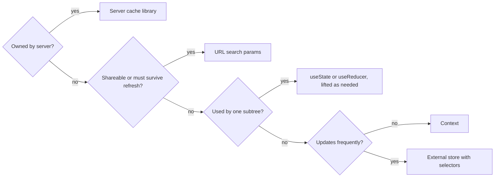

"How would you manage state in this app?" is a near-certain question for senior React roles. The weak answer names a library. The strong answer **classifies the state first**, then picks the simplest tool that fits each category, and explains the trade-offs.

## Step 1: classify the state

| Kind | Definition | Examples |
| --- | --- | --- |
| Local UI state | Belongs to one component, ephemeral | Input text, open/closed, hover |
| Shared UI state | Several distant components need it; no server owner | Theme, sidebar collapsed, multi-step wizard progress |
| Server state | Owned by a backend; the client holds a cached copy | Users, products, messages |
| URL state | Should survive refresh and be shareable | Filters, sort, pagination, selected tab, search query |
| Form state | Field values, validation, dirty/touched | Checkout form |
| Persistent client state | Must survive reload/offline | Drafts, preferences, offline queue |
| Derived state | Computable from other state | Filtered list, totals, `isValid` |

**Derived state should not be stored.** Compute it during render.

## Step 2: pick the tool per kind



### Local state: `useState` / `useReducer`

Start here. **Colocate** state as close as possible to where it's used, and lift it only to the nearest common ancestor when siblings need it. Most performance problems in React apps come from state placed too high.

### URL state

Filters and pagination in the URL give you deep links, back/forward navigation, and refresh persistence for free. Use your router's search params API (React Router `useSearchParams`, Next.js `useSearchParams` + `router.push`, TanStack Router typed search params). Validate URL params, since they're user input.

### Server state: a query cache

Server data has problems client state doesn't: caching, deduplication, staleness, background refetching, pagination, optimistic updates, and invalidation. Dedicated libraries solve these:

| Library | Notes |
| --- | --- |
| TanStack Query | Framework-agnostic, query keys, mutations, infinite queries, devtools |
| SWR | Lightweight stale-while-revalidate |
| RTK Query | Built into Redux Toolkit; good if you're already on Redux |
| Apollo Client / Relay / urql | GraphQL, normalized caches (Relay is the most opinionated) |
| Framework loaders / RSC | Next.js, React Router, and Remix fetch on the server or in route loaders |

```tsx
function useProduct(id: string) {
  return useQuery({
    queryKey: ['product', id],
    queryFn: ({ signal }) => fetch(`/api/products/${id}`, { signal }).then((r) => r.json()),
    staleTime: 60_000,
  });
}
```

Moving server state out of Redux is often the largest simplification in legacy React apps. What's left in a global store is usually small.

### Context

Context is a **dependency injection mechanism**, not a state manager. It's ideal for values that change rarely: theme, locale, the current user, feature flags, or a stable service instance.

Its limits: every consumer re-renders when the value changes, and there are no built-in selectors. For frequent updates (a cursor position, a large mutable document), context causes broad re-renders.

Mitigations: split contexts, memoize the value, pass `dispatch` (which is stable) separately from state, or put a store *instance* in context and subscribe with selectors.

### External stores

| Library | Model | Strengths | Consider when |
| --- | --- | --- | --- |
| Redux Toolkit | Single store, reducers, actions | Predictable, devtools, middleware, large ecosystem | Large teams, complex cross-cutting client state, existing Redux |
| Zustand | Hook-based store with selectors | Tiny API, no provider needed, fine-grained subscriptions | Medium apps wanting simplicity |
| Jotai | Atoms (bottom-up) | Fine-grained derived state, Suspense-friendly | Many small interdependent pieces of state |
| MobX | Observable, mutable | Automatic tracking, less boilerplate | Teams comfortable with reactive models |
| XState / XState Store | State machines/statecharts | Explicit states and transitions, visualizable | Complex flows (checkout, onboarding, media players) |
| Valtio | Proxy-based mutable | Ergonomic mutations | Small to medium apps |

All of the modern ones integrate with concurrent React through `useSyncExternalStore`.

```ts
import { create } from 'zustand';

type CartState = {
  items: Record<string, number>;
  add: (id: string) => void;
  remove: (id: string) => void;
};

export const useCart = create<CartState>((set) => ({
  items: {},
  add: (id) => set((s) => ({ items: { ...s.items, [id]: (s.items[id] ?? 0) + 1 } })),
  remove: (id) =>
    set((s) => {
      const { [id]: _, ...rest } = s.items;
      return { items: rest };
    }),
}));

// Component subscribes only to what it reads
const count = useCart((s) => Object.values(s.items).reduce((a, b) => a + b, 0));
```

### Form state

Use native form features plus either React 19 Actions (`useActionState`) for simple server-backed forms or a form library (React Hook Form, TanStack Form) for complex client validation. See the Forms chapter.

## Trade-off table for interviews

| Criterion | Local state | Context | Zustand/Jotai | Redux Toolkit | Query cache |
| --- | --- | --- | --- | --- | --- |
| Learning curve | None | Low | Low | Medium | Medium |
| Re-render control | Excellent (colocated) | Poor for frequent updates | Selector-based | Selector-based | Per query key |
| Devtools | React DevTools | React DevTools | Redux DevTools (middleware) | Excellent | Excellent |
| Boilerplate | None | Low | Low | Medium | Low |
| Server data features | None | None | None | Via RTK Query | Built in |
| Best for | Most UI state | Rarely changing globals | Shared client state | Large-team, complex client logic | Server data |

## Common anti-patterns

1. **Copying props into state.** `useState(props.value)` ignores later prop changes. Use the prop directly, or a `key` to reset.
2. **Storing derived values.** `const [fullName, setFullName]` alongside `first` and `last`. Compute it.
3. **One giant context** for the whole app's state, so every keystroke re-renders the tree.
4. **Global store for server data** with hand-written loading flags, caching, and invalidation.
5. **Syncing state with effects.** Chains of `useEffect` that update one state from another.
6. **Premature globalization.** Putting modal open state in Redux "in case" someone else needs it.

## Talking about migrations (senior and lead)

Interviewers often ask how you'd improve a legacy app with a bloated Redux store:

1. **Inventory** the slices: which are server data, URL, or genuinely global?
2. **Introduce a query library** alongside Redux, and migrate one feature's server data at a time.
3. **Move filters and pagination to the URL**.
4. **Colocate** UI flags back into components.
5. **Keep Redux** (Toolkit) for truly complex client state, or replace the remainder with a lighter store.
6. **Measure:** bundle size, lines of state code, bug rate in affected areas, and render counts.
7. **Codify** the decision in an ADR and lint rules (e.g. restricting imports of the legacy store in new code).

## Interview answer template

> "I'd split state by kind. Server data such as products and the cart contents from the API goes in TanStack Query with keys per resource and optimistic updates for add-to-cart. Filters and sort go in the URL so results are shareable. UI state like the open drawer stays local. For the few cross-cutting client concerns, like theme and the mini-cart's open state, I'd use context for theme and a small Zustand store for the cart UI, because it updates often and I want selector-level subscriptions. Nothing derived is stored. Totals are computed."

That answer classifies the state, matches tools to kinds, and justifies each choice, which is what the interviewer is looking for.
