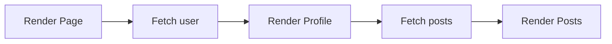
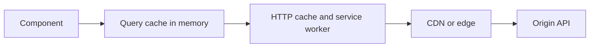

Data fetching is where many React apps accumulate bugs: race conditions, waterfalls, duplicate requests, stale data, and inconsistent loading states. Interviewers probe this area because it shows whether you understand React's lifecycle *and* the network.

## The landscape in 2025

| Approach | Where data loads | Typical tools |
| --- | --- | --- |
| Effect-based fetching | Client, after render | `useEffect` + `fetch` (fine for small apps and interviews) |
| Query cache | Client, with caching | TanStack Query, SWR, RTK Query, Apollo, Relay |
| Route loaders | Before route render (client or server) | React Router / Remix loaders, TanStack Router loaders |
| Server Components | On the server during render | Next.js App Router, other RSC frameworks |
| `use` + Suspense | Render reads a promise created elsewhere | React 19 `use`, framework-provided promises |

React's docs recommend using a framework or a caching library for production data fetching, rather than hand-rolled effects.

## Fetching in an effect (the interview baseline)

You'll often be asked to fetch without libraries in a coding round. Do it correctly:

```tsx
type State<T> =
  | { status: 'loading' }
  | { status: 'error'; error: Error }
  | { status: 'success'; data: T };

function useFetch<T>(url: string): State<T> {
  const [state, setState] = useState<State<T>>({ status: 'loading' });

  useEffect(() => {
    const controller = new AbortController();
    setState({ status: 'loading' });
    fetch(url, { signal: controller.signal })
      .then((res) => {
        if (!res.ok) throw new Error(`HTTP ${res.status}`);
        return res.json() as Promise<T>;
      })
      .then((data) => setState({ status: 'success', data }))
      .catch((error) => {
        if (error.name !== 'AbortError') setState({ status: 'error', error });
      });
    return () => controller.abort();
  }, [url]);

  return state;
}
```

What interviewers look for:

- **Race-condition protection:** aborting (or an `ignore` flag) prevents an older response from overwriting a newer one when `url` changes quickly.
- **Checking `res.ok`:** `fetch` only rejects on network errors, not on 4xx/5xx.
- **A discriminated-union state:** no impossible combinations such as loading and error at once.
- **Cleanup works with Strict Mode:** the dev double-mount aborts the first request.

What it lacks: caching, deduplication, retries, background refresh, and pagination. Say so and mention the library you'd use in production.

## Waterfalls

A waterfall happens when requests that could run in parallel run one after another:



Causes: each component fetches in its own effect after its parent finishes loading.

Fixes:
- **Hoist fetches** to the route level (loaders) and start them in parallel.
- **Start fetching before render** (on route transition or hover intent), then read the result where it's needed.
- With RSC, fetch in parallel with `Promise.all` or start promises early and pass them down.
- Use GraphQL fragments or BFF endpoints to combine data.

## Query caches: TanStack Query as the reference

```tsx
const { data, isPending, isError, error, isFetching } = useQuery({
  queryKey: ['todos', { status }],
  queryFn: ({ signal }) => api.getTodos({ status }, { signal }),
  staleTime: 30_000,
});
```

Concepts to explain:

| Concept | Meaning |
| --- | --- |
| Query key | The cache identity. It must include every input that affects the result. |
| `staleTime` | How long data counts as fresh (no background refetch). Default 0. |
| `gcTime` | How long unused cache entries are kept before garbage collection (default 5 min). |
| Deduplication | Components asking for the same key share one request. |
| Background refetch | On window focus, reconnect, or mount if stale. |
| `isPending` vs `isFetching` | No data yet vs a request currently in flight (including background). |
| Placeholder / keepPreviousData | Keep showing the old page while the next one loads, so pagination doesn't flash. |

### Mutations and invalidation

```tsx
const queryClient = useQueryClient();
const addTodo = useMutation({
  mutationFn: api.addTodo,
  onSuccess: () => queryClient.invalidateQueries({ queryKey: ['todos'] }),
});
```

Invalidation strategies, from simplest to most precise:
1. Invalidate related keys and refetch.
2. Write the server's response directly into the cache (`setQueryData`).
3. Optimistic update with rollback.

### Optimistic updates

```tsx
useMutation({
  mutationFn: api.toggleLike,
  onMutate: async (postId) => {
    await queryClient.cancelQueries({ queryKey: ['post', postId] });
    const previous = queryClient.getQueryData<Post>(['post', postId]);
    queryClient.setQueryData<Post>(['post', postId], (p) =>
      p && { ...p, liked: !p.liked, likeCount: p.likeCount + (p.liked ? -1 : 1) }
    );
    return { previous };
  },
  onError: (_err, postId, ctx) => queryClient.setQueryData(['post', postId], ctx?.previous),
  onSettled: (_d, _e, postId) => queryClient.invalidateQueries({ queryKey: ['post', postId] }),
});
```

React 19's `useOptimistic` offers a built-in alternative for optimistic state tied to an Action (see the React 19 chapter).

## Suspense for data

Suspense lets a component "wait" during render while a boundary higher up shows a fallback:

```tsx
<Suspense fallback={<FeedSkeleton />}>
  <Feed />
</Suspense>
```

The component itself must use a **Suspense-enabled data source**: a framework (Next.js, Relay), TanStack Query's `useSuspenseQuery`, or React 19's `use(promise)` with a promise that's **cached or created outside render**.

```tsx
// React 19
function Comments({ commentsPromise }: { commentsPromise: Promise<Comment[]> }) {
  const comments = use(commentsPromise);
  return <ul>{comments.map((c) => <li key={c.id}>{c.text}</li>)}</ul>;
}
```

Don't create the promise inside the component that calls `use`. Each render would create a new promise and suspend again. Create it in a loader, a Server Component, or a cache.

**Boundary placement** is a design decision. Too high, and the whole page shows a spinner. Too low, and you get popcorn UI with many spinners. Group content that should appear together. Transitions (`startTransition`) keep already-visible content on screen instead of replacing it with a fallback during navigation.

## Server-side data loading

| Pattern | Pros | Cons |
| --- | --- | --- |
| SSR with loaders | Data in the first HTML; good SEO and LCP | Server cost; TTFB depends on the slowest query unless streamed |
| Streaming SSR with Suspense | Shell paints early; slow parts stream in | More complex error and loading design |
| Server Components | No client JS for data-only parts; direct backend access | Requires a framework; you must manage the client/server boundary |
| Static / ISR | CDN-fast | Freshness limits |

For hydration, server-fetched data must be serialized into the page and reused on the client (frameworks and query libraries handle this through dehydrate/hydrate APIs), so the client doesn't refetch immediately.

## Pagination and infinite loading

- Cursor-based APIs plus `useInfiniteQuery`.
- An `IntersectionObserver` sentinel to fetch the next page.
- Keep scroll position on back navigation (cache pages and restore the scroll offset).
- Combine with virtualization for long lists.

## Error handling

- Distinguish **expected errors** (404, validation), handled inline, from **unexpected** ones, caught by error boundaries.
- Retry with exponential backoff for transient failures (query libraries default to a few retries). Don't retry 4xx.
- Error boundaries catch errors thrown during render, including from Suspense data sources. They don't catch errors in event handlers or async callbacks, so handle those explicitly.
- React 19 adds `onCaughtError` and `onUncaughtError` root options for centralized reporting.

## Caching layers to mention



Each layer has its own invalidation story. A senior answer explains which layer handles which data: hashed assets as immutable at the CDN, public JSON with short `max-age` plus `stale-while-revalidate`, personalized data `private` and cached only in memory on the client.

## Common interview questions

1. **How do you prevent race conditions in effects?** Abort or ignore stale responses in cleanup.
2. **Why not put fetched data in Redux?** Server state needs caching, staleness, and dedupe, which query libraries provide. Redux only makes sense with RTK Query.
3. **What's the difference between `isLoading` and `isFetching`?** First load without data vs any in-flight request.
4. **How would you avoid waterfalls?** Fetch at the route level in parallel, start early, and use loaders or RSC.
5. **When would you use `use`?** To read a promise passed from a server component or loader, or to read context conditionally.

## Lead-level perspective

- Standardize on **one** data layer per app and document the conventions: key factories, error handling, retry policy.
- Generate typed API clients from OpenAPI or GraphQL schemas.
- Monitor real-user data latency, error rates, and cache hit ratios.
- When adopting RSC, decide clearly which data belongs to server components vs the client cache to avoid double-fetching.
