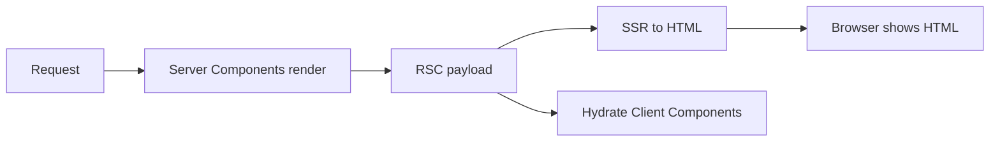

"What's the difference between SSR and Server Components?" has become a standard senior React question. Many candidates mix them up. This chapter explains each rendering model precisely, how they combine, and what to weigh when choosing.

## The rendering spectrum

| Model | Where HTML is produced | When | JS shipped for the content |
| --- | --- | --- | --- |
| CSR | Browser | After JS loads | All of it |
| SSR | Server | Per request | All of it (to hydrate) |
| SSG | Build server | At build time | All of it (to hydrate) |
| ISR / revalidation | Server, cached | On a schedule or on demand | All of it (to hydrate) |
| React Server Components | Server (request or build time) | Per request or at build | **Only for Client Components** |

SSR answers *when and where HTML is first produced*. RSC answers *which components ever run on the client*. They're complementary: RSC frameworks typically also SSR the result.

## SSR and hydration

1. The server renders the React tree to HTML and sends it.
2. The browser displays the HTML (fast first paint).
3. The JS bundle loads and React **hydrates**: it renders the same tree on the client and attaches event handlers to the existing DOM.

```tsx
// Client entry (React 18+)
import { hydrateRoot } from 'react-dom/client';
hydrateRoot(document.getElementById('root')!, <App />);
```

### Hydration mismatches

If the client render differs from the server HTML, React reports a mismatch. In React 18 it may also re-render the subtree on the client. React 19 gives much clearer error messages with a diff.

Common causes:
- `Date.now()`, `Math.random()`, or locale or time zone formatting differing between server and client
- Reading `window` or `localStorage` during render
- Invalid HTML nesting (`<div>` inside `<p>`)
- Browser extensions modifying the DOM (React 19 is more tolerant of injected third-party elements in `<head>` and `<body>`)

Fixes: render client-only values after mount (an effect sets the state), pass server values down as data, use `useId` for ids, or use `suppressHydrationWarning` for unavoidable single-element text differences such as timestamps.

### Streaming SSR (React 18+)

`renderToPipeableStream` (Node) and `renderToReadableStream` (Web streams) send HTML progressively. With `<Suspense>` boundaries:

- The shell (everything outside boundaries, or with fallbacks) streams first.
- Each boundary's content streams in when its data resolves, along with a tiny inline script that swaps it into place.
- **Selective hydration:** React hydrates boundaries independently and prioritizes the one the user interacts with.

This fixes the "all or nothing" problem of classic SSR, where the slowest query blocked the whole page and the entire tree had to hydrate before anything was interactive.

## React Server Components

Server Components (stable in React 19, used through frameworks like Next.js App Router) **run only on the server** (or at build time). Their code is never sent to the browser. They can:

- Be `async` and `await` data directly (databases, internal services, the file system).
- Import large server-only libraries (markdown parsers, syntax highlighters) at zero client cost.
- Render Client Components and pass them serializable props.

They can't:
- Use state, effects, or browser APIs.
- Attach event handlers.
- Use context (as consumers).

```tsx
// app/products/[id]/page.tsx: a Server Component (default in the App Router)
import { AddToCart } from './AddToCart';

export default async function ProductPage({ params }: { params: Promise<{ id: string }> }) {
  const { id } = await params;
  const product = await db.product.findUnique({ where: { id } });
  if (!product) notFound();
  return (
    <article>
      <h1>{product.name}</h1>
      <p>{product.description}</p>
      <AddToCart productId={product.id} price={product.price} />
    </article>
  );
}
```

```tsx
// AddToCart.tsx
'use client';
import { useState } from 'react';

export function AddToCart({ productId, price }: { productId: string; price: number }) {
  const [adding, setAdding] = useState(false);
  // interactive logic here
  return <button disabled={adding} onClick={() => { /* ... */ }}>Add to cart</button>;
}
```

### The boundary rules

- `'use client'` marks a **module** as a client entry point. Everything it imports becomes part of the client bundle.
- Server Components can render Client Components. Client Components **cannot import** Server Components, but they can receive them as `children` or other props:

```tsx
// Server Component
<ClientTabs>
  <ServerRenderedPanel />  {/* rendered on the server, passed as a prop */}
</ClientTabs>
```

- Props crossing the boundary must be **serializable**: primitives, plain objects, arrays, Dates, Maps/Sets, promises, JSX, and Server Function references. Not ordinary functions or class instances.
- Keep `'use client'` boundaries **low in the tree** (leaf interactive components) to keep client bundles small.
- Use the `server-only` package to make sure server modules (with secrets) are never imported into client code.

### What the client receives

The server produces the **RSC payload**, a serialized description of the rendered tree with references to Client Component modules. The client merges it into the React tree. Navigation can fetch new RSC payloads and reconcile them **without losing client state**, which is different from a full-page reload.



## Server Functions (`'use server'`)

Functions marked with `'use server'` can be called from the client. The framework turns them into network endpoints. They're commonly used as form Actions:

```tsx
// actions.ts
'use server';
export async function addComment(formData: FormData) {
  const session = await auth();
  if (!session) throw new Error('Unauthorized');
  const text = String(formData.get('text') ?? '').slice(0, 2000);
  await db.comment.create({ data: { text, userId: session.userId } });
  revalidatePath('/posts');
}
```

**Security:** every Server Function is a public HTTP endpoint. Authenticate, authorize, and validate inputs inside it, every time. (React's docs now use "Server Functions" as the umbrella term; "Server Actions" refers to those used as actions.)

## SSR vs RSC

| Question | SSR | RSC |
| --- | --- | --- |
| Faster first paint? | Yes | Yes (when combined with SSR) |
| Less client JS? | No, everything hydrates | Yes, server-only components ship no JS |
| Direct backend access in components? | Only in loaders/getServerSideProps-style APIs | Yes, inside components |
| Needs a framework? | Can be hand-rolled | Practically yes (bundler integration) |
| Interactivity | Everything hydrated | Only Client Components |
| State preserved on navigation? | Depends on router | Yes, with RSC refetch and reconcile |

## Trade-offs to bring up

**Benefits:** smaller bundles, data fetching close to the source with no client waterfalls, secrets stay on the server, and streaming.

**Costs:**
- A new mental model (two module graphs, serialization rules) and the onboarding cost that comes with it.
- Server infrastructure and cost; latency depends on server placement relative to data.
- Caching complexity (framework caches, revalidation semantics).
- Library compatibility: libraries that use context or effects need `'use client'` wrappers.
- Debugging across the boundary.
- Not every app benefits. A highly interactive internal dashboard may be simpler as CSR.

## Common interview questions

1. **Are Server Components the same as SSR?** No. SSR renders to HTML for the first load. RSC is a component type that never runs on the client, and it can be used with or without SSR.
2. **Can a Client Component render a Server Component?** Not by importing it, but it can receive one as `children` or as a prop from a Server Component parent.
3. **Why can't I pass an `onClick` function from a Server Component?** Functions aren't serializable. Use a Client Component, or a Server Function for mutations.
4. **What causes hydration errors and how do you fix them?** Non-deterministic rendering, browser-only APIs during render, invalid nesting. Fix by moving client-only values to effects and keeping server and client output identical.
5. **How does Suspense help SSR?** It enables streaming and selective hydration.

## Lead-level perspective: adoption decision

| Factor | Favors RSC/SSR | Favors CSR |
| --- | --- | --- |
| SEO and public content | Strong | Weak |
| First-load performance on slow devices | Strong | Weak |
| Highly interactive, logged-in tool | Neutral | Strong |
| Team experience with servers | Required | Not required |
| Existing SPA investment | Migration cost | Keep |
| Hosting constraints (static only) | Blocker | Fine |

A typical migration path: introduce the new framework for new routes, move shared components into client-compatible modules, convert data-heavy and static-heavy pages first, and measure LCP, JS bytes, and server cost per route. Record the decision in an ADR, including what would make you reverse it.
