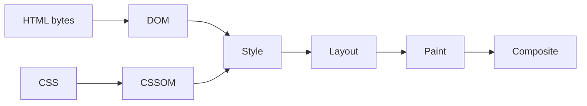

## TL;DR

The critical rendering path is everything the browser must do between receiving HTML bytes and painting pixels: **parse HTML into the DOM, parse CSS into the CSSOM, combine them for style, compute layout, then paint and composite**. **CSS is render-blocking**: the browser won't paint until the stylesheets in `<head>` have loaded. **Classic `<script>` is parser-blocking**: HTML parsing stops while it downloads and runs, and it also waits for preceding CSS. To shorten the path, **reduce and inline critical CSS, `defer` or `async` scripts, make key resources discoverable early, and send less HTML before the first meaningful content**.

## The pipeline

1. **Parse HTML** incrementally into the DOM. The parser can process a streamed response chunk by chunk.
2. Meanwhile the **preload scanner** reads ahead in the raw markup and starts fetching ``, `<link>` and `<script src>` URLs even while the main parser is blocked. Resources it can't see (injected by JS, CSS backgrounds, `@import` inside CSS) are discovered late.
3. **CSSOM** is built from all stylesheets. It isn't incremental the way the DOM is, because later rules can override earlier ones.
4. **Style → layout → paint → composite**: compute styles per element, compute geometry, record draw operations, then rasterise and composite layers (often on the GPU).

## What blocks what

| Resource | Blocks parsing? | Blocks rendering? |
|---|---|---|
| `<link rel="stylesheet">` in `<head>` | No | **Yes**, until loaded (unless `media` doesn't match) |
| `<script>` (classic, no attributes) | **Yes**, download + execute, and waits for pending CSS | Indirectly |
| `<script defer>` | No; runs after parsing, in order | No |
| `<script async>` | No to download; pauses parsing briefly while it runs | No |
| `<script type="module">` | Deferred by default | No |
| Web fonts | No | Text may be invisible (depends on `font-display`) |
| Images | No | No (but often the LCP element) |

Why does a classic script wait for CSS? Because it might read computed styles (`getComputedStyle`), so the browser must finish the CSSOM first. A slow stylesheet therefore delays script execution, which delays parsing.

## Shortening the path

- **Critical CSS inline** in `<head>` for above-the-fold content, with the rest loaded non-blocking. Or simply keep total CSS small and split by route.
- **`media` attributes** for non-matching stylesheets (`media="print"`) so they don't block rendering.
- **`defer`** for app scripts. Avoid `document.write` and synchronous third-party tags in `<head>`.
- **Make critical resources discoverable**: real `` tags in server HTML, `preload` for fonts or CSS-referenced hero images, no `@import` chains.
- **Stream HTML** and flush `<head>` early so the browser starts fetching CSS and JS while the server is still rendering the body.
- **Fewer origins on the critical path** (`preconnect` to unavoidable ones), and HTTP caching for repeat visits.
- **Reduce DOM size and CSS complexity** so style and layout are cheap.

## Pitfalls

- Moving everything to `async`, then hitting ordering bugs. `defer` preserves order; `async` doesn't.
- Client-side-rendered SPAs: the critical path includes downloading and running the JS bundle and fetching data before *anything* meaningful renders.
- Inlining too much CSS bloats every HTML response and defeats caching.
- Anti-flicker snippets from A/B testing tools that hide the page until a script loads.

## In an interview, mention…

- Render-blocking (CSS) vs parser-blocking (classic scripts), and why scripts wait for CSS.
- The preload scanner and the "late discovery" problem.
- Concrete fixes and how you'd verify them in a WebPageTest or DevTools waterfall (start render, FCP, LCP).
