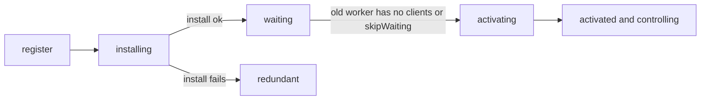

## TL;DR

A service worker is a script that sits between your pages and the network for a scope, intercepting `fetch` events. Its lifecycle is **register → install → (waiting) → activate → control pages**. A **new version installs in the background but waits** until no tab is using the old one, so a page never has two versions of its worker mid-session. Pick a **caching strategy per request type** (cache-first for hashed assets, network-first or stale-while-revalidate for HTML and APIs), and treat **updates** as the hard part: a buggy worker can keep serving broken content until you ship a fix the worker itself lets through.

## Lifecycle



```js
// sw.js
const VERSION = 'v42';
const PRECACHE = `precache-${VERSION}`;

self.addEventListener('install', (event) => {
  event.waitUntil(caches.open(PRECACHE).then(c => c.addAll(['/offline.html', '/assets/app.3f9a.js'])));
});

self.addEventListener('activate', (event) => {
  event.waitUntil((async () => {
    const keys = await caches.keys();
    await Promise.all(keys.filter(k => k !== PRECACHE).map(k => caches.delete(k)));
    await self.clients.claim(); // take control of already-open pages
  })());
});
```

- The **first** install doesn't control the page that registered it until reload, unless you call `clients.claim()`.
- The browser checks for an updated `sw.js` on navigations (and at most roughly every 24 hours it bypasses the HTTP cache for that check). A byte difference in the script triggers a new install.
- `self.skipWaiting()` activates the new worker immediately, but already-open pages may then be running old JS against a new worker and new caches. Only do it if versions are compatible, or reload the clients.

## Caching strategies

| Strategy | How | Use for |
|---|---|---|
| Cache first | Cache, fall back to network | Content-hashed static assets, fonts |
| Network first | Network, fall back to cache on failure or timeout | HTML, frequently changing API data |
| Stale-while-revalidate | Serve cache, update it in the background | Avatars, non-critical API data |
| Network only | Never cache | Analytics, payments, auth |
| Cache only | Precached | The app shell, offline page |

Workbox packages these with expiry, size limits and precache manifests generated by your build.

## Shipping updates safely

1. **Never cache `sw.js` in the HTTP cache for long.** Serve it with `Cache-Control: no-cache`.
2. **Version the precache** and delete old caches in `activate`.
3. **Prompt users** ("A new version is available. Reload?") when a worker reaches `waiting`, then `postMessage` it to `skipWaiting` and reload on `controllerchange`.
4. **Network-first for HTML**, so a deploy shows up without waiting for a worker update.
5. Keep a **kill switch**: a no-op worker deployed at the same URL that clears caches and unregisters (`self.registration.unregister()`). Also, the server can send `Clear-Site-Data: "cache", "storage"` in emergencies.
6. Test in DevTools → Application: "Update on reload", "Bypass for network", offline mode.

## Pitfalls

- Caching HTML cache-first: users see the old app forever.
- Caching opaque (`no-cors`) cross-origin responses: you can't check their status, so you may cache errors, and they count heavily against storage quota.
- Scope surprises: a worker at `/js/sw.js` can only control `/js/` unless the server sends `Service-Worker-Allowed`.
- Breaking navigation preload, or not using it, which adds worker boot time to every navigation. Enable `registration.navigationPreload` for network-first HTML.
- Storage eviction: browsers can evict origin storage under pressure. Request `navigator.storage.persist()` for offline-critical apps.
- Safari caveats: storage for sites the user hasn't interacted with can be cleared after periods of inactivity under its tracking prevention rules.

## In an interview, mention…

- The waiting phase and why it exists (one version per client).
- Strategy per request type, and network-first or SWR for HTML.
- Update UX (prompt + `skipWaiting`), cache versioning, and a kill switch, with a real incident if you have one.
