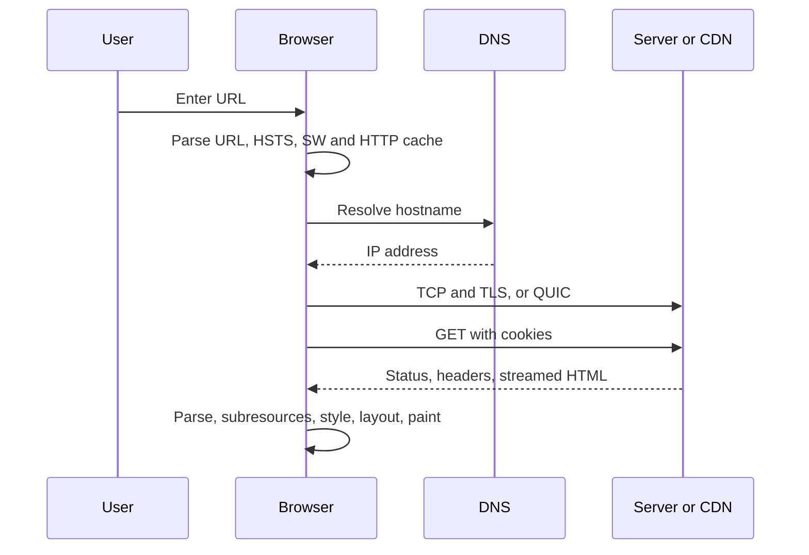

## TL;DR

The browser decides whether the input is a URL or a search, **upgrades to HTTPS if HSTS says so**, checks for a **service worker and the HTTP cache**, **resolves DNS**, opens a connection (**TCP + TLS 1.3**, or **QUIC for HTTP/3**), sends the request, and receives (possibly streamed) HTML. A renderer process then **parses HTML, fetches subresources, builds DOM and CSSOM, lays out, paints and composites**, while running JavaScript along the way. A senior answer picks the stages where **latency hides and where you can optimise**, instead of reciting every step at equal depth.

## The journey

**1. Input and navigation start.** The browser (the "browser process" in Chromium's multi-process model) parses the omnibox text, may already have **prefetched or prerendered** the page because of speculation rules or predictions, and fires `beforeunload` on the current page.

**2. HSTS and caching.** If the host is on the HSTS list (preloaded or remembered from a previous `Strict-Transport-Security` header), `http://` becomes `https://` internally with no network round trip. A **service worker** registered for the scope gets a `fetch` event first. Then the **HTTP cache** is checked. Navigations are usually revalidated, but a back/forward navigation may be served instantly from the **bfcache**.

**3. DNS.** Browser cache → OS cache → resolver (often over DNS-over-HTTPS) → recursive lookups. Modern DNS can also return **HTTPS records** advertising HTTP/3 support, which saves a round trip of protocol discovery.

**4. Connection.** TCP handshake (1 RTT) + TLS 1.3 (1 RTT, 0-RTT on resumption for idempotent requests). With **HTTP/3**, QUIC combines transport and TLS in one handshake over UDP. Certificate validation, ALPN to negotiate `h2` or `h3`, and connection reuse or coalescing for other hostnames on the same certificate.

**5. Request and response.** Cookies are attached according to `SameSite`, `Secure` and partitioning rules. The server or CDN might answer with a redirect (each one costs a round trip), **103 Early Hints** so the browser can preload while the HTML is generated, then the response. Headers matter: `Content-Type`, caching, CSP, `Set-Cookie`, compression (Brotli/Zstandard).

**6. Commit.** The browser hands the response to a renderer process (site isolation puts different sites in different processes). The URL bar updates, and the old page is unloaded or put into bfcache.

**7. Parse and render.** The HTML is parsed incrementally, the preload scanner fetches CSS, JS and images early, CSS blocks rendering, classic scripts block parsing. Then style → layout → paint → composite, followed by `DOMContentLoaded` and `load`. Then hydration or app bootstrap, and fetching data for a SPA.

## Where a senior engineer optimises

| Stage | Cost | Lever |
|---|---|---|
| Redirects | 1+ RTT each | Remove redirect chains, HSTS preload |
| DNS + connection | 1–3 RTT | CDN close to users, HTTP/3, `preconnect`, connection reuse |
| Server think-time | TTFB | Edge caching, streaming SSR, Early Hints |
| HTML size and order | Discovery delay | Flush `<head>` early, discoverable LCP resources |
| Render-blocking CSS/JS | Start render | Critical CSS, `defer` |
| JS bootstrap | INP, LCP for CSR | SSR/SSG, less JS, code splitting |
| Repeat visits | All of the above | Cache headers, service worker, bfcache eligibility |

## Pitfalls

- Spending five minutes on DNS internals and none on rendering or caching.
- Forgetting HTTPS upgrade, redirects and the cache, which often dominate in practice.
- Saying "HTTP/2 Server Push". It's been removed from Chrome; Early Hints replaced it.

## In an interview, mention…

- The order: HSTS → service worker → HTTP cache → DNS → connection → request → streaming parse → render.
- Process model (browser vs renderer processes, site isolation) at a high level.
- Two or three concrete optimisations tied to the stages, with how you'd measure them (Navigation Timing, TTFB, LCP).
