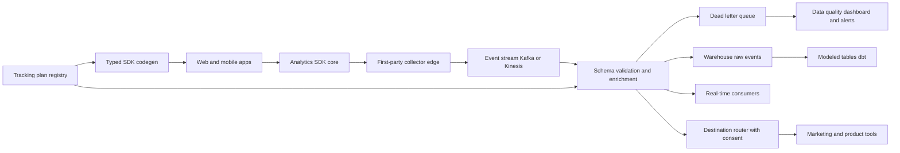

## Framing the problem

The brief's real problem is **trust**, not collection. Sending events is easy; making 2 billion events a day mean the
same thing to every analyst is hard. Untrustworthy analytics usually comes from four causes:

1. **No contract**: events are invented ad hoc in code, so names and properties drift.
2. **Lossy delivery**: events fired on unload, from slow devices, or blocked by ad-blockers silently disappear,
   and the loss is uneven across browsers.
3. **Identity confusion**: anonymous and logged-in users are stitched inconsistently, inflating or deflating user counts.
4. **No validation**: bad events land in the warehouse and become dashboards before anyone notices.

The design therefore centres on a **governed tracking plan that compiles into a typed SDK**, plus a pipeline that
validates every event against it. The SDK itself is the second half: small, reliable, consent-aware and boringly
predictable.

## 1. Requirements exploration

### Stakeholders

- **Product teams**: an easy, typed way to track events; confidence their events arrive.
- **Analysts and data scientists**: stable, documented events in the warehouse; consistent identity.
- **Marketing**: attribution data and forwarding to ad and marketing tools, within consent.
- **Privacy / legal**: consent enforcement, PII prevention, deletion requests, data residency.
- **Platform / performance**: no regression to page performance.

### Functional requirements

- **Tracking plan**: a registry of event definitions with schemas, owners, versions and status.
- **Client SDK**: `track`, `page`, `identify`, `group`/account context, automatic context (app, version, page,
  locale, campaign parameters), batching, persistence, retries.
- **Consent**: categories (necessary, analytics, marketing), integration with the consent management platform (CMP),
  no network calls for denied categories.
- **Collection**: first-party endpoint, validation, enrichment, routing to warehouse and downstream tools.
- **Quality**: schema validation, dead-letter queue, data-quality dashboards, alerts on volume anomalies.
- **Privacy operations**: user deletion and export requests across stored data.

### Non-functional requirements and SLOs

- **Volume**: 2B events/day averages about 23k events/s; plan for 5× peaks (about 120k/s).
- **Delivery**: at least 99% of events that the SDK accepts arrive in the warehouse (measured), with duplicates removed
  downstream (at-least-once delivery plus dedupe).
- **Latency**: events queryable in the warehouse within 15 minutes; a real-time stream within 1 minute for experiments
  and operational dashboards.
- **SDK budget**: under 10 KB gzipped core, no main-thread task over 5 ms attributable to the SDK, lazy-loaded
  destinations.
- **Availability**: collection endpoint 99.95%.

### Out of scope

- The BI layer itself (dashboards, notebooks); we deliver modeled tables to it.

## 2. Architecture



Principles:

- **One SDK, one first-party endpoint**. Third-party destinations (Amplitude, ad platforms) are fed server-side by the
  router, not by tags in the page. That shrinks page weight, gives consent a single enforcement point, and keeps raw
  data in our warehouse first.
- **The tracking plan is the source of truth** for codegen, validation and documentation.
- **Raw events are immutable**; modeling (sessionisation, identity stitching, business metrics) happens downstream in
  the warehouse where it can be reprocessed.

## 3. Data model and contracts

### Event definition (tracking plan entry)

```yaml
name: product_added_to_cart
version: 3
status: active            # draft | active | deprecated
owner: team-cart
description: User added a product to the cart from any surface.
trigger: Fired after the add-to-cart API call succeeds, once per product added.
consent: analytics
properties:
  product_id:    { type: string, required: true }
  quantity:      { type: integer, minimum: 1, required: true }
  price:         { type: number, required: true, description: "Unit price as a decimal in the given currency" }
  currency:      { type: string, pattern: "^[A-Z]{3}$", required: true }
  source_surface:
    type: string
    enum: [product_page, search_results, recommendations, quick_view]
    required: true
pii: false
destinations: [warehouse, amplitude]
```

Conventions enforced by review and linting of the plan itself: `object_action` snake_case names in past tense, no
free-text properties without a reason, enums over open strings, currency as ISO 4217 code, explicit `trigger` text
(the most common source of analyst confusion is *when* an event fires). Each definition compiles to a **JSON Schema**
used for validation.

### Wire format (envelope)

```json
{
  "batchId": "b_01HZX3...",
  "sentAt": "2025-06-02T10:15:05.120Z",
  "events": [
    {
      "eventId": "01HZX3F8Q4...",
      "name": "product_added_to_cart",
      "schemaVersion": 3,
      "timestamp": "2025-06-02T10:15:03.004Z",
      "anonymousId": "a_5d1c...",
      "userId": "u_8f2a",
      "sessionId": "s_77ab",
      "consent": { "analytics": true, "marketing": false },
      "context": {
        "app": { "name": "storefront-web", "version": "2025.06.02-a1b2c3" },
        "page": { "path": "/product/:id", "referrerHost": "www.google.com" },
        "locale": "en-GB",
        "campaign": { "source": "newsletter", "medium": "email" },
        "flags": { "checkout.new-payment-sheet": "treatment" }
      },
      "properties": { "product_id": "p_123", "quantity": 1, "price": 24.99, "currency": "GBP", "source_surface": "search_results" }
    }
  ]
}
```

- `eventId` is a client-generated ULID or UUID v7: the **deduplication key** for at-least-once delivery.
- `timestamp` is the device time; the collector adds `receivedAt`, and downstream corrects skew using
  `receivedAt - (sentAt - timestamp)`, the standard approach for untrusted clocks.
- No IP or full user agent in the payload; the collector derives coarse geo and device class, then discards them.

## 4. Interfaces

### SDK API

```ts
interface AnalyticsConfig {
  writeKey: string;
  endpoint: string;               // first-party, e.g. https://www.acme.com/_e
  app: { name: string; version: string };
  consent: ConsentAdapter;        // bridges to the CMP
  flushIntervalMs?: number;       // default 5000
  maxBatchSize?: number;          // default 50
  maxQueueSize?: number;          // default 1000, drop oldest beyond
  debug?: boolean;
}

interface ConsentAdapter {
  get(): { analytics: boolean; marketing: boolean } | 'unknown';
  onChange(cb: (c: { analytics: boolean; marketing: boolean }) => void): () => void;
}

interface Analytics {
  track<E extends EventName>(name: E, properties: EventProperties<E>): void;
  page(properties?: { name?: string; category?: string }): void;
  identify(userId: string, traits?: SafeTraits): void;
  reset(): void;                  // on logout: new anonymousId, clear userId
  flush(): Promise<void>;
}
```

`EventName` and `EventProperties<E>` are **generated from the tracking plan**, so:

```ts
analytics.track('product_added_to_cart', {
  product_id: 'p_123', quantity: 1, price: 24.99, currency: 'GBP', source_surface: 'search_results',
}); // compiles

analytics.track('add_to_cart', { id: 1 }); // type error: unknown event
```

Generated wrappers can be even more explicit (`track.productAddedToCart({...})`), which tools like Avo and Segment
Protocols' Typewriter popularised.

### React helpers

```tsx
<TrackImpression event="recommendation_viewed" properties={{ slot: 'pdp-bottom', count: 8 }}>
  <Recommendations />
</TrackImpression>
```

Uses `IntersectionObserver` (50% visible for at least 1 s) and fires once per mount, standardising "viewed" semantics
that teams otherwise implement differently.

### Tracking plan workflow and CI

```bash
acme-analytics plan validate          # lint the plan YAML
acme-analytics codegen --out src/analytics.generated.ts
acme-analytics diff --base main       # human-readable changes for review
```

Plan changes live in a git repo; PRs require review from the data team (CODEOWNERS). Merging publishes schemas to the
validator's schema registry **before** apps can ship code that uses them (the generated package is versioned).

## 5. Deep dives and trade-offs

### Reliable delivery from browsers

- **Queue in memory, persist to storage**: events go into an in-memory queue mirrored to `localStorage` or IndexedDB,
  so a crash or navigation does not lose them. On next load, the SDK resends persisted events (dedupe handles any
  duplicates).
- **Flush triggers**: batch size reached, interval elapsed, and **`visibilitychange` to `hidden`**. Do not rely on
  `unload` or `beforeunload`: they are unreliable on mobile and disable the back/forward cache.
- **Transport on page hide**: `navigator.sendBeacon` or `fetch(url, { keepalive: true })`; both have a body size budget
  (about 64 KB shared across in-flight keepalive requests), so split large batches and prioritise newest events.
- **Retries** with exponential backoff and jitter, honouring `Retry-After`; drop after a maximum age (say 7 days) so
  the queue cannot grow forever.
- **Multiple tabs**: use a Web Lock or a leader tab via BroadcastChannel so persisted queues are not flushed twice.
- **Ad-blockers**: first-party domain and neutral paths reduce loss; measure the remaining loss by comparing analytics
  events to server-side facts (orders placed) and publish it.

### Server-side vs client-side tracking

Business-critical facts (order placed, subscription started, payment failed) should be emitted **server-side** from the
system of record, which is complete and tamper-resistant. The client tracks behaviour that only the client sees
(clicks, views, UI states). Sharing the same tracking plan and identity across both lets analysts join them. A good
lead answer pushes revenue events to the server.

### Identity

- `anonymousId`: random ID in a first-party cookie set by the server (longer-lived than script-set cookies under
  Safari ITP rules) with localStorage as backup.
- `identify(userId)` on login links anonymous and user IDs; the **stitching is done in the warehouse** (identity graph
  table), not in the SDK, so rules can change and be reprocessed.
- `reset()` on logout prevents a shared device from merging two people.
- Never use email as `userId`; use an opaque internal ID.

### Consent and privacy

- Before consent is known, the SDK may queue events in memory (not persisted, not sent) and either send them once
  consent is granted or discard them if denied; legal decides which, by jurisdiction.
- Each event declares its consent category in the plan; the SDK and the router both enforce it (defence in depth).
- **PII guards**: schemas forbid free-text properties by default, the SDK scrubs values matching email or card patterns
  and drops query strings from URLs, and the validator rejects events with detected PII into a quarantine queue.
- **Deletion requests**: events are keyed by `userId`/`anonymousId`; the warehouse supports deletion by ID, and the
  router forwards deletion requests to destinations' APIs.
- **Data residency**: regional collectors (EU, US) writing to regional storage, chosen by the edge based on the
  user's region.

### Pipeline scale

At about 120k events/s peak, a stateless collector fleet behind a CDN or load balancer writes to a partitioned stream
(Kafka, Kinesis or Pub/Sub). The collector does minimal work: authenticate the write key, check size, add
`receivedAt`, write. Validation and enrichment happen asynchronously in stream processors, which can be scaled and
replayed independently. Warehouse loading uses micro-batches (Snowpipe, BigQuery Storage Write API or similar).
Deduplication by `eventId` happens in the warehouse model within a time window.

### Build vs buy

| Option | Notes |
| --- | --- |
| **Segment** (Twilio) | Mature SDKs, many destinations, Protocols for tracking plans; costs scale with tracked users and get significant at 15M DAU |
| **RudderStack** | Segment-compatible API, warehouse-first, open-source core, self-hostable |
| **Snowplow** | Schema-first (Iglu schemas), strong validation, self-hosted or managed; excellent data quality, more engineering effort |
| **Amplitude, Mixpanel, PostHog** | Analytics products with their own SDKs; great UIs but put raw data in their system first (PostHog can self-host) |
| **Avo** | Tracking plan management and typed codegen; pairs with any of the above |
| **Build** | A thin SDK and collector are feasible; validation, routing, identity and destination integrations are where the cost lies |

**Recommendation:** at this scale and with a data-trust problem, a **warehouse-first, schema-first** pipeline:
Snowplow or RudderStack (managed or self-hosted) or a lean in-house collector, with an in-house **facade SDK** that
generates typed tracking from our plan. Product tools like Amplitude are fed from the warehouse or router rather than
directly from the page. Segment remains a reasonable buy if cost is acceptable and the team is small.

### Data quality

- Validation outcome per event: valid, valid with warnings (unknown extra property), invalid (to dead-letter queue).
- **Dashboards per event**: volume over time, invalid rate, property null rates, per-app breakdown.
- **Anomaly alerts**: volume drops by more than 30% versus the same hour last week, invalid rate above 1%, a new app
  version emitting zero of a key event (catches broken instrumentation in releases).
- **Contract tests in CI**: end-to-end tests assert expected events (using the SDK's debug mode or a test transport) for
  critical funnels, so a refactor that drops `checkout_started` fails the build.

## Org and people considerations

- **Ownership**: a data platform team owns the pipeline; a small front-end platform group owns the SDK; each event has
  an owning product team; analytics engineers own modeled tables. The tracking plan makes ownership explicit.
- **Review process**: new events or breaking changes need data-team review in the plan repo. Additive changes
  (optional property) are fast-tracked. Breaking changes create a new `version` and run both for a deprecation window.
- **Deprecation**: deprecated events show warnings in codegen and dashboards; usage per app is tracked; removal after
  zero emissions for 30 days.
- **Education**: a short "instrumentation guide" with naming rules and examples; office hours with analytics.

### Migration plan

1. Facade SDK that forwards to the existing tools (so teams switch API without losing current dashboards).
2. Tracking plan seeded from existing events: cluster duplicates (`AddToCart`, `cart-add`), pick canonical names,
   map legacy names in the pipeline for continuity.
3. Move destinations server-side one by one; remove third-party tags from pages (measure performance gain).
4. Turn validation from "report only" to "enforce" per app once invalid rates are low.
5. Retire the home-grown endpoint.

### Success metrics

- Percentage of events validated against the plan; invalid event rate.
- Measured delivery rate (client-sent vs warehouse-received, and analytics vs server-side order counts).
- Number of dashboards built on canonical events; analyst-reported trust (survey).
- Time from "new event needed" to "available in warehouse".
- Third-party script weight removed and its effect on LCP and INP.
- PII incidents (target zero) and deletion-request SLA compliance.

## What a lead-level answer adds

- Identifies **trust as the problem** and makes the **tracking plan the contract** that drives codegen, validation and
  docs.
- Handles **browser delivery realities**: page lifecycle, keepalive and beacon limits, persistence, dedupe keys, clock
  skew.
- Pushes **business-critical events server-side**, and feeds third-party tools from the pipeline, not page tags.
- Designs **consent and PII enforcement at multiple layers** and covers deletion and residency.
- Has a **migration plan** that keeps existing dashboards alive and gradually turns validation on.

## Common follow-up questions

**How do you know you are losing events?**
Compare client events against server-side ground truth (orders, sign-ups), compare event sequences (every
`checkout_completed` should have a `checkout_started`), and track sequence numbers per session to detect gaps.

**A team needs an event today, but review takes a day.**
Allow `draft` events in non-production environments without review, and fast-track additive changes. Production
requires the plan entry, which is a small YAML PR.

**Should the SDK auto-capture all clicks?**
Autocapture gives quick coverage but noisy, unstable data tied to DOM structure. Use it, if at all, for exploratory
analysis, and keep key metrics on explicit, planned events.

**What about single-page app page views?**
The SDK integrates with the router to emit `page` on route changes with templated paths and the previous route as
referrer, deduplicating replaceState updates that do not change the route template.

**How do you handle bots?**
Filter at the collector using known bot user agents and behavioural signals, and keep a `is_suspected_bot` flag
rather than dropping, so the rules can be tuned later.
