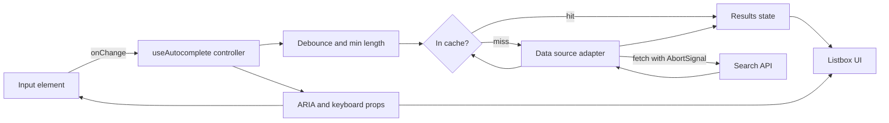

## 1. Requirements exploration

Autocomplete is a **component** question, so the "system" is the component, its public API, and the contract with
whatever data source plugs into it. The interviewer is testing API design, state management, async correctness and
accessibility more than infrastructure.

### Functional requirements

- Text input; as the user types, show a popup list of suggestions.
- Suggestions can come from a **remote API**, a **local list**, or both (recent searches + server results).
- Select with mouse, touch, or keyboard (`↑`/`↓`, `Enter`, `Escape`, `Tab`).
- Custom rendering for suggestions (thumbnail + title + price, avatar + name, highlighted match).
- States: idle, loading, results, empty ("No results for …"), error (with retry).
- Optional grouping (sections: "Recent", "Products", "Categories").
- Single select by default; multi-select (chips/tokens) as an extension.

### Non-functional requirements

| Concern | Target |
| --- | --- |
| Perceived latency | suggestions visible < 200 ms after the user pauses; cached queries < 16 ms (same frame) |
| Server load | ≤ 1 request per pause in typing; zero for repeated queries within the cache TTL |
| Correctness | the list always matches the current input text |
| Input responsiveness | typing never drops frames, even with 1,000 local items or slow rendering |
| Bundle size | < 8 KB gzipped for the core (no heavy dependencies) |
| Accessibility | WAI-ARIA combobox pattern, WCAG 2.2 AA |
| Reusability | usable across frameworks? (Clarify: React-only is assumed here) |

### Out of scope

- The search backend itself (ranking, spell correction, the index). We define what we need from it.
- A full search results page.

### Clarifying questions

1. Who are the consumers? One product or a design-system component used by dozens of teams? (Drives API
   flexibility: headless hooks vs a styled component.)
2. Is the value **free text** (search box: the user can submit anything) or must it be **one of the options**
   (city picker)? This changes `Enter` and blur behaviour.
3. Expected result set size and latency of the backend? Can the server return results for prefixes cheaply?
4. Is the data user-specific (personal contacts — can't share caches across users) or global (product
   catalogue — CDN-cacheable)?
5. Mobile: should the list be a full-screen overlay on small screens?
6. Do we need multi-select, grouping, or creating new options ("Add 'foo'…")?

Assume: design-system component used by many teams, free-text and strict modes, remote + local sources, mobile web
included.

## 2. Architecture / high-level design

### Layering

A lead-level answer separates **behaviour** from **presentation**:

1. **Data source adapter** (`source`): turns a query into suggestions. Remote, local, or composite.
2. **Headless controller hook** (`useAutocomplete`): owns state machine, debounce, caching, race handling,
   keyboard logic and ARIA props. No markup.
3. **Default UI** (`<Autocomplete>`): a styled component built on the hook for the 80% use case, with render props
   for custom items.

Teams with unusual layouts use the hook directly; everyone else uses the component. This is the pattern Downshift,
React Aria and Headless UI follow, and it keeps accessibility logic in one tested place.

```
<Autocomplete>
  <Label />
  <InputWrapper>
    <Chips />               // multi-select only
    <Input />               // role="combobox"
    <ClearButton />
    <Spinner />
  </InputWrapper>
  <Popover>                 // portal, positioned with Floating UI or CSS anchor positioning
    <Listbox>               // role="listbox", virtualized when large
      <Group label="Recent">
        <Option />          // role="option", rendered by renderItem
      <Group label="Products" />
      <EmptyState /> | <ErrorState /> | <Loading />
    </Listbox>
  </Popover>
  <LiveRegion />            // "5 suggestions available"
</Autocomplete>
```



### Internal state machine

Model state explicitly instead of a soup of booleans:

```
idle --type--> debouncing --timer--> loading --success--> showingResults
                                         |--empty---> showingEmpty
                                         |--error---> showingError
any --Escape/blur/select--> idle (closed)
showingResults --type--> debouncing (keep previous results visible, dimmed)
```

Keeping the previous results visible while the next request is in flight (rather than flashing a spinner on every
keystroke) is a big perceived-performance win; mark them `aria-busy` and visually de-emphasize them.

## 3. Data model

### Client state

```ts
interface AutocompleteState<T> {
  inputValue: string;                 // exactly what is in the input (controlled or uncontrolled)
  query: string;                      // normalized, debounced query that results belong to
  isOpen: boolean;
  status: 'idle' | 'loading' | 'success' | 'empty' | 'error';
  items: T[];                         // flat list used for keyboard navigation
  groups?: { label: string; start: number; end: number }[];
  highlightedIndex: number;           // -1 = none
  selectedItems: T[];                 // single select uses [0]
  error?: Error;
}
```

### Cache

```ts
interface CacheEntry<T> {
  items: T[];
  fetchedAt: number;
  complete: boolean;                  // server says this is the full result set for the prefix
}

// Keyed by normalized query plus source-specific params:
// key = `${sourceId}|${locale}|${normalize(query)}`
type QueryCache<T> = Map<string, CacheEntry<T>>; // LRU, e.g. max 100 entries, TTL 5 min
```

Normalization: trim, collapse whitespace, lower-case with `toLocaleLowerCase(locale)`, and Unicode-normalize
(`normalize('NFKC')`) so "Café" typed with a combining accent and a precomposed "é" hit the same entry.

**Prefix refinement**: if the cache has a `complete` result set for `"ap"` (the server returned fewer than the limit),
results for `"app"` are a subset, so we can filter locally and skip the network entirely. This turns many
keystrokes into zero-latency updates.

Where it lives: the cache belongs to the **source**, not the component instance, so two autocompletes on the
same page (or the same one remounted) share it. For user-specific data, the cache is scoped to the session and
cleared on logout.

## 4. Interface definition (API)

### Server API

```http
GET /api/suggest?q=wireless%20hea&limit=8&locale=en-GB&session=s_81f
```

```json
{
  "query": "wireless hea",
  "items": [
    { "id": "sku_1", "type": "product", "title": "Wireless Headphones X2", "thumbnail": "https://cdn.example.com/x2_64.webp",
      "highlights": [[0, 12]] },
    { "id": "cat_9", "type": "category", "title": "Headphones", "highlights": [[0, 3]] }
  ],
  "complete": false
}
```

Notes:

- **Echo the query** in the response so the client can verify the response matches what it asked for (cheap
  defence against reordering, though `AbortController` + request ids already handle it).
- **Highlights from the server** are ranges, not HTML. The client wraps ranges in `<mark>`, avoiding XSS.
- **No pagination** for suggestions: show the top 5–10. If "see all results" is needed, that is a search page with
  cursor pagination.
- Global queries are **GET** with cache headers (`Cache-Control: public, max-age=60, stale-while-revalidate=300`)
  so the CDN absorbs popular prefixes. Personal queries use `private`.
- A `session` token lets the backend correlate keystrokes for analytics/ranking without logging every partial query
  against the user's identity.
- HTTP/2 or HTTP/3 keeps per-request overhead low; `preconnect` to the suggest origin on focus.

### Component API

```ts
interface DataSource<T> {
  id: string;
  fetch(query: string, opts: { signal: AbortSignal; limit: number }): Promise<{ items: T[]; complete?: boolean }>;
  getKey(item: T): string;
  getLabel(item: T): string;            // used for input text and accessible names
  filterLocally?(items: T[], query: string): T[]; // enables prefix refinement
}

interface AutocompleteProps<T> {
  label: string;                        // required: accessible name
  source: DataSource<T> | DataSource<T>[];
  mode?: 'free-text' | 'strict';        // strict: value must be an option
  multiple?: boolean;
  value?: T | T[] | null;               // controlled
  defaultValue?: T | T[] | null;        // uncontrolled
  onChange?: (value: T | T[] | null) => void;
  onInputChange?: (text: string) => void;
  onSubmit?: (text: string) => void;    // free-text Enter without a highlighted option
  minQueryLength?: number;              // default 1 (0 shows recents on focus)
  debounceMs?: number;                  // default 150
  maxItems?: number;                    // default 8
  renderItem?: (item: T, state: { highlighted: boolean; selected: boolean; query: string }) => React.ReactNode;
  renderEmpty?: (query: string) => React.ReactNode;
  placeholder?: string;
  disabled?: boolean;
  id?: string;                          // otherwise useId()
}

// Headless hook
function useAutocomplete<T>(options: Omit<AutocompleteProps<T>, 'renderItem' | 'renderEmpty'>): {
  state: AutocompleteState<T>;
  getInputProps(user?: React.InputHTMLAttributes<HTMLInputElement>): React.InputHTMLAttributes<HTMLInputElement>;
  getListboxProps(): React.HTMLAttributes<HTMLElement>;
  getOptionProps(item: T, index: number): React.HTMLAttributes<HTMLElement>;
  getLabelProps(): React.LabelHTMLAttributes<HTMLLabelElement>;
  open(): void; close(): void; clear(): void;
};
```

Design choices worth calling out:

- **Prop getters** (`getInputProps`) merge the consumer's handlers with ours, so teams can add their own `onKeyDown`
  without breaking navigation.
- Support **controlled and uncontrolled** usage like native inputs.
- `label` is required: a design-system component can enforce accessibility through its API.
- Sources are pluggable, so "recent searches" (localStorage) and "server suggestions" compose into groups.

## 5. Optimizations and deep dives

### Debounce vs throttle, and when to fire

- **Debounce** (≈ 100–200 ms): wait for a pause. Fewer requests; slight delay.
- **Throttle**: guaranteed updates while typing continuously. Better for fast local filtering.
- Common hybrid: filter local/cached results **immediately on every keystroke**, and debounce only the network
  request. The user sees instant feedback and the server sees one request per pause.
- Skip requests below `minQueryLength`, and for queries that only differ by trailing whitespace.

### Race conditions

Typing "ap" then "app": the "ap" response may arrive after "app". Defences, ideally combined:

1. **Abort** the previous request with `AbortController` when a new one starts (also saves bandwidth).
2. **Request id check**: store `latestRequestId`; ignore any response whose id isn't the latest. Abort alone is not
   enough because a response might already be resolving when you abort, or the source may not support signals.
3. Only commit results whose `query` equals the current debounced query.

In React, run the fetch in an effect keyed by the debounced query with cleanup that aborts, or use a server-cache
library (TanStack Query with the query string in the key and `placeholderData: keepPreviousData`), which gives
cancellation, dedupe and caching for free.

### Rendering performance

- Typing must never be blocked by rendering suggestions. With heavy item renderers, use `useDeferredValue` for the
  query passed to the list (React 18+), or `startTransition` for the results update, so keystrokes stay urgent.
- Virtualize only for long lists (e.g. a 5,000-entry local country/time-zone picker); with 8 server suggestions it is
  unnecessary overhead.
- Large local datasets: pre-index once (lower-cased, normalized, maybe a trie or a precomputed search key) and filter
  in a Web Worker if over ~50k items.
- Keep the popover mounted while open and update items in place; keyed by item id to avoid remounting images.

### Keyboard interaction (WAI-ARIA combobox)

| Key | Behaviour |
| --- | --- |
| `↓` / `↑` | open if closed; move highlight, wrapping or stopping at ends (pick one, be consistent) |
| `Enter` | select highlighted option; in free-text mode with no highlight, submit the text |
| `Escape` | close the list; second `Escape` clears the input (per APG guidance) |
| `Tab` | close; in strict mode, optionally select highlighted (debatable — document it) |
| `Home` / `End` | move the caret in the input (don't hijack) |
| `Alt+↓` | open without moving highlight |

Focus **stays in the input**; the highlighted option is communicated via `aria-activedescendant`, and the option is
scrolled into view (`scrollIntoView({ block: 'nearest' })`).

### Accessibility markup

```html
<label id="ac-label" for="ac-input">Search products</label>
<input id="ac-input" role="combobox" aria-autocomplete="list" aria-expanded="true"
       aria-controls="ac-listbox" aria-activedescendant="ac-opt-2" autocomplete="off" />
<ul id="ac-listbox" role="listbox" aria-labelledby="ac-label">
  <li id="ac-opt-1" role="option" aria-selected="false">Wireless headphones</li>
  <li id="ac-opt-2" role="option" aria-selected="true">Wireless earbuds</li>
</ul>
<div role="status" aria-live="polite" class="visually-hidden">8 suggestions available</div>
```

- Announce result counts via a polite live region, debounced so screen readers aren't flooded on every keystroke.
- Highlighted matches use `<mark>`, but the option's accessible name must still read as the full string.
- Ensure 44×44 px touch targets (WCAG 2.2 target size) and visible focus/highlight styles that don't rely on color
  alone.
- Set `autocomplete="off"` on the input to stop the browser's own autofill dropdown from overlapping (or set a
  meaningful token like `address-level2` if browser autofill is desired instead).

### IME and mobile edge cases

- During IME composition (Chinese, Japanese, Korean), `input` events fire for intermediate states. Don't select on
  `Enter` while `event.nativeEvent.isComposing` is true, and consider waiting for `compositionend` before querying.
- Mobile virtual keyboards shrink the viewport: position the popover with the Visual Viewport API or make it a
  full-screen sheet on small screens.
- Blur handling: clicking an option blurs the input before `click` fires. Use `mousedown` + `preventDefault` on
  options (or `pointerdown`) so the list doesn't close before selection.
- Paste of a long string, emoji, and leading/trailing spaces should all behave.

### Positioning and layering

Render the popover in a portal to escape `overflow: hidden` ancestors; position with Floating UI (flip when near the
viewport bottom). Newer options: the **Popover API** (`popover` attribute, top layer, light dismiss) and **CSS anchor
positioning**, which are increasingly supported in 2025 browsers but need fallbacks for older Safari/Firefox
versions.

### Caching strategy summary

| Layer | Scope | Lifetime |
| --- | --- | --- |
| In-memory LRU per source | tab | minutes |
| HTTP cache / CDN | global queries | `max-age` 60 s + SWR |
| Prefix refinement | derived | while parent entry valid |
| Recents in `localStorage` | user/device | until cleared; capped at 10 |

Pre-warm: fetch "trending" or recents on `focus`, before the first keystroke, so the list is ready instantly.

### i18n

- Locale-aware matching: `Intl.Collator(locale, { sensitivity: 'base' })` for accent-insensitive local filtering
  ("resume" matches "résumé").
- RTL: popover aligns with the input's inline-start; icons mirror.
- Pluralized live-region messages via ICU.

### Security and privacy

- Render highlights from ranges, never server HTML. If a team needs rich rendering, they own sanitization.
- Partial queries can contain personal data (people paste emails, phone numbers). Don't log raw keystrokes in client
  analytics; log the final selection and aggregated metrics.
- Rate-limit on the server per session; the client's debounce is not a security control.

### Observability

- Metrics: time from keystroke to results painted, cache hit rate, requests per search session, abort rate, zero-
  result rate, selection position (did users pick #1?), and error rate per source.
- These double as product metrics for the search team.

### Testing

- Unit tests for the reducer/state machine and normalization.
- Hook tests with fake data sources: out-of-order resolution (resolve "ap" after "app" and assert the list shows
  "app" results), abort on unmount, error → retry.
- Testing Library interaction tests for every key in the table above; assert ARIA attributes update.
- Automated a11y (axe) plus a manual screen reader pass (VoiceOver + Safari, NVDA + Firefox/Chrome), since combobox
  announcements differ between screen readers.

## What a lead-level answer adds

- **API design as a product**: headless hook + default component, prop getters, controlled/uncontrolled, strong
  TypeScript generics. Discuss versioning and how to evolve the API without breaking 40 consumer teams (additive
  props, codemods for breaking changes).
- **Correctness under concurrency** explained clearly: abort + latest-request guard, and why each alone is
  insufficient.
- **Accessibility owned centrally**: the component is where a company fixes combobox a11y once for everyone, and a
  lead pushes for screen reader testing in the release checklist.
- **Metrics-driven tuning**: debounce interval, min length and max items chosen from data (p50 inter-keystroke
  interval, server cost per query), not guesses.
- Knows when **not** to build: evaluate React Aria / Downshift before writing a combobox from scratch, and wrap it in
  the design system's styles.

## Common follow-up questions

**How would you support 1 million local items?** Pre-built index (trie or n-gram) built in a worker, search in the
worker, return the top N. Or move it to the server; a million items is several MB to ship.

**How do you implement "recent searches" alongside server results?** A composite source: local recents filtered
synchronously and rendered first in a "Recent" group; server results appended when they arrive, deduped by key.

**How do you test the race condition?** Use a fake source that returns controllable promises; type "a", "ab"; resolve
"ab" then "a"; assert the list shows only "ab" results.

**Should the first option be auto-highlighted?** For strict pickers, often yes (Enter selects the best match). For
free-text search, no — Enter should submit what the user typed. Make it an option.

**Where do you put the debounce — in the component or the source?** In the controller, configurable per instance,
because it is about user typing behaviour, while caching belongs to the source because it is about data.

**How does this change with React Server Components?** The input is interactive, so the component stays a client
component; suggestions could be streamed from a server action, but a plain cached GET is usually simpler and
CDN-friendly.
