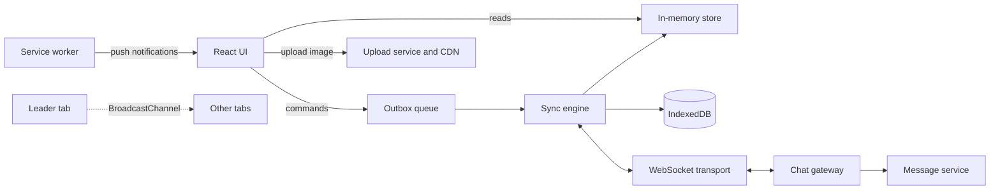

## 1. Requirements exploration

Chat is a **distributed systems problem that happens to have a UI**. The hard parts are ordering, delivery
guarantees, reconnection, multi-tab consistency and long histories, not the message bubble. Establish that early.

### Functional requirements

- Conversation list sorted by most recent activity, with unread counts, last-message preview and presence dots.
- Open a conversation: load the latest messages, scroll up to load older history.
- Send text, emoji and images; reply to a message; react to a message.
- Delivery states per message: **sending → sent → delivered → read**, with "seen by" avatars in groups.
- Typing indicators ("Ana is typing…") and online/last-active presence.
- Unread badge in the tab title and browser notifications when the tab is in the background.
- Search within a conversation (stretch).

### Non-functional requirements

| Concern | Target |
| --- | --- |
| Message latency | p95 < 500 ms sender → recipient when both online |
| Send feedback | the bubble appears in < 50 ms (optimistic) |
| Delivery guarantee | **at-least-once** over the wire, **exactly-once in the UI** (dedupe) |
| Ordering | consistent per conversation for all participants |
| Reconnect | resume within 2 s after network returns, without losing or duplicating messages |
| Scroll | smooth through 10k+ loaded messages; bounded memory |
| Cold start | conversation list visible in < 1.5 s on repeat visits (from local cache) |
| Multi-tab | read state and new messages consistent across tabs |

### Out of scope

- Voice/video calls (see the video conferencing question), stories, payments.
- Server-side storage, fan-out and push infrastructure (we treat them as black boxes with an API).

### Clarifying questions

1. Max group size? 250 changes how we do read receipts (aggregate) versus 2-person chats (per user).
2. Do we need **end-to-end encryption**? It moves search, previews and history sync onto the client.
3. Must history be available offline, and how much (last 30 days? everything)?
4. Message edit/delete ("unsend") support? Affects the event model.
5. Are attachments limited to images, or arbitrary files with size limits?
6. Is there an existing WebSocket gateway, or do we choose the transport?

Assumptions: groups ≤ 250, no E2EE in v1 (discussed at the end), last 30 days cached offline, edit/delete supported
as events, WebSocket gateway available.

## 2. Architecture / high-level design

### Core idea: an event-sourced local database

The UI never talks to the network directly. It reads from a **local store** (in-memory + IndexedDB) and writes
**commands** into an **outbox**. A sync engine reconciles the local store with the server over a WebSocket. This
makes the app instant (reads are local), offline-capable (writes queue), and correct across reconnections (sync is
resumable from a cursor). Messenger's "LightSpeed" rewrite moved logic into a local database for similar reasons.

### Component tree

```
<ChatApp>
  <ConnectionBanner />               // "Connecting…", "Offline – messages will send later"
  <Sidebar>
    <ConversationSearch />
    <ConversationList>               // virtualized
      <ConversationRow />            // avatar, name, preview, time, unread badge, presence
  <ConversationPane>
    <ConversationHeader />           // name, presence, call buttons
    <MessageList>                    // reverse-scrolling, virtualized
      <DayDivider />
      <MessageGroup>                 // consecutive messages by same sender
        <MessageBubble />            // text, image, reply preview, reactions, status
      <TypingIndicator />
    <Composer />                     // textarea, attachments, emoji, send
```

### Client modules

- **Transport**: owns one WebSocket, heartbeats, exponential backoff with jitter, and auth refresh.
- **Sync engine**: on connect, sends the last known sync cursor and applies the delta; then applies live events.
  Assigns sequence numbers, dedupes, and acks.
- **Outbox**: persistent queue of pending commands (send, react, mark-read) with `clientMessageId`s.
- **Local DB**: IndexedDB (via Dexie or idb) for conversations and recent messages; an in-memory normalized store for
  what is rendered.
- **Tab coordinator**: elects one **leader tab** that owns the WebSocket (Web Locks API), and fans events out to
  other tabs over `BroadcastChannel`. Alternative: a `SharedWorker` holds the socket (not available on all mobile
  browsers, so keep the leader election fallback).
- **Notification service**: Web Push via a service worker for background tabs and closed browsers; `document.title`
  badge for unread count.



## 3. Data model

### Server data vs client state

| Data | Owner | Client location |
| --- | --- | --- |
| Conversations, participants | server | IndexedDB + memory |
| Messages | server (authoritative order) | IndexedDB (recent N per conversation) + memory window |
| Pending outgoing messages | client until acked | outbox (IndexedDB) |
| Read/delivered watermarks | server | memory + IndexedDB |
| Typing, presence | server, ephemeral | memory only, TTL-based |
| Draft text per conversation | client | IndexedDB / localStorage |
| Scroll position, open conversation | client | memory / URL (`/t/:conversationId`) |

### Shapes

```ts
type ID = string;

interface Conversation {
  id: ID;
  type: 'direct' | 'group';
  title?: string;
  participantIds: ID[];
  lastMessageId: ID | null;
  lastActivityAt: string;
  unreadCount: number;           // derived on server, adjusted locally
  myReadSeq: number;             // highest seq I have read
  muted: boolean;
}

interface Message {
  id: ID | null;                 // server id, null until acked
  clientMessageId: ID;           // uuid generated on the client, stable forever
  conversationId: ID;
  senderId: ID;
  seq: number | null;            // server-assigned, monotonic per conversation
  createdAt: string;             // server time once acked; local time while pending
  kind: 'text' | 'image' | 'system';
  text?: string;
  attachments?: { uploadId: ID; url?: string; width: number; height: number; localBlobUrl?: string }[];
  replyToId?: ID;
  reactions: Record<string, ID[]>; // emoji -> userIds
  editedAt?: string;
  deleted?: boolean;
  status: 'pending' | 'sent' | 'failed'; // client-only for own messages
}

interface ParticipantReceipt {
  userId: ID;
  deliveredSeq: number;          // watermark, not per-message flags
  readSeq: number;
}

interface ChatStore {
  conversations: Record<ID, Conversation>;
  conversationOrder: ID[];                  // sorted by lastActivityAt
  messagesByConversation: Record<ID, {
    byKey: Record<ID, Message>;             // keyed by clientMessageId
    orderedKeys: ID[];                      // by seq, pending at the end
    oldestLoadedSeq: number | null;
    hasMoreBefore: boolean;
  }>;
  receipts: Record<ID, Record<ID, ParticipantReceipt>>; // conversationId -> userId -> receipt
  typing: Record<ID, Record<ID, number>>;   // conversationId -> userId -> expiresAt
  syncCursor: string | null;                // global per-user sync position
}
```

Key decisions:

- **Watermarks, not per-message flags.** "Read up to seq 1042" is one integer per participant per conversation, so
  "seen by" in a 250-person group is O(participants), not O(messages × participants). A message is read by a user
  if `message.seq <= receipt.readSeq`.
- **Server-assigned `seq` defines order**, not client timestamps (clocks drift). Pending messages render at the
  bottom in local order until their `seq` arrives.
- **`clientMessageId` is the stable key** for React and for dedupe, so the bubble does not remount (and lose focus or
  animation state) when the server id arrives.

## 4. Interface definition (API)

### Transport choice

- **WebSocket**: bidirectional, low overhead per message, the standard choice. Needs heartbeats and reconnection
  logic; some corporate proxies break it.
- **SSE + HTTP POST**: server-to-client stream plus normal requests for sends. Simpler, works well over HTTP/2,
  automatic reconnect with `Last-Event-ID`. A good fallback.
- **Long polling**: last-resort fallback.
- **WebTransport**: promising (HTTP/3, unreliable datagrams for typing/presence), but not universally supported yet.

I would use a WebSocket with an SSE/long-poll fallback, behind one transport interface.

### Sync protocol

```json
// Client -> server after connect (auth via cookie or a short-lived token in the first frame, never in the URL)
{ "type": "hello", "cursor": "c_88310", "clientVersion": "2025.03.1" }

// Server -> client: events since the cursor, paged
{ "type": "sync", "events": [
    { "type": "message.new", "conversationId": "cv_1", "message": { "id": "m_901", "clientMessageId": "a1b2", "seq": 1043, "senderId": "u_2", "text": "hey", "createdAt": "2025-03-02T10:00:00Z" } },
    { "type": "receipt", "conversationId": "cv_1", "userId": "u_2", "readSeq": 1041 }
  ],
  "nextCursor": "c_88312", "hasMore": false }

// Client -> server: send
{ "type": "message.send", "conversationId": "cv_1", "clientMessageId": "5f0c-...", "text": "On my way" }

// Server -> client: ack (also broadcast as message.new to other devices, carrying the same clientMessageId)
{ "type": "ack", "clientMessageId": "5f0c-...", "id": "m_902", "seq": 1044, "createdAt": "2025-03-02T10:00:03Z" }

// Ephemeral
{ "type": "typing", "conversationId": "cv_1", "userId": "u_2", "state": "start" }
{ "type": "presence", "userId": "u_2", "status": "online" }

// Client -> server: read watermark (throttled)
{ "type": "read", "conversationId": "cv_1", "readSeq": 1044 }
```

Every event that changes durable state carries a position in the user's event stream. After a disconnect, the
client sends its last cursor and receives exactly what it missed. If the cursor is too old (e.g. offline for a
month), the server responds with `resync_required` and the client refetches conversations from scratch.

### REST for history and uploads

```http
GET /api/conversations?cursor=...&limit=30
GET /api/conversations/cv_1/messages?beforeSeq=1000&limit=50
POST /api/uploads   -> { "uploadId": "up_9", "putUrl": "https://storage.example.com/...signed" }
```

History pagination uses **`beforeSeq` (a keyset cursor)**: new messages keep arriving at the end, so an offset
would shift on every incoming message. Keyset pagination is also an efficient index lookup on the server.

### Component props

```ts
interface MessageListProps {
  conversationId: ID;
  keys: ID[];                         // clientMessageIds in display order
  hasMoreBefore: boolean;
  onLoadOlder: () => Promise<void>;
  onVisibleRangeChange: (lastVisibleSeq: number) => void; // drives read receipts
}

interface ComposerProps {
  conversationId: ID;
  initialDraft: string;
  onSend: (input: { text: string; files: File[]; replyToId?: ID }) => void;
  onTyping: () => void;                // throttled inside the composer
  disabled?: boolean;
}
```

## 5. Optimizations and deep dives

### Sending: optimistic, idempotent, ordered

1. Generate `clientMessageId` (`crypto.randomUUID()`), insert the message with `status: 'pending'`, append to the
   outbox in IndexedDB (so a crash or reload doesn't lose it).
2. If connected, send immediately; otherwise wait for reconnection.
3. On `ack`, set `id`, `seq`, `createdAt`, `status: 'sent'`, remove from outbox, and move the message into its seq
   position (usually unchanged).
4. If no ack within a timeout, retry with the **same** `clientMessageId`; the server dedupes. After N attempts,
   mark `failed` with "Tap to retry".
5. Send messages per conversation **in order**: don't send message 2 before message 1 is acked, or recipients may
   see them reversed. Different conversations can proceed in parallel.

Images: show the local `URL.createObjectURL(file)` preview immediately, resize/compress client-side (canvas or
`createImageBitmap` in a worker) to cap size, upload via pre-signed URL with progress, then send the message
referencing `uploadId`. Revoke the object URL afterwards.

### Receiving and dedupe

The same message can arrive via the live socket, the sync replay and the sender's own ack. Merge by
`clientMessageId` and treat updates as idempotent upserts. Ignore events whose entity version is older than what is
stored (edits can race).

### Reconnection

- Detect dead sockets with application-level heartbeats (ping every 25–30 s; consider dead after 2 missed pongs),
  since TCP may not report a dropped mobile connection for minutes.
- Reconnect with exponential backoff + full jitter (e.g. 0.5 s → 30 s cap) to avoid thundering herds after an
  outage. Reconnect immediately on `online` and `visibilitychange` to visible.
- After reconnect: send `hello` with cursor → apply delta → flush outbox in order.

### Long histories and scrolling

- **Reverse-anchored virtualization**: chat starts at the bottom and loads upward. When older messages are
  prepended, preserve the visual position by adjusting `scrollTop` by the height added (or use
  `overflow-anchor` / a virtualizer that supports prepending). Variable heights (images, long text) need measured
  sizes cached by `clientMessageId`.
- Keep only a window of messages in memory (e.g. 500 around the viewport); evict the rest and reload from IndexedDB
  or the server on demand.
- **Stick to bottom** only if the user is already at the bottom; otherwise show "↓ 3 new messages" instead of yanking
  the scroll position.
- Images have known dimensions in the payload, so space is reserved before load (no jumps).

### Read receipts and typing

- Report read state from what is actually visible: an `IntersectionObserver` on the last bubbles, only while the
  document is visible and focused. Throttle `read` events (e.g. at most every 1 s) and send only the max seq.
- Typing: send `start` at most every 3 s while the user types, `stop` on send/blur. Receivers expire typing state
  after ~5 s without a refresh, so a crashed client never shows "typing…" forever.
- Presence is coarse and eventually consistent; don't let presence events cause list re-sorting.

### Multi-tab

- Use `navigator.locks.request('chat-socket', ...)` to elect a leader that owns the socket; other tabs receive events
  via `BroadcastChannel` and send commands to the leader. When the leader closes, the lock is released and another
  tab takes over.
- All tabs write the same IndexedDB; mark-as-read in one tab propagates to all, and the unread badge stays in sync.
- Only one tab should show a notification for a given message (leader decides, or use the notification `tag` to
  collapse duplicates).

### Offline

- Service worker caches the app shell; IndexedDB holds conversations and recent messages so the app opens offline.
- The outbox persists; on reconnect it flushes. Background Sync can flush even after the tab closes where supported
  (Chromium), otherwise flush on next open.
- Show clear state: banner + per-message "pending" clock icon.

### Rendering performance

- Conversation list and message list both virtualized; rows subscribe to their own entity so a new message in one
  conversation re-renders one row and the reorder, not 500 rows.
- High-frequency events (typing, presence, receipts in big groups) are **batched** per animation frame before
  hitting React state.
- Parse/format heavy work (link detection, emoji, markdown-lite) is memoized per message and computed once.
- Move the sync engine and IndexedDB writes into a **Web Worker** if profiling shows main-thread contention;
  communicate via `postMessage` with transferable data.

### Accessibility

- The message list is a `role="log"` with `aria-live="polite"` so screen readers announce new incoming messages
  (but not every historical message on load — set the live region only after initial render).
- Each message has an accessible name including sender and time ("Ana, 10:03, Hey there").
- Composer: `Enter` sends, `Shift+Enter` newline, documented; IME composition (`isComposing`) must not send on
  `Enter` for CJK input.
- Keyboard navigation between conversations (`Alt+↑/↓`), focus moves to the composer on open, and focus is not
  stolen when new messages arrive.
- Delivery status icons have text alternatives ("Read by 3").

### Internationalization

- Per-message `dir="auto"` so mixed-language conversations render correctly; the bubble alignment uses logical
  properties so "my messages" flip sides in RTL.
- Time/day dividers via `Intl.DateTimeFormat` in the user's time zone ("Today", "Yesterday" via
  `Intl.RelativeTimeFormat`).
- Emoji and grapheme-aware truncation for previews (`Intl.Segmenter`) so a family emoji isn't cut in half.

### Security

- Treat all message content as untrusted: render as text; linkify by building anchor elements from parsed ranges;
  never `dangerouslySetInnerHTML`.
- Authenticate the socket with a cookie or a short-lived token sent in the first frame; validate `Origin` on the
  server to prevent cross-site WebSocket hijacking.
- Strict CSP including `connect-src` limited to the gateway; images served from a separate sandboxed domain;
  link previews generated server-side to avoid leaking the user's IP.
- Clear IndexedDB on logout; consider encrypting cached data at rest when E2EE is enabled.
- Rate-limit sends client-side to protect against runaway loops.

### End-to-end encryption (stretch)

With E2EE (Signal protocol, as in WhatsApp and Messenger), the server only stores ciphertext. The client must
manage keys per device (stored in IndexedDB, non-extractable `CryptoKey` via WebCrypto where possible), decrypt
every message, generate previews and search indexes locally, and handle device linking/history sync. Search and
notifications become client problems: push payloads carry no plaintext, and the service worker decrypts.

### Observability

- Metrics: send → ack latency, send → delivered latency, reconnect count and duration, outbox depth, failed sends,
  duplicate-suppressed count (a high number reveals a server bug), IndexedDB quota errors.
- Trace a message end to end with the `clientMessageId` as a correlation id across client logs and server.

### Testing

- Unit-test the sync engine as a pure reducer: given events in any order, with duplicates and gaps, the resulting
  state is identical (property-based tests are great here).
- Integration tests with a fake WebSocket server that drops, delays, duplicates and reorders frames.
- Playwright multi-context tests: two users, two tabs each, offline toggling via `context.setOffline(true)`.
- Accessibility checks on message list announcements.

## What a lead-level answer adds

- Names the **consistency model** explicitly: at-least-once delivery + idempotent client = effectively exactly-once
  display; per-conversation total order via server `seq`.
- Treats the client as a **replica** with a sync protocol and recovery path (`resync_required`), not as a socket
  listener. This is what makes multi-device, multi-tab and offline fall out naturally.
- Plans the **migration path**: e.g. moving from in-memory Redux to a local-first DB, behind a feature flag, with
  dual-write and metrics comparing unread counts between the two.
- Considers **cost and scale**: one socket per user (not per tab), batching receipts, coarse presence, and
  heartbeat intervals tuned against mobile battery and load-balancer idle timeouts.
- Aligns with other clients: the protocol and event schema are shared with iOS/Android and versioned.

## Common follow-up questions

**How do you guarantee order if two people send at the same time?** The server assigns `seq` per conversation;
both clients reorder their optimistic messages once acks/events arrive. Locally, a user's own messages stay in send
order because the outbox is sequential per conversation.

**What if the ack is lost but the server stored the message?** The client retries with the same
`clientMessageId`; the server returns the existing message instead of creating a duplicate.

**How do you show unread counts correctly across devices?** The server owns `readSeq`; unread = messages with seq
greater than `readSeq` not sent by me. Locally we update optimistically and reconcile on the next event.

**How would you implement search?** Server-side search API for full history; local search over IndexedDB for
recent messages to get instant results. With E2EE, only local search (build an index in a worker).

**Why not store everything in IndexedDB forever?** Storage quotas and eviction (browsers may clear storage under
pressure unless `navigator.storage.persist()` is granted). Cache a bounded window and treat the server as the source
of truth.

**How do you handle 10,000 unread messages in a group?** Don't load them all: jump to the first unread with a
"Jump to latest" button, load windows around the anchor, and show the count from the server.
