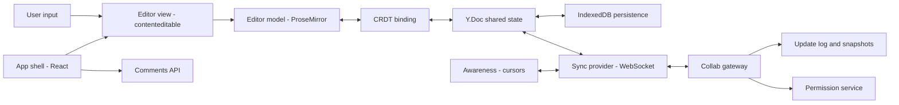

## 1. Requirements exploration

A collaborative editor is two hard problems glued together: a **rich-text editor** (a structured document, a
selection model, input handling) and a **replicated data structure** (many replicas editing concurrently and
converging). Interviewers want to see that you know which decisions belong to which half, and that you can pick a
concurrency strategy and defend it.

### Functional requirements

- Open a document, render it, edit rich text: paragraphs, headings, bold/italic/underline, lists, links, inline
  images, simple tables.
- Real-time co-editing: remote changes appear within ~200 ms; no edit is ever lost or duplicated.
- **Presence**: who is here (avatars), remote cursors and selections in the collaborator's colour, "X is typing".
- **Comments**: anchored to a text range; the anchor follows the text as it is edited; threads, resolve.
- **Offline**: keep editing for minutes or hours without a connection; merge on reconnect.
- **Version history**: named and automatic snapshots, diff view ("changes since"), restore.
- Permissions: viewer (read-only), commenter, editor, owner.
- Undo/redo that only undoes *my* changes, not a collaborator's.

### Non-functional requirements

| Concern | Target |
| --- | --- |
| Local keystroke latency | input to paint < 16 ms p95 (one frame) regardless of network |
| Remote propagation | p50 < 150 ms, p95 < 500 ms between two clients in the same region |
| Document size | 100+ pages (~300k characters, a few thousand blocks); open in < 2 s on a mid-range laptop |
| Concurrency | 50 editors, 500 viewers on one doc |
| Convergence | all replicas reach the identical document once they have seen the same set of operations |
| Durability | an acknowledged edit survives a server crash; an unacknowledged one survives a tab crash (IndexedDB) |
| Accessibility | editable region usable with screen readers (NVDA, JAWS, VoiceOver), keyboard-only, IME input |

### Out of scope

- Server storage engine, search indexing, document export to PDF/DOCX.
- Spreadsheets and drawings embedded in documents (treat as opaque embeds).
- Suggestion mode ("track changes") — mention as a follow-up.

### Clarifying questions

1. Is a central server always involved, or must peer-to-peer/local-first work? (Strongly influences OT vs CRDT.)
2. How long can a client be offline? Seconds (reconnect blips) or days (field workers)?
3. Do we have an existing editor investment (ProseMirror, Lexical, Slate, a home-grown engine)?
4. Is end-to-end encryption a requirement? (A server that cannot read the document cannot run OT transforms.)
5. How important is history granularity — every keystroke, or snapshots every few minutes?
6. Mobile web support, or desktop browsers only?

Assume: central server available, offline for up to a day, desktop + tablet browsers, no E2EE, React app shell.

## 2. Architecture / high-level design

### Choosing the concurrency model first

Everything else depends on this, so state the decision up front.

**Operational Transformation (OT).** Each edit is an operation such as `insert(pos=42, "x")`. When two operations
are concurrent, a transform function rewrites one against the other so positions stay correct. Production OT
(Google Docs, early Etherpad, ShareDB) relies on a **central server that defines a total order**: the client sends
one batch at a time, the server transforms it against anything committed since the client's base version, assigns a
version number and broadcasts. The client keeps an *in-flight* batch and a *pending* buffer and transforms incoming
remote ops against both.

- Pros: compact operations, small documents in memory (no per-character metadata), history is a simple log, the
  server can validate every op (permissions, schema).
- Cons: transform functions for rich-text trees are notoriously hard to get right (every pair of op types needs a
  transform, and the TP1 property must hold); long offline periods mean transforming against a huge backlog;
  needs the server online to make progress.

**CRDTs (Conflict-free Replicated Data Types).** Each character (or run of characters) gets a unique, immutable ID
(`clientId`, `clock`) and is placed relative to its neighbours' IDs, not by index. Merging is commutative,
associative and idempotent, so updates can arrive in any order, be duplicated, or flow peer-to-peer and replicas
still converge.

- **Yjs** uses the YATA algorithm, merges adjacent inserts from the same client into a single struct, and is very
  fast and compact in practice. Deleted content is garbage-collected into small tombstone ranges unless you disable
  GC to keep full history. It has mature bindings (`y-prosemirror`, `y-codemirror`, Lexical, Tiptap), an awareness
  protocol for presence, and providers for WebSocket, WebRTC and IndexedDB.
- **Automerge** (2.x, Rust core compiled to WebAssembly) keeps the full operation history by default with a columnar
  binary encoding, which makes history, diffs and branching natural; it has rich-text marks based on the Peritext
  research. Historically heavier than Yjs, though the gap has narrowed.
- Pros: offline and multi-device are first-class; no transform functions to write; the server can be a dumb relay
  plus storage.
- Cons: metadata overhead (IDs, tombstones), harder to enforce server-side validation (the server must decode and
  check updates), schema constraints (e.g. "a list item must be inside a list") can be violated by a merge and need a
  normalisation pass, and intention preservation for formatting spans needs care.

**Decision.** For a new build in 2025 with day-long offline, I would choose a **CRDT (Yjs)** bound to a
**model-based editor (ProseMirror via Tiptap, or Lexical)**, with a central server acting as relay, persistence and
permission gate. I would say clearly that OT with a central server is equally valid when offline is short and the
team already owns a proven OT engine; Google Docs works this way.

### Client components

| Component | Responsibility |
| --- | --- |
| **App shell** | routing, auth, document list, toolbar, sharing dialog (React) |
| **Editor view** | renders the document model to a `contenteditable` DOM, maps DOM selection to model positions, handles `beforeinput`, IME composition, paste |
| **Document model** | schema-validated tree (ProseMirror `Node`/Lexical nodes), the editor's source of truth for rendering |
| **CRDT binding** | two-way sync between the editor model and the shared `Y.XmlFragment`; converts local transactions to CRDT ops and remote CRDT events to editor transactions |
| **Sync provider** | WebSocket connection, sync handshake, batching, reconnect with backoff, auth refresh |
| **Persistence provider** | stores CRDT updates in IndexedDB; loads the local copy before the network responds |
| **Awareness/presence** | ephemeral state per client: user, colour, cursor anchor/head as CRDT relative positions |
| **Comments store** | comment threads (server REST/GraphQL) + anchors stored as relative positions or as marks in the CRDT |
| **Undo manager** | scoped to local origin so it only reverts my changes |
| **History panel** | lists snapshots, renders diffs, triggers restore |



### Lifecycle of a keystroke

1. Browser fires `beforeinput` (`insertText`). The editor view prevents default where needed and creates a model
   transaction; the view updates the DOM synchronously. The user sees the character in the same frame.
2. The binding observes the transaction and applies the equivalent change to the `Y.Doc` with origin `local`.
3. Yjs emits an `update` (a few dozen bytes). The persistence provider appends it to IndexedDB; the sync provider
   batches updates for ~20–50 ms and sends them.
4. The gateway checks permission, appends to the document's update log, and broadcasts to other clients in the room.
5. Remote clients apply the update to their `Y.Doc`; the binding translates the resulting events into an editor
   transaction tagged `remote` (excluded from the local undo stack) and the view patches the DOM.

## 3. Data model

### Shared (replicated) state

```ts
// The Y.Doc is the replicated source of truth.
type SharedDoc = {
  content: Y.XmlFragment;          // the rich-text tree: paragraphs, headings, lists, tables
  meta: Y.Map<unknown>;            // title, page setup, default styles
  commentAnchors: Y.Map<AnchorRef>; // commentId -> relative range (see below)
};

type AnchorRef = {
  start: Uint8Array; // encoded Y.RelativePosition
  end: Uint8Array;
};
```

Relative positions are the key idea for anything that must "stick" to text (cursors, comments): instead of an index
that shifts with every edit, store the ID of the character the position is attached to. Converting back to an
absolute index happens at render time.

### Editor model (derived)

```ts
// ProseMirror-like schema, simplified
type BlockNode =
  | { type: 'paragraph'; attrs: { align?: 'left' | 'center' | 'right' }; content: InlineNode[] }
  | { type: 'heading'; attrs: { level: 1 | 2 | 3 }; content: InlineNode[] }
  | { type: 'bulletList' | 'orderedList'; content: ListItem[] }
  | { type: 'table'; content: TableRow[] }
  | { type: 'image'; attrs: { src: string; alt: string; width?: number } };

type InlineNode = { type: 'text'; text: string; marks: Mark[] };
type Mark =
  | { type: 'bold' | 'italic' | 'underline' | 'code' }
  | { type: 'link'; attrs: { href: string } }
  | { type: 'comment'; attrs: { id: string } };
```

### Ephemeral and server-only data

```ts
type AwarenessState = {
  user: { id: string; name: string; color: string; avatarUrl?: string };
  cursor: { anchor: Uint8Array; head: Uint8Array } | null; // relative positions
  lastActiveAt: number;
};

type CommentThread = {
  id: string;
  docId: string;
  resolved: boolean;
  comments: { id: string; authorId: string; body: string; createdAt: string }[];
};

type Snapshot = {
  id: string;
  docId: string;
  createdAt: string;
  label?: string;            // "Final draft"
  stateVector: Uint8Array;   // Yjs state vector at that point
  authors: string[];
};
```

Where each lives: the `Y.Doc` in memory plus IndexedDB; awareness only in memory (never persisted); comments and
snapshot metadata in a server cache (TanStack Query or similar); UI state (open panels, toolbar state) in React
state. The editor model is **derived** from the `Y.Doc` and must never be edited directly by app code.

## 4. Interface definition (API)

### REST

```http
GET  /api/docs/:docId            -> { id, title, role: "editor", createdAt, ownerId }
GET  /api/docs/:docId/snapshots?cursor=...   -> { items: Snapshot[], nextCursor }
POST /api/docs/:docId/snapshots  { label }   -> Snapshot
POST /api/docs/:docId/restore    { snapshotId } -> 202
GET  /api/docs/:docId/comments   -> { threads: CommentThread[] }
POST /api/docs/:docId/comments   { anchor, body } -> CommentThread
POST /api/docs/:docId/collab-token -> { token, expiresAt, wsUrl }
```

The collab token is short-lived and scoped to one document and role, so the WebSocket gateway can authorise without
a database round trip.

### WebSocket protocol (binary frames)

```ts
type ClientMessage =
  | { t: 'sync-step-1'; stateVector: Uint8Array }  // "here is what I have"
  | { t: 'sync-step-2'; update: Uint8Array }        // "here is what you are missing"
  | { t: 'update'; update: Uint8Array; clientSeq: number }
  | { t: 'awareness'; update: Uint8Array }
  | { t: 'ping' };

type ServerMessage =
  | { t: 'sync-step-1'; stateVector: Uint8Array }
  | { t: 'sync-step-2'; update: Uint8Array }
  | { t: 'update'; update: Uint8Array; origin: string }
  | { t: 'ack'; clientSeq: number }                 // persisted durably
  | { t: 'awareness'; update: Uint8Array }
  | { t: 'error'; code: 'FORBIDDEN' | 'DOC_TOO_LARGE' | 'TOKEN_EXPIRED'; message: string };
```

On connect, both sides exchange state vectors and send each other only the missing updates. This is the whole
reconnect story for a CRDT: no special "replay" logic, because applying an update twice is a no-op. The `ack` lets
the client mark local updates as durable, which drives the "All changes saved" indicator.

A viewer's connection is receive-only: the gateway drops `update` messages from viewers and commenters (commenters
may update `commentAnchors` only, which the gateway checks by decoding the update and inspecting which shared types it
touches).

### Editor component API

```ts
interface CollaborativeEditorProps {
  docId: string;
  role: 'viewer' | 'commenter' | 'editor' | 'owner';
  user: { id: string; name: string; color: string };
  onSaveStateChange?: (s: 'saved' | 'saving' | 'offline' | 'error') => void;
  onSelectionChange?: (sel: { from: number; to: number; marks: string[] }) => void;
  extensions?: EditorExtension[]; // tables, mentions, embeds, slash commands
}
```

## 5. Optimizations and deep dives

### contenteditable vs model-based editing

Raw `contenteditable` plus `document.execCommand` produces inconsistent HTML across browsers and offers no reliable
model to sync. Modern editors (ProseMirror, Lexical, Slate) keep a **schema-validated model**, treat the DOM as a
render target, and use `beforeinput` events (Input Events Level 2) to translate intent (`insertText`,
`deleteContentBackward`, `insertFromPaste`) into model transactions. They still rely on `contenteditable` because it
gives native caret, selection, spellcheck, IME and accessibility for free. The hard part is reconciling when the
browser mutates the DOM anyway (IME composition on Android, autocorrect, spellcheck replacements): editors use a
`MutationObserver` to read the change back into the model. A lead candidate mentions that remote updates must
**not** be applied mid-composition in a way that destroys the composing text node; buffer remote transactions until
`compositionend` or map around the composition range.

Google Docs went further and renders to its own layout engine (moving towards canvas) to get exact pagination; that
is a huge investment justified only for page-faithful layout. For most products, a DOM-based model editor is right.

### Rich-text semantics under concurrency

- Two users bold overlapping ranges: with marks stored as attributes on characters (Yjs `format` on `Y.Text`, or
  ProseMirror marks mapped to XML attributes) the result is the union. Peritext-style spans define whether text typed
  at a mark's boundary inherits it (bold should expand at the end; links should not).
- One user deletes a paragraph while another types in it: CRDTs keep the inserted characters attached to deleted
  parents' positions; the binding must decide whether that text appears. Yjs keeps it in the surviving structure
  where possible; write tests for this.
- Schema violations after merge (e.g. a list item orphaned outside a list): run a **normalisation** transaction
  locally after applying remote updates. Every client must normalise deterministically, or replicas diverge in shape.

### Performance in a 100-page document

- **Incremental rendering**: the editor view diffs only changed nodes (ProseMirror reuses DOM for unchanged nodes by
  identity). Never re-render the whole document in React; the editor owns its DOM subtree and React only renders
  chrome around it.
- **Lazy decoration**: remote cursors, spell-check underlines and comment highlights are decorations computed only
  for the visible viewport plus margin.
- **Virtualizing blocks** is possible but risky: off-screen blocks still must exist for find-in-page, screen
  readers and selection across pages. Prefer `content-visibility: auto` with `contain-intrinsic-size` on block
  containers, which skips layout and paint while keeping the DOM present.
- **Decode off the main thread**: on open, load the snapshot + update tail in a Web Worker, then transfer the merged
  binary update to the main thread. Yjs decoding of a large document can take tens of milliseconds; keep it out of
  the critical path of first paint by rendering a server-rendered read-only HTML preview first, then hydrating the
  editor.
- **Batching**: coalesce local updates for 20–50 ms before sending (Yjs `mergeUpdates`); throttle awareness
  updates to ~10/s.
- **Compaction**: the server periodically merges the update log into a snapshot so a cold load is "one snapshot +
  short tail", not 100k tiny updates.

### Offline and durability

- Write every local update to IndexedDB (`y-indexeddb`) before or concurrently with sending. On reload, the local
  state renders immediately and the sync handshake fills the gap.
- Request persistent storage (`navigator.storage.persist()`) for heavy users so the browser does not evict the data.
- Show honest status: "Saved", "Saving…", "Offline — changes saved on this device". Warn on `beforeunload` only if
  there are updates neither acked nor persisted locally.
- Permission changes while offline: if the user was downgraded to viewer, the server rejects their backlog. Do not
  silently drop it: keep the rejected updates, show "You no longer have edit access", and offer "copy my changes".
- Multiple tabs: use `BroadcastChannel` so tabs of the same doc share updates locally and one tab can hold the
  socket (or each tab connects; the CRDT tolerates duplicates).

### Presence and cursors

- Awareness state is a separate, last-writer-wins map per client with a timeout (~30 s) so crashed clients
  disappear.
- Cursors are stored as relative positions and rendered as decorations: a 2 px caret plus a name label that fades
  after inactivity. For 50 editors, cap rendered labels and collapse to avatars in the header.
- Throttle cursor broadcasts and only send when the selection actually changes.

### Undo/redo

A global undo would revert collaborators' work. Use a per-client undo manager that tracks only transactions with
origin `local` (Yjs `UndoManager` with `trackedOrigins`). Undoing an insert that a collaborator has since edited
around still works because the CRDT reverts by item ID, not position. Group keystrokes into undo steps by time
(~500 ms) and by word boundaries.

### Version history

- Automatic snapshots on idle (e.g. after 5 minutes of no edits) and named snapshots on demand.
- With Yjs, snapshots require keeping deleted content (disable GC, or keep full update log server-side and rebuild
  old states there). Automerge keeps history natively, which is one reason to prefer it if history is a core
  feature.
- The diff view renders two states and marks insertions/deletions with author colours. Compute it server-side or in
  a worker for long documents.
- Restore = create a **new** change that sets the content to the old state (never rewrite history), so collaborators
  converge on the restore like any other edit.

### Security

- Sanitise pasted HTML through the schema (unknown nodes and attributes dropped); never insert raw HTML.
- Validate link `href` protocols (`http`, `https`, `mailto`) to block `javascript:` URLs.
- The gateway enforces roles per connection, decodes updates and rejects oversized or malformed ones (a malicious
  client could otherwise send a gigabyte insert).
- CSP with no inline scripts; images proxied to avoid leaking viewers' IPs.

### Accessibility

- Keep the document in real DOM with semantic elements (`h1`–`h3`, `ul/ol`, `table`) inside a `contenteditable`
  region with `role="textbox"` and `aria-multiline="true"` and an accessible name.
- Announce collaborator join/leave and save state via a polite `aria-live` region, rate-limited so it does not
  chatter.
- Remote cursor labels are `aria-hidden`; provide a "collaborators" panel that lists who is where in text form.
- Toolbar uses the APG toolbar pattern (roving tabindex), with shortcuts listed in a help dialog.

### Observability and testing

- Metrics: keystroke-to-paint latency (Event Timing API / INP), update round-trip time, reconnect count, local
  backlog size, convergence failures (periodic checksum of document state compared with the server).
- Fuzz testing: randomised concurrent operations across simulated replicas with random delivery order, asserting
  identical final documents and valid schema. This is the single most valuable test for collaborative editing.
- E2E: two browser contexts in Playwright editing the same doc with network throttling and offline toggles.

## What a lead-level answer adds

- **Makes the OT vs CRDT decision explicitly**, tied to requirements (offline duration, server trust, E2EE, existing
  investment), instead of reciting definitions. Knows the costs of each in production: transform bugs for OT,
  metadata growth and validation difficulty for CRDTs.
- **Buy vs build**: recommends ProseMirror/Tiptap or Lexical plus Yjs (or a hosted service such as Liveblocks or
  Tiptap Collab) for most teams; writing an editor engine is a multi-year effort.
- **Correctness as a product feature**: convergence checksums, fuzzing, and an incident plan for "a document is
  corrupted" (restore from snapshot, keep the bad update log for debugging).
- **Separation of concerns**: the editor owns its DOM; React owns chrome. This prevents the classic performance
  disaster of re-rendering the document on every keystroke.
- **Operational thinking**: compaction, room sharding by `docId` on the gateway, document size limits, and a
  degradation plan when the gateway is down (local editing continues; banner explains).

## Common follow-up questions

**Why not just lock paragraphs so only one person edits each?** Locking is simpler but hurts UX: people collide in
the same paragraph constantly (titles, tables). It also fails offline. Locking is fine for coarse objects such as a
slide or a form field, not for text.

**How do you add suggestion mode (track changes)?** Store suggestions as marks (`insertion`, `deletion` with author
and id) instead of applying the change; accept = remove the mark (or delete the text), reject = the inverse. Both
are ordinary edits, so they sync like everything else.

**What happens if two users paste 10,000 words at the same spot?** CRDT ordering is deterministic by client ID, so
the two blocks appear one after the other, never interleaved character by character (YATA and RGA keep runs from
the same client together).

**How would end-to-end encryption change the design?** The server can no longer transform or validate content.
CRDTs fit: the server stores and relays encrypted updates; clients merge after decrypting. You lose server-side
search, previews and validation.

**How big does a Yjs document get?** Roughly proportional to content plus small per-run metadata; with GC on,
deletions cost a few bytes per deleted range. Disabling GC for history grows it with every deleted character, which
is why history is often kept server-side.

**Can React render the document?** It can (Lexical renders via its own reconciler, not React), but a React re-render
per keystroke over thousands of nodes is too slow. Let the editor library own the DOM and expose node views for
custom React components (embeds, mentions).
