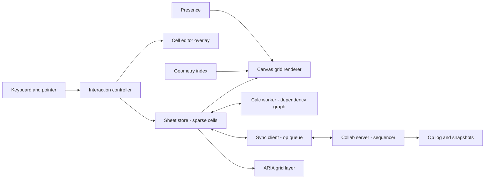

## 1. Requirements exploration

A spreadsheet looks like "a big table", but the interesting parts are a **rendering problem** (a grid far larger than
any DOM can hold), a **compute problem** (a reactive formula engine with a dependency graph) and a
**collaboration problem** (concurrent edits where the unit of change is a cell or a structural operation such as
"insert row"). Say this framing early: it organises the whole answer.

### Functional requirements

- Workbook with multiple sheets (tabs). Grid with column letters and row numbers.
- Select cells, ranges, whole rows/columns; keyboard navigation (arrows, `Tab`, `Enter`, `Ctrl+Arrow` to jump to
  data edges, `Shift` to extend).
- Edit a cell inline or via the formula bar. Values: numbers, text, booleans, dates, errors.
- Formulas with references (`A1`, `$A$1`, `A1:B10`, `Sheet2!C3`, whole-column `A:A`), ~100 common functions.
- Formatting: number formats, bold/colour/borders, alignment, wrap; conditional formatting as a stretch.
- Insert/delete/resize/hide rows and columns; freeze rows/columns.
- Copy/cut/paste within the app and to/from Excel (TSV + HTML).
- Real-time collaboration: others' edits and selections visible, coloured by user.
- Undo/redo of my own changes. Version history.

### Non-functional requirements

| Concern | Target |
| --- | --- |
| Scrolling | 60 fps on a 1M-row sheet; no blank flashes during fast scroll on a mid-range laptop |
| Edit latency | typed value visible immediately; dependent formulas updated < 100 ms for ≤ 10k dependents |
| Load | first meaningful grid paint < 1.5 s for a 50k-cell sheet; large sheets load progressively |
| Memory | sparse storage: memory proportional to non-empty cells, not rows × cols |
| Collaboration | remote edits visible p95 < 500 ms; all clients converge on identical values |
| Correctness | client and server compute identical results (same function semantics, float handling) |
| Accessibility | APG grid semantics for screen readers despite canvas rendering |

### Out of scope

- Charts, pivot tables, scripting (Apps Script), data connectors. Mention extension points only.
- Server storage engine internals.

### Clarifying questions

1. Real data shape: is 1M rows the common case or the cap? (Drives whether all data is loaded client-side.)
2. Must formulas compute offline, or can the server be the source of truth for computed values?
3. Excel formula compatibility level? Volatile functions like `NOW()`, `RAND()`?
4. Is there external data (`IMPORTRANGE`, API-backed functions) that must run server-side?
5. Mobile editing, or view-only on mobile?

Assume: most sheets < 50k non-empty cells, cap of 10M cells; formulas compute client-side for responsiveness with
the server also able to compute (for headless exports, API reads and very large sheets).

## 2. Architecture / high-level design

### The big decisions

1. **Rendering: canvas, not DOM.** A DOM grid with virtualization works for data tables (a few dozen columns, rows
   of similar shape), but spreadsheets need per-cell borders, merged cells, overflowing text into empty neighbours,
   frozen panes, and selection overlays at 60 fps. Google Sheets, Excel on the web and most modern sheet libraries
   draw the cell area onto `<canvas>` and use DOM only for overlays: the cell editor, comments, dropdowns,
   and an accessibility layer. DOM virtualization is the right answer for a 20-column admin table; canvas is the
   right answer for a 100-column spreadsheet with arbitrary formatting.
2. **Compute: a formula engine in a Web Worker** with an explicit dependency graph, so recalculation never blocks
   input or scrolling.
3. **Collaboration: server-ordered cell operations** (OT-style with a central sequencer) rather than a text CRDT.
   Cells are mostly last-writer-wins registers; the hard concurrency cases are structural (insert/delete rows shift
   references), and those transform cleanly with a central order.

### Components

| Component | Responsibility |
| --- | --- |
| **Shell (React)** | toolbar, formula bar, sheet tabs, menus, dialogs, sharing |
| **Grid renderer** | canvas layers: cells, gridlines, headers, selection; computes visible window from scroll offset |
| **Geometry index** | row heights / column widths with prefix sums for O(log n) offset ↔ index lookup |
| **Interaction controller** | pointer, keyboard, selection model, fill handle, resize handles, cell editor overlay |
| **Sheet store** | sparse cell map, formats, structure (row/col metadata); main-thread copy for rendering |
| **Calc worker** | parser, dependency graph, evaluator, function library; posts changed values back |
| **Sync client** | WebSocket, op queue (pending/in-flight), transform of local ops against remote ops |
| **Presence** | collaborators' selections and active cell |
| **A11y layer** | off-screen DOM `role="grid"` window around the active cell, live announcements |



### Lifecycle of an edit

1. User types `=SUM(A1:A100)` in C1 and presses Enter.
2. The controller creates an op `setCell(sheet, C1, {formula})`, applies it optimistically to the store, and
   queues it for sync.
3. The store posts the change to the calc worker. The worker parses the formula, updates C1's edges in the
   dependency graph, computes C1 and anything that depends on C1, and posts back `{cell: value}` patches.
4. The renderer redraws only the dirty rectangles that are visible.
5. The server sequences the op, transforms it if needed, persists it and broadcasts to collaborators, who apply it
   and recalculate locally.

## 3. Data model

### Addressing and sparse storage

```ts
type SheetId = string;
type CellKey = number; // row * MAX_COLS + col, a single number is cheaper than "A1" strings

interface Cell {
  input?: string;          // what the user typed: "42", "hello", "=A1*2"
  value?: CellValue;       // computed or literal value
  formatId?: number;       // index into a deduplicated format table
}

type CellValue =
  | { t: 'n'; v: number }
  | { t: 's'; v: string }
  | { t: 'b'; v: boolean }
  | { t: 'e'; v: '#REF!' | '#DIV/0!' | '#VALUE!' | '#NAME?' | '#N/A' | '#CYCLE!' };

interface Sheet {
  id: SheetId;
  name: string;
  rowCount: number;  // logical size, e.g. 1_000_000
  colCount: number;
  cells: Map<CellKey, Cell>;          // only non-empty cells
  rowMeta: Map<number, { height?: number; hidden?: boolean }>;
  colMeta: Map<number, { width?: number; hidden?: boolean }>;
  merges: Range[];
  frozen: { rows: number; cols: number };
}

interface Range { r1: number; c1: number; r2: number; c2: number; sheet?: SheetId }
```

Formats are deduplicated into a table (`formats[formatId]`), because a sheet with 50k bold red cells should store one
format object, not 50k. Column-oriented typed storage (Float64Array per column chunk) is an optimisation for very
large numeric sheets.

Structural edits need a stable mapping: if rows are identified purely by index, inserting a row means re-keying every
cell below. Two options: (a) accept the re-key cost in the store (fine for 50k cells) or (b) give rows/cols stable
IDs and keep an index→ID ordered list (more complex, but makes concurrent structural edits and references cheaper to
rebase). Mention the trade-off; choose (b) for the collaborative engine, translating to indices at the boundary.

### Dependency graph (in the worker)

```ts
interface FormulaNode {
  key: CellKey;
  ast: Expr;
  precedents: Array<CellKey | Range>; // what this formula reads
  volatile: boolean;                  // NOW(), RAND()
}

interface DepGraph {
  formulas: Map<CellKey, FormulaNode>;
  // reverse edges: who depends on a given cell
  dependents: Map<CellKey, Set<CellKey>>;
  // range dependencies stored separately in an interval/R-tree style index,
  // so A1:A100000 is one entry, not 100k edges
  rangeDeps: RangeIndex<CellKey>;
}
```

### UI state

Selection (`anchor`, `focus`, extra ranges), scroll offsets, editing state, clipboard snapshot: local, not synced.
Presence: ephemeral via the socket.

## 4. Interface definition (API)

### REST

```http
GET  /api/workbooks/:id                -> { id, title, sheets: [{ id, name, rowCount, colCount }], role, version }
GET  /api/workbooks/:id/sheets/:sid/cells?r1=0&r2=999&c1=0&c2=50
     -> { version, cells: [[row, col, input, value, formatId]], formats: {...} }
GET  /api/workbooks/:id/snapshot?version=1234  -> binary snapshot for fast open
```

Large sheets load in **row-band chunks** (for example 1,000 rows), prioritising the viewport, then background-filling
the rest so formulas over full columns can compute. For sheets beyond the client cap, the server computes and the
client only fetches windows of values (a "thin client" mode).

### WebSocket ops

```ts
type Op =
  | { type: 'setCells'; sheet: SheetId; cells: Array<{ r: number; c: number; input: string | null }> }
  | { type: 'setFormat'; sheet: SheetId; range: Range; formatPatch: Partial<Format> }
  | { type: 'insertRows'; sheet: SheetId; at: number; count: number }
  | { type: 'deleteRows'; sheet: SheetId; at: number; count: number }
  | { type: 'insertCols' | 'deleteCols'; sheet: SheetId; at: number; count: number }
  | { type: 'resize'; sheet: SheetId; axis: 'row' | 'col'; index: number; size: number }
  | { type: 'addSheet' | 'renameSheet' | 'deleteSheet'; sheet: SheetId; name?: string };

// client -> server
type Submit = { t: 'submit'; baseVersion: number; clientOpId: string; ops: Op[] };
// server -> client
type Commit = { t: 'commit'; version: number; clientOpId?: string; authorId: string; ops: Op[] };
type Presence = { t: 'presence'; userId: string; sheet: SheetId; selection: Range[] };
```

Only **inputs** are synced, never computed values: every client recomputes deterministically. This keeps messages
small and avoids "who computed what" conflicts, at the price of requiring identical function semantics across
client and server engines (share the engine code, compiled for both).

### Worker API

```ts
type ToWorker =
  | { t: 'load'; sheets: SerializedSheet[] }
  | { t: 'apply'; ops: Op[]; txId: number }
  | { t: 'tick' }; // for volatile functions
type FromWorker =
  | { t: 'values'; txId: number; patches: Array<[SheetId, CellKey, CellValue]> }
  | { t: 'progress'; txId: number; done: number; total: number };
```

## 5. Optimizations and deep dives

### Canvas grid rendering

- **Visible window**: from `scrollTop`, binary-search the row prefix-sum array to find the first visible row; same
  for columns. Only draw that window (typically ~50 rows × ~20 columns, ~1,000 cells).
- **Fake scroll container**: a DOM element with a spacer sized to the full sheet height gives native scrollbars,
  momentum scrolling and accessibility of scroll position, while the canvas stays fixed in the viewport. Browsers cap
  element heights (tens of millions of pixels); for a 1M-row sheet at 21 px that is ~21M px, near the limit, so
  scale scroll positions when the logical height exceeds a safe max.
- **Layers**: separate canvases (or cached regions) for static cell content, selection/presence overlay, and
  headers. Moving the selection repaints only the overlay.
- **Device pixel ratio**: size the backing store at `cssSize * devicePixelRatio` and scale the context, otherwise
  text is blurry. Align 1 px gridlines to half-pixels.
- **Text measurement cache**: `measureText` is expensive; cache widths per (font, string) for overflow and
  auto-fit calculations.
- **Frozen panes**: draw four quadrants with separate clip rects and scroll offsets.
- **Rendering off-thread**: `OffscreenCanvas` in a worker is possible, but the main thread still needs geometry for
  hit testing. Most teams keep drawing on the main thread (it is fast when bounded to the window) and move
  *compute* off-thread.
- Trade-off with DOM: canvas loses native text selection, find-in-page, browser zoom reflow and accessibility, so
  each must be rebuilt (custom find, an ARIA layer). That is why canvas is justified only at spreadsheet scale.

### Formula engine and dependency graph

- **Parse once**: tokenize and parse to an AST when the input changes; store relative references so fill-down can
  copy formulas by offsetting.
- **Dirty propagation**: on change of cell X, collect all transitive dependents (direct reverse edges plus range
  index hits), then **topologically sort** them and evaluate in order so each formula is computed once per
  transaction. Kahn's algorithm with in-degree counts within the dirty subgraph is a good answer.
- **Cycle detection**: if the topological sort cannot consume all dirty nodes, the remaining nodes are in a cycle;
  set them to `#CYCLE!` (or support iterative calculation as a setting, like Excel).
- **Range dependencies**: `SUM(A:A)` must not create a million edges. Store range precedents in an interval index
  keyed by column; when a cell changes, query "which ranges contain (r, c)" in O(log n + k).
- **Incremental aggregates**: for large ranges, cache partial sums per block so changing one cell updates the
  aggregate in O(1) instead of re-summing 100k cells.
- **Chunked evaluation**: if a recalculation exceeds a time budget, post intermediate patches and progress; the UI
  shows a thin progress bar and stale cells keep their old values with a subtle indicator.
- **Volatile functions** recompute on every transaction and on a timer, which is why `NOW()` heavy sheets are slow
  in every spreadsheet product.
- **Structural rewrites**: inserting a row above A5 rewrites `=A5` to `=A6` in every formula. With stable row IDs,
  ASTs reference IDs and only display text changes.
- **Numerics**: IEEE doubles produce `0.1 + 0.2 = 0.30000000000000004`; spreadsheets round displayed values to 15
  significant digits. Dates are serial numbers; locales change decimal and argument separators (`;` in many
  European locales).

### Collaboration and conflicts

- Concurrent `setCells` on the same cell: last committed wins (server order). Show a brief highlight on the cell so
  the overwritten user notices.
- `setCells` at row 10 concurrent with `insertRows(at: 5)`: transform the cell op to row 11. `deleteRows` covering a
  cell being edited: the edit is dropped and the editor overlay closes with a toast.
- Formulas referencing deleted rows become `#REF!` deterministically on all clients.
- Client queue: one in-flight batch plus pending ops; incoming commits transform pending ops, as in classic OT. Since
  ops are coarse (cells, ranges, rows), the transform matrix is small and testable, much simpler than rich-text OT.
- Why not a CRDT? Possible (a `Y.Map` per cell, `Y.Array` of row IDs), and it gives offline merge. But formulas
  referencing ranges, merges and row moves need validation and a canonical order anyway, so the server sequencer is
  simpler. If offline-first is a hard requirement, a CRDT of row/column ID arrays plus LWW cell registers works.

### Copy and paste

- Write both `text/plain` (TSV) and `text/html` (a `<table>` with inline styles) to the clipboard so Excel and Docs
  understand it. Internally, also store a richer payload (formulas with relative references) for in-app paste.
- Paste from Excel arrives as HTML with `mso-` styles; parse into values and a subset of formats. Sanitise.
- Large pastes (100k cells) become one op batch, applied in a worker, with a single undo step.

### Accessibility

Canvas content is invisible to assistive technology, so:

- Maintain a small DOM grid (`role="grid"`, `aria-rowcount`/`aria-colcount` with the full logical size, rows with
  `aria-rowindex`, cells with `aria-colindex`) containing only the active cell's neighbourhood, positioned off-screen
  or transparently over the canvas.
- Focus stays on the grid; `aria-activedescendant` (or roving focus) points at the active cell. Announce value,
  formula and coordinates ("C1, formula SUM A1 to A100, value 5,050").
- Keyboard model follows the APG grid pattern; all pointer-only actions (resize, fill handle) have keyboard or menu
  equivalents.
- Respect browser zoom: re-render at the new devicePixelRatio and size.

### Load and memory

- Snapshot + op tail on open, as binary. Render the viewport from the first chunk; compute formulas whose precedents
  are not yet loaded later (show a "Loading…" value).
- Keep only one copy of large data: either the worker owns cells and the main thread holds a viewport cache, or
  share via `SharedArrayBuffer` (requires cross-origin isolation headers — a deployment cost to call out).

### Observability and testing

- Metrics: scroll frame time, recalc duration by dependents count, op round-trip, rejected ops, convergence check
  (hash of inputs per version, compared with the server).
- Tests: property-based tests for the parser and transform functions; golden tests comparing function results with
  Excel for a corpus; fuzzed concurrent op sequences across simulated clients.

## What a lead-level answer adds

- Justifies **canvas vs DOM** with concrete limits and lists what canvas costs (a11y, find, text selection), instead
  of saying "canvas is faster".
- Treats the formula engine as a **shared library** run in the worker and on the server, so values never disagree,
  and owns a compatibility test corpus.
- Designs for **progressive capability**: full client compute for normal sheets, thin-client mode for enormous ones,
  decided by measured size.
- Separates ops (inputs) from derived data (values) in the sync protocol, keeping the collaboration surface small.
- Plans the team split: grid/rendering, calc engine, collaboration, and features, with clear interfaces between
  them.

## Common follow-up questions

**How do you implement fill-down (drag the fill handle)?** Generate `setCells` for the target range, offsetting
relative references in each formula AST and detecting series (1, 2, 3 or Mon, Tue). It is one op batch and one undo
step.

**How do you handle a formula referencing another workbook?** Treat it as an external, asynchronous dependency:
the server resolves it with the user's permissions and pushes values; the cell shows `Loading…` then the value.

**Why sync inputs rather than values?** Values are derived; syncing them doubles traffic and creates conflicts
between computed results. Syncing inputs and computing deterministically guarantees convergence if the engine is
deterministic.

**What breaks determinism?** Volatile functions (`RAND`, `NOW`), locale-dependent parsing, and floating point
differences between engines. Seed or server-assign volatile results when they must match, and parse in a canonical
locale.

**How would you support conditional formatting on 1M rows?** Evaluate rules lazily for visible cells only, cache
per cell with invalidation on dependency change, and treat rules like formulas in the dependency graph.

**Could you use a DOM grid with virtualization instead?** For a few thousand rows and modest formatting, yes, and
it gives a11y for free. It breaks down with many columns, merged cells, text overflow and 60 fps scroll, which is why
large sheet products moved to canvas.
