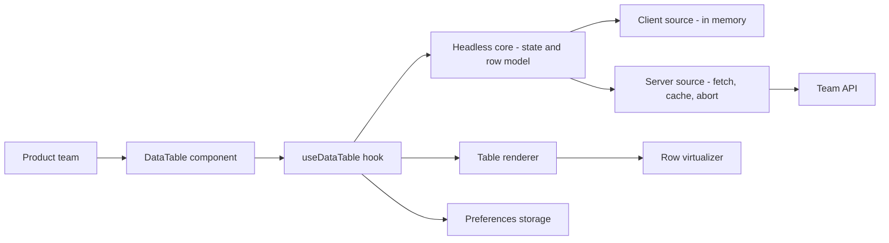

## 1. Requirements exploration

A data table looks simple until 30 teams use it. The real design problem is **an API that covers very different
use cases without becoming a 150-prop monster**, a state model that works whether the data lives in the browser or
on the server, and rendering that stays fast at 50k rows while remaining accessible.

### Functional requirements

- Columns defined declaratively: header, accessor, cell renderer, width, sortable, filterable, alignment.
- Sorting: click header to cycle asc → desc → none; `Shift+click` for multi-sort.
- Filtering: global search and per-column filters (text, select, range, date).
- Pagination (page size selector, total count) **or** infinite scroll / "load more".
- Selection: checkbox column, select all on page vs all matching rows, shift-click range select.
- Row actions (menu per row), bulk actions for the selection, expandable detail rows.
- Column resize (drag and keyboard), reorder, show/hide, pin left/right; sticky header.
- Loading, empty, error and partial-error states; skeleton rows.
- Persist user preferences (column widths, visibility, sort) per table.

### Non-functional requirements

| Concern | Target |
| --- | --- |
| Render | 1,000 client rows render < 100 ms; 50k rows scroll at 60 fps with virtualization |
| Interaction | sort/filter of 10k client rows < 50 ms (or moved off the main thread) |
| Server mode | no duplicate or out-of-order requests; previous page stays visible while loading |
| Bundle | core < 15 KB gzip; virtualization and advanced features opt-in |
| Accessibility | semantic table semantics, sortable headers announced, keyboard-operable everything |
| API stability | additive evolution; no breaking changes without codemods |

### Out of scope

- Spreadsheet-style editing with formulas (see the spreadsheet question), pivoting, charting.

### Clarifying questions

1. Is this a **table** (read-mostly, links and buttons in cells) or a **grid** (spreadsheet-like cell navigation and
   editing)? This decides the ARIA pattern and keyboard model.
2. What is the split of client vs server data across teams? Which backend conventions exist (cursor vs offset
   pagination, filter syntax)?
3. Do we need column groups (multi-level headers) and row grouping/aggregation?
4. Mobile: should tables reflow into cards on small screens?

Assume both modes, mostly read-only tables with some inline edit, desktop-first with a responsive fallback.

## 2. Architecture / high-level design

### Headless core + styled shell

| Layer | Responsibility |
| --- | --- |
| **Table core (headless)** | column model, row model pipeline (filter → sort → group → paginate), selection, expansion, column sizing/ordering/pinning state; framework-agnostic logic |
| **React adapter** | `useDataTable()` hook exposing state and prop getters |
| **Data source adapters** | client source (array in memory) or server source (fetch with params, cache, abort) |
| **Renderer** | `<DataTable>` in the design system's style: semantic `<table>`, sticky header, optional virtualizer |
| **Feature modules** | resizing, reordering (drag and drop), column visibility menu, export, persistence |

Behaviour and rendering are separate so a team with an unusual layout (cards on mobile, a tree table) can reuse the
logic. This is the TanStack Table philosophy; in practice I'd build on TanStack Table's core rather than re-invent the
row model, and own the styled shell, virtualization integration and a11y.



### Row model pipeline

In client mode: `rawRows → filtered → sorted → grouped/expanded → paginated → visible`. Each stage is memoised on
its inputs, so changing the page does not re-sort, and changing a filter does not re-run column sizing. In server
mode, filter/sort/paginate are **delegated**: the core only turns state into request parameters and treats the
response as the final row set ("manual" mode).

## 3. Data model

```ts
interface ColumnDef<TRow, TValue = unknown> {
  id: string;
  header: React.ReactNode | ((ctx: HeaderContext<TRow>) => React.ReactNode);
  accessor: keyof TRow | ((row: TRow) => TValue);
  cell?: (ctx: CellContext<TRow, TValue>) => React.ReactNode;
  sortable?: boolean;
  sortFn?: (a: TValue, b: TValue) => number;          // client mode
  filter?: { type: 'text' | 'select' | 'range' | 'date'; options?: string[] };
  width?: number; minWidth?: number; maxWidth?: number;
  align?: 'start' | 'end' | 'center';
  pin?: 'left' | 'right';
  hideable?: boolean;
  meta?: Record<string, unknown>;                      // escape hatch for teams
}

interface TableState {
  sorting: Array<{ id: string; desc: boolean }>;
  filters: Array<{ id: string; value: unknown }>;
  globalFilter: string;
  pagination: { pageIndex: number; pageSize: number } | { cursor: string | null; pageSize: number };
  rowSelection: Record<RowId, true>;                    // keyed by stable row id
  selectAllMatching: boolean;                           // "all 12,430 rows" across pages
  expanded: Record<RowId, true>;
  columnSizing: Record<string, number>;
  columnOrder: string[];
  columnVisibility: Record<string, boolean>;
  columnPinning: { left: string[]; right: string[] };
}

type RowId = string;
```

Key decisions:

- **Stable row IDs** (`getRowId: row => row.id`) instead of array indices, so selection survives sorting, filtering,
  refetching and pagination.
- `selectAllMatching` is a flag, not a list of 12k IDs: bulk actions send the current filters to the server
  ("archive everything matching these filters, except these excluded IDs").
- Table state is **serialisable**, so it can sync to the URL (`?sort=-createdAt&status=open&page=3`) for shareable
  views and back-button support, and to storage for preferences.
- Server data lives in a server cache (TanStack Query) keyed by the request parameters; UI state stays in the table.

## 4. Interface definition (API)

### Component props

```ts
interface DataTableProps<TRow> {
  columns: ColumnDef<TRow>[];
  getRowId: (row: TRow) => string;

  // Data: either rows (client mode) or a source (server mode)
  data?: TRow[];
  source?: ServerSource<TRow>;

  // State: each piece can be controlled or uncontrolled
  state?: Partial<TableState>;
  defaultState?: Partial<TableState>;
  onStateChange?: (next: TableState, change: keyof TableState) => void;

  selection?: 'none' | 'single' | 'multi';
  renderExpanded?: (row: TRow) => React.ReactNode;
  rowActions?: (row: TRow) => Array<{ label: string; onSelect: () => void; destructive?: boolean }>;
  bulkActions?: (sel: { ids: RowId[]; allMatching: boolean }) => React.ReactNode;

  virtualize?: boolean | { rowHeight: number; overscan?: number };
  density?: 'compact' | 'standard' | 'comfortable';
  persistKey?: string;            // stores sizing/visibility/order per user
  caption: string;                // accessible name, can be visually hidden
  emptyState?: React.ReactNode;
  loadingRows?: number;
}

interface ServerSource<TRow> {
  fetch(params: {
    sorting: TableState['sorting'];
    filters: TableState['filters'];
    globalFilter: string;
    pageSize: number;
    pageIndex?: number;
    cursor?: string | null;
    signal: AbortSignal;
  }): Promise<{ rows: TRow[]; total?: number; nextCursor?: string | null }>;
}
```

Each state slice follows the **controlled/uncontrolled** pattern: teams that don't care pass nothing; teams that
sync with the URL control `sorting` and `pagination` only.

### Example server API

```http
GET /api/orders?sort=-createdAt,amount&status=open&q=acme&limit=50&cursor=eyJpZCI6...
200 { "rows": [...], "nextCursor": "eyJpZCI6...", "total": 12430, "totalIsEstimate": false }
```

Cursor pagination is stable under inserts (no duplicated or skipped rows); offset pagination supports "jump to page
40" and exact totals. Support both in the adapter; the backend decides. For huge tables, `total` may be an
estimate, so display "12,000+".

## 5. Optimizations and deep dives

### Virtualization

- Only render rows in the viewport plus overscan (e.g. 10 rows). With fixed row height, the window is
  `floor(scrollTop / rowHeight)`; with variable heights (expanded rows, wrapped text), measure rendered rows
  (`ResizeObserver`) and keep a prefix-sum of estimated/measured heights.
- Keep the semantic table: render a spacer row (or `padding-top/bottom` on the body) for off-screen rows, and set
  `aria-rowcount` on the table and `aria-rowindex` on rendered rows so screen readers know the true size and
  position.
- Column virtualization only when there are many columns (> 30); otherwise the complexity isn't worth it.
- Trade-offs to state: virtualized rows break browser find-in-page (`Ctrl+F`) for off-screen content and make
  printing harder. Offer a non-virtualized mode for small datasets (the default under ~200 rows) and a built-in
  search.
- Pagination is often the better UX for task-oriented tables (users can say "it's on page 3"); infinite scroll suits
  logs and feeds. Virtualization is orthogonal: a 500-row page can be virtualized too.

### Rendering performance

- Memoise rows by row identity and the subset of state that affects them (selected, expanded); a selection change
  re-renders one row, not 1,000.
- Cell renderers from consumers are the main risk: document "keep cells cheap", provide built-in cell types
  (badge, date, currency, avatar) that are optimised, and use `React.memo` per cell when columns are stable.
- Column resize: update a CSS variable per column (`--col-amount: 140px`) during the drag instead of re-rendering
  rows; commit to state on pointer up. Use `table-layout: fixed` so widths don't depend on content measurement.
- Sticky header/first column with `position: sticky`; watch for `overflow: hidden` ancestors breaking stickiness.
- Client sort/filter on 50k rows: precompute sort keys (e.g. lower-cased strings, timestamps) once per data change;
  use `Intl.Collator` for locale-aware comparison (created once, not per comparison). If still slow, move to a worker
  and use `useDeferredValue`/transitions to keep typing responsive.

### Server mode correctness

- Every state change that affects the query (sort, filter, page) produces a new query key; previous requests are
  aborted, and the latest response wins.
- Show the previous page dimmed while the next loads (`placeholderData: keepPreviousData`), instead of flashing a
  skeleton.
- Reset `pageIndex` to 0 when sort or filters change; preserve selection by ID but clear `selectAllMatching` when
  filters change (the "matching" set changed).
- Debounce text filters (~300 ms); apply select filters immediately.
- Optimistic row updates for inline edits, with per-row error state and retry.

### Accessibility

- **Table or grid?** For read-mostly tables, use native `<table>`, `<thead>`, `<th scope="col">`, `<caption>`. Tab
  moves through interactive elements inside cells normally. For spreadsheet-like editing, use the APG **grid**
  pattern: `role="grid"`, a single tab stop, arrow keys move between cells, `Enter`/`F2` to edit. Don't use grid
  semantics for a simple table; it forces a mode screen reader users don't expect.
- Sortable headers: a `<button>` inside the `<th>`, with `aria-sort="ascending" | "descending"` on the `th` (only on
  the currently sorted column; multi-sort secondary columns are announced through the button's description).
- Selection checkboxes: labelled per row ("Select order 1042"); the header checkbox is tri-state
  (`aria-checked="mixed"` / `indeterminate`).
- Expand buttons: `aria-expanded` and `aria-controls` pointing to the detail row.
- Resize handles: focusable separators (`role="separator"`, `aria-orientation="vertical"`, `aria-valuenow` for width)
  operable with arrow keys.
- Announce results after filtering ("38 results") via a polite live region; announce loading state without
  stealing focus.
- Responsive: on narrow screens, either horizontal scroll with a sticky first column (keep table semantics) or a card
  layout (a list of definition lists); don't use CSS-only reflow that breaks table semantics.

### Persistence and preferences

Store sizing, order, visibility and density per `persistKey` per user (server-side preferences for cross-device, or
`localStorage`). Version the stored shape, and reconcile when columns change (unknown IDs dropped, new columns
appended).

### Export

Client mode: generate CSV from the processed row model (respecting current sort/filter, using accessors and a
`exportValue` per column, not rendered JSX). Server mode: request a server-side export job; never fetch 1M rows into
the browser.

### Testing and governance

- Unit tests on the headless core (row model pipeline, selection logic, state transitions).
- Interaction tests with Testing Library for keyboard sorting, selection, resizing.
- Accessibility checks (axe) in CI plus manual screen reader passes for releases.
- A storybook of real team use cases as visual regression tests; usage telemetry on which props/features teams use
  to guide deprecations.

## What a lead-level answer adds

- **Headless core + styled default** to serve 30 teams, with controlled/uncontrolled state per slice and an escape
  hatch (`meta`, render props) instead of ever-growing boolean props.
- Distinguishes **table vs grid** semantics and picks deliberately.
- Treats server mode as first-class: query keys, abort, keep-previous-data, cursor vs offset trade-offs, "select all
  matching" via filters.
- Knows where virtualization hurts (find-in-page, printing, a11y) and makes it opt-in by data size.
- Builds on a proven core (TanStack Table) and spends effort on integration, a11y and governance: versioning,
  codemods, docs and adoption metrics.

## Common follow-up questions

**How do you keep selection when the user changes pages?** Selection is keyed by row ID, independent of the current
page; the header checkbox reflects only the current page, with a banner offering "Select all 12,430 matching".

**How do you support row grouping with aggregates?** Add a grouping stage to the row model producing group rows with
aggregate values (sum, count), rendered with `aria-level`/expand buttons; in server mode the API must return groups.

**How would you implement inline editing?** Cell enters edit mode on `Enter` or double-click, renders an input,
commits on `Enter`/blur and cancels on `Escape`; optimistic update with rollback; validation errors shown in the cell
with `aria-invalid` and a description.

**Infinite scroll vs pagination?** Pagination for tasks (find, compare, share a page), infinite scroll for browsing
and logs. Infinite scroll needs a reachable footer, focus restoration and "jump to top".

**How do you prevent layout shift when data loads?** Fixed column widths, skeleton rows with the expected count and
height, and reserved space for the pagination bar.
