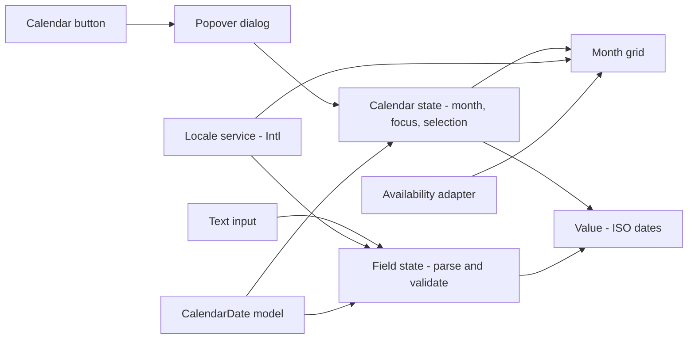

## 1. Requirements exploration

Date pickers are a favourite component question because they look like a grid of numbers but involve **time
semantics** (a calendar date is not a timestamp), **localisation** (formats, week starts, calendars, RTL),
**complex keyboard interaction** (a 2D grid with paging), and **form integration** (typed input, partial input,
validation). Start by asking whether a custom picker is needed at all.

### Functional requirements

- Text input accepting typed dates in the user's locale format, with parsing and validation; a button opens a calendar.
- Calendar: month grid with weekday headers, previous/next month, month/year jump, "today" indicator.
- Modes: single date, date range (start + end with hover preview), optionally multiple months side by side
  (two months for ranges on desktop).
- Constraints: `min`, `max`, `isDateUnavailable(date)`, minimum/maximum range length (e.g. 1–30 nights).
- Custom day content: price or availability dot (travel), presets for ranges ("Last 7 days").
- Clear, apply/cancel (for ranges in dashboards), controlled and uncontrolled usage.
- Mobile: full-screen sheet with vertically scrolling months, or the native picker.

### Non-functional requirements

| Concern | Target |
| --- | --- |
| Correctness | no off-by-one-day bugs across time zones and DST; the value means the same date for every user |
| Localisation | formats, month/weekday names, first day of week, numbering systems, RTL via `Intl` |
| Accessibility | APG date picker dialog pattern; WCAG 2.2 AA; typed input always available |
| Performance | open < 16 ms of script work; month change renders 42 cells cheaply; custom cell data fetched per visible month |
| Bundle | < 10 KB gzip without a heavy date library; locale data from `Intl`, not bundled |
| Form integration | works with native form submission (hidden ISO value) and form libraries |

### Out of scope

- Time pickers (mention as extension), recurring event rules.

### Clarifying questions

1. Do we need a custom picker everywhere, or is `<input type="date">` acceptable for simple fields (birth dates)?
2. Are values **calendar dates** (check-in date, birthday) or **instants** (a meeting at 3 pm in some zone)? Almost
   always the former for a date picker.
3. Which locales and calendars? (Islamic, Hebrew, Japanese, Buddhist calendars matter in some markets.)
4. Range constraints and availability data: from an API per month?
5. Is this in a design system used by many teams? (Headless hook + styled component.)

Assume calendar dates, Gregorian calendar with others as an extension, design-system scope.

## 2. Architecture / high-level design

### Native vs custom

`<input type="date">` gives a localised, accessible, mobile-optimised picker for free, and its value is an ISO
`YYYY-MM-DD` string. Limitations: limited styling, no range mode, no per-day content (prices), no disabled specific
dates (only `min`/`max`), and display format follows the browser/OS locale rather than the app's chosen locale. Use
it for simple fields (birth date, forms in internal tools) and on mobile where appropriate; build custom for ranges,
availability and branded booking flows. A design system can offer both behind one API (`variant="native"`).

### Layers

| Part | Responsibility |
| --- | --- |
| **Date model** | plain calendar-date type and arithmetic (add days/months, compare, start of week), no time zones |
| **Locale service** | `Intl.DateTimeFormat` for names and formatting; first day of week; parsing patterns derived from `formatToParts` |
| **Calendar state** | visible month(s), focused date, selection, hover preview for ranges |
| **Field state** | input text, parsed value, validation errors, segments (optional segmented input) |
| **Grid renderer** | weeks × days table; cell states (selected, in range, today, disabled, unavailable, outside month) |
| **Popover/dialog** | positioning near the input, focus management, dismissal; full-screen sheet on mobile |
| **Data adapter** | optional per-month fetch of availability/prices |



## 3. Data model

### Calendar dates, not `Date` objects

The most common date picker bug: storing a picked day as a JavaScript `Date` at local midnight and serialising with
`toISOString()`. A user in UTC+5:30 picks June 10; local midnight is June 9 18:30 UTC; the server stores June 9.
Also, DST transitions make "add 1 day" via milliseconds wrong (days with 23 or 25 hours), and some zones historically
skipped midnight entirely.

The value is a **calendar date**: year, month, day with no time or zone.

```ts
interface CalendarDate {
  year: number;
  month: number; // 1-12
  day: number;   // 1-31
}

// Wire and form format: ISO 8601 date string "2025-06-10"
type IsoDate = `${number}-${number}-${number}`;

type DateRange = { start: CalendarDate; end: CalendarDate };
```

Arithmetic uses pure calendar maths (or `Temporal.PlainDate`, which models exactly this; Temporal now ships in
recent Firefox and Chromium versions, with a polyfill elsewhere). If a `Date` is unavoidable, construct it in UTC
(`Date.UTC(y, m - 1, d)`) and only ever read UTC fields.

"Today" depends on a time zone: compute it with `Intl.DateTimeFormat(locale, { timeZone })` from the user's (or the
property's) zone. For hotel bookings, "today" and check-in dates are in the **property's** time zone, not the
traveller's; the API should send a `timeZone` or the current local date for the property.

### Component state

```ts
interface DatePickerState {
  inputText: string;                // what the user typed
  value: CalendarDate | null;       // committed value (single mode)
  range: { start: CalendarDate | null; end: CalendarDate | null }; // range mode
  hoverDate: CalendarDate | null;   // range preview
  visibleMonth: { year: number; month: number }; // first visible month
  focusedDate: CalendarDate;        // roving focus within the grid
  isOpen: boolean;
  error: 'invalid' | 'before-min' | 'after-max' | 'unavailable' | 'range-too-long' | null;
}
```

## 4. Interface definition (API)

```ts
interface DatePickerProps {
  label: string;
  value?: IsoDate | null;
  defaultValue?: IsoDate | null;
  onChange?: (value: IsoDate | null) => void;
  min?: IsoDate;
  max?: IsoDate;
  isDateUnavailable?: (date: IsoDate) => boolean;
  locale?: string;                  // defaults to app locale
  firstDayOfWeek?: 0 | 1 | 6;       // override; otherwise from locale
  timeZone?: string;                // for computing "today"
  name?: string;                    // renders a hidden input with the ISO value for native forms
  required?: boolean;
  description?: string;             // e.g. "Format: DD/MM/YYYY"
  errorMessage?: string | ((error: DatePickerState['error']) => string);
  renderDay?: (date: IsoDate, state: DayState) => React.ReactNode; // prices, dots
  variant?: 'popover' | 'inline' | 'native';
}

interface DateRangePickerProps extends Omit<DatePickerProps, 'value' | 'defaultValue' | 'onChange'> {
  value?: { start: IsoDate; end: IsoDate } | null;
  onChange?: (range: { start: IsoDate; end: IsoDate } | null) => void;
  minNights?: number;
  maxNights?: number;
  visibleMonths?: 1 | 2;
  presets?: Array<{ label: string; range: () => { start: IsoDate; end: IsoDate } }>;
  onVisibleMonthsChange?: (months: Array<{ year: number; month: number }>) => void; // fetch availability
}

interface DayState {
  isSelected: boolean;
  isRangeStart: boolean;
  isRangeEnd: boolean;
  isInRange: boolean;
  isToday: boolean;
  isDisabled: boolean;
  isUnavailable: boolean;
  isOutsideMonth: boolean;
}
```

Values cross the component boundary as **ISO strings**: serialisable, time-zone free, and directly usable in URLs
and APIs (`?checkin=2025-06-10&checkout=2025-06-14`). A headless `useDatePicker()` / `useCalendar()` exposes state
and prop getters for custom layouts.

Availability API example:

```http
GET /api/listings/123/availability?from=2025-06-01&to=2025-07-31
200 { "timeZone": "Europe/Lisbon", "days": { "2025-06-10": { "available": true, "price": 140 }, ... } }
```

## 5. Optimizations and deep dives

### Typed input and parsing

- Derive the expected order from the locale (`formatToParts` on a sample date gives the order of day, month and year
  and the literal separators), show it as a hint ("DD/MM/YYYY"), and parse tolerant variants (single digits,
  different separators). `06/07/2025` is ambiguous across locales; never guess, follow the locale.
- Parse on blur or Enter, not on every keystroke (partial input like "1/" is not an error yet). Show errors after
  blur, linked via `aria-describedby`, with `aria-invalid="true"`.
- Typing a valid date moves the calendar's visible month to it when open.
- A **segmented input** (separate day/month/year spinbutton segments, like the native control and React Aria's
  DateField) gives better typing UX and screen reader support but is much more work; a single text field with good
  parsing is acceptable.

### Rendering the month grid

- Generate 6 rows × 7 columns (42 cells) for stable height so the popover doesn't jump between months. Compute the
  leading offset from the weekday of the 1st and the locale's first day of week (`Intl.Locale` week info where
  available, falling back to a small table: Monday for most of Europe, Sunday for the US, Saturday for some Middle
  East locales).
- Weekday headers: short names from `Intl.DateTimeFormat(locale, { weekday: 'short' })` with full names as `abbr` or
  accessible labels.
- Cells are cheap; memoise by date + state. Range hover updates only cells whose in-range state changes; computing
  42 states per hover is trivial, so don't over-engineer.
- Two-month view for ranges on desktop; mobile shows a vertical list of months, virtualized if it spans years.
- `renderDay` content (prices) fetched per visible month window; prefetch the next month when the user navigates.

### Keyboard interaction (APG date picker dialog)

The calendar grid uses roving `tabindex`: exactly one day button is tabbable (the focused date).

| Key | Behaviour |
| --- | --- |
| `ArrowLeft` / `ArrowRight` | previous/next day (mirrored in RTL) |
| `ArrowUp` / `ArrowDown` | same weekday previous/next week |
| `Home` / `End` | first/last day of the week (locale aware) |
| `PageUp` / `PageDown` | same day previous/next month (clamped: Jan 31 → Feb 28/29) |
| `Shift+PageUp` / `Shift+PageDown` | previous/next year |
| `Enter` / `Space` | select the focused date (range: first press sets start, second sets end) |
| `Escape` | close the popup, return focus to the calendar button (or input) without changing the value |

Moving focus across a month boundary changes the visible month. Disabled dates remain focusable (so users can hear
that they're unavailable) but cannot be selected.

### Focus management and positioning

- The popup is a **non-modal or modal dialog** (`role="dialog"` with `aria-modal="true"` in the APG example) labelled
  by the visible month heading ("June 2025"); on open, focus goes to the selected date, or today, or the first
  enabled date.
- Tab order inside: month/year controls → grid → action buttons. Previous/next month buttons have labels ("Previous
  month").
- Positioning: anchored below the input, flipping above near the bottom edge, shifting horizontally to stay in
  view; render in the top layer (Popover API) so `overflow: hidden` containers and modals don't clip it. Floating UI or
  CSS anchor positioning (where supported) handles the geometry.
- On mobile, a full-screen sheet (`<dialog>` with `showModal()`) avoids cramped popovers and the virtual keyboard
  covering the calendar; set `inputmode="numeric"` on the text input if users type.
- Close on outside click and `Escape`; for ranges with Apply/Cancel, outside click cancels (doesn't commit a half
  range).

### Accessibility details

- Grid semantics: a `<table role="grid">` with `<th scope="col" abbr="Monday">Mon</th>` headers, cells containing
  `<button>`s. Each button's accessible name is the full date ("Tuesday, June 10, 2025"), from
  `Intl.DateTimeFormat` with `dateStyle: 'full'`, plus state ("selected", "unavailable", "check-in date"). Use
  `aria-selected` on selected cells and `aria-disabled` on disabled ones. Today: `aria-current="date"`.
- Announce month changes via the dialog's month heading in a polite live region.
- Ranges: announce "Check-in June 10 selected, choose check-out date" after the first selection.
- The calendar button has a name reflecting the value ("Choose date, selected date is June 10, 2025").
- Never make the calendar the only way in: the typed input must accept dates, which is also faster for birth dates
  decades in the past.
- Prices in cells must be part of the accessible name ("June 10, €140").
- Colour is not the only indicator for unavailable days (strikethrough or a pattern).

### Localisation

- Month and weekday names, digits (`ar-EG` uses Arabic-Indic digits), and the first day of week from `Intl`.
- RTL: mirror layout and arrow key directions; "previous month" button points right.
- Non-Gregorian calendars: `Intl.DateTimeFormat` can format in other calendars (`calendar: 'islamic-umalqura'`), but
  grid generation needs calendar-specific month lengths. Temporal supports calendars natively; libraries like React
  Aria's `@internationalized/date` implement them. Scope this explicitly.

### Validation and edge cases

- Ranges: end before start → swap or restart selection (product choice); enforce min/max nights; a range cannot span
  unavailable dates for bookings (check-out on an unavailable date may be allowed, since the night before is what's
  booked — a classic hotel-domain subtlety worth asking about).
- `min`/`max` disable navigation buttons when the adjacent month is entirely out of bounds.
- Leap years and month clamping (Jan 31 + 1 month).
- Controlled value changes while open (e.g. reset): update focus and visible month without stealing focus.

### Testing

- Pure unit tests for calendar maths and parsing across locales and zones (run tests with `TZ` set to several zones,
  including UTC+14 and UTC−12, and around DST transitions).
- Interaction tests for every key in the table, RTL, range selection, focus return.
- Screen reader checks for day names and announcements.

## What a lead-level answer adds

- Leads with the **calendar date vs instant** distinction and prevents the classic off-by-one bug by design (ISO
  date strings at the boundary, `Temporal.PlainDate`-style model internally).
- Pushes the **native input** where it's sufficient and limits custom pickers to cases that need them.
- Uses `Intl` instead of bundling locale data, and is explicit about calendar-system scope.
- Separates field (typing) from calendar (picking), offers headless hooks, and recommends proven foundations (React
  Aria's date components) instead of hand-rolling every edge case.
- Considers domain rules (property time zones, check-out on unavailable dates) as API-level concerns.

## Common follow-up questions

**How would you add time selection?** A separate time field (segmented hours/minutes with locale-aware 12/24h), and
the combined value becomes a `PlainDateTime` plus an explicit time zone, converted to an instant only when needed.

**Why not use moment.js?** It's in maintenance mode, mutable and large. Use `Intl`, small utilities (date-fns) or
Temporal (polyfilled where needed).

**How do you prefetch availability efficiently?** Fetch per month window when the calendar opens, cache by month,
prefetch the next month on navigation, and keep stale data visible while revalidating.

**How do you test time zone bugs?** Run the suite under multiple `TZ` environment values in CI and include
dates around DST changes; assert ISO output equals the clicked date.

**What does the hidden form value look like?** `<input type="hidden" name="checkin" value="2025-06-10">`, so
non-JS form submission and server validation are straightforward.
