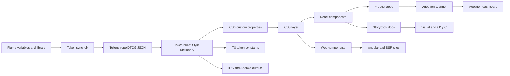

## Framing the problem

A design system at this scale is not a component library. It is a **product whose customers are other engineering
teams**, and the platform you design has to serve three different kinds of consumers: designers (Figma), engineers on
the main stack (React), and engineers on everything else (Angular, server-rendered HTML, email, native). The most
common failure mode is not bad components; it is a system that nobody adopts, or one that gets adopted and then
freezes because nobody can upgrade it.

So the answer is organised around one idea: **put the most portable layer (tokens) at the bottom, keep framework
code thin on top of it, and invest heavily in the upgrade path.**

## 1. Requirements exploration

### Stakeholders and consumers

| Consumer | What they need |
| --- | --- |
| Product designers | Figma library that matches code; tokens they can reference; clear usage guidance |
| React product teams (most apps) | Accessible components, good TypeScript types, tree-shakeable, SSR-safe |
| Angular teams, marketing site | Same visual language without a React runtime |
| White-label / brand team | Re-theme the whole product without forking components |
| Accessibility / legal | Evidence that core components meet WCAG 2.2 AA |
| Platform / performance team | Bounded bundle and CSS cost; no runtime style injection surprises |

### Functional requirements

- A single source of truth for **design tokens** (colour, spacing, typography, radius, elevation, motion) with
  brand and mode variants.
- A **component library** covering the 30–40 most common primitives and patterns (Button, TextField, Select,
  Combobox, Dialog, Toast, Tabs, Table, DatePicker, layout primitives).
- **Documentation** with live examples, usage guidance, accessibility notes and a changelog.
- **Tooling**: codemods for breaking changes, lint rules, an adoption scanner, and CI checks for visual and a11y regression.
- **Contribution model** so product teams can add or propose components without waiting on the core team.

### Non-functional requirements and SLOs

- **Scale**: 40 teams, 25 apps, about 300 front-end engineers, 3+ brands × 2 modes.
- **Upgrade cost**: a minor release should be adoptable in under 30 minutes by an app team; every major ships with
  codemods covering at least 80% of call sites.
- **Performance**: the CSS for the core set stays under about 30 KB gzipped; per-component JS cost is published and
  budgeted; no runtime CSS-in-JS that blocks streaming SSR or React Server Components.
- **Quality**: zero known AA violations in core components; visual regression on every PR.
- **Support SLO**: triage community issues within 2 business days; critical a11y or security bugs patched within 1 week
  across the last two majors.

### Out of scope (say this explicitly)

- Page-level templates for every product surface (teams own their own layouts).
- Native mobile component implementations (tokens are shared; native libraries are a later phase).

### Clarifying questions worth asking

- Is there executive sponsorship to make adoption mandatory for new work, or is it opt-in?
- How divergent are the brands: colour only, or also typography, density and shape?
- What is the current upgrade cadence of the slowest team? That sets the support window.
- Do we already have a Figma library, and who owns it?

## 2. Architecture

The system has four layers, each consumable on its own:

1. **Tokens**: authored as JSON in the design tokens community group (DTCG) format, synced with Figma variables,
   compiled by a build pipeline into CSS custom properties, TypeScript constants, Android/iOS formats and a JSON
   manifest.
2. **Styles**: a framework-agnostic CSS layer (class names and CSS custom properties) for the parts that can live
   without JavaScript, such as typography, layout primitives and button styles. This is what Angular and the marketing
   site consume.
3. **Components**: React components built on a headless accessibility layer, styled with the CSS layer. Optionally
   web components for the non-React consumers that need interactive widgets.
4. **Tooling and docs**: Storybook docs site, codemods, ESLint plugin, adoption telemetry, visual and a11y CI.



### Why this layering

- Tokens are the **only layer every platform can share**, so they must be framework-free and stable.
- A CSS layer means a non-React team can get 70% of the visual consistency with zero JS dependency.
- React components are where interaction and accessibility live; they are thin wrappers over a headless layer so the
  core team is not re-implementing focus management and ARIA patterns from scratch.

### Repository layout

One monorepo for the design system (pnpm workspaces plus Turborepo or Nx), publishing independently versioned
packages: `@acme/tokens`, `@acme/css`, `@acme/react`, `@acme/icons`, `@acme/eslint-plugin`, `@acme/codemods`. Changesets
drives versioning and changelogs. Product apps consume published packages from the private registry; they do not import
source from the design-system repo, which keeps the contract explicit.

## 3. Data model and contracts

### Token schema (three tiers)

Tokens are organised in tiers so brands can change values without changing meaning:

- **Primitive (global)**: raw palette and scales, e.g. `color.blue.600`, `space.4`. Never used directly by components.
- **Semantic (alias)**: intent-based, e.g. `color.action.primary.bg`, `color.text.danger`, `space.inset.md`. This is
  what brands and modes re-map.
- **Component**: optional, scoped overrides, e.g. `button.primary.bg`. Use sparingly; every component token is API
  surface you have to version.

A DTCG-style source file:

```json
{
  "color": {
    "action": {
      "primary": {
        "bg": {
          "$type": "color",
          "$value": "{color.blue.600}",
          "$description": "Background of primary actions",
          "$extensions": {
            "com.acme": { "status": "stable", "since": "3.2.0", "figmaVariableId": "VariableID:12:34" }
          }
        }
      }
    }
  }
}
```

Brands and modes are separate token sets resolved at build time into separate CSS scopes:

```css
:root, [data-theme="acme-light"] { --acme-color-action-primary-bg: #1f5fd6; }
[data-theme="acme-dark"]         { --acme-color-action-primary-bg: #7aa5ff; }
[data-theme="partnerx-light"]    { --acme-color-action-primary-bg: #0b7a5a; }
```

Switching brand or mode is then an attribute change on a root element: no re-render, no JS bundle per brand, and it
works identically in React, Angular and plain HTML.

### Component contract

Each component ships a machine-readable manifest alongside the code. It powers docs, the adoption scanner and
deprecation warnings:

```json
{
  "name": "Button",
  "package": "@acme/react",
  "status": "stable",
  "since": "1.0.0",
  "a11y": { "pattern": "button", "wcag": ["2.1.1", "2.4.7", "1.4.3"], "audited": "2025-05-12" },
  "tokens": ["color.action.*", "space.inset.*", "radius.control"],
  "deprecatedProps": [{ "prop": "kind", "replacement": "variant", "removeIn": "6.0.0" }],
  "owners": ["@acme/design-system-core"]
}
```

Status values (`experimental`, `beta`, `stable`, `deprecated`) are a promise: `experimental` can break in a minor,
`stable` follows strict semver.

## 4. Interfaces

### React component API conventions

Consistency across components matters more than the cleverness of any one API:

```ts
type Size = 'sm' | 'md' | 'lg';

interface ButtonProps extends Omit<React.ButtonHTMLAttributes<HTMLButtonElement>, 'type'> {
  variant?: 'primary' | 'secondary' | 'tertiary' | 'danger';
  size?: Size;
  loading?: boolean;          // sets aria-busy, keeps width stable, disables activation
  startIcon?: React.ReactNode;
  endIcon?: React.ReactNode;
  type?: 'button' | 'submit' | 'reset'; // defaults to "button", not the HTML default "submit"
  asChild?: boolean;          // render the child element (e.g. a router Link) with button styling
}

export const Button: React.ForwardRefExoticComponent<ButtonProps & React.RefAttributes<HTMLButtonElement>>;
```

Conventions applied everywhere: refs forwarded to the DOM node, native attributes spread through, controlled and
uncontrolled modes (`value`/`defaultValue`/`onValueChange`), compound components for complex widgets
(`<Tabs.List>`, `<Tabs.Panel>`), and no `className`-based theming hooks beyond a single `className` escape hatch.

### Theming API

```ts
export function ThemeProvider(props: {
  theme: 'acme' | 'partnerx' | 'partnery';
  mode?: 'light' | 'dark' | 'system';
  children: React.ReactNode;
}): JSX.Element; // sets data-theme on a wrapper; no runtime style computation

export const tokens: {
  color: { action: { primary: { bg: 'var(--acme-color-action-primary-bg)' } } };
  // generated: values are CSS var references, so they follow the active theme
};
```

### CLI and CI integration

```bash
npx @acme/ds doctor              # checks versions, duplicate installs, peer deps, CSS import order
npx @acme/ds migrate --to 6      # runs jscodeshift codemods for the major, prints remaining manual TODOs
npx @acme/ds scan --report json  # adoption scan: DS usage vs local look-alikes, deprecated props
```

CI checks offered to product repos as a reusable workflow:

- `@acme/eslint-plugin` rules: `no-deprecated-props`, `no-raw-color` (flags hex values where a token exists),
  `prefer-ds-component` (flags `<button className="btn-primary">`).
- Optional Chromatic or Playwright screenshot checks on the app's own stories.

## 5. Deep dives and trade-offs

### Build vs buy: what to own

| Layer | Options | Recommendation |
| --- | --- | --- |
| Accessibility primitives | Build in house; React Aria (Adobe); Radix Primitives; Ark UI | **Buy (open source)**. React Aria or Radix give tested keyboard and screen-reader behaviour. Owning focus traps, typeahead and collision-aware positioning yourself is years of bugs. |
| Styling | Runtime CSS-in-JS (Emotion, styled-components); zero-runtime (vanilla-extract, Panda CSS, CSS Modules); utility CSS (Tailwind with a token preset) | **Zero-runtime**. Runtime CSS-in-JS complicates RSC and streaming and costs main-thread time. CSS variables plus CSS Modules or vanilla-extract keep output portable. |
| Token pipeline | Style Dictionary; Tokens Studio; Figma variables REST API; Specify, Supernova | Style Dictionary (v4 supports DTCG) for builds; Figma variables as the designer-facing source, synced via API. |
| Docs | Storybook; Docusaurus or a custom Next.js site; zeroheight, Supernova | Storybook for component docs and as the test harness; a custom site only if marketing-quality docs are required. |
| Visual testing | Chromatic; Percy; self-hosted Playwright screenshots | Chromatic if budget allows (tight Storybook integration, review UI); Playwright snapshots if not, accepting flakiness work. |
| Wholesale library | MUI, Chakra, Mantine with a theme | Viable for a small org. At 3 brands and 40 teams you eventually fight the library's opinions, so wrap the headless layer instead. |

The guiding rule: **own the API and the visual language, buy the behaviour.** Consumers import `@acme/react`, never
Radix directly, so you can swap the underlying primitive without a breaking change.

### Framework-agnostic consumers

Three realistic options for the Angular apps and marketing site:

1. **CSS layer only** (cheap, covers static visuals; interactive widgets are rebuilt per framework).
2. **Web components** (Lit or Stencil) for interactive widgets. Works everywhere, but React 19 is needed for clean
   property and event interop, SSR of shadow DOM requires Declarative Shadow DOM, and form participation needs
   `ElementInternals`. Shadow DOM also blocks global token styles unless tokens are CSS custom properties (which do
   inherit through the shadow boundary, another reason to use them).
3. **Web components as the primary implementation with React wrappers** (the approach used by Shoelace/Web Awesome
   and some large enterprise systems). Maximises reuse but makes the React experience second-class.

For a React-majority org I would pick option 1 plus selective option 2 for a handful of complex widgets the Angular
teams actually need (DatePicker, Combobox), not a full parallel library.

### Versioning and migration

- **Semver per package, Changesets for release notes.** Tokens and CSS change more slowly than components.
- **Majors at most twice a year**, announced a quarter ahead, with codemods and a migration guide. Most churn is
  absorbed in minors via deprecation warnings (`console.warn` in development builds only, plus the lint rule).
- **Support window**: current major gets features; previous major gets security and a11y fixes for 12 months.
- **Never ship two majors in one app**. `ds doctor` and a CI check fail on duplicate `@acme/react` versions because
  duplicate React contexts silently break theming and portals.
- **Visual changes are breaking changes** even if the API is identical. Shifting a button's padding can break
  someone's layout. Treat significant visual diffs as at least a minor with a release note and screenshots.

### Adoption and rollout

1. **Pick 2 lighthouse teams** with upcoming redesigns. Embed a design-system engineer for a sprint; fix the gaps
   they find. Their success stories sell the system.
2. **Tokens first**. Adopting CSS variables is low risk and immediately unlocks dark mode and brand theming, which
   gives teams a concrete reason to adopt.
3. **New code must use the system; old code migrates opportunistically**, enforced by lint rules that warn on new
   look-alike components only (use ESLint's ability to scope to changed files in CI).
4. **Measure and publish** adoption per app so leadership can see progress without the DS team policing.

### Success metrics

- **Adoption**: share of interactive elements rendered by DS components, measured by the static scanner (JSX import
  analysis) and optionally by a runtime `data-ds` attribute sampled in RUM.
- **Version currency**: percentage of apps on the current or previous major; median days to adopt a minor.
- **Quality**: a11y violations per app (axe in CI), visual regression escapes, open bugs by severity.
- **Efficiency**: time to build a new screen (survey plus cycle time), CSS and JS weight of DS code per app.
- **Satisfaction**: quarterly developer NPS or CSAT for the DS, with free-text themes tracked.

Avoid vanity metrics like "number of components". More components increase maintenance cost.

### Accessibility as a platform property

- Each stable component has a documented keyboard map, screen-reader test notes (NVDA + Firefox or Chrome, VoiceOver +
  Safari), and automated axe checks in Storybook via the a11y addon and test runner.
- Colour tokens are validated at build time: the token pipeline fails if a semantic text/background pair falls below
  4.5:1 contrast in any brand or mode. This catches problems the moment a brand team edits a palette.
- Automated checks catch around a third of issues; schedule manual audits for new components and after major changes.

### Performance

- Ship ESM with `sideEffects` declared (CSS files listed) so bundlers tree-shake unused components.
- Publish a per-component size table generated in CI (size-limit) and fail a DS PR that grows a stable component past
  its budget without sign-off.
- Avoid one giant CSS file if apps use only a subset; either CSS per component imported by the component module, or
  a single small base file plus per-component files.

## Org and people considerations

- **Ownership model: federated core.** A small core team owns tokens, primitives, tooling and quality gates.
  Product teams contribute patterns through a defined path: propose (RFC issue), incubate in their app or in a
  `@acme/labs` package marked `experimental`, then graduate after review, docs and a11y audit. This scales better
  than either a pure central team (bottleneck) or a pure open-source free-for-all (inconsistency).
- **RFC process**: lightweight template (problem, prior art, API sketch, a11y plan, migration impact), a weekly
  design-system council with design, engineering and accessibility representation, and decisions recorded as ADRs.
- **Design and engineering pairing**: each component has a design owner and an engineering owner. Figma components
  and code components share names, props and variant names (Figma component properties map to React props, Code
  Connect can link them in Dev Mode).
- **Deprecation policy**: deprecate in a minor with a lint rule and codemod, keep for at least one major plus 6 months,
  publish usage counts so teams know they are on the hook before removal.
- **Support**: rotating on-call ("DS sheriff") for questions and triage, office hours, and a public roadmap. Treat
  support load as signal: frequently asked questions are documentation or API bugs.

## What a lead-level answer adds

- Frames the design system as an **internal product** with customers, SLOs, a roadmap and metrics, not as a folder
  of components.
- Starts from **constraints of the org** (brands, frameworks, team size, release cadences) and explicitly says what
  the core team will not build.
- Puts the **upgrade path** (semver discipline, codemods, deprecation windows, duplicate-version detection) at the
  centre, because that is what decides whether a design system survives its third year.
- Makes **build vs buy decisions per layer** with reasons, and protects consumers from vendor choices through a
  wrapper API.
- Treats accessibility and contrast as **automated build-time checks** rather than review comments.
- Has a concrete **adoption plan** with lighthouse teams, enforcement only on new code, and published dashboards.

## Common follow-up questions

**How do you keep Figma and code in sync?**
Make Figma variables and the token repo bi-directionally synced via the Figma REST API (or Tokens Studio), with the
repo as the reviewed source of truth: designer changes open a PR, CI shows contrast checks and visual diffs, and
merging publishes. For components, align names and variant props and use Code Connect so Dev Mode shows real code.

**A team says the Button doesn't fit their use case and wants to fork it. What do you do?**
Understand the need first. Usually it is a missing variant or composition point. Offer an escape hatch (`asChild`,
slots, `className`) for the immediate case and open an RFC for the general one. If forking is truly necessary, have
them build on the same headless primitive and tokens so it still themes correctly, and track it in the scanner.

**Monorepo or separate repos for the design system?**
A separate design-system monorepo publishing versioned packages is usually better than placing it inside a company
mega-monorepo with source imports, because versions give slow teams an upgrade buffer. If the company already runs
everything in one monorepo with trunk-based upgrades, you must instead invest in codemods you run yourself across all
apps, since everyone is always on HEAD.

**How would you handle dark mode?**
Semantic tokens re-mapped per mode, switched via a `data-theme` attribute, with `color-scheme` set so native form
controls and scrollbars follow. Set the attribute before first paint (inline script reading a cookie or
`prefers-color-scheme`) to avoid a flash.

**Runtime CSS-in-JS is already used by half the apps. Migrate?**
Not as a big bang. Make the DS output zero-runtime CSS that coexists with Emotion; apps can keep their own Emotion
code. Measure INP and SSR cost before pushing app teams to migrate.

**How do you prove the design system is worth the headcount?**
Pair adoption data with outcomes: reduced a11y defects, faster delivery of a recent rebrand (for example, a brand
change that took one PR instead of a quarter), fewer duplicate components, and developer survey results.
