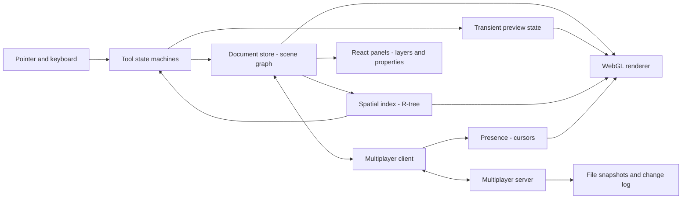

## 1. Requirements exploration

A design tool is closer to a game engine than to a typical web app: a scene graph, a render loop, a camera,
hit testing, and a tight interaction loop. On top of that sits multiplayer sync. The interviewer is looking for a
clear rendering decision, a scene model that suits both rendering and syncing, and credible performance techniques
for very large files.

### Functional requirements

- Infinite canvas with pan (drag, trackpad, space+drag) and zoom (pinch, `Ctrl`+wheel, zoom to fit/selection).
- Tools: select, rectangle, ellipse, line/arrow, pen (Bézier paths), pencil (freehand), text, image, frame.
- Select (click, shift-click, marquee), move, resize, rotate, with snapping and smart guides.
- Group/ungroup, z-order (bring forward/back), layers panel, lock/hide.
- Properties panel: fill, stroke, opacity, corner radius, text styles.
- Multiplayer: live edits, cursors with names, others' selections, "follow" a collaborator's viewport.
- Undo/redo (mine only), copy/paste (within and across files, and paste images from the OS), export PNG/SVG/PDF.
- Comments pinned to canvas coordinates or objects.

### Non-functional requirements

| Concern | Target |
| --- | --- |
| Pan/zoom | 60 fps (16 ms frame) with 100k objects; 120 fps on high-refresh displays where possible |
| Drag latency | object follows the pointer within one frame |
| File open | interactive < 3 s for a 50k-object file; progressive loading by page/frame |
| Multiplayer | remote edits visible p95 < 300 ms; cursors ~20 updates/s, smoothed |
| Memory | < 1 GB for the largest supported files; texture memory budgeted on the GPU |
| Correctness | all clients converge; no orphaned or cyclic tree after concurrent reparenting |
| Accessibility | toolbar, panels and layers fully keyboard and screen-reader accessible; canvas objects reachable via the layers tree |

### Out of scope

- Prototyping/animations, plugin platform, design-token export, version branching. Mention them as extensions.
- Font rendering engine internals beyond the choice of approach.

### Clarifying questions

1. Is this Figma-like (precision vector editing, huge files) or Canva-like (templates, fewer objects, more
   images)? This drives how far to push rendering.
2. Offline editing needed? For how long?
3. Which browsers? (WebGL2 is universal in 2025; WebGPU is available in Chromium and Safari and rolling out in
   Firefox, so it is a progressive enhancement, not a baseline.)
4. Is exact cross-platform rendering parity required (same pixels on every OS)? That pushes towards rendering text
   and shapes yourself instead of relying on the browser.

Assume Figma-like precision, short offline tolerance (reconnects), desktop browsers.

## 2. Architecture / high-level design

### Rendering: SVG vs Canvas 2D vs WebGL

| Option | Strengths | Weaknesses | Fits |
| --- | --- | --- | --- |
| **SVG/DOM** | free hit testing, events, CSS, accessibility, crisp at any zoom, easy export | every object is a DOM node; style/layout cost grows linearly; > ~5k nodes gets janky on pan/zoom | diagram tools with hundreds of shapes, whiteboards with modest content |
| **Canvas 2D** | immediate mode, simple API, good text via `fillText`, thousands of shapes fine | CPU rasterisation; you build hit testing, dirty rects, text editing yourself; 50k+ shapes per frame is slow | Canva-like editors, Excalidraw-style whiteboards |
| **WebGL2 (or WebGPU)** | GPU rasterisation, instancing, tiles cached as textures, smooth zoom | you build everything, including text and vector path rendering (tessellation or SDF/stencil techniques); harder to debug; context loss handling | Figma-scale precision tools |

**Decision:** a **WebGL2 renderer** behind a renderer interface, with a Canvas 2D fallback for export and
low-end devices, and WebGPU as a future backend. Figma famously renders with its own engine (C++ compiled to
WebAssembly) on WebGL, and has been adding WebGPU. A smaller team building a Canva-like product should start with
Canvas 2D (or a library like Konva/Pixi) and only move to WebGL when profiling demands it. The DOM is still used for
everything that is not the canvas: toolbars, panels, menus, the text editing overlay and the accessibility tree.

### Components

| Component | Responsibility |
| --- | --- |
| **Document store** | the scene graph (nodes by ID, parent/child order), applies local and remote changes, emits change events |
| **Scene index** | spatial index (R-tree / quadtree) of world-space bounding boxes for hit testing and culling |
| **Renderer** | camera transform, culling, batching, tile cache, draws each frame on `requestAnimationFrame` when dirty |
| **Tool state machines** | one per tool (select, pen, text…): pointer events in, intents out (preview state + committed changes) |
| **Selection and transform** | selection set, handles, snapping engine, smart guides |
| **Multiplayer client** | WebSocket, outbound change batching, inbound application, ack tracking, presence |
| **Undo manager** | stack of inverse changes for local edits |
| **Panels (React)** | layers tree, properties panel, toolbar; subscribe to selected-node slices only |
| **Workers** | image decoding, path boolean ops, export rasterisation, file parsing |



Key separation: **React never renders canvas objects.** The scene graph is a plain mutable store optimised for the
renderer; React panels subscribe to small slices (the selected node's properties, the layers tree for the visible
part of the list).

## 3. Data model

### Scene graph

```ts
type NodeId = string; // e.g. `${clientId}:${counter}`, globally unique without a server round trip

interface BaseNode {
  id: NodeId;
  type: 'frame' | 'group' | 'rect' | 'ellipse' | 'path' | 'text' | 'image';
  parentId: NodeId | null;
  // Fractional index string: ordering among siblings without renumbering
  sortKey: string;              // e.g. "a0", "a0V", "a1"
  name: string;
  transform: [number, number, number, number, number, number]; // 2D affine, relative to parent
  width: number;
  height: number;
  opacity: number;
  visible: boolean;
  locked: boolean;
}

interface ShapeStyle {
  fills: Paint[];
  strokes: Paint[];
  strokeWidth: number;
  cornerRadius?: number;
}

interface PathNode extends BaseNode, ShapeStyle {
  type: 'path';
  // compact command encoding: M x y, C x1 y1 x2 y2 x y, Z
  commands: Float32Array;
}

interface TextNode extends BaseNode {
  type: 'text';
  characters: string;
  styleRuns: Array<{ start: number; end: number; fontFamily: string; fontSize: number; fontWeight: number }>;
}

interface ImageNode extends BaseNode, ShapeStyle {
  type: 'image';
  imageHash: string; // content-addressed blob, uploaded separately
}

type Paint =
  | { type: 'solid'; color: [number, number, number, number] }
  | { type: 'linear-gradient'; stops: Array<{ pos: number; color: [number, number, number, number] }> }
  | { type: 'image'; imageHash: string; scaleMode: 'fill' | 'fit' | 'tile' };
```

Why these choices:

- **Flat map + parent pointer** (`Map<NodeId, Node>`) rather than nested children arrays: a change is "set
  property P of node N", which is easy to sync, undo and diff. Children order comes from `sortKey`.
- **Fractional indexing** lets two users insert between the same siblings concurrently without renumbering; ties are
  broken by node ID.
- **Local transforms** relative to parent; world transforms are computed and cached, invalidated on ancestor change.
- **Content-addressed images**: upload once, reference by hash; dedupes across files.

### Derived and transient state

```ts
interface RenderCache {
  worldTransform: Map<NodeId, Float32Array>;
  worldBounds: Map<NodeId, AABB>;     // feeds the spatial index
  tessellation: Map<NodeId, GpuMesh>; // per-node geometry, rebuilt on shape change
}

interface Camera { x: number; y: number; zoom: number } // world -> screen

interface Presence {
  userId: string;
  color: string;
  cursor: { x: number; y: number } | null; // world coordinates
  selection: NodeId[];
  viewport: { x: number; y: number; w: number; h: number };
}
```

Transient interaction state (the rectangle being dragged out, the in-progress path) lives in the tool, not the
document, until commit. Optionally broadcast it as "ephemeral" changes so collaborators see the drag in progress.

## 4. Interface definition (API)

### REST

```http
GET  /api/files/:fileId              -> { id, name, role, pages: [{ id, name }], version }
GET  /api/files/:fileId/snapshot     -> binary scene snapshot (all pages, or ?page=:id for lazy pages)
POST /api/images                     (multipart, returns { hash, width, height })
GET  /api/images/:hash?w=512         -> resized image from CDN
POST /api/files/:fileId/exports      { nodeIds, format: "png" | "svg" | "pdf", scale } -> { jobId }
```

### Multiplayer protocol

```ts
// A change is a set of property writes on nodes, plus creates and deletes.
type NodeChange =
  | { op: 'create'; node: SerializedNode }
  | { op: 'set'; id: NodeId; props: Partial<SerializedNode> }   // only changed properties
  | { op: 'delete'; id: NodeId };

type ClientMsg =
  | { t: 'changes'; batchId: number; changes: NodeChange[] }
  | { t: 'presence'; cursor?: { x: number; y: number }; selection?: NodeId[]; viewport?: Viewport }
  | { t: 'ephemeral'; changes: NodeChange[] }; // drag previews, not persisted

type ServerMsg =
  | { t: 'init'; version: number; snapshot: Uint8Array }
  | { t: 'changes'; version: number; authorId: string; changes: NodeChange[] }
  | { t: 'ack'; batchId: number; version: number }
  | { t: 'reject'; batchId: number; reason: 'PERMISSION' | 'CYCLE' | 'INVALID' }
  | { t: 'presence'; userId: string; state: Partial<Presence> };
```

### Tool interface

```ts
interface Tool {
  id: string;
  cursor: string;
  onPointerDown(e: CanvasPointerEvent, ctx: ToolContext): void;
  onPointerMove(e: CanvasPointerEvent, ctx: ToolContext): void;
  onPointerUp(e: CanvasPointerEvent, ctx: ToolContext): void;
  onKeyDown?(e: KeyboardEvent, ctx: ToolContext): boolean;
}

interface CanvasPointerEvent {
  screen: { x: number; y: number };
  world: { x: number; y: number };
  pressure: number;           // from PointerEvent, for pencil tools
  modifiers: { shift: boolean; alt: boolean; meta: boolean };
}
```

## 5. Optimizations and deep dives

### Multiplayer model

A full text-style CRDT is unnecessary: objects and their properties are the unit of change.

- **Per-property last-writer-wins, ordered by a central server.** Two users changing the fill of the same rectangle:
  the later one at the server wins and everyone converges. Changing different properties of the same object both
  survive. This is simple, predictable and matches users' mental model.
- **Optimistic local application with pending-wins**: the client applies its change immediately. If a remote change
  to the same property arrives before the server acks mine, keep my local value (the server will order mine later),
  otherwise the property would flicker back and forth.
- **Tree integrity**: concurrent reparenting can create a cycle (A into B while B into A). The server validates
  and rejects the later move; the client reverts it. Deleting a parent while someone adds a child: the server
  rejects or reparents the orphan to the page.
- **Ordering**: fractional `sortKey` strings; two clients generating the same key are tie-broken by ID.
- **Why not OT or a sequence CRDT?** There are no positional sequences except inside text nodes and child order.
  Text inside a text node can use a small sequence CRDT or simply LWW on the whole string with locking while
  someone edits it (a pragmatic choice: concurrent typing in the same text box is rare in design tools).
- **Offline**: queue changes; on reconnect send them with the base version; LWW makes the merge straightforward. Warn
  if the offline period was long and the user's changes overwrote others'.

### Spatial indexing and hit testing

- Maintain an **R-tree** (or a loose quadtree) of world-space AABBs. Queries: "nodes intersecting the viewport"
  (culling), "nodes under the pointer" (hit testing), "nodes inside the marquee" (selection), "nearby edges" (snapping).
- Hit testing is two-phase: broad phase via the index (candidate boxes), narrow phase on exact geometry (point in
  polygon, distance to stroke within a tolerance scaled by zoom, rotated bounds), walking candidates in reverse
  z-order to get the topmost.
- Update cost: moving 500 selected nodes updates 500 entries; batch updates per frame. During a drag, keep the
  dragged nodes out of the index and treat them separately; reinsert on drop.
- An alternative for exact hit testing is **GPU picking**: render IDs as colours to an off-screen buffer and read the
  pixel under the cursor. Accurate for complex shapes but `readPixels` stalls the GPU; use sparingly (on click, not on
  every move).

### Rendering performance

- **Dirty flag render loop**: only draw when something changed (camera, scene, presence). Idle files use zero GPU.
- **Viewport culling** via the index; skip nodes smaller than a pixel at the current zoom (or draw them as a single
  dot).
- **Batching/instancing**: group draws by material; one draw call for thousands of solid rectangles.
- **Tiles**: rasterise the static scene into tiles (e.g. 512×512 px) per zoom level and cache them as textures. Pan
  composites cached tiles; zoom shows the nearest cached level scaled while sharp tiles render progressively.
- **Level of detail**: at low zoom, render frames as simplified previews; images use mip-mapped lower-resolution
  textures fetched from the CDN by size.
- **Text**: either browser text via Canvas 2D rasterised to textures (simple, but metrics vary by platform) or a
  custom text shaper (HarfBuzz compiled to WebAssembly) with glyph atlases for exact parity. Mention the trade-off.
- **WebAssembly** for the hot core (geometry, tessellation, boolean ops) gives predictable performance with no GC
  pauses mid-gesture.
- **Context loss**: WebGL contexts can be lost (GPU reset, too many tabs). Listen for `webglcontextlost`, rebuild GPU
  resources from the scene graph on restore.

### Interaction loop

- Use Pointer Events with `setPointerCapture` so drags continue outside the canvas; use `getCoalescedEvents()`
  for smooth freehand strokes and `pressure` for pen input.
- Coalesce work per frame: pointer moves update transient state; one `requestAnimationFrame` renders. Never commit a
  document change per pointermove: commit once on pointerup (and send ephemeral previews at a throttled rate).
- Snapping: query the index for nearby nodes' edges and centres within a screen-space threshold; compute guides.
- Wheel: distinguish trackpad pinch (`ctrlKey` set on wheel events in Chromium/Firefox) from scrolling; zoom around
  the pointer position.

### Presence

- Cursors at ~20 Hz, interpolated on receivers (render at 60 fps, lerp between samples) so they glide.
- "Follow" mode: subscribe to a user's viewport updates and animate the camera.
- For files with hundreds of viewers, the server fans out presence only for editors plus a sample; viewer counts
  shown as a number.

### Undo/redo

Record the inverse of each local change (previous property values) as one undo step per gesture. Undo applies the
inverse as a **new** change, so it syncs like any other edit. If a collaborator has since changed the same property,
the product decision is usually "undo still applies my previous value" (Figma-style), which is simple and
predictable; document it.

### Accessibility

- The canvas itself gets an accessible name and description; the **layers panel** is a real tree (`role="tree"`)
  that mirrors the scene, so screen-reader users can navigate, select and edit objects through panels.
- All tools are reachable from the keyboard; arrow keys nudge the selection (Shift for 10 px); properties are
  editable as form fields.
- Respect `prefers-reduced-motion` for camera animations; ensure collaborator colours have accessible contrast
  with labels.

### Security and robustness

- Server validates every change: permissions, schema, sizes (a 100 MB path is rejected).
- Pasted SVG is parsed into nodes, never injected as markup.
- Image uploads are scanned and served from a separate domain.
- Autosave status and a local recovery buffer (IndexedDB) for unacked changes.

### Observability and testing

- Frame time histograms during pan/zoom/drag per file-size bucket; long task attribution; GPU memory estimates.
- Visual regression tests that render scenes to PNG and diff against goldens across GPUs.
- Multiplayer fuzzing: random concurrent create/move/delete/reparent ops across simulated clients, assert
  convergence and tree validity.

## What a lead-level answer adds

- Chooses the renderer by product requirements and team capacity: Canvas 2D or a library for a Canva-like product,
  a custom WebGL/Wasm engine only when scale and precision justify the cost.
- Picks a **simpler conflict model** (LWW per property with server ordering) than a general CRDT and explains why it
  suits objects, while handling the genuinely hard cases (cycles, orphans, ordering).
- Draws a hard line between the high-frequency engine (no React, no allocation in the hot path) and the React UI.
- Plans the performance program: frame-time budgets by file size, synthetic large files in CI, telemetry on real
  files.
- Considers organisational design: an engine team owning rendering and the scene graph API, product teams building
  tools on top through the `Tool` interface.

## Common follow-up questions

**How do you implement the eraser or boolean operations (union/subtract)?** Run path booleans in a worker or Wasm
module on the paths' geometry; produce a new path node and delete the originals in one change and one undo step.

**How does copy/paste across files work?** Serialize the selected subtree (with new IDs on paste) to the clipboard
as a custom MIME payload plus an SVG/PNG fallback for other apps. Images are referenced by hash, so no re-upload is
needed if the hash exists.

**How do you render 1 million objects?** You mostly don't: culling and LOD mean only visible, pixel-relevant objects
render; tiles cache static content; pages load lazily. Memory, not GPU, becomes the limit, so keep compact typed-array
representations.

**What happens when two people drag the same object?** Both see their own drag locally; the server orders the two
commits; the last one wins on drop. Showing the other user's selection outline discourages this in practice.

**How would you build "follow presenter" for 500 viewers?** The presenter's viewport and selection are published on
a broadcast channel; viewers interpolate. The server rate-limits and fans out via a pub/sub tier separate from the
edit path.

**SVG for export?** Yes: export walks the scene graph and emits SVG elements, independent of the on-screen renderer.
This is another reason to keep the document model renderer-agnostic.
