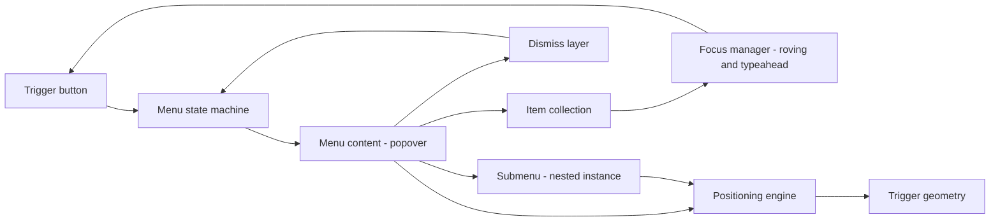

## 1. Requirements exploration

A dropdown menu is a small component with three hard problems: **semantics** (a menu is not a listbox, a
navigation list or a dialog, and choosing wrong breaks screen readers), **focus and keyboard management**
(roving focus, typeahead, submenus, returning focus), and **positioning and layering** (escaping `overflow: hidden`
and `z-index` stacking contexts, flipping at edges). A lead-level answer also designs the API for a design system:
composable, headless where needed, and hard to misuse.

### Functional requirements

- Trigger button opens a menu on click, `Enter`, `Space` or `ArrowDown` (focus first item) / `ArrowUp` (focus last).
- Item types: action (`onSelect`), link (navigates), checkbox item, radio group, separator, group label, submenu.
- Disabled items (focusable but not activatable, or skipped — configurable), icons, shortcut hints, destructive
  styling.
- Menu closes on selection (configurable for checkbox items), `Escape`, outside click, `Tab`, or trigger click.
- Submenus open on hover (with intent detection), `ArrowRight` (`ArrowLeft` in RTL) or `Enter`.
- Typeahead: typing letters focuses the next matching item.
- Positioning: below the trigger, flip above when there's no space, shift to stay in the viewport, constrained max
  height with scrolling, follows the trigger on scroll.
- Works inside modals, scroll containers, tables and sticky headers.

### Non-functional requirements

| Concern | Target |
| --- | --- |
| Open latency | opens in the same frame as the click (< 16 ms of script work) |
| Positioning | no visible jump on open; repositions within one frame on scroll/resize |
| Bundle | < 6 KB gzip for menu + positioning core |
| Accessibility | WAI-ARIA APG menu button pattern; works with NVDA, JAWS, VoiceOver, TalkBack |
| Theming | headless primitives + styled default; no hard-coded styles in behaviour code |
| Robustness | correct inside `overflow: hidden`, transformed ancestors, iframes, RTL |

### Out of scope

- Menubars (application "File / Edit / View" bars) beyond noting the pattern; context menus are a small extension.
- Select/combobox inputs, which are a different component.

### Clarifying questions

1. Are the items **actions/navigation** (menu) or **a value choice** (select/listbox)? If the user is choosing a value
   that is displayed in the trigger, that's a select, not a menu.
2. Do we need nested submenus? How deep? (More than two levels is a UX smell.)
3. Which browsers? (Determines whether we can rely on the Popover API and CSS anchor positioning.)
4. Will items be dynamic or async (loaded on open)?
5. Touch-first contexts: should the menu become a bottom sheet on mobile?

## 2. Architecture / high-level design

### Menu vs other patterns

| Need | Pattern | Roles |
| --- | --- | --- |
| list of actions or links behind a button | **menu button** | `button[aria-haspopup="menu"]` + `role="menu"` + `menuitem*` |
| choose a value shown in the trigger | **select / listbox** | `combobox` + `listbox` + `option` |
| site navigation links in a disclosure | **disclosure navigation** | `button[aria-expanded]` + plain list of links |
| rich content (forms) in a floating panel | **popover / non-modal dialog** | `dialog` or no role with `aria-expanded` |

ARIA menus put screen readers into a special interaction mode and expect application-style keyboard behaviour.
Using `role="menu"` for site navigation is a common mistake; a disclosure with links is better there. Saying this
unprompted is a strong signal.

### Layers

| Part | Responsibility |
| --- | --- |
| **Menu state machine** | closed, open (with focus target: first/last/none), submenu open stack |
| **Collection** | ordered registry of items (key, text value for typeahead, disabled), built from children |
| **Focus manager** | roving focus or `aria-activedescendant`, typeahead buffer, wrap behaviour |
| **Dismiss layer** | outside pointer down, `Escape`, focus leaving the menu tree (including submenus in portals) |
| **Positioning engine** | anchor + floating element geometry: placement, flip, shift, size, auto-update |
| **Layering** | top layer via Popover API, or a portal with a managed z-index stack |
| **Styled components** | `DropdownMenu.Trigger`, `.Content`, `.Item`, `.CheckboxItem`, `.Sub`… |



Submenus are recursive instances of the same machinery, with the parent item as anchor and the parent menu as the
dismiss "inside" region.

## 3. Data model

```ts
type ItemKey = string;

interface MenuItemRecord {
  key: ItemKey;
  textValue: string;            // used for typeahead; from children text or explicit prop
  disabled: boolean;
  kind: 'action' | 'link' | 'checkbox' | 'radio' | 'submenu';
  ref: React.RefObject<HTMLElement>;
}

interface MenuState {
  open: boolean;
  focusOnOpen: 'first' | 'last' | 'none';
  activeKey: ItemKey | null;    // currently focused/highlighted item
  typeahead: { buffer: string; lastKeyAt: number };
  openSubmenuKey: ItemKey | null;
  // pointer intent for submenus: last few pointer positions to compute the safe triangle
  pointerTrail: Array<{ x: number; y: number }>;
}
```

Items register themselves in DOM order (a collection built from refs, sorted with
`compareDocumentPosition`), so conditional rendering, fragments and wrappers all work. Checkbox and radio states are
owned by the consumer (`checked` + `onCheckedChange`), keeping the menu stateless about business data.

## 4. Interface definition (API)

### Compound components

```tsx
<DropdownMenu.Root modal={false} onOpenChange={setOpen}>
  <DropdownMenu.Trigger asChild>
    <IconButton aria-label="More actions" icon={<MoreIcon />} />
  </DropdownMenu.Trigger>

  <DropdownMenu.Content placement="bottom-end" sideOffset={4} collisionPadding={8}>
    <DropdownMenu.Item onSelect={rename} shortcut="F2">Rename</DropdownMenu.Item>
    <DropdownMenu.Item onSelect={duplicate}>Duplicate</DropdownMenu.Item>
    <DropdownMenu.Separator />
    <DropdownMenu.Group label="View">
      <DropdownMenu.CheckboxItem checked={showGrid} onCheckedChange={setShowGrid}>
        Show grid
      </DropdownMenu.CheckboxItem>
    </DropdownMenu.Group>
    <DropdownMenu.Sub>
      <DropdownMenu.SubTrigger>Move to</DropdownMenu.SubTrigger>
      <DropdownMenu.SubContent>
        {folders.map(f => (
          <DropdownMenu.Item key={f.id} onSelect={() => move(f.id)}>{f.name}</DropdownMenu.Item>
        ))}
      </DropdownMenu.SubContent>
    </DropdownMenu.Sub>
    <DropdownMenu.Separator />
    <DropdownMenu.Item onSelect={remove} variant="destructive">Delete</DropdownMenu.Item>
  </DropdownMenu.Content>
</DropdownMenu.Root>
```

### Prop types

```ts
interface DropdownMenuRootProps {
  open?: boolean;
  defaultOpen?: boolean;
  onOpenChange?: (open: boolean) => void;
  modal?: boolean;              // true: outside content is inert while open
  dir?: 'ltr' | 'rtl';
}

interface DropdownMenuContentProps {
  placement?: `${'top' | 'bottom' | 'left' | 'right'}${'' | '-start' | '-end'}`;
  sideOffset?: number;
  collisionPadding?: number;
  loop?: boolean;               // wrap focus from last to first item
  onEscapeKeyDown?: (e: KeyboardEvent) => void;   // call preventDefault() to keep open
  onPointerDownOutside?: (e: PointerEvent) => void;
  onCloseAutoFocus?: (e: Event) => void;          // customise where focus returns
}

interface DropdownMenuItemProps {
  onSelect?: (e: Event) => void; // preventDefault() keeps the menu open
  disabled?: boolean;
  textValue?: string;            // typeahead text if children are complex
  shortcut?: string;             // display only; the app registers the shortcut
  variant?: 'default' | 'destructive';
  asChild?: boolean;             // render as a link: <Item asChild><a href="/settings">…</a></Item>
}
```

Design notes:

- **`onSelect` instead of `onClick`**: fires for pointer, `Enter` and `Space` uniformly, after which the menu closes
  and focus returns to the trigger; it is cancelable.
- **`asChild`** (slot pattern) lets teams use their own button/link components without wrapper elements.
- A **headless hook** (`useMenu`) exists for teams with radically different visuals; the styled compound
  components are built on it.
- A data-driven convenience (`items={[…]}`) can be layered on top for simple menus, but the compound API is the
  primitive.

## 5. Optimizations and deep dives

### Keyboard interaction (APG menu button)

| Key | Behaviour |
| --- | --- |
| `Enter` / `Space` / `ArrowDown` on trigger | open, focus first item (`ArrowUp` opens and focuses the last) |
| `ArrowDown` / `ArrowUp` | move to next/previous enabled item (optionally wrap) |
| `Home` / `End` | first/last item |
| printable characters | typeahead: accumulate keys typed within ~500 ms, focus next item whose `textValue` starts with the buffer; repeating one letter cycles |
| `Enter` / `Space` on item | activate; checkbox toggles; close unless prevented |
| `ArrowRight` on submenu trigger | open submenu, focus its first item (`ArrowLeft` in RTL) |
| `ArrowLeft` in submenu | close submenu, focus its trigger |
| `Escape` | close the current (sub)menu, return focus to its trigger |
| `Tab` | close the whole menu and let focus move naturally |

Typeahead should match with `Intl.Collator` base sensitivity (or at least case-insensitive, accent-aware) for i18n.

### Focus management

- **Roving focus** (actual DOM focus moves to each `menuitem` with `tabindex="-1"`) is the most robust option for
  menus: screen readers follow focus reliably. `aria-activedescendant` (focus stays on the container) is an
  alternative useful for comboboxes but less consistently supported for menus.
- On open, focus the first item (or the menu itself on pointer open, depending on convention) after the content is
  positioned, to avoid scrolling the page to an unpositioned element (`focus({ preventScroll: true })`).
- On close, return focus to the trigger, unless closing was caused by clicking another focusable element outside, in
  which case let that element keep focus.
- Pointer hover moves the active item (so keyboard and mouse share one highlight), but hover leaving the menu should
  not leave a stale highlight.

### Submenus and hover intent

Moving the mouse diagonally from a submenu trigger towards the submenu crosses other items, which would open their
submenus and close the target. Solutions:

- **Safe triangle** (pointer-intent polygon): while the pointer moves within the triangle formed by the pointer
  position and the submenu's near edge, ignore hover on other items.
- Short open/close delays (~100–200 ms) as a simpler fallback.
- On touch, submenus open on tap, never hover.

### Positioning

The floating element must be anchored to the trigger and stay visible:

- **Compute**: placement (`bottom-start`), `offset`, **flip** to the opposite side if it doesn't fit, **shift** along
  the axis to stay within the viewport with padding, **size** to constrain `max-height` to available space
  (scrolling inside the menu), plus RTL mirroring of `start/end`. This is what Floating UI's middleware pipeline does;
  in practice use Floating UI (or React Aria's overlays) rather than hand-rolling the geometry.
- **Auto-update**: recompute on scroll of any ancestor scroll container, on resize (`ResizeObserver` on both
  elements), and on layout shifts; throttle to animation frames.
- **Hide when the anchor is clipped**: if the trigger scrolls out of its container, hide or close the menu.
- **CSS anchor positioning** (`anchor-name`, `position-anchor`, `position-try-fallbacks`) can now do placement and
  flipping declaratively in Chromium and Safari 26; it is not yet supported in every engine, so treat it as a
  progressive enhancement with the JS engine as fallback.

### Layering: escaping clipping and stacking contexts

A menu rendered inside a card with `overflow: hidden`, or inside an element with `transform`, gets clipped or
mis-stacked. Options:

- **Portal** to `document.body` with a managed z-index scale (tokens: dropdown 1000, modal 1100, toast 1200). Works
  everywhere, but z-index wars return when a menu opens inside a modal (the menu must stack above the modal).
- **Popover API + top layer**: `popover="auto"` (or `manual` controlled by our state) puts the content in the
  browser's **top layer**, above everything including `<dialog>` modals, regardless of `overflow` or `z-index` of
  ancestors. It also provides light dismiss (outside click and `Escape`) and keeps nested popovers open when opened
  from within a parent popover. Baseline since 2024. The DOM stays in place (better for event bubbling and React
  context), no portal needed.
- Decision: use the **Popover API with `popover="manual"`** controlled by our state machine (so we keep exact control
  over dismissal rules, submenus and `onOpenChange`) and fall back to a portal where unsupported.

### Dismissal rules

- Outside `pointerdown` closes the menu; clicking the trigger toggles it (don't close on pointerdown and reopen on
  click).
- Submenus are portaled/top-layered elsewhere in the DOM, so "outside" must be computed against the **menu tree**
  (root + open submenus), not DOM containment.
- `Escape` closes only the innermost layer; the event must not also close a parent modal (stop propagation once
  handled, or coordinate through a shared layer stack).
- Scroll outside: either close (simple) or reposition (better for long pages); choose per product.

### Accessibility details

- Trigger: `<button aria-haspopup="menu" aria-expanded="true|false" aria-controls="menu-id">`.
- Content: `role="menu"`, `aria-labelledby` pointing at the trigger (or `aria-label`).
- Items: `role="menuitem"`, `menuitemcheckbox` with `aria-checked`, `menuitemradio` within a `role="group"`;
  disabled items use `aria-disabled="true"` (still discoverable).
- Separators: `role="separator"`; group labels via `role="group"` + `aria-labelledby`.
- Links inside menus: `menuitem` rendered as `<a>` keeps link behaviour (middle-click, open in new tab).
- Shortcut hints: render with `aria-keyshortcuts` on the item (only if the shortcut actually works globally).
- Touch targets ≥ 24×24 CSS px (WCAG 2.5.8), and menus usable with screen magnifiers (no hover-only actions).

### Performance

- Render content only when open (lazy mount), unless consumers need it pre-rendered for SEO (they don't, for menus).
- Positioning reads layout once per frame; avoid forced synchronous layout loops.
- For very long menus (> 100 items), consider a different component (a searchable command palette) rather than
  virtualizing a menu.

### Testing

- Unit tests of the state machine and typeahead.
- Interaction tests (Testing Library + user-event) for every key in the table above, RTL, and focus return.
- Visual tests near viewport edges, in scroll containers, inside dialogs and transformed parents.
- Screen reader smoke tests per release.

## What a lead-level answer adds

- Starts with **"is this really a menu?"**, steering teams away from `role="menu"` for navigation and value
  selection.
- Uses the platform: Popover API/top layer for layering, CSS anchor positioning as enhancement, `inert` for modal
  menus.
- Designs the API for many teams: compound + headless, `asChild`, cancelable `onSelect`, controlled/uncontrolled open
  state, documented escape hatches for focus return.
- Recommends building on proven primitives (React Aria, Radix, Ariakit, Floating UI) and investing in tests and
  documentation rather than reinventing the hardest parts.
- Owns cross-component concerns centrally: a single layer/dismiss stack so menus, modals, tooltips and toasts
  cooperate.

## Common follow-up questions

**How do you implement a context menu (right-click)?** Same content component; the anchor is a virtual element at
the pointer coordinates (`getBoundingClientRect` returning a zero-size rect). Open on `contextmenu` and on
`Shift+F10`/the context menu key for keyboard users.

**Should disabled items be focusable?** APG allows both; focusable disabled items let screen reader users discover
that an action exists but is unavailable. Make it the default and explain why in docs.

**How would you make the menu a bottom sheet on mobile?** Keep the same state and collection logic; swap the
`Content` renderer below a breakpoint to a modal sheet (`<dialog>`), keeping `role="menu"` inside.

**Why not just use `<select>`?** It's for choosing a value, not triggering actions. Customisable `<select>`
(`appearance: base-select`) is arriving in Chromium for styled selects, but it still has listbox semantics.

**How do you handle async items?** Open immediately with a loading state (`aria-busy="true"` on the menu), then
populate; keep focus on the menu container until items arrive, then focus the first item.
