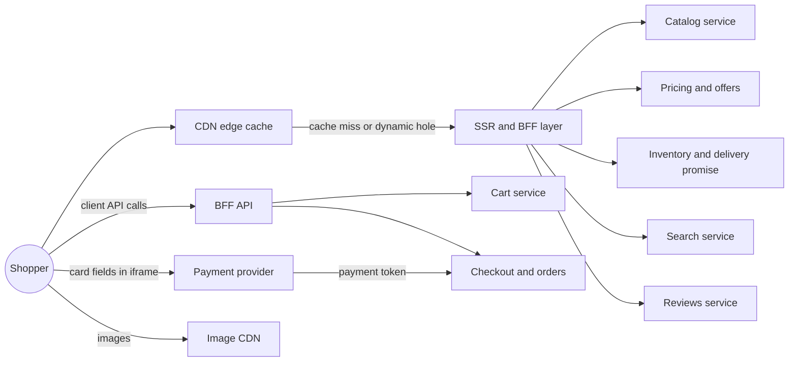

## 1. Requirements exploration

E-commerce is the classic **content-heavy, SEO-critical, conversion-sensitive** application. Unlike a social feed,
most pages are the same for every visitor except a few personalised fragments (price for your region, delivery
estimate, cart count). The core design question is: **how do we cache and serve mostly-static pages while keeping
the dynamic parts correct?**

### Functional requirements

- **Search & browse**: keyword search with autocomplete, category pages, faceted filters, sort, paginated grid.
- **PDP**: image gallery with zoom, variants, price (with discounts), stock status, delivery estimate for the user's
  location, seller info, reviews with filtering, recommendations.
- **Cart**: add to cart from listing and PDP, update quantity, save for later, guest cart merged on login.
- **Checkout**: address book, delivery speed options, payment methods (cards, wallets), promo codes, order review,
  place order, confirmation.
- Locale and currency switching.

### Non-functional requirements

| Concern | Target |
| --- | --- |
| LCP | < 2.0 s p75 on PDP and listing (mobile) |
| INP | < 200 ms (filters, add-to-cart, variant switches) |
| CLS | < 0.1 (ads, recommendations and price must not shift the page) |
| TTFB | < 600 ms p75 globally → CDN edge caching |
| SEO | all listing and product pages crawlable, structured data, canonical URLs |
| Correctness | price and availability validated server-side at checkout; idempotent order placement |
| Availability | browsing works even if recommendations/reviews services are degraded |
| Security | PCI DSS scope minimised; no raw card data touching our JS |

### Out of scope

Seller tools, warehouse/fulfilment, search ranking internals, recommendation models, returns flow.

### Clarifying questions

1. Is it a single storefront or multi-seller marketplace? (Same product, multiple offers → "buy box".)
2. How many SKUs and how often do prices change? (Millions; minutes) → full-page caching must exclude prices or use
   short TTLs.
3. Is personalisation required on first paint (e.g. "Hi, Sam" and delivery estimate)?
4. Which payment providers? Are we allowed to collect card data directly? (Assume a PSP with hosted fields.)
5. Mobile app shares APIs? (Yes — a BFF per client is reasonable.)
6. Markets and languages at launch? (Drives URL structure for i18n SEO.)

## 2. Architecture / high-level design

### Rendering strategy by page

| Page | Strategy | Reasoning |
| --- | --- | --- |
| Home | SSR at edge + personalised islands | Mostly merchandising; personal rows streamed |
| Category / search listing | SSR, CDN cache keyed by URL (filters in query string), short TTL (60 s) + SWR | SEO, shareable filter URLs |
| PDP | SSR/ISR (static shell cached, regenerated on product update) + **dynamic price/stock/delivery fetched or streamed** | SEO, fast TTFB, fresh price |
| Cart, checkout | CSR or SSR without caching (`Cache-Control: private, no-store`) | Fully personal, correctness over cacheability |
| Account, orders | SSR private | Personal |

The key pattern is **static shell + dynamic holes**: the bulk of the PDP (title, images, description, specs, review
summary) is cacheable for minutes to hours and identical for everyone in a locale. Price, stock, delivery
promise and cart badge are personal or volatile and are filled in separately via:

- **Streaming SSR with Suspense** (React 18+): the shell flushes immediately from cache; the price block
  streams when the pricing service responds. With React 19 / Next.js "partial prerendering", the static shell is
  prerendered and dynamic holes stream in the same response.
- **Edge composition** (ESI or edge functions) that stitch a cached page with personalised fragments.
- **Client fetch** after hydration: simplest, but price pops in late and must reserve space.

Price is part of the purchase decision and the `Product` structured data, so I'd render a **cached list price in
HTML** (for SEO and fast paint, with a short TTL) and **verify/replace it with the live, personalised price** via a
streamed boundary. Checkout re-validates regardless.

### Micro-frontends?

At Amazon scale, separate teams own search, PDP, cart and checkout. Options: one monorepo app with strong module
ownership, or route-level micro-frontends (each route a separately deployed app behind the same domain). Route-level
splits are the low-risk version; component-level runtime composition (module federation) adds complexity and
duplicate-dependency risk. Mention it; don't make it the centre of the answer.

### Component tree (PDP)

```
<ProductPage>
  <Header>  <SearchBox /> <DeliverToLocation /> <CartBadge /> </Header>
  <Breadcrumbs />
  <ProductGallery />                    // images, video, zoom; LCP element
  <ProductInfo>
    <Title /> <RatingSummary />
    <VariantSelector />                 // size, color -> updates URL ?variant=
    <Suspense fallback={<PriceSkeleton />}><PriceBlock /></Suspense>
    <Suspense><AvailabilityAndDelivery /></Suspense>
  </ProductInfo>
  <BuyBox>  <QuantityPicker /> <AddToCartButton /> <BuyNowButton /> <OtherSellers /> </BuyBox>
  <Suspense><FrequentlyBoughtTogether /></Suspense>   // below the fold, lazy
  <ProductDetails />                    // specs, description
  <Suspense><Reviews /></Suspense>      // paginated, lazy-hydrated
</ProductPage>
```



A **BFF (backend for frontend)** aggregates 5–10 downstream services into page-shaped responses, applies timeouts
(reviews are optional — if they're slow, render without them), and keeps the browser from making a waterfall of
calls.

## 3. Data model

### Server data (cached on the client in a query cache)

```ts
type ID = string;
type Money = { amount: string; currency: string }; // decimal string to avoid float errors, e.g. "19.99"

interface Product {
  id: ID;                         // parent product (ASIN-like)
  slug: string;
  title: string;
  brand: string;
  images: { url: string; width: number; height: number; alt: string }[];
  attributes: Record<string, string>;
  variantDimensions: { name: 'size' | 'color' | string; values: { id: ID; label: string; swatch?: string }[] }[];
  variants: Record<ID, { sku: ID; options: Record<string, ID>; imageIndex: number }>; // key = variant id
  ratingSummary: { average: number; count: number; histogram: number[] };
  updatedAt: string;
}

interface Offer {                  // volatile, personalised: never baked into long-cached HTML
  sku: ID;
  sellerId: ID;
  price: Money;
  listPrice?: Money;
  availability: 'in_stock' | 'low_stock' | 'out_of_stock' | 'preorder';
  maxQuantity: number;
  deliveryPromise?: { earliest: string; latest: string; cutoffAt?: string; option: string };
  fetchedAt: string;
}

interface Cart {
  id: ID;
  version: number;                // optimistic concurrency
  lines: { lineId: ID; sku: ID; quantity: number; unitPrice: Money; savedForLater: boolean; warnings?: string[] }[];
  subtotal: Money;
  itemCount: number;
}
```

### Client state

| State | Location |
| --- | --- |
| Search query, filters, sort, page | **URL** (`/s?k=headphones&brand=sony&sort=price_asc&page=2`) — shareable, crawlable, back button works |
| Selected variant | URL (`?th=1&psc=...` style, or `/dp/:id?variant=blue-m`) |
| Gallery index, zoom, open accordions | component state |
| Cart | server (cart service) + client cache; **guest cart id in a cookie** |
| Checkout step data | server-side checkout session; client form state per step |
| Recently viewed | localStorage (privacy-friendly, no login needed) |
| Location / currency preference | cookie (so SSR can use it), with care about CDN cache keys |

Putting filters in the URL is the single biggest state-design decision: it gives SEO, sharing, history and
server-rendering for free. Not every filter combination should be indexed, though: canonicalize and `noindex`
deep combinations to avoid crawl traps.

## 4. Interface definition (API)

### Search

```http
GET /api/search?k=wireless+headphones&brand=sony,bose&price=50-200&sort=relevance&page=2&pageSize=48&locale=en-US
```

```json
{
  "query": "wireless headphones",
  "total": 3412,
  "page": 2,
  "pageSize": 48,
  "items": [
    { "id": "B0XYZ", "slug": "sony-wh-1000xm5", "title": "Sony WH-1000XM5", "image": { "url": "https://img.example.com/B0XYZ_320.webp", "width": 320, "height": 320 },
      "price": { "amount": "329.99", "currency": "USD" }, "rating": 4.6, "ratingCount": 18211, "badges": ["fast_delivery"] }
  ],
  "facets": [
    { "id": "brand", "label": "Brand", "type": "multi", "values": [{ "id": "sony", "label": "Sony", "count": 312, "selected": true }] },
    { "id": "price", "label": "Price", "type": "range", "min": 9, "max": 899 }
  ],
  "spellCorrection": null
}
```

**Offset/page-number pagination is the right choice here**, unlike a social feed: users and crawlers need stable,
addressable pages (`page=3`), the result set for a given query is fairly stable, and showing "1–48 of 3,412" matters.
Deep pagination is capped (e.g. 20 pages) because deep offsets are expensive for the search engine and nobody browses
page 300. Mobile may use "Load more" on top of the same page parameter.

### PDP

```http
GET /api/products/B0XYZ?locale=en-US            -> Product (cacheable: s-maxage=300, stale-while-revalidate=3600)
GET /api/offers?skus=B0XYZ-BLK&zip=98101        -> Offer[] (private or short-lived; varies by location and user)
GET /api/products/B0XYZ/reviews?cursor=...&sort=helpful&rating=5   -> cursor pagination (infinite list)
```

Splitting **cacheable product content** from **volatile offers** is what makes the whole caching strategy work.

### Cart

```http
POST  /api/cart/lines            { "sku": "B0XYZ-BLK", "quantity": 1, "idempotencyKey": "a7f1..." }
PATCH /api/cart/lines/l_12       { "quantity": 3, "expectedVersion": 14 }
DELETE /api/cart/lines/l_12
GET   /api/cart                  -> Cart
```

- Responses return the **whole updated cart** (small), so the client replaces its cache rather than computing
  totals locally. Taxes, discounts and promotions are server logic.
- `expectedVersion` detects concurrent edits from another tab/device (409 → refetch and re-apply).

### Checkout

```http
POST /api/checkout/sessions                 -> { "sessionId": "chk_1", "cartVersion": 14 }
PUT  /api/checkout/sessions/chk_1/address   { "addressId": "a_3" }
PUT  /api/checkout/sessions/chk_1/delivery  { "option": "two_day" }
POST /api/checkout/sessions/chk_1/place-order
     { "paymentToken": "tok_from_psp", "expectedTotal": { "amount": "352.18", "currency": "USD" } }
     Idempotency-Key: 5b0e...
-> 201 { "orderId": "o_991", "status": "confirmed" }
-> 409 { "error": "price_changed", "newTotal": { "amount": "355.18", "currency": "USD" } }
```

`expectedTotal` ensures the user is never charged an amount they didn't see; a change returns 409 and the UI shows
the new total for re-confirmation. The `Idempotency-Key` header makes double-clicks and retries safe — the server
returns the same order instead of charging twice.

### Component props (examples)

```ts
interface VariantSelectorProps {
  dimensions: Product['variantDimensions'];
  selected: Record<string, ID>;
  availability: Record<ID, Offer['availability']>;   // to disable/strike out unavailable combos
  onChange: (next: Record<string, ID>) => void;      // updates URL with replaceState
}

interface AddToCartButtonProps {
  sku: ID;
  quantity: number;
  disabled?: boolean;
  onAdded?: (cart: Cart) => void;
}

interface FacetPanelProps {
  facets: Facet[];
  onToggle: (facetId: string, valueId: string) => void;   // pushes new URL; results fetched for URL
  onRange: (facetId: string, min: number, max: number) => void;
}
```

## 5. Optimizations and deep dives

### Caching layers

| Layer | What | TTL / strategy |
| --- | --- | --- |
| CDN (HTML) | listing, PDP shells per locale | `s-maxage=60–300, stale-while-revalidate`; purge on product update |
| CDN (assets) | JS/CSS with content hash | `max-age=31536000, immutable` |
| Image CDN | product images, resized | immutable URLs |
| BFF | product content, facets | in-memory/Redis, seconds-minutes |
| Browser | query cache (TanStack Query / framework cache) | stale time ~30 s for offers |
| Service worker | app shell, recently viewed PDPs | optional; careful with prices |

Cache keys must not explode: vary on locale and currency (in the URL path, e.g. `/en-gb/`), **not** on cookies like
session id. Personal data comes from uncached fragments. A classic bug is caching a page with someone's name or
cart count in it.

### Performance

- **LCP** is the main product image: SSR it with `fetchpriority="high"`, preload via a `Link` header (or 103 Early
  Hints) so the browser starts fetching before HTML parsing reaches it.
- **JS budget**: the PDP is mostly static content. Islands/partial hydration or React Server Components keep JS
  for description, specs and breadcrumbs at zero; only the buy box, gallery and variant selector hydrate.
  Reviews and recommendations hydrate on visibility.
- **Third parties** (analytics, ads, A/B testing, chat widgets) are the usual INP killers: load after
  interaction-ready, use `async`/`defer`, consider running tag managers in a worker (Partytown) and audit
  each tag's cost. A/B testing via edge (server-side assignment) avoids flicker and render-blocking scripts.
- **Faceted search INP**: toggling a filter updates the URL and fetches; mark the results update as a transition so
  the checkbox responds instantly while results show a pending state; abort superseded requests.
- **Prefetch**: when the user hovers or the tile enters the viewport with idle network, prefetch PDP data (or use
  Speculation Rules for prerendering the most likely next page in Chromium). Respect Save-Data.
- **bfcache**: avoid `unload` handlers and `no-store` on listing pages so "back to results" is instant.
- **Skeletons** with exact dimensions for price, delivery and recommendations keep CLS near zero.

### Cart and add-to-cart UX

- Optimistic cart badge increment and mini-cart flyout on add; on failure (out of stock), roll back with a clear
  message.
- Guest cart id in a first-party cookie; on login, the server merges guest and account carts (sum quantities, cap
  at limits) and returns the merged cart.
- Sync across tabs: `BroadcastChannel('cart')` to refresh the badge, or refetch on `visibilitychange`.
- Cart lines show **warnings** returned by the server ("Price changed from $X to $Y", "Only 2 left").

### Checkout

- A focused, minimal-JS route: no recommendations, no third-party scripts beyond payment; separate bundle.
- Each step persists to the server checkout session, so refresh/back doesn't lose progress.
- Autofill-friendly forms: correct `autocomplete` tokens (`shipping street-address`, `cc-number` in the PSP iframe),
  `inputmode`, and address lookup.
- **Payments**: card fields rendered in the payment provider's iframes (hosted fields), so card data never touches
  our DOM — this keeps us in the lightest PCI scope. Offer Apple Pay / Google Pay (Payment Request API or provider
  SDK) for one-tap checkout on mobile. 3-D Secure challenges handled in the provider's modal.
- "Place order" button disables on click, shows progress, and uses the idempotency key; a network error leads to
  "checking order status…" rather than inviting a second click.

### Accessibility

- Search results as a list of links with headings; the result count announced after filtering (polite live
  region).
- Filters are real checkboxes/radios in `fieldset`/`legend`; price range slider has min/max inputs as an
  alternative.
- Variant swatches are radio groups with labels ("Color: Midnight Blue"), not unlabeled color dots; unavailable
  variants are announced as such.
- Image zoom has a keyboard-accessible alternative (open full-size dialog).
- Checkout: error summary at top with links to fields, `aria-invalid` + `aria-describedby`, no timeouts without
  warning (WCAG 2.2.1).
- Price with strikethrough must be announced meaningfully ("Was $399, now $329") using visually hidden text.

### Internationalization

- Locale in URL path (`/de-de/`) with `hreflang` alternates for SEO; currency formatting with
  `Intl.NumberFormat(locale, { style: 'currency', currency })`; never do money math in floating point on the client.
- Dates for delivery promises in the user's time zone ("Arrives Thursday").
- RTL layouts via logical CSS properties; product images are not mirrored.
- Translations loaded per route and locale; avoid shipping all languages in one bundle.

### SEO

- Clean URLs (`/sony-wh-1000xm5/dp/B0XYZ`), canonical tags (variants canonicalize to the parent unless
  meaningfully different), `Product` + `Offer` + `AggregateRating` JSON-LD, breadcrumbs structured data.
- Out-of-stock products stay indexed with availability updated; discontinued ones 301 to the replacement or a
  category.
- Listing pages: crawlable pagination links, `noindex` for low-value filter combinations, and sitemaps.

### Security

- Strict CSP with nonces; payment iframes allowed via `frame-src` for the PSP only.
- Session cookies `HttpOnly; Secure; SameSite=Lax`; CSRF tokens on state-changing requests.
- Never trust client-sent prices: the server computes totals. The client sends SKUs and quantities only.
- Review content (user-generated) rendered as text; images proxied through the image CDN.
- Bot protection on add-to-cart and checkout (scalpers), rate limiting, and Subresource Integrity on any
  third-party script loaded from another origin.

### Resilience

- BFF timeouts and fallbacks: reviews/recommendations failing must not fail the page (Suspense boundaries +
  error boundaries per section).
- If the pricing service is down, show "Price unavailable — see options" and disable add to cart rather than
  showing a stale price.

### Observability

- RUM Web Vitals per page type and market; conversion funnel events (listing → PDP → add to cart → checkout →
  order) correlated with performance cohorts to prove the "100 ms" claim internally.
- Checkout error rates by step and payment method; 409 price-change rate; idempotency replay count.
- Synthetic monitoring of checkout in every market.

### Testing

- Contract tests between BFF and services; MSW-mocked integration tests for cart and checkout.
- E2E for the purchase path in CI against a sandbox PSP (Playwright), including 3-D Secure flows and double-click.
- Visual regression across locales (long German strings, RTL Arabic).
- Lighthouse CI budgets on PDP and listing; a11y automation (axe) plus manual audits of checkout.

## What a lead-level answer adds

- Draws the **cacheable vs volatile** line explicitly (product content vs offers) and designs APIs, caches and
  rendering around it.
- Talks about **organisational scale**: team ownership of routes, a shared design system and commerce component
  library, performance budgets per team, and governance for third-party tags (a tag review process).
- Ties engineering metrics to **business outcomes**: A/B test performance improvements against conversion; quantify
  revenue impact to prioritise.
- Plans for **failure and peak events** (Black Friday): pre-warm caches, feature-flag non-essential widgets off,
  degrade gracefully, load test the BFF.
- Considers **compliance**: PCI scope, cookie consent (GDPR) gating analytics, accessibility legislation (ADA, the
  European Accessibility Act from June 2025).

## Common follow-up questions

**How do you keep a cached PDP from showing a stale price?** Don't cache the price with long TTLs: stream or fetch it
as a dynamic hole, revalidate on product updates via cache purge, and always re-price at checkout with
`expectedTotal`.

**SSR or SPA?** SSR (or static generation) for listing and PDP for SEO and LCP; client-side navigation after the first
load. Cart/checkout can be either; SSR helps first load on slow devices.

**How would you implement faceted filters with instant feedback?** URL as state, debounced fetch for range sliders,
optimistic checkbox state, transition for results, abort previous requests, cache results per URL.

**How do you handle 'Add to cart' when the user is offline or the request fails?** Show an error and keep the button
enabled for retry; don't silently queue purchases offline — availability and price may change.

**How do you handle A/B tests without flicker?** Assign variants at the edge/server (cookie), render the right variant
in SSR, include the variant in the CDN cache key only for the affected pages.

**How do you merge a guest cart on login?** Server-side merge keyed by guest cart cookie and user id; the client
refetches the cart after login and shows a notice if quantities were capped.
