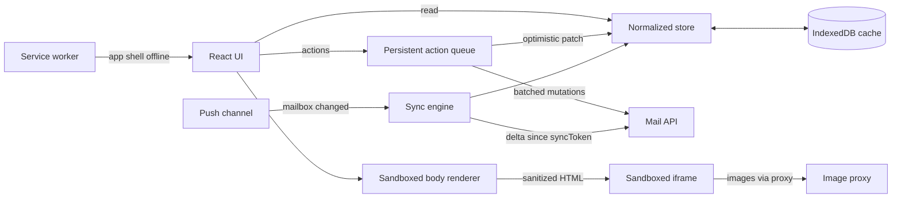

## 1. Requirements exploration

An email client is a **long-lived productivity app**, closer to a desktop program than a website. Users keep it open
for hours, act on hundreds of messages with the keyboard, and expect it to work on a train. And unlike most apps,
the main content (HTML email) is **hostile input written by strangers**. The interesting parts are sync, list
performance, safe rendering, and the composer.

### Functional requirements

- Folder/label navigation with unread counts.
- Message list: conversations sorted by date, sender, subject, snippet, attachments/flag icons; select one or many;
  bulk actions (archive, delete, move, mark read, flag); infinite scroll.
- Reading pane: full thread with collapsed older messages, HTML rendering, remote images blocked by default,
  attachments (preview/download), quoted text collapsed.
- Compose: new/reply/reply-all/forward, rich text, recipient autocomplete (contacts + directory), attachments with
  upload progress, drafts auto-saved, send with "undo send" window, schedule send (stretch).
- Real-time arrival of new mail; notifications.
- Search with operators (`from:`, `has:attachment`, date ranges).
- Keyboard shortcuts for everything common.

### Non-functional requirements

| Concern | Target |
| --- | --- |
| Startup (warm) | inbox visible < 1 s from local cache; cold < 2.5 s |
| Open a message | < 100 ms when cached, < 500 ms otherwise |
| Actions | archive/delete reflected instantly (optimistic), INP < 100 ms for keyboard actions |
| List scale | smooth scrolling through 100k+ conversations in a folder |
| Memory | stable over an 8-hour session (no leaks from iframes, object URLs, listeners) |
| Offline | last ~30 days of mail readable; actions and drafts queued |
| Security | no script execution or tracking from email content; strict CSP |

### Out of scope

Mail transport (SMTP/IMAP servers), spam filtering, calendar and contacts apps, admin settings.

### Clarifying questions

1. Threaded (conversation) view by default, or per-message? Support both as a setting?
2. Folders (one location) or labels (many)? Gmail labels vs Outlook folders change the data model.
3. Offline depth and devices (shared computers must not cache mail — "public computer" mode)?
4. Is search server-side only, or also local for offline?
5. Multiple accounts in one client?
6. Enterprise requirements: S/MIME, DLP warnings, retention policies?

Assume: threaded by default, labels as many-to-many (folders are a special case), 30-day offline cache opt-in,
server search with local fallback.

## 2. Architecture / high-level design

### App model

A **single-page app** with a local data layer, similar in spirit to a chat client:

- **Local store** (IndexedDB + in-memory normalized cache) is what the UI reads.
- **Sync engine** keeps it up to date using a delta API (changes since `syncToken`) plus push notifications of
  changes (WebSocket/SSE).
- **Action queue** applies mutations optimistically and persists them until the server confirms — the foundation of
  both instant UI and offline.
- **Rendering sandbox** for email bodies.

SSR adds little here (no SEO, personal data); a fast-loading shell from the service worker cache + local data gives a
better warm start than server rendering.

### Component tree

```
<MailApp>
  <TopBar>  <SearchBox /> <AccountMenu /> <SyncStatus /> </TopBar>
  <Shell>
    <NavPane>  <ComposeButton /> <FolderTree /> <LabelList /> </NavPane>
    <ListPane>
      <ListToolbar />                 // select all, bulk actions, sort, filter
      <MessageList>                   // virtualized
        <ConversationRow />
    <ReadingPane>
      <ThreadHeader />                // subject, labels, actions
      <ThreadMessages>
        <MessageCard collapsed />
        <MessageCard expanded>
          <MessageHeader />           // from, to, date, security indicators
          <SafeEmailBody />           // sandboxed iframe
          <AttachmentList />
      <InlineReply />
  <ComposeWindows />                  // multiple floating/docked composers
  <UndoToast />
  <ShortcutHelpDialog />
```



## 3. Data model

```ts
type ID = string;

interface Address { name?: string; email: string }

interface Message {
  id: ID;
  threadId: ID;
  from: Address;
  to: Address[];
  cc: Address[];
  bcc?: Address[];                 // only on sent/draft
  subject: string;
  snippet: string;                 // plain text preview from server
  receivedAt: string;
  labelIds: ID[];                  // INBOX, UNREAD, STARRED, user labels
  hasAttachments: boolean;
  bodyState: 'none' | 'loading' | 'loaded';  // bodies lazily fetched
  body?: { html?: string; text?: string; sanitizedAt?: number };
  attachments: { id: ID; filename: string; mimeType: string; size: number; inlineCid?: string }[];
  headers: { messageId: string; inReplyTo?: string; references?: string[] };
  security?: { spf: 'pass' | 'fail'; dkim: 'pass' | 'fail'; externalSender: boolean; encrypted?: boolean };
}

interface Thread {
  id: ID;
  messageIds: ID[];                // chronological
  lastMessageAt: string;
  participants: Address[];
  labelIds: ID[];                  // union of message labels
  unreadCount: number;
  subject: string;
  snippet: string;
}

interface Label { id: ID; name: string; type: 'system' | 'user'; unreadCount: number; totalCount: number; color?: string }

interface Draft {
  id: ID;                          // server draft id once saved
  localId: ID;                     // client id; stable before first save
  mode: 'new' | 'reply' | 'reply_all' | 'forward';
  inReplyToMessageId?: ID;
  to: Address[]; cc: Address[]; bcc: Address[];
  subject: string;
  bodyHtml: string;                // editor output, sanitized on save
  attachments: { localId: ID; uploadId?: ID; name: string; size: number; progress: number }[];
  version: number;                 // increments per local edit; server stores latest
  savedVersion: number;
}

interface MailStore {
  threads: Record<ID, Thread>;
  messages: Record<ID, Message>;
  labels: Record<ID, Label>;
  lists: Record<string, {          // key: "label:INBOX|sort:date" or "search:from:ana"
    threadIds: ID[];
    nextPageToken?: string;
    totalEstimate?: number;
  }>;
  selection: { listKey: string; ids: Set<ID>; anchorId?: ID; focusedId?: ID };
  pendingActions: PendingAction[];
  syncToken: string | null;
  drafts: Record<ID, Draft>;       // keyed by localId
}

type PendingAction =
  | { id: ID; type: 'modifyLabels'; threadIds: ID[]; add: ID[]; remove: ID[]; createdAt: number }
  | { id: ID; type: 'trash'; threadIds: ID[]; createdAt: number }
  | { id: ID; type: 'send'; draftLocalId: ID; sendAt: number };
```

Design notes:

- **Labels as the universal mechanism**: archive = remove `INBOX`; read = remove `UNREAD`; star = add `STARRED`.
  One mutation type (`modifyLabels`) covers most actions and makes optimistic updates and undo uniform (undo = the
  inverse label change).
- **Bodies are lazy**: lists only need headers/snippets; bodies are fetched on open and cached (they are the bulk of
  storage).
- **Lists are views** over thread ids. Applying an action to a thread updates its labels; list membership is
  recomputed for affected lists (a thread losing `INBOX` disappears from the inbox list immediately).
- Selection state is UI state, but kept in the store so toolbar, list and keyboard handler share it.

## 4. Interface definition (API)

### Lists

```http
GET /api/threads?labelId=INBOX&pageSize=50&pageToken=CiAKGjBpNDd2Nmp2Zml2cXRwYjBpOXA0
```

```json
{
  "threads": [
    { "id": "th_1", "subject": "Q3 planning", "snippet": "Here's the draft agenda for…", "lastMessageAt": "2025-03-03T09:12:00Z",
      "participants": [{ "name": "Priya", "email": "priya@example.com" }], "labelIds": ["INBOX", "UNREAD", "IMPORTANT"],
      "unreadCount": 1, "messageIds": ["m_9", "m_14"] }
  ],
  "messages": { "m_14": { "id": "m_14", "threadId": "th_1", "from": { "name": "Priya", "email": "priya@example.com" }, "receivedAt": "2025-03-03T09:12:00Z", "hasAttachments": true } },
  "nextPageToken": "CiAKGjBpNDd2Nmp2Zml2cXRwYjBpOXA1",
  "resultSizeEstimate": 18234
}
```

**Cursor (page token) pagination**: new mail arrives constantly at the top; offsets would shift. The estimate drives the
"1–50 of ~18,000" display and scrollbar sizing. Outlook-style "jump to date" needs a seekable index: a cursor
encoding a timestamp (`before=2024-06-01`) supports that.

### Thread and body

```http
GET /api/threads/th_1?format=full
-> { "thread": {...}, "messages": [ { "id": "m_14", "body": { "html": "<html>…</html>", "text": "…" }, "attachments": [...] } ] }
GET /api/messages/m_14/attachments/a_2   -> binary (Content-Disposition: attachment)
```

### Sync

```http
GET /api/sync?since=st_88210
-> { "changes": [
      { "type": "threadAdded", "thread": {...} },
      { "type": "labelsChanged", "threadId": "th_7", "labelIds": ["INBOX"] },
      { "type": "messageDeleted", "messageId": "m_3" }
   ], "syncToken": "st_88231", "hasMore": false }
-> 410 Gone  { "error": "sync_token_expired" }   // full resync of recent window
```

Push channel only says "something changed" (`{ "type": "mailboxChanged", "historyId": "st_88231" }`); the client
then calls `/sync`. This keeps push messages tiny and makes the delta API the single source of truth.

### Mutations

```http
POST /api/threads/batchModify
{ "threadIds": ["th_1", "th_7"], "addLabelIds": [], "removeLabelIds": ["INBOX"], "clientActionId": "act_31" }

PUT  /api/drafts/d_5   { "version": 12, "to": [...], "subject": "...", "bodyHtml": "...", "attachmentIds": ["up_3"] }
-> 200 { "id": "d_5", "version": 12 }
-> 409 { "error": "stale_version", "serverVersion": 13 }    // edited in another tab/device

POST /api/drafts/d_5/send   { "clientActionId": "send_d_5" }
```

Batch endpoints matter: "select all 2,000 and archive" must be one request (or a server-side job by query:
`{ "query": "label:INBOX older_than:1y" }`), not 2,000.

### Component props

```ts
interface MessageListProps {
  listKey: string;
  threadIds: ID[];
  selection: Set<ID>;
  focusedId?: ID;
  density: 'compact' | 'comfortable';
  onOpen: (threadId: ID) => void;
  onSelect: (threadId: ID, mode: 'single' | 'toggle' | 'range') => void;
  onEndReached: () => void;
}

interface SafeEmailBodyProps {
  html: string;
  inlineAttachments: Record<string, string>; // cid -> blob/proxy URL
  allowRemoteImages: boolean;
  onLinkClick: (url: string) => void;         // warning for mismatched link text, phishing checks
  onHeightChange?: (px: number) => void;
}

interface ComposerProps {
  draftLocalId: ID;
  mode: Draft['mode'];
  onClose: () => void;
  onSend: () => void;
}
```

## 5. Optimizations and deep dives

### Rendering untrusted HTML safely (the critical deep dive)

Email HTML can contain scripts, event handlers, forms that phish, CSS that overlays your UI, tracking pixels, and
`<meta http-equiv="refresh">`. Defence in depth:

1. **Sanitize** (server-side at ingestion and again client-side with DOMPurify): drop `<script>`, `on*` attributes,
   `javascript:` URLs, `<form>`, `<object>`, `<embed>`, `<base>`, `<meta>`; allow a vetted set of tags, attributes
   and CSS properties. Rewrite `cid:` references to attachment URLs.
2. **Isolate** in an `<iframe sandbox>` with no `allow-scripts` and no `allow-same-origin`, rendered from `srcdoc`
   (or a separate cookieless origin). Even if sanitization misses something, script can't run and the frame can't
   touch the app's cookies or DOM. Add `allow-popups` + `allow-popups-to-escape-sandbox` only so links can open in
   a new tab.
3. **CSP** inside the frame (`<meta http-equiv="Content-Security-Policy" content="default-src 'none'; img-src https: data: cid:; style-src 'unsafe-inline'">`)
   and a strict CSP for the app (nonces, `object-src 'none'`, Trusted Types to prevent accidental
   `innerHTML` in app code).
4. **Remote images through a proxy**: blocked by default for unknown senders ("Show images"); when shown, they load
   via an image proxy that strips cookies and hides the user's IP, and can pre-fetch to defeat open-tracking timing.
5. **Links**: intercept clicks, warn when visible text shows a different domain than the `href`, open with
   `rel="noopener noreferrer"`.
6. **CSS containment**: since email styles live inside the iframe, they can't break the app layout. Size the iframe
   to content via `ResizeObserver` (needs a tiny trusted script — or measure from the parent: the parent can read
   `contentDocument` height only if same-origin, which conflicts with no `allow-same-origin`; a common compromise
   is server-provided height estimates plus a dedicated sandbox origin that posts its height via `postMessage`).

Trade-off to state: a separate sandbox origin with a minimal trusted resize script gives the best UX (exact
heights, dark-mode adjustments) with strong isolation; pure `srcdoc` without scripts is simplest and safest but
needs fixed/estimated heights or scrolling frames.

### Message list performance

- **Virtualize** with fixed row heights per density (fixed heights make virtualization trivial and scrolling
  stable). 100k threads = only ~30 rows mounted.
- Fetch pages ahead of the scroll; for "jump far" via the scrollbar, use date-based cursors and placeholder rows
  rather than loading everything in between.
- Rows read only their thread entity; a new mail at the top inserts one row and shifts the virtual offset — if the
  user is scrolled down, keep their visible rows stable (adjust scroll offset) and show "1 new message" at the top.
- Format dates with a memoized `Intl.DateTimeFormat` instance (constructing formatters is surprisingly expensive in
  a loop).

### Optimistic actions and undo

- Archive/delete: patch labels in the store immediately, move focus to the next conversation, show an "Undo" toast
  for ~5 s. The request can go out immediately (undo sends the inverse) or be delayed until the toast closes — delay
  reduces server churn; immediate is safer if the tab closes. "Undo send" must delay: the message is held client-side
  (or scheduled server-side with `sendAt`) for N seconds.
- Coalesce rapid actions (mark read on open, then archive) into one batch per tick.
- On failure, revert and show an error; conflicts resolved by applying server state from the next sync.

### Sync, multi-tab and offline

- Delta sync on startup, on push notification, on `online`, and on focus after being hidden.
- Leader tab owns the push connection (Web Locks + `BroadcastChannel`), like a chat client; all tabs share IndexedDB.
- Offline: service worker serves the shell; IndexedDB has recent threads + bodies (configurable window, quota aware —
  request `navigator.storage.persist()`); actions and drafts queue in the persistent action queue; "Send" while offline
  goes to the Outbox and is sent on reconnect.
- Public computer mode: disable persistent caching; wipe IndexedDB and caches on sign-out (and on session expiry).

### Composer

- Rich text editor built on `contenteditable` via a framework (ProseMirror/Tiptap, Lexical) rather than raw
  `execCommand` (deprecated and inconsistent). The output HTML is sanitized before saving/sending.
- **Draft autosave**: debounce (~2 s after typing stops) plus save on blur/close and on `visibilitychange`; versioned
  saves so two tabs editing the same draft detect conflicts (409 → "This draft was edited elsewhere").
- Attachments upload immediately on add (resumable for large files); send is blocked until uploads finish, with a
  clear state. Large files → offer a cloud link instead.
- Recipient field is an autocomplete with chips (see the autocomplete question): contacts cached locally, directory
  searched remotely, paste of comma-separated addresses parsed.
- Reply quoting: quote the previous message collapsed ("…"), preserve thread headers (`In-Reply-To`, `References`)
  server-side.
- Warnings: "You mentioned an attachment but none is attached", external recipients in enterprise, reply-all to large
  lists.

### Keyboard-first UX and accessibility

- Shortcuts: `j/k` next/previous, `o`/Enter open, `e` archive, `#` delete, `r`/`a`/`f` reply/all/forward, `c`
  compose, `/` search, `x` select, `?` help. Disabled while typing in inputs; user can turn single-key shortcuts off
  (WCAG 2.1.4 Character Key Shortcuts).
- The message list is a `grid` or `listbox` with roving `tabindex`/`aria-activedescendant`; selection announced
  ("Selected, 3 of 50"). Row accessible names include unread state, sender, subject, date, attachment.
- Landmarks for nav, list and reading pane; `F6` to cycle panes (Outlook convention).
- After archive, focus moves to the next item — not to the top of the page.
- The sandboxed iframe gets a `title` ("Message body"); email content may be inaccessible itself, so offer a plain-text
  view.
- High contrast/forced-colors mode support, and dark mode that adapts email content carefully (inverting
  arbitrary email HTML can make it unreadable — apply heuristics or offer "view in light mode").

### Search

- Server search with operators; results are just another list (`lists["search:…"]`).
- Instant suggestions (contacts, recent searches) from local data while the server query runs.
- Offline: search the local IndexedDB window (subject/from/snippet index built in a worker), clearly labelled
  "Results from offline mail".

### Internationalization

- Message bodies come in any charset (server normalises to UTF-8) and any direction: `dir="auto"` per message and
  subject; the app chrome flips for RTL locales.
- Internationalized email addresses (EAI) and IDN domains displayed in Unicode but with homograph protection
  (show punycode for mixed-script domains).
- Date grouping ("Today", "Yesterday", "Last week") per locale and time zone.

### Performance and memory over long sessions

- Detach and destroy iframes for messages scrolled out of a long thread; revoke object URLs for attachments.
- Cap in-memory bodies (LRU) while IndexedDB keeps them.
- Lazy-load the composer, calendar integrations, and attachment previewers (PDF viewer is big).
- Monitor heap growth in long-session synthetic tests.

### Observability

- Time to inbox (warm/cold), open-message latency, action success/failure and rollback rate, sync latency (mail
  received server-side → visible in client), queue depth, IndexedDB errors and quota, CSP violation reports (they
  reveal sanitizer gaps or injected extensions).

### Testing

- Sanitizer: a large corpus of real-world and malicious emails (XSS payloads, CSS tricks) as regression tests; fuzzing.
- Sync engine tests with out-of-order and duplicated deltas, expired tokens, offline/online transitions.
- Keyboard E2E flows (triage 20 emails without a mouse) and screen reader manual passes.
- Rendering fidelity: visual snapshots of popular email templates (newsletters, receipts) across browsers.

## What a lead-level answer adds

- Frames email body rendering as a **security boundary** with layered defences and explicit trade-offs (sandbox
  origin vs `srcdoc`, proxying images for privacy), and sets up CSP reporting to detect failures in production.
- Designs a **uniform mutation model** (labels + inverse operations) that makes optimistic UI, undo, offline queueing
  and multi-tab sync fall out of one mechanism.
- Thinks in **long sessions**: memory budgets, leak tests, and sync recovery after laptop sleep.
- Addresses **enterprise needs**: retention/DLP warnings, S/MIME, accessibility compliance, shared/public device
  mode, and data residency.
- Plans migration and coexistence (e.g. moving from an old server-rendered client to the SPA per folder or per user
  cohort with feature flags).

## Common follow-up questions

**Why not render email HTML directly into a div after sanitizing?** Sanitizers have bugs and email CSS would leak
into the app (and app CSS into the email). An iframe sandbox adds isolation that doesn't depend on the sanitizer being
perfect.

**How do you show "1–50 of 18,234" when lists are cursor-paginated?** Use the server's estimate; exact counts on huge
mailboxes are expensive and change constantly.

**How does "select all 18,000 and delete" work?** The client sends a query-based batch operation; the server runs it as
a job and streams progress; the client optimistically empties the visible list and reconciles via sync.

**How do you make the inbox appear in under a second?** Service worker cached shell + IndexedDB-cached first page of
the inbox rendered immediately, then delta sync in the background.

**How do you handle tracking pixels?** Block remote images by default for unknown senders, proxy all images, and
optionally prefetch them server-side so open-time can't be inferred.
