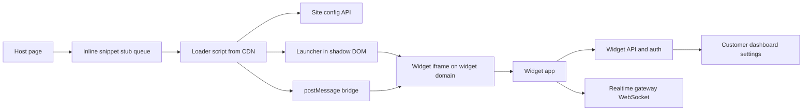

## Framing the problem

A third-party widget is the most hostile environment front-end code can run in. You do not control the page, its CSS,
its JavaScript globals, its CSP, its framework, its polyfills or its release schedule, and the page owner does not
control you either. Every byte you ship is paid for by **someone else's** Core Web Vitals, and every bug you ship
appears on 40,000 sites at once.

The design priorities, in order:

1. **Do no harm** to the host: tiny initial cost, no global pollution, no style leakage, never throw into the host's
   error handlers, never block rendering.
2. **Be robust against the host**: hostile CSS, overwritten globals (`Array.prototype.find` patched by an old library),
   CSP restrictions, aggressive privacy settings.
3. **Evolve safely**: versioning and rollout for code embedded in pages you can never redeploy.
4. **Be secure**: the host must not be able to impersonate another user, and the widget must not become an XSS vector.

## 1. Requirements exploration

### Stakeholders

- **Host-site developers** (our customers' engineers): easy install, small footprint, a stable JS API, CSP guidance.
- **Host-site end users**: fast, accessible chat that does not break the page.
- **Our product teams**: ship features to the widget frequently.
- **Support and solutions engineers**: debug issues on sites they cannot access.
- **Security and privacy**: identity verification, data protection, compliance with cookie and consent laws.

### Functional requirements

- Copy-paste snippet that works on any site (including tag managers).
- Launcher button, chat panel, help articles, unread badge, notifications.
- Host JS API: `boot`, `identify`, `open`, `close`, `on(event)`, `update(attributes)`, `shutdown` (logout).
- Customization: colours, position, language, which features show, set from the dashboard and overridable in code.
- Real-time messaging (WebSocket with fallback) and persistence of conversation across page navigations.
- Works in SPAs (route changes) and multi-page sites.

### Non-functional requirements and SLOs

- **Snippet + loader**: under 3 KB gzipped, async, no render blocking; nothing else loads until idle or interaction.
- **Full widget**: lazy-loaded; under 100 KB gzipped for the chat panel; launcher visible within 1.5 s of host load
  on a mid-tier phone.
- **Zero** uncaught errors attributed to our code in host error monitoring.
- **Availability**: loader on a multi-CDN setup, 99.99%; if our backend is down, the launcher hides gracefully.
- **Scale**: 500M page views/month (about 200 loads/s on average, with large peaks around sales events); the vast
  majority never open the widget, so the loader path must be nearly free.

### Clarifying questions

- Do customers need the widget on pages with strict CSP (banks)? That affects inline scripts and styles.
- Must the chat survive cross-subdomain navigation (`shop.example.com` to `help.example.com`)?
- Is there a mobile SDK too? Shared business logic matters.

## 2. Architecture



### The layers

1. **Snippet** (inline, a few hundred bytes): defines a tiny stub `window.AcmeChat` that queues calls made before the
   loader arrives, then injects the loader `<script async>`.
2. **Loader** (about 3 KB, short cache): reads site config, decides whether to show anything (targeting rules,
   business hours, page rules), renders the **launcher** in a Shadow DOM host element, sets up the
   **postMessage bridge**, and replays queued calls.
3. **Widget iframe** (lazy): on first open (or on idle if there are unread messages), creates an iframe pointing to
   `https://widget.acmechat.com/frame?v=...` that runs the full chat app with its own framework, styles and network
   connections.

### Why the hybrid (Shadow DOM launcher + iframe panel)

| Isolation option | Pros | Cons |
| --- | --- | --- |
| **Inline DOM, no isolation** | Simplest; full access to the page | Host CSS breaks you; your CSS breaks the host; shares globals; any XSS in your code is XSS on the host |
| **Shadow DOM** | Style encapsulation both ways; light; can overlay page naturally | Same JS realm (globals, prototypes can be tampered with); inherited properties (font, colour) still leak in unless reset; host scripts can reach into an open shadow root |
| **Iframe on your own origin** | Strong isolation: separate realm, CSS, storage, CSP, crashes; host cannot read conversation data | Sizing and positioning need a bridge; focus management across frames; one more document to load; third-party storage restrictions |

The launcher is small and must feel native, so Shadow DOM (with `all: initial` resets) is enough. The chat panel
handles user data and runs a full app, so it lives in an iframe on our origin: the host page cannot read messages, and
a compromise of the host does not expose other users' conversations.

## 3. Data model and contracts

### Snippet

```html
<script>
  (function (w, d, id) {
    if (w.AcmeChat) return;
    var q = [];
    var stub = function () { q.push(arguments); };
    stub.q = q;
    w.AcmeChat = stub;
    var s = d.createElement('script');
    s.async = true;
    s.src = 'https://cdn.acmechat.com/loader/v1/loader.js';
    s.dataset.siteId = id;
    d.head.appendChild(s);
  })(window, document, 'site_123');
  AcmeChat('boot', { language: 'en' });
</script>
```

The URL contains a **major version** (`v1`), never a full version. Strict-CSP sites can use an external file version
of the snippet with a nonce, documented separately.

### Site configuration (served by config API, cached at edge)

```json
{
  "siteId": "site_123",
  "enabled": true,
  "widgetVersion": "1.42.3",
  "frameUrl": "https://widget.acmechat.com/frame/1.42.3/index.html",
  "theme": { "primary": "#5b3cc4", "position": "bottom-right", "offset": { "x": 20, "y": 20 } },
  "features": { "helpCenter": true, "fileUpload": false },
  "pageRules": [{ "match": "/checkout*", "show": false }],
  "identityVerification": "required",
  "allowedOrigins": ["https://shop.example.com", "https://help.example.com"]
}
```

`widgetVersion` per site is how we run **staged rollouts**: the loader is stable and tiny, the heavy app version is
chosen per site by config.

### postMessage protocol

```ts
type HostToFrame =
  | { ns: 'acme'; v: 1; type: 'boot'; payload: BootOptions }
  | { ns: 'acme'; v: 1; type: 'identify'; payload: { userId: string; userHash: string; traits?: Traits } }
  | { ns: 'acme'; v: 1; type: 'open' | 'close' | 'shutdown' };

type FrameToHost =
  | { ns: 'acme'; v: 1; type: 'ready' }
  | { ns: 'acme'; v: 1; type: 'resize'; payload: { width: number; height: number; mode: 'panel' | 'fullscreen' } }
  | { ns: 'acme'; v: 1; type: 'event'; payload: { name: 'conversation_started' | 'message_received' | 'closed'; data?: unknown } }
  | { ns: 'acme'; v: 1; type: 'unread'; payload: { count: number } };
```

Rules: always pass an explicit `targetOrigin` (never `"*"`) when posting into the frame; in the frame, accept
messages only from `event.source === window.parent` and from an origin in the site's `allowedOrigins`; in the loader,
accept messages only from our frame's origin and `contentWindow`. Messages are namespaced and versioned; unknown types
are ignored, which keeps old loaders and new frames compatible.

## 4. Interfaces

### Host-facing JavaScript API

```ts
interface AcmeChatApi {
  (cmd: 'boot', options: BootOptions): void;
  (cmd: 'identify', user: { userId: string; userHash: string; email?: string; name?: string }): void;
  (cmd: 'update', attributes: Record<string, string | number | boolean>): void;
  (cmd: 'open' | 'close' | 'toggle'): void;
  (cmd: 'on', event: WidgetEventName, handler: (data: unknown) => void): void;
  (cmd: 'off', event: WidgetEventName, handler: (data: unknown) => void): void;
  (cmd: 'shutdown'): void;   // logout: clears identity and conversation state on this device
}

interface BootOptions {
  language?: string;
  hideLauncher?: boolean;      // host provides its own button
  container?: HTMLElement;     // inline mode instead of floating
  zIndex?: number;
}
```

A command-style function API (rather than an object with methods) matches the snippet stub, so calls work before and
after load, and adding commands never breaks old snippets. An **npm package** (`@acmechat/widget`) offers the same API
with types and React bindings for SPA customers, but still loads the runtime from the CDN so all sites get fixes.

### Identity verification

`identify` without verification lets anyone open devtools and claim to be another user. The customer's **server**
computes `userHash = HMAC-SHA256(secret, userId)` (or issues a short-lived signed JWT), and our API rejects
identification without a valid hash. The secret never touches the browser.

### Customer-facing tooling

- **Install checker** in the dashboard: fetches the customer page server-side and verifies the snippet and CSP.
- **Debug mode**: `?acmechat_debug=1` logs lifecycle and bridge messages to the console, and support can request
  a diagnostic bundle.
- **CSP guide**: required directives (`script-src https://cdn.acmechat.com`, `frame-src https://widget.acmechat.com`,
  `connect-src` for the API and WebSocket, `img-src` for avatars).

## 5. Deep dives and trade-offs

### Defensive coding in a hostile page

- Wrap every entry point in try/catch; report our own errors to our telemetry, never let them reach `window.onerror`.
- Capture references to built-ins at loader start (`const _fetch = window.fetch.bind(window)`) and avoid relying on
  prototypes that old libraries patch. Inside the iframe this problem disappears, which is another reason to keep logic
  there.
- No globals except `window.AcmeChat`. No polyfills that modify globals; bundle ponyfills instead.
- Shadow DOM with a reset (`:host { all: initial; }`) plus explicit font and colour, since inherited properties cross
  the shadow boundary.
- Choose a z-index strategy (a high default, configurable) and test against common site overlays (cookie banners).
- Use a closed or at least namespaced shadow root; do not depend on the host's framework.

### Performance budget

- The loader is all most visitors ever get. Keep it framework-free, ship modern syntax only (with a tiny legacy build
  served via `nomodule` only if your customer base needs it), and defer non-essential work to `requestIdleCallback`.
- Do not create the iframe or open a WebSocket until the user interacts or there is a reason (unread messages,
  proactive message rule). An idle iframe costs memory and a document load on every page view.
- Preconnect to the widget origin on launcher hover to make opening feel instant.
- Fonts: use the system font stack or a tiny subset; never load a web font into the host document.
- Publish the widget's cost in documentation, and measure it with real-user data (LCP/INP deltas on a sample of sites
  with and without the widget). Customers will run Lighthouse and blame you; have the numbers.

### Versioning and rollout

- **Three version layers**: snippet (effectively permanent, so it must stay trivial), loader (major version in URL,
  minor updates under the same URL with a short cache TTL like 5 minutes), widget app (immutable, versioned URLs,
  chosen per site by config).
- **Rollout**: new widget versions go to internal sites, then 1%, 10%, 50%, 100% of sites, with automatic rollback on
  error-rate or load-failure increases. Large customers can **pin** a version for a release freeze, with a maximum pin
  age.
- **Breaking API changes** go into a new loader major (`/v2/`); `v1` remains supported for years, typically as a
  compatibility shim over the v2 internals. Deprecations are announced in the dashboard and through console warnings in
  debug mode only.
- **SRI** does not work on a mutable loader URL. Offer an optional pinned, immutable loader URL with an `integrity`
  hash for customers whose security policy requires it, accepting they will update manually.

### Cookies, storage and privacy

Inside a third-party iframe, storage is **partitioned** by top-level site in Chrome, Firefox and Safari, and Safari
blocks third-party cookies entirely; Chrome also restricts them for some users. Consequences:

- Do not rely on third-party cookies for session continuity. Store the visitor session in partitioned storage inside
  the iframe (works per host site, which is what we want anyway), or use partitioned cookies (CHIPS, the `Partitioned`
  attribute) for HTTP-only session cookies.
- Cross-subdomain continuity (`shop.` and `help.` of the same site) works because partitioning is by **site**
  (scheme + registrable domain), not by origin.
- Identity across devices comes from `identify` with a verified user, not cookies.
- Respect host consent: `boot({ consent: false })` or a CMP integration delays non-essential storage and analytics.
- The Storage Access API exists for cases that truly need unpartitioned access, but requires a user gesture and prompts;
  avoid designing around it.

### Security

- Strict CSP inside the widget iframe (no inline scripts), and sanitize all agent-authored rich content (help articles,
  messages) with a vetted sanitizer before rendering.
- `X-Frame-Options`/`frame-ancestors` on the widget frame restricted to the site's `allowedOrigins`, preventing other
  sites from framing a customer's widget to phish.
- Rate limiting and abuse detection on anonymous conversation creation (spam bots love support widgets).
- Supply-chain discipline: the loader is executed on 40,000 sites, so its build pipeline, CDN credentials and release
  approvals are treated as critical infrastructure (two-person review, signed builds, monitored CDN contents).

### Accessibility

The launcher is a real `<button>` with an accessible name and unread count announced via `aria-live`. Opening the
panel moves focus into the iframe and traps it in modal mode; closing returns focus to the launcher. Escape closes.
Respect `prefers-reduced-motion` and the host's zoom levels. Test with screen readers on top of busy host pages.

### Build vs buy

Customers are choosing between you and Intercom, Zendesk or Crisp, so the widget is the product: build it. What you
can buy is infrastructure: multi-CDN delivery, a realtime service (Ably, Pusher, or managed WebSocket gateways) if
you do not want to run your own, and error monitoring for the widget itself (with strict scrubbing).

## Org and people considerations

- **Ownership**: a widget platform team owns loader, bridge, versioning, performance budgets and the public API; feature
  teams build inside the iframe app. The public API has an API review board, because every addition is forever.
- **RFCs** for public API changes, new permissions or new third-party requests, with a compatibility section.
- **Release management**: release trains for the iframe app with automated staged rollout; loader changes are rare and
  require extra review.
- **Customer communication**: changelog, deprecation notices with timelines, status page, and a "widget health" report
  for large customers.
- **Support tooling**: per-site diagnostics (version served, errors, load timing), install checker, debug mode.

### Success metrics

- Loader size and p75 added main-thread time on host pages; measured LCP and INP impact.
- Widget load success rate and time to interactive on open.
- Errors per 1,000 sessions, split by host browser and site.
- Percentage of sites on the latest widget version; pinned sites count and pin ages.
- Install-related support tickets; time to first successful install.
- Conversations started per 1,000 page views (business health).

## What a lead-level answer adds

- Starts from **do no harm** and quantifies the budget the host pays.
- Chooses **isolation per component** (Shadow DOM launcher, origin-isolated iframe panel) with reasons, and designs a
  **secure postMessage protocol**.
- Separates **snippet, loader and app versions**, enabling staged rollouts and rollback across sites you cannot deploy.
- Knows the **privacy landscape**: storage partitioning, third-party cookie blocking, CHIPS, consent.
- Treats **identity verification and supply-chain security** as core, not add-ons.
- Considers the **people around the product**: API review board, customer communication, support tooling.

## Common follow-up questions

**Why not render everything in Shadow DOM and skip the iframe?**
Shadow DOM isolates styles, not JavaScript or data. Host scripts (or an XSS on the host) could read conversations and
tokens. The iframe gives a separate origin, realm and storage, which is what user data needs.

**How does the iframe resize?**
The frame posts `resize` messages with desired dimensions and mode; the loader updates the container with CSS
transitions, and on small screens switches to fullscreen. The loader enforces limits so a buggy frame cannot cover the
whole page unexpectedly.

**A customer's SPA calls `boot` on every route change.**
Make commands idempotent: `boot` with the same options is a no-op, and route changes are detected via the History API
and `popstate` so page rules re-evaluate without re-booting.

**How do you test across thousands of different host sites?**
A test harness of hostile pages (global CSS resets, `* { box-sizing: content-box }`, patched prototypes, strict CSP,
huge z-index overlays), plus synthetic monitoring on a sample of real customer sites, plus RUM error rates by site.

**How would you handle a bad release that breaks a large customer's checkout?**
Immediate per-site rollback via config (the loader picks up the previous version within the config TTL), global rollback
if widespread, then a post-incident review on why staged rollout did not catch it.
