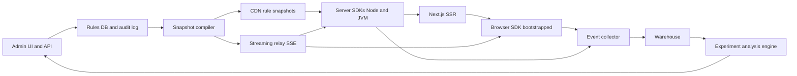

## Framing the problem

Feature flags and experiments look like one product but have two different jobs:

- **Release control** (ops flags, kill switches, gradual rollouts): needs to be fast, always available, and changeable
  in seconds. Correctness means "the right users see the right code path".
- **Experimentation** (A/B tests): needs **statistically trustworthy assignment and exposure data**. Correctness means
  "every user is consistently bucketed, every exposure is logged exactly when the user could see the variant, and the
  analysis does not lie".

A good design shares the evaluation engine between both, but treats exposure logging, metrics and governance as
first-class concerns of the experimentation side. The most important architectural decision is **where evaluation
happens**: locally in the SDK against a cached ruleset, not by calling a remote service on every check.

## 1. Requirements exploration

### Consumers

- **Engineers**: create flags in code, roll out gradually, kill a feature in seconds.
- **Product managers and data scientists**: define experiments, target audiences, read results.
- **SRE and incident commanders**: kill switches with audit trail.
- **Platforms**: React web (SSR and client), iOS, Android, Node and JVM services.

### Functional requirements

- Flag types: boolean, multivariate (string, number, JSON).
- Targeting rules on user and context attributes (country, plan, app version, internal employee, custom segments).
- Percentage rollouts with **sticky bucketing** (same user, same variant, across devices if logged in).
- Experiments: variants with weights, mutual exclusion layers, holdouts, start and stop, guardrail metrics.
- Exposure logging and an analysis pipeline (conversion, revenue, latency guardrails).
- Environments (dev, staging, prod), audit log, approvals for production changes, scheduled changes.
- Flag lifecycle: owner, type, expiry date, stale-flag detection and clean-up tooling.

### Non-functional requirements and SLOs

- **Evaluation latency**: under 1 ms p99 in-process (local evaluation, no network).
- **Propagation**: a change reaches connected SDKs within 5 seconds p95; kill switches are the critical path.
- **Availability**: flag evaluation must work when the platform is down (cached rules, safe defaults).
  Control-plane (UI/API) target 99.9%; delivery-plane (rules CDN and streaming) 99.99%.
- **Scale**: 50k RPS on the web tier means server SDKs must never call out per request; about 5,000 active flags;
  billions of exposure events per day at peak experiment load.
- **Privacy**: client-side SDKs must not download targeting rules that leak internal data (email lists, segment
  definitions for enterprise customers).

### Out of scope

- Building a full product-analytics tool; we integrate with the existing warehouse and event pipeline.

## 2. Architecture

Two planes:

- **Control plane**: admin UI, management API, rules database, audit log, approval workflows.
- **Delivery plane**: compiled rule snapshots pushed to a CDN and to a streaming relay; SDKs evaluate locally.

Plus an **exposure and metrics pipeline** for experiments.



### Server-side vs client-side evaluation

- **Server SDKs** download the full ruleset for their environment and evaluate locally. They are trusted, so they can
  hold segment definitions.
- **Browser and mobile SDKs** should not receive the full ruleset. Two patterns:
  1. **Remote evaluation**: the client sends its context to an edge evaluation endpoint, which returns only the
     resolved values for that user (`{ "new-checkout": "treatment" }`). Private rules never leave the server.
  2. **Bootstrap from SSR**: the Next.js server evaluates all client-visible flags during render and embeds the
     resolved values into the HTML. The browser SDK starts with those values synchronously, which **eliminates
     flicker**, then subscribes for updates.

For this brief, I would use bootstrap-from-SSR for web, remote evaluation at the edge for mobile, and local evaluation
for services.

## 3. Data model and contracts

### Flag definition

```json
{
  "key": "checkout.new-payment-sheet",
  "type": "string",
  "kind": "experiment",
  "owner": "team-payments",
  "createdAt": "2025-04-03",
  "expiresAt": "2025-08-01",
  "clientVisible": true,
  "variations": [
    { "id": "control", "value": "legacy" },
    { "id": "treatment", "value": "sheet-v2" }
  ],
  "environments": {
    "production": {
      "enabled": true,
      "offVariation": "control",
      "rules": [
        { "id": "r1", "description": "Employees always get treatment",
          "conditions": [{ "attribute": "email", "op": "endsWith", "values": ["@acme.com"] }],
          "serve": { "variation": "treatment" } },
        { "id": "r2", "description": "Excluded markets",
          "conditions": [{ "attribute": "country", "op": "in", "values": ["DE", "FR"] }],
          "serve": { "variation": "control" } }
      ],
      "fallthrough": {
        "rollout": {
          "bucketBy": "userId",
          "salt": "checkout.new-payment-sheet:exp-42",
          "weights": { "control": 50000, "treatment": 50000 }
        }
      },
      "prerequisites": [{ "flag": "checkout.platform-v2", "variation": "on" }]
    }
  },
  "experiment": {
    "id": "exp-42",
    "layer": "checkout",
    "trafficAllocation": 0.2,
    "primaryMetric": "checkout_completed",
    "guardrails": ["page_error_rate", "inp_p75"],
    "hypothesis": "A sheet-based payment UI increases completion by 1%"
  }
}
```

Evaluation order: flag off, serve `offVariation`; prerequisites; individual targets; rules in order; fallthrough
rollout. The order must be identical in every SDK, which is why a **shared conformance test suite** (a JSON file of
contexts and expected outputs) runs in every SDK's CI.

### Bucketing

`bucket = hash(salt + ":" + bucketByValue) mod 100000`. Use a stable, fast non-cryptographic hash (MurmurHash3 or
FNV-1a are common) implemented identically on every platform. Key details:

- The **salt includes the experiment id**, so different experiments are independently randomised. Re-using a salt
  correlates experiments.
- Increasing a rollout from 10% to 20% keeps the original 10% in treatment (monotonic ranges), which is what you want
  for rollouts. For experiments, changing weights mid-flight invalidates results; the UI should warn and require a
  new experiment iteration.
- Anonymous users bucket by a stable device ID (first-party cookie); on login you either keep the device bucket or
  switch to user ID. Decide per experiment, and document it, because switching causes users to see two variants.

### Exposure event

```json
{
  "type": "exposure",
  "flagKey": "checkout.new-payment-sheet",
  "experimentId": "exp-42",
  "variationId": "treatment",
  "ruleId": "fallthrough",
  "unitType": "userId",
  "unitId": "u_8f2a",
  "timestamp": "2025-06-02T10:15:03.120Z",
  "sdk": "web@4.2.1",
  "snapshotVersion": 18234
}
```

Only `fallthrough` rollouts inside an experiment produce analysable exposures; users matched by targeting rules
(employees) are excluded from analysis.

## 4. Interfaces

### Vendor-neutral API via OpenFeature

Application code should depend on **OpenFeature**, the CNCF vendor-neutral flag API, with a provider for our platform.
That makes a later switch to or from a vendor a provider change, not a codebase rewrite.

```ts
import { OpenFeature } from '@openfeature/web-sdk';

await OpenFeature.setProviderAndWait(new AcmeProvider({ bootstrap: window.__FLAGS__, streaming: true }));
const client = OpenFeature.getClient();

const sheet = client.getStringValue('checkout.new-payment-sheet', 'legacy');
```

Our own SDK surface (what the provider wraps):

```ts
interface EvaluationContext {
  targetingKey: string;               // userId or deviceId
  attributes: Record<string, string | number | boolean | string[]>;
}

interface EvaluationResult<T> {
  value: T;
  variationId: string;
  reason: 'OFF' | 'TARGET_MATCH' | 'RULE_MATCH' | 'FALLTHROUGH' | 'PREREQUISITE_FAILED' | 'ERROR' | 'DEFAULT';
  ruleId?: string;
  experimentId?: string;
}

interface FlagClient {
  evaluate<T>(key: string, defaultValue: T, ctx?: EvaluationContext): EvaluationResult<T>;
  onChange(key: string, cb: (r: EvaluationResult<unknown>) => void): () => void;
  trackExposure(key: string): void;         // explicit, for lazy exposure
  flush(): Promise<void>;
}
```

### React bindings

```tsx
function PaymentStep() {
  const { value, track } = useFlag('checkout.new-payment-sheet', 'legacy', { exposure: 'manual' });
  useEffect(() => { track(); }, [track]); // log only when this step actually renders
  return value === 'sheet-v2' ? <PaymentSheet /> : <LegacyPayment />;
}
```

`exposure: 'manual'` matters: logging exposure when the flag is merely evaluated (for example, during route
prefetching) dilutes the experiment with users who never saw the change.

### CLI and CI

```bash
acme-flags create checkout.new-payment-sheet --kind experiment --owner team-payments --expires 2025-08-01
acme-flags codegen --out src/flags.generated.ts   # typed keys and variation values
acme-flags stale --repo .                          # flags fully rolled out for 30+ days, still referenced in code
```

Codegen gives typed flag keys so a typo is a compile error. A CI check fails if code references a flag that does not
exist in the platform, and a weekly job opens clean-up PRs for flags that have been at 100% for 30 days.

## 5. Deep dives and trade-offs

### Propagation and resilience

- Snapshot compiler emits a versioned, gzipped JSON snapshot per environment (and per client-visible subset) to the
  CDN on every change.
- SDKs poll the CDN (with ETag) every 30–60 s **and** hold a server-sent events stream to the relay for sub-second
  push. SSE is a good fit: one-way, works over HTTP/2, auto-reconnects. WebSockets are unnecessary.
- If the stream drops, polling still converges. If both fail, the SDK keeps the last known snapshot (persisted to disk
  for servers, `localStorage` for browsers) and, failing that, uses **in-code defaults**. Defaults must therefore be
  the safe option, typically "old behaviour".
- Relay fan-out: 20M users do not all need streaming. Use streaming for server SDKs and for logged-in web sessions,
  and polling or "refresh on app foreground" for mobile.

### Flicker and SSR

Flicker (showing control, then swapping to treatment) both hurts UX and biases experiments. Prevent it by evaluating on
the server and bootstrapping the client with the same values, or, for static pages, evaluating at the edge
(middleware) and rewriting to a pre-rendered variant. Never block first paint on a client-side network call to the
flag service. For live updates in the browser, decide per flag whether to apply immediately (kill switch) or on next
navigation (UI experiment, to avoid layout jumps mid-task).

### Experiment statistics (enough to be credible)

- Pre-register primary metric, minimum detectable effect and duration; compute sample size up front.
- Watch for **sample ratio mismatch** (a 50/50 test getting 52/48) as an automatic data-quality alarm. It usually means
  biased exposure logging or bots.
- Use sequential testing or a fixed horizon to avoid peeking bias; CUPED variance reduction speeds up results.
- Layers give mutual exclusion between conflicting experiments; a global holdout (say 2%) measures the cumulative
  effect of all launched features.

### Build vs buy

| Option | Notes |
| --- | --- |
| **LaunchDarkly** | Market leader for release management; mature SDKs, streaming, approvals, strong governance. Experimentation is an add-on. Cost scales with seats and MAU/contexts and becomes significant at 20M MAU. |
| **Statsig**, **Optimizely**, **Eppo** | Experimentation-first; stronger stats engines (CUPED, sequential testing). Eppo and Statsig support warehouse-native analysis. |
| **Unleash** | Open source, self-hostable, good for release flags; experimentation analysis is not its focus. |
| **GrowthBook** | Open source, warehouse-native experimentation plus flags; good when data already lives in Snowflake/BigQuery. |
| **Flagsmith**, **Flipt**, **PostHog** | Open-source or open-core alternatives with different strengths. |
| **Build** | Full control and no per-MAU cost, but you own SDKs on 5 platforms, a stats engine, streaming infra and an audit-ready UI. That is a team of 5–8 engineers indefinitely. |

**Recommendation:** standardise the application API on OpenFeature first. Then, for most companies, **buy** for release
flags (or self-host Unleash/GrowthBook if cost or data residency demands it) and run analysis warehouse-native. Build
only the thin parts that are company-specific: codegen, stale-flag tooling, governance integrations, SSR bootstrap
glue. A full in-house build is justified only at very large scale with a dedicated experimentation team.

### Security and privacy

- Client SDK keys are public; they can only read the client-visible snapshot or call remote evaluation.
- Never ship PII-based targeting rules (email lists) to clients; resolve segments server-side.
- Production changes require approval for flags tagged `critical`; every change is audited with who, what, why.

### Performance

Local evaluation of a ruleset with 5,000 flags is microseconds per call. Precompile rules into a lookup structure
keyed by flag. Exposure events are batched (every 5 seconds or 50 events) and sent with `fetch(..., { keepalive: true })`
or `navigator.sendBeacon` on page hide. Deduplicate exposures per session per flag to reduce volume.

## Org and people considerations

- **Flag types with different policies**: release flags (expire in 30–90 days), experiment flags (end with the
  experiment), ops/kill switches (permanent, reviewed yearly), permission flags (should usually move into the
  entitlements system). Mixing them is how flag debt happens.
- **Ownership**: every flag has an owning team and a Slack channel; ownerless flags are flagged in a weekly digest.
- **Debt budget**: track flags per team and the percentage past expiry; make it part of team health reviews. Automate
  removal PRs (a codemod that inlines the winning branch) rather than nagging.
- **Experimentation review**: a lightweight review board (data science plus product) for experiment design on high-
  traffic surfaces, and a shared results template to avoid cherry-picked metrics.
- **Incident process**: kill switches are part of runbooks; incident commanders have permission to flip them without
  approval, with an audit entry.

### Rollout of the platform

1. Ship OpenFeature-based SDKs for web and Node with the chosen provider; migrate existing ad-hoc config flags.
2. Add SSR bootstrap and React bindings; onboard 3 teams.
3. Turn on experimentation with the warehouse pipeline and an A/A test to validate bucketing and SRM checks.
4. Mobile SDKs; governance features (expiry, approvals, stale detection).

### Success metrics

- Percentage of production releases behind a flag; median time from merge to 100% rollout.
- Mean time to mitigate incidents via kill switch.
- Number of experiments per quarter and percentage with valid results (no SRM, pre-registered).
- Stale flags count and median flag age; flags removed per month.
- SDK health: evaluation errors, snapshot age at evaluation time, propagation latency p95.

## What a lead-level answer adds

- Separates **release management** from **experimentation** and designs for both without conflating their correctness
  requirements.
- Insists on **local evaluation** and **safe defaults**, so a flag outage never becomes a product outage.
- Solves **flicker and exposure bias** concretely (SSR bootstrap, manual exposure), and mentions SRM checks.
- Uses **OpenFeature** to avoid vendor lock-in, then makes an honest build-vs-buy call grounded in team cost.
- Treats **flag debt as a governance problem** with typed lifecycles, owners, expiry and automated clean-up.

## Common follow-up questions

**The flag service is down. What happens?**
Nothing visible. SDKs keep evaluating with the last snapshot; new processes load the snapshot from the CDN or disk
cache; if all else fails, in-code defaults apply. Only changes stop propagating, so incident runbooks include a
deploy-based fallback for critical kill switches.

**How do you ensure a user sees the same variant on web and mobile?**
Bucket by the logged-in user ID with the same salt and hash on every platform, verified by the shared conformance
suite. Before login you can only be consistent per device.

**How do you test code with many flags?**
Tests set flags explicitly via an in-memory provider. Do not test all combinations; test each flag's on and off paths
in isolation plus the combinations a prerequisite or layer makes possible. Storybook stories per variant help design
review.

**Can flags replace a config service?**
For a few runtime config values, yes. For large or structured configuration, no; flags are optimised for small values
and fast propagation, and permissions belong in an entitlements system with its own audit model.

**How do you stop an experiment from being rolled out with a bug?**
Guardrail metrics (error rate, INP, crash rate) evaluated automatically during the experiment, with auto-pause when a
guardrail degrades beyond a threshold.
