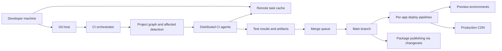

## Framing the problem

A monorepo is a trade: you give up the isolation of separate repositories in exchange for **atomic changes across
packages, one version of each dependency, and one place to enforce standards**. The trade only pays off if the
tooling makes the repository feel small to each engineer. Without affected-only builds, caching and clear ownership, a
400-person monorepo becomes a 60-minute CI pipeline that everybody blames on everybody else.

So the design has three pillars:

1. **A dependency graph you can trust** (explicit package boundaries, enforced rules).
2. **Graph-aware, cached execution** (build and test only what a change can affect, never redo work).
3. **Governance that scales** (code owners, dependency policy, upgrade ownership).

## 1. Requirements exploration

### Consumers

- **Product engineers**: fast local dev, fast PR feedback, simple commands, no cross-repo upgrade chores.
- **Platform / DX team** (likely 5–8 engineers): owns tooling, CI, caching, generators.
- **Package owners** (design system, data clients): want to change APIs and update all consumers in one PR.
- **Release managers / SRE**: independent app deploys, safe rollbacks.
- **Security**: dependency auditing, supply-chain controls.

### Functional requirements

- Workspace with apps and packages, a single lockfile, shared tooling config.
- Task orchestration (build, test, lint, typecheck, e2e) across the project graph with affected detection.
- Local and remote caching shared between developers and CI.
- Module boundary rules (apps cannot import other apps; feature libraries cannot import from other domains).
- Code generators for new apps and packages following the paved road.
- Per-app deployment pipelines with preview environments per PR.
- Versioned publishing for the few packages consumed outside the monorepo.

### Non-functional requirements and SLOs

- **PR CI**: p50 under 8 minutes, p90 under 15 minutes for typical PRs; worst-case (root config change) under 45 min.
- **Main branch**: always green; broken main is fixed or reverted within 30 minutes.
- **Local**: `install` under 2 minutes cold; dev server for one app starts in under 10 seconds.
- **Scale**: 150 packages growing to 300; around 300 PRs merged per day; 12 apps.
- **Cache hit rate**: over 70% of CI tasks served from remote cache.

### Clarifying questions

- Git host and CI provider? (Assume GitHub plus GitHub Actions with self-hosted or larger runners.)
- How many packages truly need to be published outside? Those need versioning; internal ones can be source-only.
- Are there back-end services in scope? A front-end only monorepo keeps tooling uniform; polyglot pushes towards Bazel.

## 2. Architecture



### Workspace layout

```
apps/
  storefront/            # Next.js
  admin/                 # Vite SPA
packages/
  design-system/         # @acme/design-system
  data/orders-client/    # generated API client
  features/checkout/     # domain feature library
  utils/dates/
tooling/
  eslint-config/ tsconfig/ jest-preset/ generators/
```

Every project has a manifest (`package.json` plus `project.json` or `turbo.json` task config) with **tags** describing
its type and domain: `type:app`, `type:feature`, `type:ui`, `type:util`, `domain:checkout`. Tags drive boundary rules.

### Core decisions

- **Package manager**: pnpm workspaces. Strict `node_modules` layout prevents phantom dependencies (importing a package
  you did not declare), which is critical for accurate graphs. `workspace:*` protocol for internal deps.
- **Single version policy** for third-party dependencies (one React, one TypeScript), with pnpm catalogs to declare
  versions in one place. Exceptions require an explicit allow-list entry and an owner.
- **Internal packages consumed as source** within the monorepo (TypeScript project references or path-based exports),
  not prebuilt, except where build output matters (published packages). Reduces build steps and makes go-to-definition
  work.
- **Orchestrator**: Nx or Turborepo (see trade-offs), with remote cache.

## 3. Data model and contracts

### Project graph and boundary rules

The graph is derived from `package.json` dependencies plus static import analysis. Rules expressed as data:

```json
{
  "depConstraints": [
    { "sourceTag": "type:app",     "onlyDependOnLibsWithTags": ["type:feature", "type:ui", "type:util", "type:data"] },
    { "sourceTag": "type:feature", "onlyDependOnLibsWithTags": ["type:ui", "type:util", "type:data"] },
    { "sourceTag": "type:ui",      "onlyDependOnLibsWithTags": ["type:ui", "type:util"] },
    { "sourceTag": "type:util",    "onlyDependOnLibsWithTags": ["type:util"] },
    { "sourceTag": "domain:checkout", "onlyDependOnLibsWithTags": ["domain:checkout", "domain:shared"] }
  ]
}
```

This mirrors Nx's `enforce-module-boundaries` lint rule; with Turborepo you implement the same thing with
`eslint-plugin-boundaries`, dependency-cruiser or Turborepo's boundaries feature.

### Task pipeline definition

```json
{
  "tasks": {
    "build":     { "dependsOn": ["^build"], "inputs": ["src/**", "package.json", "tsconfig.json"], "outputs": ["dist/**"] },
    "typecheck": { "dependsOn": ["^build"], "outputs": [] },
    "test":      { "dependsOn": [], "inputs": ["src/**", "test/**", "$TEST_CONFIG"], "outputs": ["coverage/**"] },
    "lint":      { "outputs": [] },
    "e2e":       { "dependsOn": ["build"], "cache": false }
  }
}
```

Cache key = hash of task inputs (source files, dependency outputs, lockfile slice, declared env vars, tool versions).
**Declaring inputs accurately is everything**: an undeclared env var means a stale cache hit, which destroys trust in
the cache faster than any slowness.

### Ownership manifest

```
# CODEOWNERS
/apps/storefront/            @acme/storefront-team
/packages/features/checkout/ @acme/checkout-team
/packages/design-system/     @acme/design-system
/tooling/                    @acme/dx-platform
/pnpm-lock.yaml              @acme/dx-platform
```

Combined with each project's metadata (`owner`, `slack`, `oncall`), this powers review routing and the service catalogue.

## 4. Interfaces

### Developer CLI (wrapping the orchestrator)

```bash
pnpm dev storefront                 # starts one app and only what it needs
pnpm affected test --base=origin/main
pnpm gen package --name dates --type util --domain shared   # generator with tags, tsconfig, lint, owners
pnpm graph                           # interactive project graph
pnpm doctor                          # checks Node version, pnpm version, cache config, git hooks
```

A thin wrapper (`acme` CLI or package scripts) hides whether the underlying tool is Nx or Turborepo, so the platform
team can change internals without retraining 400 people.

### CI pipeline (PR)

1. **Checkout with sufficient history** for affected detection (merge base with main).
2. **Install** with pnpm store cache keyed on lockfile hash.
3. **Compute affected projects** from the diff and the graph.
4. **Run affected `lint`, `typecheck`, `test`, `build` in parallel** across agents, pulling from remote cache.
5. **Affected e2e** for apps whose graph changed, against preview deployments.
6. **Report**: per-project status, cache hit rate, timing, and bundle-size diffs as a PR comment.

### Merge and deploy

- A **merge queue** (GitHub merge queue or similar) re-runs affected checks on the combination of queued PRs, so main
  stays green even with 300 merges a day.
- After merge, each affected **app** has its own deploy pipeline: build (cache hit from CI), upload immutable assets,
  promote via progressive rollout. Apps are deployed independently; unaffected apps are not redeployed.
- **Published packages** use Changesets: PRs include a changeset file; a release workflow versions and publishes.

## 5. Deep dives and trade-offs

### Tooling comparison

| Tool | Strengths | Weaknesses | Fit |
| --- | --- | --- | --- |
| **Nx** | Rich project graph, affected commands, module boundary lint rule, generators, plugins for many frameworks, distributed task execution and remote cache (Nx Cloud, or self-hosted cache options) | More concepts to learn; plugins can be opinionated; some features tied to the paid cloud | Large JS/TS monorepo needing governance features out of the box |
| **Turborepo** | Simple config, fast, excellent caching, low ceremony; remote cache via Vercel or self-hosted implementations | Fewer built-in governance features; no first-party distributed execution; graph is package-level only | Medium monorepos; teams that want minimal tooling |
| **Bazel** (with rules_js) | Hermetic, correct caching and remote execution at huge scale; polyglot | Steep learning curve, heavy maintenance, friction with JS ecosystem conventions | Very large polyglot orgs with a build team |
| **Rush** (with pnpm) | Strict policies, version policies, good for publishing many packages | Smaller community, less dev-loop tooling | Library-heavy monorepos |
| **pnpm workspaces alone** | Zero extra tooling | No caching or affected detection | Under about 20 packages |

**Recommendation for this brief:** pnpm + **Nx**, primarily for affected detection, boundary enforcement, generators
and distributed execution at 150–300 projects. Turborepo would be a legitimate choice if the org values simplicity and
is willing to assemble boundaries and distribution separately. Bazel is not justified for a front-end only repo of this
size: its correctness is excellent, but the cost of owning it is a dedicated build team.

### Keeping CI under 15 minutes

- **Affected detection** removes most of the work: a change to `features/checkout` only builds checkout and the apps
  that depend on it.
- **Remote caching** turns repeat work (re-runs, rebases, merge queue runs, developers' local builds) into downloads.
- **Distribution**: split affected tasks across N agents (Nx distributed execution, or a sharded matrix in GitHub
  Actions using the affected list). Shard large test suites by timing data.
- **Make the graph shallow**: a utility imported by everything means every change to it rebuilds everything. Split
  "god packages", and avoid barrel files that import the world (they also hurt test speed and tree-shaking).
- **Fast tools**: SWC or esbuild-based transforms for tests (Vitest, or Jest with `@swc/jest`), `tsc --build` with
  incremental project references for typechecking, Vite or Rspack for app builds.
- **Root changes are expensive by design**: a lockfile or root tsconfig change touches everything. Make those PRs
  rare, owned by the platform team, and scheduled.
- **Track it**: CI duration p50/p90, cache hit rate and flaky test rate are platform team SLOs on a public dashboard.

### Cache correctness and security

- Cache poisoning is a real risk: a malicious or misconfigured branch could upload a bad artifact that main later
  downloads. Mitigate with **read-write tokens only on trusted CI for main and the merge queue**, read-only for PRs from
  forks and developer machines (or separate namespaces), and signed or hashed artifacts.
- Include tool versions (Node, pnpm, compiler) in hash inputs; pin Node via `.nvmrc` / `engines` and Corepack or a
  version manager.

### Flaky tests

At 300 merges a day, a 1% flaky test is a daily blocker. Detect flakiness by re-running failures automatically and
recording pass-on-retry, quarantine flaky tests automatically (still run, not blocking) with an auto-created ticket for
the owning team, and report flaky rate per team. End-to-end tests are kept to critical journeys per app; the rest is
component and integration tests.

### Dependency management and upgrades

- One version of each dependency means **one upgrade PR for everybody**, which is the big win and the big cost: the
  upgrader must fix all consumers. Use Renovate with grouped updates, automerge for patch versions with green CI, and
  codemods for majors.
- The platform team owns framework upgrades (React, Next.js, TypeScript) and pairs with teams on hard migrations.
- Supply chain: pnpm `onlyBuiltDependencies` style allow-lists for install scripts, lockfile review by code owners,
  `minimumReleaseAge`-type delays on brand-new versions, and audit tooling in CI.

### Local developer experience

- Editors struggle with huge TypeScript projects; project references and per-package `tsconfig` keep the language
  server responsive.
- Sparse checkout is rarely necessary for a 150-package JS repo, but keep the option open.
- `pnpm dev <app>` must start only that app and its watched dependencies.

## Org and people considerations

- **DX platform team** owns tooling, CI, caching, generators, Renovate config, root configs and upgrade campaigns.
  It treats product engineers as customers with SLOs and a quarterly survey.
- **Ownership is mandatory**: every project has an owner tag and CODEOWNERS entry; CI fails for unowned projects.
  Orphaned packages are adopted or deleted.
- **RFCs** for new top-level tooling, new dependency exceptions, and boundary rule changes. A small architecture group
  reviews; decisions are recorded as ADRs in the repo.
- **Review load**: code owners for shared packages get many review requests. Use tiered ownership (owners only required
  for public API files; internal changes need any reviewer in the domain) and bots for mechanical changes.
- **Deprecation**: deprecated packages are tagged; lint warns on new imports; a dashboard tracks remaining imports by
  team; removal happens when usage is zero, executed by the owner.

### Migration from 60 repositories

1. Build the skeleton (tooling, CI, cache, generators) with **2 pilot repos**: a shared package and one app that
   consumes it. Prove CI times.
2. Import repos with history (`git subtree` or tools that rewrite paths), one domain at a time, starting with the
   most-shared packages so consumers benefit immediately.
3. During migration, still **publish** packages that outside repos consume, so not-yet-migrated apps keep working.
4. Converge versions of third-party deps per imported project; apps that are majors behind get a time-boxed
   exception with an owner and a deadline.
5. Archive old repos read-only with a pointer to the new location.

Plan for 2–3 quarters. The bottleneck is dependency convergence, not git.

### Success metrics

- PR CI duration p50/p90; time from merge to production per app.
- Remote cache hit rate; compute cost per merged PR.
- Percentage of apps on the current major of shared packages (target 100%, since there is only one version).
- Flaky test rate; main-branch red time per week.
- DORA metrics (deployment frequency, lead time, change failure rate, time to restore).
- Developer satisfaction with build and CI.

## What a lead-level answer adds

- Starts with **why** (atomic cross-package changes, single version policy) and the conditions under which a monorepo
  fails, rather than tooling first.
- Treats the **project graph as the core artifact** and protects it with boundaries, strict package management and
  accurate task inputs.
- Gives a **concrete CI budget** and the levers to hit it: affected detection, remote caching, distribution, graph shape.
- Addresses **cache poisoning, flaky tests and merge queues**, which only appear at scale.
- Has a **migration plan** that keeps unmigrated repos working, and an ownership model for upgrades.

## Common follow-up questions

**Why not keep polyrepos with better automation?**
You can, with Renovate and a shared CI template. But cross-package changes remain multi-PR, multi-release sequences,
and version drift returns. If teams rarely change shared code, polyrepos are fine; here, drift is the stated problem.

**How do you handle an app that must stay on an older React for a quarter?**
Temporary exception in the version policy with an owner and expiry; pnpm can install a different version for that one
workspace. Track it on the dashboard; exceptions without deadlines become permanent.

**How do you stop one team's change from breaking another team's app?**
The affected graph runs the other app's tests in the same PR, and code owners of the shared package review public API
changes. That is the main safety benefit of the monorepo.

**What about very large tests like visual regression?**
Run them only for affected UI projects, use a service such as Chromatic with TurboSnap-like change detection, and
accept them as non-blocking for unrelated changes.

**Who owns main when it breaks?**
The merge queue should prevent most breaks. When one happens, an automatic revert bot reverts the culprit PR after
bisecting within the queue batch, and the author is notified. Humans fix forward only when the revert is unsafe.
