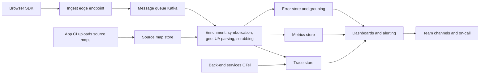

## Framing the problem

Front-end observability is harder than back-end observability for three reasons: the runtime is **untrusted and
heterogeneous** (thousands of device, browser, extension and network combinations), data must leave the client over an
unreliable connection **without hurting the page it is measuring**, and the code is **minified**, so raw errors are
unreadable. On top of that, at 8 million page views a day, sending everything is expensive, so **sampling and cost
control** are part of the architecture, not an afterthought.

The platform's job is to answer three questions quickly for any team: *Is my app broken? Is it slow? Where in the
stack is the problem?* Everything in the design traces back to one of those.

## 1. Requirements exploration

### Consumers

- **Product teams**: errors and performance for their app or route, alerts to their channel.
- **SRE / incident command**: cross-app view during incidents, correlation with back-end traces.
- **Leadership**: Core Web Vitals and reliability scorecards per product.
- **Privacy and security**: assurance that no PII or secrets are captured.

### Functional requirements

1. **Errors**: uncaught exceptions, unhandled promise rejections, React error boundaries, failed network requests,
   resource load failures, with de-minified stack traces, breadcrumbs and release tagging.
2. **RUM**: LCP, INP, CLS, plus TTFB and FCP, route-change timings for SPAs, long animation frames, custom marks
   ("search results rendered").
3. **Tracing**: a user interaction (click "Pay") produces a trace that continues into back-end spans via W3C trace
   context headers.
4. **Dashboards and alerts**: per app, per route, per release, per team; error-rate and vitals SLO alerts.
5. **Optional session replay** for debugging specific failures, with strict masking.

### Non-functional requirements and SLOs

- **SDK cost**: under 15 KB gzipped for the core (errors + vitals), loaded without blocking rendering; no measurable
  INP regression; tracing and replay loaded lazily.
- **Data freshness**: errors visible within 1 minute; vitals aggregated within 5 minutes.
- **Ingestion availability**: 99.9%; the client must drop data rather than retry indefinitely.
- **Scale**: 8M page views/day, roughly 100 events per page view before sampling, meaning up to 800M raw events per
  day. With sampling, target under 100M stored events per day.
- **Privacy**: no PII in payloads by default; GDPR-compliant consent handling; configurable data residency (EU).

### Out of scope

- Product analytics (funnels, retention), which lives in a separate analytics pipeline, though the two share
  transport code.

## 2. Architecture



Components:

- **Browser SDK**: a small core plus lazily loaded plugins (tracing, replay), configured per app.
- **Ingest edge**: a stateless endpoint on our own domain (avoids ad-blockers that block third-party collectors and
  keeps cookies out), validates payload size and schema, applies server-side sampling and rate limits per app, and
  writes to a queue.
- **Enrichment workers**: symbolicate stack traces with private source maps, parse user agents, add coarse geo from
  IP then drop the IP, scrub PII, attach team ownership from a service catalogue.
- **Stores**: an error store with fingerprint grouping; a time-series/columnar store for vitals (ClickHouse, or the
  vendor's backend); a trace store shared with back-end tracing.
- **Ownership catalogue**: maps app + route to an owning team so alerts route automatically.

## 3. Data model and contracts

The SDK emits a single envelope format containing typed items. Aligning field names with **OpenTelemetry semantic
conventions** lets front-end and back-end data join.

```json
{
  "sdk": { "name": "acme-rum", "version": "3.1.0" },
  "resource": {
    "service.name": "storefront-web",
    "service.version": "2025.06.02-a1b2c3",
    "deployment.environment": "production"
  },
  "session": { "id": "s_7c1e", "sampled": { "errors": true, "rum": true, "replay": false } },
  "context": {
    "route": "/product/:id",
    "userAgent": "Mozilla/5.0 ...",
    "connection": { "effectiveType": "4g", "rtt": 100 },
    "flags": { "checkout.new-payment-sheet": "treatment" }
  },
  "items": [
    {
      "type": "web-vital",
      "name": "INP",
      "value": 312,
      "rating": "needs-improvement",
      "attribution": { "interactionTarget": "button#add-to-cart", "inputDelay": 18, "processingDuration": 240, "presentationDelay": 54 },
      "navigationType": "navigate"
    },
    {
      "type": "error",
      "message": "Cannot read properties of undefined (reading 'price')",
      "stack": "TypeError: ...\n at t.render (https://cdn.acme.com/app.4f3a.js:1:20431)",
      "mechanism": "react-error-boundary",
      "breadcrumbs": [{ "t": 1717322103, "category": "navigation", "data": { "to": "/product/:id" } }],
      "traceId": "4bf92f3577b34da6a3ce929d0e0e4736"
    }
  ]
}
```

Key decisions:

- **Routes are templated** (`/product/:id`), never raw URLs, which keeps cardinality bounded and avoids leaking IDs.
- **Release version** on every event, matching the source-map upload, so symbolication is exact.
- **Feature-flag variants** attached as context: "errors spiked only in the treatment" is the fastest root cause there is.

### Source map contract

CI uploads source maps keyed by `service.name` + `service.version` (and ideally a **debug ID** embedded in the bundle
and the map, which removes ambiguity when file names repeat across releases). Maps are **never served publicly**; the
build either strips the `sourceMappingURL` comment or points it at an authenticated location.

## 4. Interfaces

### SDK API

```ts
interface ObservabilityConfig {
  service: string;
  version: string;
  environment: 'production' | 'staging' | 'development';
  endpoint: string;                         // first-party, e.g. https://www.acme.com/_o/ingest
  sampleRates: { errors: number; rum: number; traces: number; replayOnError: number };
  propagateTraceTo: (string | RegExp)[];    // only these origins receive traceparent headers
  beforeSend?: (event: TelemetryEvent) => TelemetryEvent | null; // scrubbing hook
  consent?: () => 'granted' | 'denied' | 'pending';
}

declare function init(config: ObservabilityConfig): void;
declare function captureError(error: unknown, ctx?: Record<string, unknown>): void;
declare function addBreadcrumb(b: { category: string; message?: string; data?: Record<string, unknown> }): void;
declare function mark(name: string): void;                       // custom timing start
declare function measure(name: string, startMark: string): void; // custom timing end
declare function startSpan<T>(name: string, fn: (span: Span) => Promise<T> | T): Promise<T>;
declare function setContext(key: 'user' | 'flags' | 'tenant', value: Record<string, unknown>): void;
```

React integration: an `<ObservabilityErrorBoundary fallback={...}>` that captures with the component stack, a router
integration that emits route-change spans and resets per-route vitals, and a `useMeasure('search-results')` hook.

### CI integration

```bash
acme-observe sourcemaps upload ./dist --service storefront-web --release $GIT_SHA
acme-observe release finalize --service storefront-web --release $GIT_SHA --deploy production
```

Finalizing a release lets the platform show "new in this release" error groups and compare vitals before and after
the deploy.

## 5. Deep dives and trade-offs

### Collecting signals correctly

- **Vitals**: use the `web-vitals` library (attribution build) rather than hand-rolling `PerformanceObserver` logic; it
  handles edge cases such as back/forward cache restores, prerendering and reporting INP at page hide. Note that INP
  and CLS are only final when the page is hidden, so the SDK must flush on `visibilitychange` to `hidden`.
- **SPA navigations**: Core Web Vitals are defined per page load. For route changes, emit custom "route change"
  timings (navigation start to the route's key element rendered). The soft-navigation work in Chromium may eventually
  standardise this; design the schema so it can absorb it.
- **Errors**: `window.onerror`/`error` event, `unhandledrejection`, error boundaries, and wrapped `fetch`/XHR for
  failed requests. Cross-origin scripts produce opaque "Script error." unless served with CORS headers and
  `crossorigin="anonymous"`; that is a platform checklist item for every app's CDN.
- **Noise**: browser extensions, bots and old browsers create junk errors. Filter by stack frames from our own origins,
  drop known extension URLs, and ignore errors from unsupported browsers.

### Transport

Batch events and send them with `fetch(url, { method: 'POST', keepalive: true })` or `navigator.sendBeacon` on page
hide. Keep payloads under 64 KB (the keepalive body budget). Compress large batches with `CompressionStream('gzip')`
where supported. Never retry aggressively: a failing ingest endpoint must not turn into a self-inflicted DDoS. Use
exponential backoff with a small in-memory queue, and drop on overflow.

### Sampling and cost control

Sampling is the main cost lever and must be designed to keep data **statistically useful**:

- **Head-based, per session**: decide once per session whether it is in the RUM sample (for example 10%), so you get
  complete sessions rather than random fragments.
- **Errors**: capture 100% but deduplicate on the client (same fingerprint at most N times per session) and rate-limit
  per app at the edge with spike protection.
- **Traces**: head-sample 1–5% of interactions, but **always propagate the sampling decision** in `traceparent` so
  back-end spans follow the same decision. Tail-based sampling ("keep all traces with errors or above p99 latency")
  is done in the OpenTelemetry Collector, at the cost of buffering.
- **Replay**: only on sessions that hit an error (buffer the last 60 seconds in memory and upload on error).
- Dynamic sample rates delivered via remote config so an incident can temporarily raise sampling for one app.

Expected volume after sampling: errors around 5–20M events/day before grouping, vitals around 8M page views × 10% ×
a handful of metrics, traces a few million spans. That is affordable on either a vendor or a self-hosted ClickHouse.

### Tracing from browser to back end

The SDK injects a W3C `traceparent` header on requests to allow-listed origins only (`propagateTraceTo`). Sending it to
third parties leaks IDs and can break CORS preflights because it is not a safelisted header, so every API must allow
`traceparent` (and `tracestate`) in `Access-Control-Allow-Headers`. Server-rendered pages can emit the server trace ID
in a `Server-Timing` header or a meta tag, so the browser's page-load span joins the server render span. The result is
one trace: click, front-end span, BFF, services, database.

### Build vs buy

| Option | Strengths | Weaknesses |
| --- | --- | --- |
| **Sentry** | Best-in-class error grouping, source maps, release health, replay; open-source self-hosting possible | RUM and dashboards less flexible than full APM; cost grows with event volume |
| **Datadog RUM**, **New Relic**, **Dynatrace** | Unified with back-end APM, logs and infra; strong correlation | Expensive at high session volume; vendor lock-in for queries and dashboards |
| **Grafana Faro + Grafana stack**, **Elastic** | Open-source front-end SDK with OTel alignment; self-host or Grafana Cloud | More assembly and operations work |
| **OpenTelemetry JS (browser)** | Vendor-neutral standard, rich instrumentation | Browser support is still less mature than server-side; larger bundle; you build the RUM UX yourself |
| **SpeedCurve, DebugBear, Akamai mPulse** | Specialist RUM and performance analytics | Performance only, not errors |
| **Build in house** | Total control | Error grouping, symbolication and alerting UX are years of work |

**Recommendation:** a thin in-house **facade SDK** (the API above) so apps never import a vendor directly. Behind it,
use a vendor for errors and replay (commonly Sentry), and route vitals and traces into the **same backend the
back-end teams already use** (Datadog, Grafana or Honeycomb) via OTLP where possible, so traces join. Revisit
self-hosting when annual vendor spend exceeds the cost of a 3–4 person team. The facade also enforces privacy and
sampling policy centrally.

### Privacy and security

- Scrub by default: strip query strings, mask input values, redact anything matching email, card or token patterns
  in `beforeSend` and again server-side (defence in depth).
- User identity is a pseudonymous ID, never email. Respect consent: if analytics consent is denied, keep only strictly
  necessary error reporting if your legal team classifies it that way, otherwise nothing.
- Replay masks all text and inputs by default; teams opt specific elements in.
- Region-specific ingestion endpoints for EU data residency.

### Alerting that people trust

- Alert on **SLOs**, not single events: "error-free session rate below 99.5% over 30 minutes" or "INP p75 above 200 ms
  for 3 consecutive hours on /checkout".
- New error groups in a fresh release alert the deploying team, with release comparison.
- Every alert routes to the owning team from the catalogue; unknown owners go to the platform team, which treats that
  as a catalogue bug.

## Org and people considerations

- **Ownership**: a small observability platform team owns the SDK, ingestion, enrichment, catalogue and vendor
  relationship. App teams own their alerts, dashboards and SLOs. Platform provides defaults so day-one value needs no
  configuration.
- **Paved road**: the app template includes the SDK, source-map upload, release finalize and default dashboards. A
  `doctor` check in CI verifies SDK version, source maps uploaded and CORS headers for cross-origin scripts.
- **RFC for schema changes**: new standard attributes or event types go through a short RFC so names stay consistent
  across apps and align with OTel semantic conventions.
- **Cost accountability**: show per-team event volume and cost in the dashboard. Teams that turn sampling up pay for it
  in their budget view.
- **Deprecation**: migrate the home-grown beacon and direct vendor SDK usage to the facade with a codemod; maintain a
  compatibility shim for one quarter.

### Rollout plan

1. Facade SDK with errors + vitals for 3 high-traffic apps; validate overhead with an A/B test (SDK on vs off) for
   INP and LCP.
2. Source-map pipeline and release tracking; alert routing via catalogue.
3. Trace propagation with back-end teams (CORS changes are the long pole).
4. Remaining apps via the template; error-triggered replay last, after privacy review.

### Success metrics

- Coverage: percentage of apps and page views instrumented; percentage of errors with symbolicated stacks.
- **Mean time to detect** and **mean time to resolve** front-end incidents (before vs after).
- Percentage of incidents where the root cause tier (browser, CDN, API) was identified from telemetry.
- Alert quality: percentage of pages acknowledged as actionable.
- Cost per 1,000 sessions; SDK weight and measured overhead.

## What a lead-level answer adds

- Designs **sampling, cost and privacy into the architecture** from the start, with numbers.
- Puts a **facade SDK** between apps and vendors, making build vs buy a reversible decision.
- Explains the **subtle correctness issues**: when INP and CLS are final, opaque cross-origin errors, `traceparent`
  CORS requirements, release-matched source maps.
- Connects telemetry to **ownership and alert routing**, so data turns into action rather than dashboards nobody reads.
- Validates that **the observer does not hurt what it observes** by measuring SDK overhead with an experiment.

## Common follow-up questions

**How do you group errors so that one bug is one issue?**
Fingerprint on the normalised, symbolicated top in-app frames plus error type, ignoring line/column changes across
releases where function names match. Allow teams to add custom fingerprint rules for known noisy cases.

**Why do lab tools like Lighthouse disagree with RUM?**
Lab tests use one device and network profile with no user interaction; INP cannot be measured in the lab at all.
RUM is the source of truth for user experience; lab is for regression detection in CI.

**How do you measure INP for a single-page app's route changes?**
INP covers all interactions over the page's life, including those in client-side navigations, and is reported at
page hide. Use the attribution data to tag the route where the worst interaction happened.

**Ad-blockers block your telemetry. What now?**
Serve ingest from your own domain and path, avoid well-known vendor URLs and script names, and accept some loss.
Never try to evade a user's explicit privacy choice.

**How do you keep the SDK from causing errors itself?**
Wrap all SDK code in try/catch with self-reporting at a low sample rate, lazy-load optional plugins, and test the SDK
against old browsers in CI. The SDK must fail silent.
