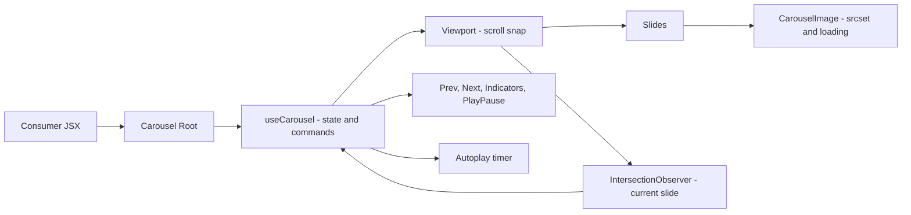

## 1. Requirements exploration

Carousels are a classic component question because they combine **layout and motion** (transforms vs native
scroll), **performance** (they often contain the LCP image), **touch interaction**, and one of the more subtle
**accessibility** patterns. A strong answer also questions the use cases: autoplaying hero carousels are known to
hurt usability, so the component should make the accessible behaviour the default.

### Functional requirements

- Slides of arbitrary content (images mostly, but also cards); one or many per view; optional peek of the next slide.
- Navigation: previous/next buttons, indicators (dots or thumbnails), swipe/drag, trackpad horizontal scroll,
  keyboard.
- Loop mode (next on the last slide goes to the first) and non-loop mode (buttons disabled at the ends).
- Autoplay with interval, paused on hover, on focus and by a visible pause button; stops permanently after user
  interaction.
- Controlled (`index` + `onIndexChange`) and uncontrolled usage; imperative `goTo(index)`.
- Optional fullscreen/lightbox for galleries (a separate component reusing the same core).

### Non-functional requirements

| Concern | Target |
| --- | --- |
| LCP | first slide image is discoverable in HTML and fetched with high priority; LCP < 2.5 s p75 |
| CLS | 0 layout shift: aspect ratio reserved before images load |
| Bandwidth | only the current and adjacent slides load eagerly; correct image size per viewport/DPR |
| Motion | 60 fps transitions; swipe follows the finger with no lag |
| Accessibility | APG carousel pattern; WCAG 2.2.2 pause/stop/hide for autoplay; reduced motion respected |
| Bundle | < 5 KB gzip core; no animation library |

### Out of scope

- Image processing/CDN implementation (we consume a resizing CDN), video slides (mention as extension).

### Clarifying questions

1. How many slides typically? 5 hero banners vs 40 product photos vs 200 items in a "related products" rail.
2. Is server rendering used? (The first slide must render on the server for LCP.)
3. Is looping really needed? It complicates a11y and scroll-snap implementations.
4. Do we need vertical orientation or RTL? (RTL is mandatory if the product is localised for Arabic/Hebrew.)

Assume SSR, 1–50 slides, RTL support, looping optional.

## 2. Architecture / high-level design

### Rendering approach: native scroll-snap vs transform-based track

| Approach | How | Pros | Cons |
| --- | --- | --- | --- |
| **CSS scroll snap** | a horizontally scrollable container with `scroll-snap-type: x mandatory`; buttons call `scrollTo`/`scrollIntoView` | native touch physics, trackpad and momentum for free; works without JS; good performance; RTL handled by the browser | infinite looping is awkward; less control over animation timing; detecting the "current" slide needs observers |
| **Transform track** | slides in a flex row; JS sets `transform: translateX(-index * 100%)`; pointer events implement swipe | full control: looping via clones, custom easing, consistent behaviour | must reimplement momentum, thresholds, trackpad handling; easier to get janky; more JS |

**Decision:** default to **scroll snap** as the engine (robust, accessible, progressive), with a transform-based
mode only for the loop/hero case if product insists on seamless infinite looping. Many modern carousel libraries
(e.g. Embla) use their own transforms; a design system can reasonably wrap one. Either way, the public API stays the
same.

### Components

| Part | Responsibility |
| --- | --- |
| `useCarousel()` (headless) | index state, slide count, navigation commands, autoplay timer, loop logic, a11y prop getters |
| `Carousel.Root` | region with label, keyboard handling, autoplay pause on hover/focus |
| `Carousel.Viewport` | the scroll-snap container (or transform viewport) |
| `Carousel.Slide` | one slide: `role="group"`, `aria-roledescription="slide"`, label "3 of 8" |
| `Carousel.Prev/Next` | buttons wired to commands, disabled at ends when not looping |
| `Carousel.Indicators` | dots or thumbnails (buttons) to jump to a slide |
| `Carousel.PlayPause` | autoplay toggle |
| **Image helper** | `<CarouselImage>`: `srcset`/`sizes`, aspect ratio, lazy vs eager, `fetchpriority` |



Compound components let consumers rearrange parts (indicators above, thumbnails beside) without new props.

## 3. Data model

```ts
interface CarouselState {
  index: number;                 // first fully visible slide
  slideCount: number;
  slidesPerView: number;         // derived from CSS/measurement, can be fractional (1.2)
  isPlaying: boolean;            // autoplay running
  pausedBy: Set<'hover' | 'focus' | 'user' | 'hidden'>; // why autoplay is paused
  isDragging: boolean;
  userInteracted: boolean;       // stops autoplay permanently once true (configurable)
}

interface SlideData {
  id: string;
  image: {
    src: string;                 // base URL for the resizing CDN
    alt: string;                 // empty string only if decorative
    width: number;               // intrinsic, for aspect ratio
    height: number;
    blurDataUrl?: string;        // tiny placeholder
  };
  caption?: string;
  href?: string;                 // hero banners link somewhere
}
```

Derived values (`canPrev`, `canNext`, `pageCount = ceil(slideCount / slidesPerView)`) are computed, not stored.
`slidesPerView` comes from layout (CSS custom property `--slides-per-view` per breakpoint) rather than JS
breakpoints, so SSR markup and CSS agree and there is no hydration jump.

## 4. Interface definition (API)

```tsx
<Carousel.Root
  label="Product images"           // required: accessible name
  loop={false}
  autoplay={{ interval: 6000, stopOnInteraction: true }} // omit for galleries
  index={index}                    // optional controlled
  onIndexChange={setIndex}
  align="start"                    // "start" | "center" for peeking layouts
>
  <Carousel.Viewport>
    {slides.map((s, i) => (
      <Carousel.Slide key={s.id}>
        <CarouselImage
          {...s.image}
          sizes="(min-width: 1024px) 50vw, 100vw"
          priority={i === 0}       // eager + fetchpriority="high"
        />
      </Carousel.Slide>
    ))}
  </Carousel.Viewport>
  <Carousel.Prev />
  <Carousel.Next />
  <Carousel.Indicators variant="thumbnails" />
  <Carousel.PlayPause />
</Carousel.Root>
```

```ts
interface CarouselRootProps {
  label: string;
  loop?: boolean;
  autoplay?: false | { interval: number; stopOnInteraction?: boolean };
  index?: number;
  defaultIndex?: number;
  onIndexChange?: (index: number, reason: 'button' | 'indicator' | 'swipe' | 'keyboard' | 'autoplay' | 'api') => void;
  align?: 'start' | 'center';
  orientation?: 'horizontal' | 'vertical';
  children: React.ReactNode;
}

interface CarouselHandle {
  goTo(index: number, opts?: { animate?: boolean }): void;
  next(): void;
  prev(): void;
}
```

The `reason` in `onIndexChange` lets analytics distinguish user engagement from autoplay, and lets consumers sync
URL state only for user actions.

## 5. Optimizations and deep dives

### Image loading strategy

- **First slide**: rendered on the server as a real `` with `srcset`, `sizes`, `width`/`height`,
  `loading="eager"` and `fetchpriority="high"`. Never hide it behind JS initialisation or a CSS background image,
  which the preload scanner cannot discover. Optionally `<link rel="preload" as="image" imagesrcset=… imagesizes=…>`
  for hero banners.
- **Adjacent slides** (next and previous): `loading="lazy"` is not enough for off-screen horizontal content in all
  browsers' heuristics; explicitly preload neighbours when the carousel becomes idle or when the user hovers/touches
  the carousel (intent), using `new Image()` with the same `srcset`/`sizes` so the cache hits.
- **Far slides**: lazy; fetched as the user approaches.
- **Responsive sizes**: a resizing CDN with `w=` widths (e.g. 320, 640, 960, 1280, 1920) plus modern formats
  (AVIF/WebP via `<picture>` or CDN content negotiation). `sizes` must match the layout, otherwise the browser
  downloads the wrong size (a common bug when slides-per-view changes per breakpoint).
- **No CLS**: `aspect-ratio` on the slide (from intrinsic dimensions or a fixed ratio) plus a blurred placeholder or
  dominant colour.
- Thumbnails use separate small renditions, not scaled-down full images.

### Interaction details

- Swipe (transform mode): Pointer Events with `setPointerCapture`; `touch-action: pan-y` on the viewport so vertical
  page scroll still works while horizontal drags are captured; follow the finger with `translateX` in
  `requestAnimationFrame`; on release decide by distance (> 20–30% width) or velocity; prevent click on links if the
  pointer moved more than a few pixels.
- Scroll-snap mode: the browser handles swipe and momentum; the hook listens to `scrollend` (with a debounced
  `scroll` fallback for browsers lacking it) or an `IntersectionObserver` with thresholds to update `index`.
- Buttons use `scrollTo({ left, behavior: 'smooth' })`, or `instant` when reduced motion is requested.
- Looping: in transform mode, clone the first/last slides and silently jump after the transition; clones must be
  `aria-hidden` and `inert` so they are not read twice or focusable. In scroll-snap mode, prefer "rewind" (next on the
  last slide animates back to the first) over true infinite loops.
- RTL: with scroll snap, `scrollLeft` semantics in RTL are standardised as negative values in modern browsers; use
  logical directions (`next` means towards the inline end) and flip arrow icons.

### Autoplay done responsibly

- WCAG 2.2.2: anything moving for more than 5 s must be pausable. Provide a visible pause/play button as the first
  control in the carousel's tab order.
- Pause on hover and on focus within; pause when `document.visibilityState === 'hidden'` or when the carousel is
  off-screen (IntersectionObserver), saving work and avoiding the user returning to a different slide.
- Disable autoplay entirely when `prefers-reduced-motion: reduce`.
- Stop permanently after any user navigation (the user took control).
- Long enough intervals (≥ 5–7 s), especially for slides with text.

### Accessibility (APG carousel pattern)

- Root: `<section aria-roledescription="carousel" aria-label="Product images">` (or `role="region"`).
- Each slide: `role="group"`, `aria-roledescription="slide"`, `aria-label="3 of 8"` (or the slide title).
- Slide container: `aria-live="off"` while autoplaying, `aria-live="polite"` when not, so manual navigation is
  announced but rotation doesn't chatter.
- Prev/next are `<button>`s with labels ("Next slide"), disabled at ends when not looping (use `aria-disabled` if
  you want them to stay focusable).
- Indicators: either a set of buttons ("Go to slide 3", `aria-current="true"` on the active one) or the APG tabbed
  variant (`role="tablist"`, slides as `tabpanel`s). Buttons are simpler and usually sufficient.
- Off-screen slides: make their interactive content unreachable with `inert` (now widely supported) so `Tab` doesn't
  land in an invisible slide, except in multi-per-view layouts where visible slides must remain reachable.
- Keyboard: buttons are standard; arrow-key handling on the viewport is optional (if the viewport is a scroll
  container it is focusable and native arrow-key scrolling works).
- Images need meaningful `alt` for galleries; hero banners that contain text should render the text as HTML, not
  baked into the image.

### Performance

- Animate only `transform` and `opacity`; avoid animating `left` or `width`.
- Avoid re-rendering all slides on index change: slides are memoised; only controls and `aria` attributes change.
- With 200 items in a rail, virtualize horizontally or render lightweight placeholders for far slides.
- `content-visibility: auto` for off-screen slides with complex content.

### SSR and hydration

Render all slides (or the first N) on the server with the CSS-driven layout so the page is usable before JS loads
(scroll-snap works without JS). Hydration attaches listeners and state without changing layout. Avoid reading
`window.innerWidth` during render.

### Testing and observability

- Unit tests on the hook (index math, loop, autoplay pausing reasons).
- Interaction tests: keyboard navigation, focus not entering hidden slides, live region updates.
- Visual tests in RTL and at breakpoints; real-device swipe tests.
- Track engagement (`onIndexChange` reasons), LCP element and image bytes per page view.

## What a lead-level answer adds

- Challenges the requirement: autoplaying hero carousels have poor engagement and a11y; the design system ships
  safe defaults (no autoplay, visible pause control if enabled) and documents why.
- Chooses **native scroll snap first** for robustness, and uses JS transforms only where necessary.
- Treats the carousel as an **LCP risk**: SSR'd first image, `fetchpriority`, correct `sizes`, no JS-gated images.
- Designs a compound, headless API that serves galleries, rails and banners without dozens of props.

## Common follow-up questions

**How would you build the fullscreen lightbox?** A modal dialog (`<dialog>` with `showModal()`) containing the same
carousel core, with pinch-zoom on images, `Escape` to close and focus returned to the thumbnail that opened it.

**How do you support video slides?** Pause video when its slide leaves view; don't autoplay audio; use poster images
for LCP; lazy-load the player.

**Why not `display: none` for inactive slides?** It prevents smooth transitions and peeking layouts, and hides
content from find-in-page. Use `inert` and `aria-hidden` (only for clones) instead.

**How do you know which slide is current with scroll snap?** IntersectionObserver with the viewport as root and a
threshold near 0.6, or compute from `scrollLeft / slideWidth` on `scrollend`. Recent Chromium also exposes
`scrollsnapchange` events.

**How do you test swipe?** Dispatch pointer events in Playwright with touch emulation; for scroll snap, assert
`scrollLeft` after `mouse.wheel` with `deltaX`.
