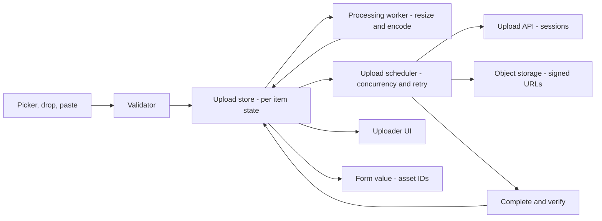

## 1. Requirements exploration

An image uploader is a component with a **pipeline** behind it: acquire files → validate → process (decode,
orient, resize, compress, strip metadata) → upload (direct to storage, chunked, resumable) → finalise (server
verification, derived sizes) → hand an ID back to the form. The UI is a list of items each moving through that
pipeline. The interview tests whether you can design the state machine, keep the main thread responsive while
processing large photos, and make uploads robust and secure.

### Functional requirements

- Input methods: file picker (`<input type="file" accept="image/*" multiple>`), drag and drop onto a drop zone,
  paste (`Ctrl/Cmd+V`), camera capture on mobile (`capture` attribute where appropriate).
- Instant thumbnails; per-file progress; cancel, retry, remove; reorder (galleries); set cover image.
- Validation: allowed types, max file size, min/max dimensions, max file count.
- Optional crop/rotate (fixed aspect for avatars).
- Client-side resize/compression before upload (configurable max dimension and quality).
- Form integration: value is an array of uploaded asset IDs; submit blocked (or queued) until uploads finish.
- Resume after transient network failures; warn before leaving the page with uploads in progress.

### Non-functional requirements

| Concern | Target |
| --- | --- |
| Feedback | thumbnail visible < 300 ms after selection, even for 12 MP photos |
| Main thread | no long tasks > 50 ms from decoding/resizing; typing elsewhere stays responsive |
| Bandwidth | upload ≤ ~1–2 MB per photo after client-side resize for typical listing images |
| Reliability | uploads resume after a dropped connection without restarting large files |
| Concurrency | 2–3 parallel uploads (tunable) so one file finishes quickly instead of all crawling |
| Accessibility | all actions keyboard operable; progress and errors announced; drag and drop never the only way |
| Security | server-side validation and re-encoding; uploads go to storage with scoped, expiring credentials |

### Out of scope

- Full image editor (filters, layers), video uploads (mention: same pipeline with different processing).
- Server-side image CDN implementation (assume one exists that generates sizes).

### Clarifying questions

1. Do we need originals preserved (photographers) or are resized versions fine (marketplace listings)?
2. Max file size and count per use case? (Avatar: 1 file; listing: up to 20.)
3. Should uploads start immediately on selection or on form submit? (Immediate is better UX: the upload runs while the
   user fills the rest of the form.)
4. Which formats: JPEG, PNG, WebP, HEIC from iPhones, GIF animations?
5. Do drafts need to survive a page reload?

Assume immediate upload, resizing allowed (keep originals optional), JPEG/PNG/WebP/HEIC input.

## 2. Architecture / high-level design

### Direct-to-storage upload

Do not stream large files through the application server. Instead:

1. Client asks the API for an **upload session** (`POST /uploads`) with file metadata.
2. API returns a **pre-signed URL** (or multipart upload URLs) scoped to one object key, content type and max size,
   expiring in minutes.
3. Client uploads bytes directly to object storage (S3/GCS/R2) or a resumable upload endpoint.
4. Client calls `POST /uploads/:id/complete`; the server verifies the object (size, magic bytes, decodes it),
   re-encodes/strips metadata, triggers derived sizes, and returns an `assetId`.

This keeps the app servers out of the data path, scales with storage, and lets the CDN/edge terminate uploads near the
user.

### Components

| Part | Responsibility |
| --- | --- |
| **Uploader UI (React)** | drop zone, picker button, item list with thumbnails, progress, actions, errors |
| **Upload store** | items keyed by local ID with state machine status; derived aggregate status for the form |
| **Validator** | type sniffing, size, count, dimensions (after decode) |
| **Processing worker** | decode (`createImageBitmap`), orientation, resize on `OffscreenCanvas`, encode (`convertToBlob`), thumbnail generation |
| **Upload scheduler** | queue with concurrency limit, retries with backoff, pause on offline |
| **Transport** | XHR (for upload progress) or chunked/resumable protocol (multipart, tus) |
| **Upload API** | sessions, signed URLs, completion, asset IDs |



## 3. Data model

```ts
type LocalId = string; // crypto.randomUUID()

type UploadStatus =
  | 'queued'        // accepted, waiting for processing
  | 'processing'    // decoding/resizing in worker
  | 'uploading'
  | 'finalizing'    // server verification
  | 'done'
  | 'error'
  | 'canceled';

interface UploadItem {
  id: LocalId;
  file: File;                       // original, kept until done (for retry)
  processed?: Blob;                 // resized output
  previewUrl?: string;              // object URL of a small thumbnail
  width?: number;
  height?: number;
  status: UploadStatus;
  progress: number;                 // 0..1 across bytes uploaded
  bytesTotal: number;
  error?: { code: UploadErrorCode; message: string; retryable: boolean };
  session?: { uploadId: string; parts?: Array<{ partNumber: number; etag?: string }> };
  assetId?: string;                 // server ID when done
  attempt: number;
  abort?: AbortController;
}

type UploadErrorCode =
  | 'TYPE_NOT_ALLOWED' | 'TOO_LARGE' | 'TOO_SMALL_DIMENSIONS' | 'DECODE_FAILED'
  | 'NETWORK' | 'SESSION_EXPIRED' | 'SERVER_REJECTED' | 'QUOTA';

interface UploaderState {
  items: UploadItem[];              // ordered, order = gallery order
  aggregate: 'idle' | 'busy' | 'error' | 'complete';
}
```

The form only cares about `items.filter(i => i.status === 'done').map(i => i.assetId)` and whether anything is still
busy. Non-serialisable things (`File`, `AbortController`) live in the store, not in form libraries' state.

## 4. Interface definition (API)

### Component props

```ts
interface ImageUploaderProps {
  value?: UploadedAsset[];                    // existing assets (editing a listing)
  onChange?: (assets: UploadedAsset[]) => void; // fires when done items change or reorder
  onStatusChange?: (s: UploaderState['aggregate']) => void; // lets the form disable submit
  maxFiles?: number;
  maxFileSize?: number;                       // bytes, before processing
  accept?: string[];                          // ['image/jpeg', 'image/png', 'image/webp', 'image/heic']
  minDimensions?: { width: number; height: number };
  resize?: false | { maxWidth: number; maxHeight: number; quality: number; format: 'image/jpeg' | 'image/webp' };
  crop?: { aspect: number };                  // e.g. 1 for avatars
  concurrency?: number;                       // default 3
  reorderable?: boolean;
  label: string;                              // accessible name, e.g. "Listing photos"
  description?: string;                       // constraints shown to all users
  uploadAdapter?: UploadAdapter;              // swap transport (tests, different backends)
}

interface UploadedAsset { assetId: string; url: string; width: number; height: number; alt?: string }

interface UploadAdapter {
  createSession(meta: { name: string; type: string; size: number }): Promise<UploadSession>;
  upload(session: UploadSession, blob: Blob, opts: { signal: AbortSignal; onProgress: (loaded: number) => void }): Promise<void>;
  complete(session: UploadSession): Promise<UploadedAsset>;
}
```

A headless `useImageUploader()` hook exposes the store and actions (`addFiles`, `retry`, `cancel`, `remove`,
`move`) for teams with custom UIs (chat composer attachments look very different from a gallery grid).

### Server API

```http
POST /v1/uploads
  { "filename": "IMG_2041.HEIC", "contentType": "image/jpeg", "size": 1843302, "purpose": "listing-photo" }
201
  { "uploadId": "up_92ks", "strategy": "single", "url": "https://storage.example.com/...signed...",
    "headers": { "Content-Type": "image/jpeg" }, "expiresAt": "2025-06-01T10:15:00Z" }

// For large files: strategy "multipart" with partSize and per-part URLs (or fetched lazily)
  { "uploadId": "up_92ks", "strategy": "multipart", "partSize": 5242880,
    "parts": [{ "partNumber": 1, "url": "..." }, { "partNumber": 2, "url": "..." }] }

POST /v1/uploads/:uploadId/complete
  { "parts": [{ "partNumber": 1, "etag": "\"a1b2\"" }] }
200 { "assetId": "as_77x", "url": "https://img.example.com/as_77x?w=800", "width": 2048, "height": 1536 }
422 { "error": "SERVER_REJECTED", "reason": "not a valid image" }
```

`purpose` lets the server apply per-use-case limits and storage paths; the client never chooses the object key.

## 5. Optimizations and deep dives

### Client-side processing

- **Why**: a 12 MP phone photo (~4–8 MB JPEG, or HEIC) is far larger than needed for a listing displayed at ≤ 2048 px.
  Resizing on the device cuts upload time on mobile by 5–10× and reduces server processing.
- **How**: in a Web Worker, `createImageBitmap(file, { imageOrientation: 'from-image' })` decodes off the main thread
  and applies EXIF orientation; draw to an `OffscreenCanvas` at the target size (step down in halves or use
  `resizeQuality: 'high'` where supported to avoid aliasing); `convertToBlob({ type: 'image/webp', quality: 0.82 })`.
- **Thumbnails** first: generate a ~200 px thumbnail before the full resize so the preview appears immediately.
  `URL.createObjectURL(thumbnailBlob)` for the preview, and `revokeObjectURL` on remove/unmount to avoid leaks.
- **Metadata**: re-encoding through canvas strips EXIF, including GPS location, which is a privacy win. Preserve
  orientation by applying it before encoding.
- **Format support**: HEIC decoding is not available in most non-Safari browsers; if decode fails, upload the
  original and let the server convert (show a generic placeholder thumbnail). Animated GIFs lose animation through
  canvas: skip processing for them.
- **Memory**: decoding many 12 MP images at once can use hundreds of MB (each is ~48 MB as RGBA). Process
  sequentially or with a concurrency of 1–2 in the worker, and `close()` `ImageBitmap`s promptly.
- **When not to resize**: if originals must be preserved, upload the original and generate derivatives server-side.

### Upload transport

- **Progress**: `fetch` has no upload progress events, so use `XMLHttpRequest` with `xhr.upload.onprogress` for
  single-request uploads; for multipart, progress = sum of completed parts plus the current part's XHR progress.
- **Resumability**: for files above a threshold (e.g. 10 MB), use multipart/chunked uploads (S3 multipart, GCS
  resumable sessions, or the tus protocol). On failure, retry only the failed part. Persist the session (uploadId,
  completed parts) in IndexedDB together with the `File` (Files are storable in IndexedDB) to resume after a reload.
- **Retries**: exponential backoff with jitter for network errors and 5xx; refresh the session on 403 expired
  signatures; no retry on 4xx validation errors.
- **Concurrency**: 2–3 files in parallel; more competes for bandwidth and delays the first completion. Prioritise the
  first image (cover) in galleries.
- **Offline**: pause the queue on `offline`, resume on `online`; show "Waiting for connection".
- **Background**: uploads stop if the tab closes. For critical uploads, warn via `beforeunload`. Service-worker
  Background Fetch is limited to downloads in practice; don't promise background uploads on the web.

### State machine and UX

- Each item moves `queued → processing → uploading → finalizing → done`, with `error` and `canceled` reachable from
  the active states. Actions are valid only in certain states (retry only from `error`).
- Show the error inline on the item with a clear reason and action ("File is larger than 20 MB — choose a smaller
  file" vs "Upload failed — Retry").
- Reordering works on all items, including in-progress ones; order is by local ID, mapped to asset IDs on change.
- Form submit: disable with an explanation ("2 photos still uploading"), or allow submit and let the form wait for
  uploads to finish (better on mobile, but needs a clear progress state).
- Drop zone: highlight on `dragenter` when the drag contains files (`dataTransfer.types.includes('Files')`); prevent
  the browser's default of navigating to the dropped file anywhere on the page while the uploader is mounted.
- Paste: listen for `paste` on the uploader and read `clipboardData.files`.

### Security

- Client validation is UX only. The server must sniff magic bytes, decode the image with a hardened library (or
  sandboxed service), enforce size/dimension limits (beware decompression bombs: tiny files with huge dimensions),
  re-encode, and strip metadata.
- Signed URLs are single-object, short-lived, with `Content-Type` and `Content-Length` conditions; storage buckets
  are private; public delivery goes through the image CDN.
- Serve user images from a separate domain with `Content-Type` set by the server and `X-Content-Type-Options:
  nosniff`; never serve SVG uploads inline from the main origin (script injection) — reject SVG or sanitise and
  serve as an attachment.
- Malware scanning for non-image files if the uploader is generalised.
- Quotas per user to prevent storage abuse; orphaned uploads (never attached to a form) garbage-collected after a TTL.

### Accessibility

- The primary input is a real button that opens the file picker (a visually styled `<label>` for a hidden
  `<input type="file">`, or a button calling `input.click()`); drag and drop is an enhancement, never the only path.
- The drop zone text describes constraints ("JPEG, PNG or WebP, up to 20 MB, at least 800×600"), linked with
  `aria-describedby`.
- Each item: thumbnail with alt text (filename by default; offer an "Add description" field for alt text that ships
  with the asset), progress as `<progress>` or `role="progressbar"` with `aria-valuenow` and a label ("IMG_2041.jpg
  upload progress").
- Announce state changes politely and sparingly: "3 files added", "IMG_2041 uploaded", "IMG_2042 failed: file too
  large". Don't announce every percent.
- Remove/retry/cancel buttons have specific names ("Remove IMG_2041.jpg"). After removal, move focus to the next
  item or the add button.
- Reorder must have a keyboard alternative (move up/down buttons or a listbox with `Alt+Arrow`), since drag to
  reorder is inaccessible on its own (WCAG 2.5.7 dragging movements).

### Observability

Track per-upload: original size, processed size, processing time, upload duration and throughput, retries, failure
codes, browser/device. Alert on rising `DECODE_FAILED` (new phone formats) or `SESSION_EXPIRED` (clock skew, too
short expiry).

### Testing

- Unit tests for the state machine and scheduler with a fake adapter (controllable promises, injected failures).
- Worker processing tests with fixture images (rotated EXIF, huge dimensions, CMYK JPEGs, PNG with alpha).
- E2E: Playwright `setInputFiles`, network throttling and offline toggling mid-upload.

## What a lead-level answer adds

- Moves bytes **directly to storage** with scoped signed URLs and a server-side completion step; app servers stay out
  of the data path.
- Does heavy processing **in a worker**, with memory awareness, and explains when client-side resizing is
  inappropriate.
- Designs for **unreliable networks**: multipart, resumable sessions persisted in IndexedDB, retry classification.
- Treats uploads as an attack surface: magic-byte checks, re-encoding, decompression bombs, SVG, separate domain.
- Provides a headless hook plus a pluggable transport adapter so different products and backends share one
  pipeline.

## Common follow-up questions

**Why upload immediately rather than on submit?** The upload overlaps with form filling, so submit is instant. The
cost is orphaned uploads when users abandon the form, solved by a TTL cleanup job.

**How do you show progress accurately for a resized file?** Progress is relative to the processed blob size, not the
original. Show a "Preparing…" phase for processing so the bar doesn't sit at 0%.

**How would you support pasting images from a screenshot tool?** Handle `paste` events; `clipboardData.files`
contains a PNG; run it through the same pipeline with a generated filename.

**How do you crop?** Show a crop UI on a downscaled preview; store crop coordinates relative to the original
dimensions; apply the crop in the worker (or send coordinates to the server to crop non-destructively).

**What changes for video?** No client re-encoding (too expensive in most cases); chunked resumable upload is
mandatory; generate a poster frame client-side from a `<video>` element for the preview; server transcodes.
