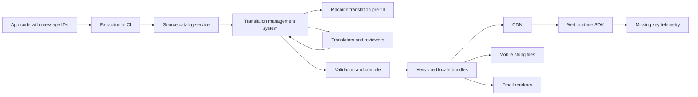

## Framing the problem

Localization at scale is mostly **not** a runtime problem. Rendering a translated string is easy. The hard parts are:

- A **message format** expressive enough for plurals, gender and placeholders in 25 locales, so engineers stop
  concatenating strings.
- A **pipeline** that moves new strings from code to translators and back without humans copying spreadsheets, with
  context for translators and checks that catch broken translations before users do.
- **Delivery** that lets translations ship independently of code deploys, without breaking apps when a key is missing.
- **Layout and formatting** that adapt: RTL mirroring, 30–40% longer German strings, locale-aware dates, numbers,
  currencies and sorting.
- An **adoption plan** across 25 teams who each have their own legacy approach.

The platform's promise to a product team: *write messages once in a standard format, get them translated and
delivered automatically, and never ship a broken string.*

## 1. Requirements exploration

### Stakeholders

- **Engineers**: simple API, type safety, no manual file juggling.
- **Product designers and writers (UX copy)**: own source copy, need to change English without a deploy.
- **Localization team / vendors**: translation management system (TMS) with context, glossary, translation memory.
- **Regional marketing and legal**: locale-specific content, legal wording reviews.
- **Platforms**: React web (SSR and SPA), iOS, Android, emails, CMS.

### Functional requirements

- Message authoring with ICU MessageFormat (plural, select, selectordinal, nested arguments, rich-text tags).
- Automatic extraction of messages from code with descriptions and screenshots for context.
- Sync to and from a TMS; machine translation pre-fill plus human review per locale tier.
- Over-the-air delivery of translation bundles with versioning and rollback.
- Runtime SDK: locale negotiation, lazy loading per route, fallback chains (`pt-BR` to `pt` to `en`).
- Formatting via `Intl` (dates, numbers, currencies, lists, relative time, collation).
- RTL support in the design system and apps.
- Pseudo-localization for testing; CI checks for missing keys and invalid translations.

### Non-functional requirements

- **Scale**: 25 locales, about 40k source messages across apps, roughly 1M translated strings.
- **Turnaround**: new strings translated for tier-1 locales within 3 business days; machine translation visible in
  staging within minutes.
- **Performance**: translation payload per route under 20 KB gzipped; no layout shift or flash of untranslated content
  on SSR pages.
- **Reliability**: a missing or invalid translation never crashes a page; it falls back and is reported.

### Clarifying questions

- Which locales are tier 1 (human translated, launch-blocking) vs tier 2 (machine translated with spot review)?
- Do we need locale-specific features (different payment methods, legal pages), or only language?
- Is there an existing TMS contract (Phrase, Lokalise, Crowdin, Smartling, Transifex)?

## 2. Architecture



Components:

- **Source catalog service**: the registry of all source messages across apps, keyed by namespace and ID, with
  description, owner, screenshots and status. It is the single integration point with the TMS, so 25 teams do not
  each integrate with the vendor.
- **TMS** (bought): translator workflow, translation memory, glossary, machine translation integration, review.
- **Validation and compile step**: parses every translation with an ICU parser, checks placeholders match the source,
  checks plural categories for the locale, and precompiles messages to an AST or functions.
- **Bundle publisher**: emits immutable, content-hashed bundles per app, namespace and locale, plus a manifest that
  points to the current version (enabling over-the-air updates and rollback).
- **Runtime SDKs** for web (React), with equivalent outputs for iOS (String Catalogs), Android (`strings.xml` with
  plurals) and emails.

## 3. Data model and contracts

### Source message

```json
{
  "id": "cart.summary.itemCount",
  "namespace": "storefront/cart",
  "defaultMessage": "{count, plural, =0 {Your cart is empty} one {You have # item} other {You have # items}}",
  "description": "Cart header. count = number of distinct products in the cart.",
  "screenshots": ["https://l10n.acme.internal/shots/cart-header.png"],
  "maxLength": null,
  "owner": "team-cart",
  "tags": ["checkout", "tier1"]
}
```

`description` is required by lint: translators cannot translate "Close" correctly without knowing whether it is a
verb on a dialog or an adjective.

### Translated message (Polish example)

```json
{
  "id": "cart.summary.itemCount",
  "locale": "pl",
  "message": "{count, plural, =0 {Twój koszyk jest pusty} one {Masz # produkt} few {Masz # produkty} many {Masz # produktów} other {Masz # produktu}}",
  "status": "reviewed",
  "sourceHash": "a91f...",
  "translatedBy": "vendor:linguist-17",
  "updatedAt": "2025-05-30T12:00:00Z"
}
```

`sourceHash` ties a translation to the exact source text it translated. When English changes, existing translations
become **stale**, not deleted: the app keeps showing the old translation (usually still acceptable) until the new one
is reviewed, instead of falling back to English.

### Bundle manifest

```json
{
  "app": "storefront",
  "releasedAt": "2025-06-02T08:00:00Z",
  "locales": {
    "de": { "cart": "https://cdn.acme.com/i18n/storefront/de/cart.3be1c2.json",
            "common": "https://cdn.acme.com/i18n/storefront/de/common.88aa01.json" },
    "ar": { "cart": "https://cdn.acme.com/i18n/storefront/ar/cart.0c4d9e.json" }
  },
  "fallbacks": { "pt-BR": ["pt", "en"], "es-MX": ["es-419", "es", "en"] }
}
```

Bundles are split by namespace (roughly per route or feature) so a page loads only what it renders.

## 4. Interfaces

### Developer API (React)

```tsx
import { defineMessages, useT, FormattedMessage } from '@acme/i18n';

const m = defineMessages({
  itemCount: {
    id: 'cart.summary.itemCount',
    defaultMessage: '{count, plural, =0 {Your cart is empty} one {You have # item} other {You have # items}}',
    description: 'Cart header. count = number of distinct products in the cart.',
  },
  terms: {
    id: 'cart.terms',
    defaultMessage: 'By paying you accept our <link>terms</link>.',
    description: 'Shown above the Pay button; link opens the terms page.',
  },
});

function CartHeader({ count }: { count: number }) {
  const t = useT('cart');
  return (
    <>
      <h2>{t(m.itemCount, { count })}</h2>
      <p><FormattedMessage {...m.terms} values={{ link: (chunks) => <a href="/terms">{chunks}</a> }} /></p>
    </>
  );
}
```

Generated types (from the catalog) make `values` type-checked: forgetting `count` is a compile error.

```ts
interface I18nRuntime {
  locale: string;                         // negotiated BCP 47 tag, e.g. "pt-BR"
  dir: 'ltr' | 'rtl';
  loadNamespaces(ns: string[]): Promise<void>;
  t<K extends MessageId>(id: K, values: MessageValues<K>): string;
  formatNumber(n: number, opts?: Intl.NumberFormatOptions): string;
  formatCurrency(amount: number, currency: string): string;
  formatDate(d: Date, opts?: Intl.DateTimeFormatOptions): string;
  formatRelativeTime(value: number, unit: Intl.RelativeTimeFormatUnit): string;
  formatList(items: string[], opts?: Intl.ListFormatOptions): string;
  compare(a: string, b: string): number; // Intl.Collator for sorting
}
```

### CLI and CI

```bash
acme-i18n extract --app storefront          # finds defineMessages, validates ICU syntax, uploads to catalog
acme-i18n pseudo --locale en-XA             # accented, 40% longer, bracketed strings
acme-i18n pull --app storefront --locales all   # for local dev and builds
acme-i18n check                              # unused keys, missing descriptions, placeholder mismatches
```

CI on every PR: extraction succeeds, ICU syntax valid, descriptions present, no string literals in JSX text
(`no-literal-string`-style lint rule, with an allow-list for brand names), screenshot capture of changed stories for
translator context. On merge: new source strings are pushed to the catalog and the TMS automatically.

## 5. Deep dives and trade-offs

### Message format choice

**ICU MessageFormat** is the de facto standard, supported by FormatJS (react-intl), i18next (via a plugin), Lingui,
and most TMSs. It handles plurals using CLDR rules, which matters: English has two plural categories, Polish and Russian
have four in practice (`one`, `few`, `many`, `other`), Arabic has six, Japanese has one. Concatenation and `n === 1 ?`
logic fail in most of the 25 locales.

Unicode **MessageFormat 2** is the next-generation syntax (more extensible, better for tooling). Its specification
is now part of the Unicode LDML standard, and there is a TC39 proposal for `Intl.MessageFormat`, but library and TMS
support is still catching up. Recommendation: author in ICU MessageFormat today, keep messages in a parsed form in the
catalog so a later migration is mechanical.

### Library choice

| Option | Notes |
| --- | --- |
| **FormatJS / react-intl** | ICU-native, strong extraction tooling, precompilation to AST, wide adoption |
| **i18next / react-i18next** | Huge ecosystem, flexible backends and namespaces; its default format is not ICU (plurals via key suffixes) unless you add the ICU plugin |
| **Lingui** | ICU-based with macros, compile-time extraction, small runtime |
| **Next.js-specific** (next-intl) | Good App Router and Server Components integration, ICU-based |
| **In-house runtime** | Only the thin wrapper; never write your own ICU parser |

Pick one org-wide, wrap it in `@acme/i18n` so the dependency can be swapped. FormatJS or Lingui fit best with a
strictly ICU pipeline; next-intl is a good inner layer for Next.js apps behind the same facade.

### Build vs buy for the TMS

Buy. Phrase, Lokalise, Crowdin, Smartling and Transifex all provide translation memory, glossaries, MT integration,
review workflows, vendor management and APIs. What you build is the **catalog service and pipeline glue**, which keeps
the vendor replaceable and gives one integration instead of 25.

### Delivery: bundled vs over the air

- **Bundled at build**: simplest, translations versioned with code, no runtime fetch. But every translation fix
  requires a deploy of every app, and builds wait on translators.
- **Over the air (OTA)** from the CDN: translations ship independently, typo fixes in minutes, rollback by manifest
  pointer. Costs: runtime fetch, version skew between code and strings (new key in code, bundle not yet published).

**Hybrid recommendation:** the build embeds the source locale and a snapshot of translations at build time (so nothing
is ever missing); at runtime, the SDK checks the manifest and, if a newer bundle exists for the current locale, loads
it on the next navigation. For SSR, the server loads bundles from the manifest and inlines the needed namespaces into
the HTML, so there is no flash of untranslated content.

### Fallback and failure behaviour

Resolution order: requested locale, then its fallback chain, then the snapshot from build, then the `defaultMessage`
in code. A formatting error in a translation (invalid ICU) falls back to the next level and is reported to telemetry
with message ID and locale. **The compile step should catch these before publish**, but runtime defence is still needed.

### RTL

- Set `<html lang="ar" dir="rtl">` server-side from the negotiated locale.
- The design system uses **CSS logical properties** (`margin-inline-start`, `padding-inline-end`, `inset-inline-start`)
  so layouts mirror automatically. A lint rule (stylelint) flags physical properties like `margin-left` in new code.
- Icons that imply direction (back arrows, progress) mirror; others (play button, checkmarks, logos) do not. The icon
  set marks which is which.
- Mixed-direction content (an English product name in Arabic text, phone numbers) needs bidi isolation: `<bdi>` or
  `unicode-bidi: isolate` around user-generated and interpolated values.
- Test with real RTL content, not just a flipped layout.

### Formatting

Use `Intl` everywhere: `Intl.NumberFormat` for currencies (never place symbols manually; `de-DE` writes `1.234,56 €`),
`Intl.DateTimeFormat` with explicit time zones, `Intl.RelativeTimeFormat`, `Intl.ListFormat`, `Intl.PluralRules` for
custom cases, and `Intl.Collator` for sorting names. Cache formatter instances; constructing them repeatedly is
expensive. Be careful with SSR hydration: server and client must use the same locale **and time zone**, or rendered
dates mismatch. Pass the user's time zone explicitly rather than relying on the server's.

### Locale negotiation

Priority: explicit user preference (account setting), then URL (`/de/...` for SEO-relevant pages, with `hreflang`
links), then cookie, then `Accept-Language`. Do not auto-redirect based on IP geolocation alone; a German speaker in
France should not be forced into French. Separate **language** from **region/market** (prices, payment methods):
`en` language with `DE` market is valid.

### Quality

- **Pseudo-localization** in staging and visual tests: catches hard-coded strings (unaccented text stands out),
  truncation (strings are longer) and concatenation.
- **Linguistic QA** via screenshots in the TMS, and in-context review mode in staging where reviewers can click a string
  to edit it.
- **Layout tests**: Storybook stories rendered in `de`, `ar` and `ja` in visual regression.
- **Length constraints** (`maxLength`) for tight UI such as buttons and push notifications.

### Performance

Precompile messages to an AST at publish time so the runtime does not ship an ICU parser (FormatJS and Lingui both
support this). Split bundles by namespace, load the route's namespaces in parallel with its code, and cache bundles
immutably. Typical savings: tens of KB of parser plus a fraction of messages per route.

## Org and people considerations

- **Ownership**: a small localization platform team (2–4 engineers) owns the SDK, catalog, pipeline and lint rules;
  the localization program team (non-engineers) owns vendors, glossary, tiers and quality; product teams own their
  messages and descriptions.
- **Content design as a partner**: source-copy quality determines translation quality. A content design review for new
  flows avoids idioms, puns and text in images.
- **RFCs** for changes to the message format, SDK surface or fallback behaviour; a glossary governance process for
  product terms.
- **Deprecation of legacy approaches**: codemods to wrap literal JSX text into `defineMessages`, migration of JSON
  files into the catalog with ID mapping, and a dashboard of remaining hard-coded strings per app.

### Rollout plan

1. Platform SDK + catalog + TMS integration with 2 pilot apps; pseudo-locale in staging.
2. Lint rules on new code only; codemods for legacy strings; dashboard per app.
3. Tier-1 locales (for example `de`, `fr`, `es`, `ja`) launched app by app behind a flag per locale.
4. RTL program: design-system logical properties first, then `ar` and `he` per app with native-speaker QA.
5. Mobile and email pipelines from the same catalog.

### Success metrics

- Percentage of user-visible strings externalised (hard-coded string count trending to zero).
- Translation coverage per locale and app; percentage of stale translations.
- Turnaround time from merge to translated in production per tier.
- Runtime fallback rate (missing or invalid translations seen by users).
- Locale-specific conversion and support tickets citing language issues.

## What a lead-level answer adds

- Focuses on the **pipeline and governance**, not just `t()`: catalog, context for translators, staleness via source
  hashes, automated validation.
- Makes a clear **delivery decision** (hybrid OTA with build snapshot) and reasons through version skew and SSR.
- Knows the **linguistic details** that break naive designs: CLDR plural categories, bidi isolation, logical properties,
  separating language from market, time zones in hydration.
- **Buys the TMS, builds the glue**, and wraps libraries behind a facade.
- Has a phased rollout with **measurable externalisation and coverage** targets.

## Common follow-up questions

**Should message IDs be semantic keys or hashes of the English text?**
Semantic keys (`cart.summary.itemCount`) are stable when English copy changes and readable in code review; hash-based
IDs (generated from text and description) remove naming effort but change when copy changes. For a large org with a
TMS, semantic IDs plus source hashes for staleness give the best of both.

**How do you handle a translation that breaks the layout?**
Prevent with `maxLength` and pseudo-locale testing; design components to wrap and truncate gracefully with full text
available (tooltip or expanded view); fix the specific string in the TMS and ship via OTA.

**How do you localize content from the CMS or user-generated content?**
CMS content has its own localization workflow (the CMS integrates with the TMS directly). User-generated content is
usually not translated, or is translated on demand by machine translation with a clear "translated" label.

**What about SEO for localized pages?**
Locale in the URL path, server-rendered translated content, `hreflang` alternates and a localized sitemap; never rely
on client-side language switching for indexable pages.

**How do you avoid shipping all 25 locales in every bundle?**
Only the active locale's namespaces are loaded at runtime; `Intl` data is built into browsers, so locale data
polyfills are needed only for very old environments.
