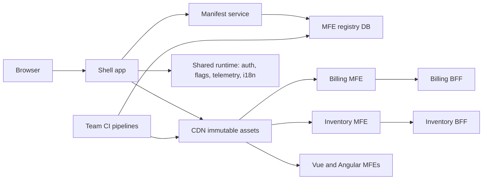

## Framing the problem

The stated pain is **coupled delivery**: one pipeline, one test suite, one release train. Micro-frontends are one fix
for that, but not the only one, and a lead-level answer says so before drawing boxes. Many of the symptoms (slow
build, flaky shared tests, everyone blocked) can be solved inside a monolith with a well-structured monorepo,
affected-only builds and ownership boundaries. Micro-frontends are justified when you also need **independent
deployment** and **heterogeneous stacks**, which this brief has (two acquired apps in Vue and Angular).

The goal is therefore: independently deployable vertical slices, composed by a thin shell, with a small number of
strictly versioned contracts between them, and a platform team that keeps the whole thing feeling like one product.

## 1. Requirements exploration

### Stakeholders

- **Domain teams** (about 15): want to deploy their area without coordinating with others.
- **Platform team** (you): owns the shell, contracts, tooling and paved road.
- **Design system team**: wants one visual language across all slices.
- **Customers and support**: want the product to feel like one app, with stable URLs and no visual seams.
- **Security and compliance**: want consistent auth, CSP and audit-pinnable releases.

### Functional requirements

- A **shell** that handles login, top-level navigation, layout and loading micro-frontends (MFEs) per route.
- **Independent build and deploy** per MFE, with instant rollback per MFE.
- **Shared services**: auth/session, feature flags, telemetry, i18n, theming, notifications.
- **Cross-MFE communication** for a few cases (for example, "billing changed plan, refresh entitlements in the header").
- **Framework heterogeneity**: React for most, plus the Vue and Angular acquisitions.
- **Release pinning**: a tenant can be pinned to a specific composition of MFE versions.

### Non-functional requirements and SLOs

- **Scale**: 15 teams, roughly 20 MFEs, about 200 routes, 50k daily active users.
- **Performance**: LCP under 2.5 s at p75 on first load over VPN; route transitions between MFEs under 300 ms at p75
  with warm cache. Shared framework code downloaded once.
- **Availability**: a broken MFE must not take down the shell or other MFEs (error isolation).
- **Deploy**: any team can deploy to production in under 15 minutes; rollback in under 1 minute.

### Out of scope

- Splitting back-end services (assume a BFF or API gateway per domain already exists).
- Mixing multiple frameworks on the same screen region at the same time (route-level composition only, plus a few
  widgets).

### Clarifying questions

- How many teams truly need to deploy independently versus just build faster?
- How often do features cut across domains? Lots of cross-cutting features is a smell that the split is wrong.
- Do the acquired apps need deep integration (shared state) or just a seat in the shell?

## 2. Architecture

### Splitting strategy

Split **vertically by business domain and route**, not horizontally by UI layer. Billing owns `/billing/*`, Inventory
owns `/inventory/*`. Each team owns its slice end to end: UI, BFF calls, tests, deploy. Horizontal splits ("the header
team", "the table team") create exactly the coordination you are trying to remove.

A handful of **shared widgets** (global search, notifications bell) are exposed by their owning team as federated
modules and mounted by the shell.

### Composition: client-side, route-level

- The **shell** is a small app (target under 60 KB of JS gzipped excluding the shared framework) that owns the router's
  first segment, layout, auth bootstrap and the MFE loader.
- An **MFE manifest service** tells the shell which version of each MFE to load for this user or tenant.
- Each MFE exposes a **lifecycle contract** (`mount`, `unmount`) and is loaded from the CDN at an immutable,
  content-hashed URL.



### Why client-side over server-side or edge composition

Server-side composition (fragments stitched at the edge or with something like Podium, or ESI) shines for SEO and
first paint of content-heavy sites. This product is authenticated and app-like, so client-side composition with a
manifest is simpler and gives instant per-MFE rollback. If first load became a problem, the shell's HTML could be
server-rendered while MFEs remain client-rendered.

## 3. Data model and contracts

### MFE manifest

The registry stores every published version; the manifest service resolves which version each user gets.

```json
{
  "schemaVersion": 2,
  "generatedAt": "2025-06-02T10:15:00Z",
  "shared": {
    "react": { "version": "19.1.0", "url": "https://cdn.acme.com/shared/react@19.1.0/index.js" },
    "@acme/design-system": { "version": "6.4.2", "url": "https://cdn.acme.com/shared/ds@6.4.2/index.js" }
  },
  "mfes": {
    "billing": {
      "version": "2025.06.02-1312-a1b2c3",
      "entry": "https://cdn.acme.com/mfe/billing/a1b2c3/remoteEntry.js",
      "routes": ["/billing"],
      "framework": "react",
      "contract": "mfe-lifecycle@2",
      "integrity": "sha384-..."
    },
    "reports": {
      "version": "4.8.0",
      "entry": "https://cdn.acme.com/mfe/reports/9f8e7d/main.js",
      "routes": ["/reports"],
      "framework": "angular",
      "contract": "mfe-lifecycle@2"
    }
  }
}
```

Resolution rules (most specific wins): tenant pin, then canary cohort, then default "production" channel. Pins give
compliance customers an auditable, reproducible composition.

### Event contract

Cross-MFE events are versioned, typed and documented in a shared package. Keep the list short; every event is a
coupling point.

```ts
type PlatformEvent =
  | { type: 'billing.plan-changed@1'; payload: { tenantId: string; planId: string } }
  | { type: 'session.expired@1'; payload: {} }
  | { type: 'nav.request@1'; payload: { path: string; replace?: boolean } };
```

## 4. Interfaces

### MFE lifecycle contract

Framework-agnostic so React, Vue and Angular all implement it:

```ts
export interface MfeContext {
  basePath: string;                 // e.g. "/billing"
  container: HTMLElement;           // region the MFE owns
  auth: { getAccessToken(): Promise<string>; user: Readonly<User> };
  flags: { isEnabled(key: string): boolean; onChange(cb: () => void): () => void };
  telemetry: { track(name: string, props?: Record<string, unknown>): void; captureError(e: unknown): void };
  i18n: { locale: string; onLocaleChange(cb: (l: string) => void): () => void };
  events: {
    emit<E extends PlatformEvent>(e: E): void;
    on<T extends PlatformEvent['type']>(type: T, cb: (e: Extract<PlatformEvent, { type: T }>) => void): () => void;
  };
  navigate(path: string, opts?: { replace?: boolean }): void;
}

export interface MicroFrontend {
  contract: 'mfe-lifecycle@2';
  mount(ctx: MfeContext): Promise<void> | void;
  unmount(): Promise<void> | void;
  onRouteChange?(path: string): void;
}
```

The shell wraps every `mount` in an error boundary equivalent: a timeout, try/catch, and a fallback panel ("Billing
is temporarily unavailable, retry") with the error reported tagged by MFE name and version.

### Platform CLI and CI

```bash
npx @acme/mfe create billing --framework react   # scaffold from the paved-road template
npx @acme/mfe dev --shell=staging                 # run this MFE locally inside the deployed staging shell
npx @acme/mfe publish --channel canary            # upload to CDN, register version, start canary
npx @acme/mfe promote billing@2025.06.02-1312 --to production
npx @acme/mfe rollback billing                    # repoint channel to previous version, no rebuild
```

CI checks per MFE: contract test against the shell's `MfeContext` type, bundle-size budget, shared-dependency
compatibility check (does it require a React major the shell does not provide?), and a smoke test that mounts the MFE
in a headless shell.

## 5. Deep dives and trade-offs

### Composition technology

| Option | Strengths | Weaknesses | Use it for |
| --- | --- | --- | --- |
| **Module Federation** (webpack 5, Rspack, `@module-federation/enhanced`, Vite plugin) | Runtime sharing of dependencies with version negotiation; type hints via MF 2.0; mature ecosystem | Couples to bundler support; shared singleton mismatches fail at runtime; debugging is harder | React MFEs on the paved road |
| **Native ES modules + import maps** (optionally with single-spa) | Standards-based, bundler-agnostic, simple mental model; import maps now supported in all evergreen browsers | Sharing must be designed by hand (one URL per shared lib); no automatic version negotiation | Mixed-framework estates; teams on different bundlers |
| **iframes** | Strongest isolation: CSS, JS globals, crashes, even different CSP | Poor UX integration (sizing, focus, modals, deep links), duplicated framework downloads, cross-frame messaging | Untrusted or legacy apps; the Angular acquisition in phase 1 |
| **Web components as the boundary** | Framework-neutral mount points; Shadow DOM style isolation | Still need a loader; SSR and theming complexity | Shared widgets across frameworks |
| **Build-time composition** (npm packages) | Simplest, best performance and type safety | No independent deploy; this is a modular monolith | Shared libraries, not MFEs |

**Recommendation:** Module Federation for the React MFEs (most of the estate), the same lifecycle contract on top so
the shell does not care how an MFE was built, an **iframe as a transitional host** for the acquired Angular app, and
a web-component wrapper for the Vue app's two embeddable widgets. Re-evaluate import maps if teams diverge on bundlers.

### Shared dependencies

The biggest technical risk is **dependency drift**. Rules:

- The platform provides a small set of **singletons**: React, React DOM, the design system, the router integration,
  the platform SDK. Each MFE declares them as shared singletons with a required version range.
- Platform upgrades of singletons (React 18 to 19) are coordinated: the shell supports both majors for a window by
  loading the right version per MFE where possible, or teams upgrade on a published deadline. This is where
  micro-frontends cost real money.
- Everything else (date libraries, state management) is **bundled per MFE**. Do not share for the sake of bytes; every
  shared library is a coordination point.

### Routing

The shell owns the top-level segment and maps it to an MFE; each MFE owns everything under its base path with its own
router configured with `basename`. Cross-MFE navigation goes through `ctx.navigate` so there is one history stack.
Links between domains use plain URLs, which keeps deep links working even if an MFE is rewritten.

### State and data

No shared global store. Each MFE fetches its own data through its BFF and caches it with its own query layer. Shared
facts (current user, tenant, entitlements, locale) come from the platform SDK as read-only values with change
subscriptions. A shared Redux store across MFEs re-creates the monolith with worse tooling.

### CSS isolation

Design-system tokens as CSS custom properties defined by the shell; each MFE's own CSS is scoped (CSS Modules or a
build-time prefix). Global resets live only in the shell. Shadow DOM is used only for widgets embedded in foreign
frameworks, because it complicates portals, modals and focus management.

### Performance

- Preload the manifest in the shell HTML (or inline it) to avoid a waterfall: HTML, shell JS, manifest, MFE entry, MFE
  chunks.
- `modulepreload` the likely next MFE based on navigation hover or idle time.
- Shared singletons have long-lived immutable URLs, so they stay cached across MFE deploys.
- Per-MFE budgets enforced in CI, and RUM tagged with MFE name so regressions are attributable.

### Deployment, canaries and rollback

Deploy = upload immutable assets + register a version. Release = move a channel pointer in the registry. Because the
manifest is resolved at runtime (cache TTL around 60 seconds), rollback is a pointer flip with no rebuild. Canary
cohorts are defined by percentage or tenant, and automated rollback triggers on error-rate or LCP regression for the
canary cohort compared to control.

Handle **version skew**: a user's open tab may hold the old manifest when a new MFE version ships. MFE entries are
immutable and kept for at least 30 days, so stale tabs keep working; the shell re-fetches the manifest on navigation
and on focus.

### Testing

- Each team owns unit and integration tests for its MFE in isolation (the platform provides a mock `MfeContext`).
- **Contract tests** verify the lifecycle and event payloads with shared schemas.
- A small set of **cross-MFE end-to-end journeys** (login, top 5 workflows) run against the production composition
  after every promotion, owned by the platform team. Keep this suite tiny so it does not recreate the release train.

### Security

One CSP for the shell document listing CDN origins; Subresource Integrity on MFE entries where possible; tokens held by
the shell and handed out via `getAccessToken` rather than read by every MFE from storage; iframes for anything with
lower trust, with `sandbox` and origin-checked `postMessage`.

## Org and people considerations

- **Ownership**: Conway's law is the design tool here. MFE boundaries must match team boundaries; if two teams share
  one MFE, split the code or merge the teams. Publish an ownership map (MFE, team, on-call, Slack channel).
- **Platform team charter**: owns the shell, SDK, CLI, templates, manifest service and the cross-MFE test suite. It
  does not own features. Its success metric is domain-team lead time, not lines of platform code.
- **Paved road over mandates**: a template that gives you CI, observability, design system and deploy for free is
  more persuasive than a policy document. Teams may leave the road but then own the consequences.
- **RFCs for contract changes**: adding a platform event, bumping a shared singleton, or changing the lifecycle
  contract requires an RFC reviewed by a front-end architecture group. Contract versions are additive; breaking
  changes get a new version (`mfe-lifecycle@3`) supported in parallel for two quarters.
- **Deprecation**: old contract versions are tracked in the registry, so the platform knows exactly which MFEs still
  use them and can chase owners with data.

### Migration plan (strangler fig)

1. Build the shell and SDK; mount the existing monolith as the single "legacy" MFE for all routes. Nothing changes for
   users.
2. Extract the domain with the most independent change (for example, Reports) as the first MFE; measure.
3. Extract further domains as teams are ready, roughly one per month; the legacy MFE shrinks.
4. Bring the acquired apps in via iframe, then migrate them to the lifecycle contract when they next undergo
   significant work.

### Success metrics

- Deployment frequency and lead time per team (DORA metrics), before and after.
- Change failure rate and mean time to restore; rollbacks should be pointer flips measured in seconds.
- Product performance: LCP and INP at p75 overall and per MFE; total JS shipped per route.
- Duplicate-dependency bytes across MFEs (a drift indicator).
- Developer survey on autonomy and on time spent on platform friction.

## What a lead-level answer adds

- **Questions the premise.** Separates "builds are slow" (fixable with a monorepo and affected builds) from "teams need
  independent deploys and mixed stacks" (the real case for MFEs), and names the costs: duplicated dependencies,
  runtime integration bugs, harder debugging, platform headcount.
- **Splits by domain, aligned to teams**, and explains why horizontal splits fail.
- **Minimises shared surface**: a tiny set of singletons, a small typed event catalogue, no shared global store.
- Treats **deployment as pointer moves** with immutable assets, which gives canaries, pins and instant rollback.
- Has an **incremental migration plan** that never stops feature delivery.
- Defines **governance** for contracts and shared versions, which is where most MFE programs actually fail.

## Common follow-up questions

**When would you not use micro-frontends?**
Fewer than about 5 teams, one framework, and no hard need for independent deploys. A modular monolith in an Nx or
Turborepo monorepo with enforced module boundaries, affected-only CI and code owners gives most of the benefits with
none of the runtime complexity.

**Two MFEs need the same user list with live updates. Shared store?**
No. Either one domain owns it and exposes it via an event or a federated hook, or both read from the same API with
their own caches. If it happens often, the boundary is probably wrong.

**How do you upgrade React from 18 to 19 across 20 MFEs?**
Make the shell capable of providing both versions (shared scope per major), let MFEs migrate on their own schedule
within a deadline, track progress in the registry, then drop 18. Budget it as a program, with a codemod and office hours.

**How do you debug a production issue that spans two MFEs?**
Every telemetry event and error carries MFE name, version and a trace ID propagated through the platform SDK and into
BFF calls. The manifest version the user had is attached too, so you can reproduce the exact composition locally with
`mfe dev --manifest <id>`.

**How do you stop the shell from becoming a new monolith?**
Strict charter (no domain features), a size budget, and an architecture review for anything added to the SDK.
