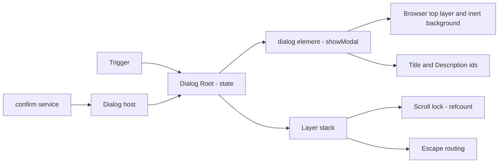

## 1. Requirements exploration

Modals are deceptively simple. The front-end challenges are **making the rest of the page truly inert** (to
keyboard, pointer, screen readers and scroll), **predictable focus** on open and close, **stacking** with other
floating layers, and an API that keeps teams from building inaccessible variants. In 2025 the native `<dialog>`
element solves most of the hard parts, so the interview is partly about knowing what the platform gives you and what
it still doesn't.

### Functional requirements

- Open/close controlled by the consumer, or via a trigger element.
- Title (required), optional description, body, footer actions.
- Close via close button, `Escape`, backdrop click (configurable: off for forms with unsaved data).
- Confirm-before-close hook (unsaved changes).
- Sizes: small (confirmation), medium (form), large, full-screen on mobile.
- Scrollable body with sticky header/footer for long content.
- Enter/exit animations.
- Nested dialogs (a confirmation opened from an edit dialog).
- Imperative helpers: `await confirm({ title, body })` returning a boolean.
- Alert dialog variant for destructive confirmations.

### Non-functional requirements

| Concern | Target |
| --- | --- |
| Accessibility | APG modal dialog pattern; WCAG 2.2 AA; tested with NVDA, JAWS, VoiceOver iOS/macOS, TalkBack |
| Inertness | background unreachable by `Tab`, screen reader virtual cursor, pointer and scroll |
| Layout | no layout shift when the page scrollbar disappears; works with the iOS virtual keyboard |
| Performance | open within one frame; content lazily mounted; animations on compositor properties |
| Bundle | < 3 KB gzip on top of the native element |
| SSR | no hydration mismatch; nothing rendered into the body until opened |

### Out of scope

- Non-modal popovers and drawers (they share primitives; mention them), toast notifications.

### Clarifying questions

1. Browser support baseline? (`<dialog>` is supported in all evergreen browsers; some newer features like
   `closedby` are not yet everywhere.)
2. Should the modal state be in the URL (deep-linkable edit dialogs, back button closes)?
3. How common are nested dialogs? (Design for two levels; discourage more.)
4. Do teams need a fully custom-rendered modal (e.g. an image lightbox) or only the styled design-system one?

## 2. Architecture / high-level design

### Native `<dialog>` vs custom `div role="dialog"`

| Concern | `<dialog>` with `showModal()` | Custom div + portal |
| --- | --- | --- |
| Rendering above everything | **top layer**: above all z-indexes, unaffected by `overflow`/`transform` of ancestors | portal to body + z-index scale |
| Background inert | browser makes everything outside the dialog **inert** (no focus, no clicks, hidden from the accessibility tree) | `inert` attribute on siblings (or `aria-hidden` + focus trap library) |
| `Escape` | fires `cancel` then closes; preventable | manual keydown handling |
| Backdrop | `::backdrop` pseudo-element | extra element |
| Focus on open | moves into the dialog per the dialog focusing steps (respects `autofocus`) | manual |
| Focus return | browsers return focus to the previously focused element on close | manual |
| Backdrop click to close | not native until `closedby="any"` (newer, not in all engines); otherwise detect clicks on the dialog element itself | manual |
| Scroll lock | **not** provided | manual |

**Decision:** build on **native `<dialog>` + `showModal()`**, adding scroll locking, backdrop-click handling, the
React API, animation support and a stack manager. Fall back to nothing: support is universal in evergreen browsers.
Libraries that predate wide support (portals + focus traps) are no longer necessary for most products.

### Components

| Part | Responsibility |
| --- | --- |
| `Dialog.Root` | open state (controlled/uncontrolled), ids for labelling, context |
| `Dialog.Trigger` | button that opens; focus returns here on close |
| `Dialog.Content` | the `<dialog>` element; calls `showModal()`/`close()` in an effect; size variants |
| `Dialog.Title` / `Dialog.Description` | wired to `aria-labelledby` / `aria-describedby` |
| `Dialog.Close` | close button(s) |
| **Layer stack** | ordered list of open layers (dialogs, menus, popovers) for `Escape` routing and scroll lock refcounting |
| **Scroll lock** | ref-counted body scroll lock with scrollbar-gutter compensation |
| `confirm()` service | imperative API that renders a dialog into a host and resolves a promise |



## 3. Data model

```ts
interface DialogState {
  open: boolean;
  phase: 'closed' | 'opening' | 'open' | 'closing'; // for exit animations
  returnFocusTo: HTMLElement | null;
  titleId: string;          // from useId()
  descriptionId: string | null;
}

interface LayerEntry {
  id: string;
  kind: 'dialog' | 'alertdialog' | 'menu' | 'popover';
  modal: boolean;
  onEscape: () => void;
  locksScroll: boolean;
}

// global (module-level) singleton
interface LayerStack {
  layers: LayerEntry[];       // last = top
  scrollLockCount: number;
}
```

The stack is module state (or a React context provider at the app root) because dialogs, menus and popovers opened
by different teams must agree on who handles `Escape` and when to unlock scrolling.

## 4. Interface definition (API)

### Declarative

```tsx
<Dialog.Root open={open} onOpenChange={setOpen}>
  <Dialog.Trigger asChild><Button>Edit profile</Button></Dialog.Trigger>
  <Dialog.Content size="md" closeOnBackdropClick={!isDirty} onBeforeClose={confirmDiscard}>
    <Dialog.Title>Edit profile</Dialog.Title>
    <Dialog.Description>Changes are visible to your team.</Dialog.Description>
    <ProfileForm id="profile-form" onSubmit={save} />
    <Dialog.Footer>
      <Dialog.Close asChild><Button variant="secondary">Cancel</Button></Dialog.Close>
      <Button type="submit" form="profile-form">Save</Button>
    </Dialog.Footer>
  </Dialog.Content>
</Dialog.Root>
```

```ts
interface DialogRootProps {
  open?: boolean;
  defaultOpen?: boolean;
  onOpenChange?: (open: boolean, reason: 'escape' | 'backdrop' | 'close-button' | 'api') => void;
  role?: 'dialog' | 'alertdialog';
}

interface DialogContentProps {
  size?: 'sm' | 'md' | 'lg' | 'fullscreen';
  fullscreenBelow?: 'sm' | 'md';            // become full-screen on small viewports
  closeOnBackdropClick?: boolean;           // default true for dialog, false for alertdialog
  closeOnEscape?: boolean;                  // default true; can't be false without a visible close
  onBeforeClose?: (reason: CloseReason) => boolean | Promise<boolean>; // return false to keep open
  initialFocus?: React.RefObject<HTMLElement>;
  finalFocus?: React.RefObject<HTMLElement>; // when the trigger no longer exists
  children: React.ReactNode;
}
```

The `reason` in `onOpenChange` lets forms treat backdrop clicks differently from explicit cancel.

### Imperative helpers

```ts
const ok = await dialogs.confirm({
  title: 'Delete project?',
  body: 'This permanently deletes 42 files.',
  confirmLabel: 'Delete',
  destructive: true,
});
if (ok) await deleteProject();
```

```ts
interface DialogService {
  confirm(opts: ConfirmOptions): Promise<boolean>;
  alert(opts: AlertOptions): Promise<void>;
  open<TResult>(render: (close: (r: TResult) => void) => React.ReactNode): Promise<TResult | undefined>;
}
```

A `<DialogHost />` mounted once at the app root renders service-opened dialogs. The promise resolves on close,
including `undefined` on dismissal. Imperative dialogs are convenient for confirmations in event handlers, but must
still capture the active element for focus return.

## 5. Optimizations and deep dives

### Focus management

- **Initial focus**: put focus on the least destructive meaningful element. For a confirmation, the "Cancel" button
  or the dialog itself; for a form, the first field; for long content, the title or dialog container (`tabindex="-1"`)
  so screen readers start reading at the top. Use `autofocus` on the chosen element so the native dialog focusing
  steps pick it, or `initialFocus`.
- **Trap**: with `showModal()`, everything outside is inert, so `Tab` cycles inside the dialog and the browser
  chrome; no JavaScript focus trap needed. With a custom implementation, you need both a trap and `inert` siblings.
- **Return focus**: to the trigger, or `finalFocus` when the trigger was removed (e.g. the row was deleted). Never
  leave focus on `<body>`; screen reader users lose their place.
- **Alert dialogs**: `role="alertdialog"` for urgent confirmations; focus goes to the safest action.

### Scroll locking

`<dialog>` doesn't stop the page behind from scrolling. Approaches:

- `html { overflow: hidden }` while any modal is open (ref-counted for nested dialogs), plus
  `scrollbar-gutter: stable` on `html` so removing the scrollbar doesn't shift layout (or add `padding-right` equal to
  the scrollbar width on older setups).
- A CSS-only version: `html:has(dialog[open]:modal) { overflow: hidden; }`.
- `overscroll-behavior: contain` on the dialog's scrollable body prevents scroll chaining to the page.
- iOS Safari historically ignored `overflow: hidden` on body for touch scrolling; modern versions respect it, but
  test, and avoid the old `position: fixed` hack (it loses scroll position) unless needed.

### Backdrop click

Without `closedby`, the click target is the `<dialog>` element itself when the user clicks on the `::backdrop`. Put
all content in an inner wrapper that fills the dialog box, and close when `event.target === dialogElement`. Track
`pointerdown` too: a text selection drag that starts inside and ends on the backdrop should not close the dialog.
`closedby="any"` (Chromium today) gives native light dismiss; use it as a progressive enhancement.

### Escape and stacking

- The dialog's `cancel` event fires on `Escape` (and on Android back gestures in some browsers); call
  `preventDefault()` when `onBeforeClose` says no or when a child layer (an open menu inside the dialog) should
  handle `Escape` first.
- Nested dialogs: calling `showModal()` on a second dialog puts it above the first in the top layer, and the first
  becomes inert. Close order is last-in-first-out. The layer stack routes `Escape` to the top layer only.
- Menus, tooltips and comboboxes inside a dialog must also render in the top layer (Popover API) or inside the
  dialog element; a portal to `document.body` would be **inert** behind the modal. This is the most common bug when
  migrating to native dialogs.
- Toasts must remain visible above modals: render them as popovers (top layer, opened after the dialog) or inside a
  live region outside the inert tree (inert content is hidden from assistive tech, so announcements must come from a
  live region in the top layer).

### Animations

- Enter: CSS transitions on `opacity`/`transform` with `@starting-style` for the initial state.
- Exit: the element leaves the top layer immediately on `close()`, so animate with `transition-behavior:
  allow-discrete` on `display` and `overlay` (Chromium), or keep the dialog open during a `closing` phase, wait for
  `transitionend`/`animationend` (with a timeout fallback), then call `close()`.
- `prefers-reduced-motion: reduce` → fade only or no animation.
- Don't animate `height` or `top`; keep it on compositor-friendly properties.

### Mobile and layout

- Full-screen below a breakpoint; respect safe areas (`env(safe-area-inset-bottom)`) for sticky footers.
- Virtual keyboard: use `dvh` units for max height (`max-height: 90dvh`) so the dialog shrinks when the keyboard
  opens; scroll the focused field into view.
- Scrollable body with sticky header and footer; the dialog itself never exceeds the viewport.

### Accessibility checklist

- `aria-labelledby` → title id; `aria-describedby` → description id (optional; omit for long content to avoid reading
  the whole body on open).
- The close button has an accessible name ("Close"), is a real `<button>`, and is reachable by keyboard.
- `aria-modal="true"` is implicit with `showModal()`; add it for custom implementations.
- Dialog content must not be the only place where critical status appears without a live region.
- Contrast for the backdrop doesn't matter, but the dialog boundary must be perceivable (border or shadow + 3:1).
- Don't open dialogs automatically on page load or on focus; they must be user-initiated except for critical
  interruptions (session timeout).

### Performance

- Lazy-mount content: render children only when open (and keep mounted during the exit animation). Code-split heavy
  dialog content (`React.lazy`) with a small skeleton.
- Avoid rendering a hidden dialog per table row; use one dialog with the selected row's data.
- SSR: render the closed `<dialog>` (or nothing) on the server; call `showModal()` in an effect on the client, since
  there is no declarative "open as modal" attribute (`open` makes it non-modal).

### URL and routing

For deep-linkable dialogs (e.g. `/projects/42/edit`), the route drives `open`; closing navigates back. Handle direct
loads (render the underlying page and then the dialog) and make browser Back close the dialog. Keep simple
confirmations out of the URL.

### Testing

- Unit/interaction tests: focus moves in on open and back on close; `Escape` respects `onBeforeClose`; backdrop
  click rules; nested dialog `Escape` order.
- jsdom does not fully implement `<dialog>` top layer and inertness; run these in a real browser (Playwright,
  Vitest browser mode).
- Screen reader checks: title announced on open, background not reachable by virtual cursor.

## What a lead-level answer adds

- Uses the **platform first**: `<dialog>` + `showModal()` + `inert` + top layer, and knows its gaps (scroll lock,
  backdrop click without `closedby`, exit animations) and the portal-inside-modal inertness trap.
- Designs a **layer stack** shared across dialogs, menus, popovers and toasts so the design system behaves
  consistently.
- Provides an ergonomic but safe API: required title, controlled/uncontrolled state, close reasons, a promise-based
  `confirm()` for teams, and guardrails (alert dialogs default to non-dismissable backdrop).
- Pushes back on modal overuse: inline editing or a side panel is often better UX than another modal.

## Common follow-up questions

**What does `inert` do exactly?** It removes an element subtree from focus order, hit testing (no clicks) and the
accessibility tree. `showModal()` applies equivalent behaviour to everything outside the dialog automatically.

**Why not `aria-hidden="true"` on siblings?** It hides content from screen readers but does not prevent focus or
clicks, so you'd still need a focus trap. `inert` covers all three.

**How do you handle a dialog that opens another dialog?** Call `showModal()` on the second; the first becomes inert.
Close the child first; focus returns into the parent dialog. Avoid more than two levels.

**How do you prevent losing unsaved work?** `onBeforeClose` returning a promise from a "Discard changes?" confirm;
backdrop click disabled while dirty; `beforeunload` for page navigation.

**How would you implement a drawer/side sheet?** Same primitives: a modal `<dialog>` styled at the edge (or a
non-modal popover for persistent panels), with slide animation and the same focus and stacking rules.
