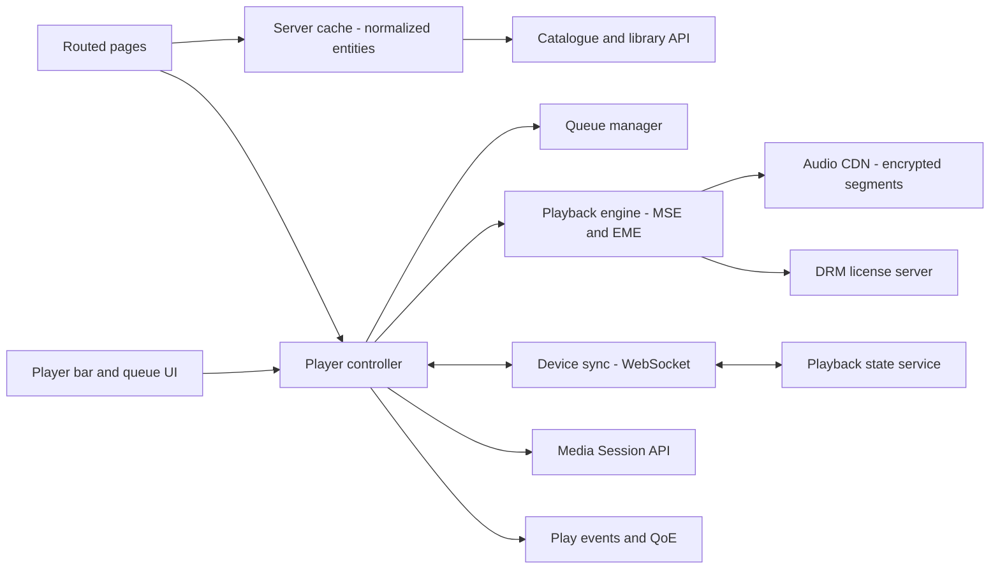

## 1. Requirements exploration

A music player is a long-lived **media session** living inside a browsing app. The two halves have different
lifetimes: pages come and go with navigation, the player must survive all of it. Most of the interesting design is
about that boundary, the playback engine (streaming, gapless, DRM), and keeping playback state consistent across the
user's devices.

### Functional requirements

- Browse: home (personalised shelves), search with instant results, artist, album and playlist pages.
- Library: liked songs, saved albums, followed playlists, user playlists (create, reorder, add/remove tracks).
- Playback: play/pause, seek, next/previous, shuffle, repeat (off/all/one), volume, a visible queue ("Next up" and
  the remaining context), play a track in the context of an album or playlist.
- Gapless playback and optional crossfade.
- Remote control ("Connect"): see the user's active devices, transfer playback, control another device.
- OS integration: media keys, lock-screen/notification controls, track metadata and artwork.
- Lyrics synced to playback (stretch).

### Non-functional requirements

| Concern | Target |
| --- | --- |
| Time to first audio | < 500 ms p50 after pressing play on a warm session; < 1.5 s cold |
| Track transitions | 0 ms gap for gapless albums; next track pre-buffered ≥ 10 s before the end |
| Navigation | playback uninterrupted; page transitions < 200 ms with cached data |
| Rebuffering | < 0.5% of playback time; adapt quality on slow networks |
| Remote control | command to playback change on another device < 1 s |
| Lists | 10k-track playlist scrolls at 60 fps |
| Accessibility | player fully keyboard operable, screen reader announces track changes, WCAG 2.2 AA |
| Bundle | initial JS < 200 KB gzip for the shell; routes code-split |

### Out of scope

- Recommendation algorithms, catalogue ingestion, royalties.
- Podcasts and video. Mention that the playback engine should be media-agnostic.
- Full offline downloads: browsers make DRM-protected offline storage limited; that is a native-app feature here.

### Clarifying questions

1. Free tier with ads? (Ad insertion into the queue, different skip limits.)
2. Which browsers must support DRM? (Widevine in Chrome/Firefox/Edge, FairPlay in Safari.)
3. Is the web player also embedded in a desktop app shell (Electron)? That changes caching and offline options.
4. Social features (friend activity, collaborative playlists, group sessions)?

Assume premium and free tiers, all evergreen browsers, web only.

## 2. Architecture / high-level design

### App structure: a persistent player outside the router

The SPA has two regions with different lifetimes:

- **Main view**: routed pages (`/`, `/search`, `/album/:id`, `/playlist/:id`). Mounted and unmounted by the router.
- **Now-playing region**: player bar, queue panel, the audio engine. Mounted once at the app root, **above** the
  router, so navigation never unmounts it.

This is the core answer to "playback must never stop". A full page reload would kill audio, so the app must be an
SPA (or use a framework with client-side navigation; with React Server Components/Next.js App Router, the player
goes in the root layout, which persists across navigations).

### Components

| Component | Responsibility |
| --- | --- |
| **Router + pages** | data-driven pages, code-split per route |
| **Server cache** | TanStack Query (or similar): catalogue entities, library, search results |
| **Entity store** | normalised tracks/albums/artists so a "liked" toggle updates everywhere |
| **Player controller** | the state machine: what is playing, queue, position, shuffle/repeat; the only API the UI uses |
| **Playback engine** | wraps `<audio>` + Media Source Extensions + EME; segment fetching, buffering, gapless, ABR |
| **Queue manager** | context (album/playlist), user queue, shuffle order, history |
| **Device sync (Connect)** | WebSocket to the playback-state service: publishes local state, receives commands |
| **OS integration** | Media Session API metadata and action handlers |
| **Telemetry** | play events (for royalties and recommendations), QoE metrics |



### Playback engine choice

- **Plain `<audio src>`**: simplest; but no DRM for progressive files without EME, limited control over buffering,
  and a decoder gap between tracks.
- **MSE + EME** (Media Source Extensions with Encrypted Media Extensions): the engine fetches encrypted audio segments
  itself and appends them to a `SourceBuffer`; EME obtains licences from the DRM server. This gives control over
  pre-buffering, quality switching and gapless joins. This is the right choice and what major services do.
- **Web Audio API**: useful for crossfade, normalisation and visualisation, by routing the media element through a
  `MediaElementAudioSourceNode` with gain nodes. Not for decoding DRM content directly (EME-decrypted audio cannot
  be read into buffers).

## 3. Data model

### Catalogue and library (server cache)

```ts
interface Track {
  id: string;
  title: string;
  durationMs: number;
  artists: Array<{ id: string; name: string }>;
  album: { id: string; name: string; images: Image[] };
  explicit: boolean;
  playable: boolean;            // licensing by region
  audio: { manifestUrl: string; loudnessDb: number; gaplessInfo?: { encoderDelay: number; padding: number } };
}

interface PlaylistPage {
  id: string;
  name: string;
  owner: { id: string; name: string };
  totalTracks: number;
  snapshotId: string;          // version for concurrent edits
  items: Array<{ uid: string; trackId: string; addedAt: string; addedBy?: string }>;
  nextCursor: string | null;
}

interface Image { url: string; width: number; height: number }
```

Tracks are normalised by ID: a playlist stores `trackId`s, the entity store holds tracks once. Playlist items have a
`uid` distinct from `trackId`, because the same track can appear twice.

### Player state (client, also mirrored to the server for Connect)

```ts
interface PlaybackState {
  deviceId: string;
  isPlaying: boolean;
  positionMs: number;
  positionTimestamp: number;   // wall clock when position was sampled, so others can extrapolate
  track: { id: string; uid?: string } | null;
  context: { type: 'album' | 'playlist' | 'artist' | 'search'; id: string } | null;
  shuffle: boolean;
  repeat: 'off' | 'context' | 'track';
  volume: number;
}

interface QueueState {
  userQueue: string[];          // "Add to queue" items, played before the context continues
  contextOrder: string[];       // uids in play order (shuffled or not), may be windowed for huge contexts
  contextIndex: number;
  history: string[];            // for "previous"
}
```

The canonical queue lives **server-side** in the playback-state service, so any device can resume or control it.
The active device holds a local copy and drives playback; it reports state changes. Other devices render the
server's state and send commands.

## 4. Interface definition (API)

### REST / GraphQL

```http
GET /v1/home?limit=10                      -> { shelves: [{ id, title, items: [...] }] }
GET /v1/search?q=radiohead&types=track,album,artist&limit=10
GET /v1/albums/:id                         -> album with tracks (albums are small)
GET /v1/playlists/:id/items?cursor=&limit=100
PUT /v1/me/library/tracks  { ids: ["..."] }
POST /v1/playlists/:id/items { trackIds, position, snapshotId } -> { snapshotId }
GET /v1/tracks/:id/playback -> { manifestUrl, licenseUrl, formats: [{ codec: "opus", bitrate: 160 }, ...] }
```

Playlist edits send the `snapshotId` they were based on; the server rebases positional inserts/moves or rejects with
409 if it cannot, and the client refetches.

### Connect WebSocket

```ts
type ClientToServer =
  | { t: 'register-device'; device: { id: string; name: string; type: 'web' } }
  | { t: 'state'; state: PlaybackState }                     // from the active device
  | { t: 'command'; targetDeviceId: string; cmd: Command };   // from a remote control

type Command =
  | { type: 'play'; context?: { type: string; id: string }; offsetUid?: string; positionMs?: number }
  | { type: 'pause' } | { type: 'resume' } | { type: 'next' } | { type: 'previous' }
  | { type: 'seek'; positionMs: number }
  | { type: 'set-shuffle'; value: boolean }
  | { type: 'transfer'; toDeviceId: string };

type ServerToClient =
  | { t: 'devices'; devices: Array<{ id: string; name: string; type: string; isActive: boolean }> }
  | { t: 'state'; state: PlaybackState; version: number }
  | { t: 'command'; cmd: Command; commandId: string };
```

### Player controller (what UI components use)

```ts
interface PlayerController {
  play(opts: { context?: ContextRef; startAtUid?: string; positionMs?: number }): Promise<void>;
  pause(): void;
  resume(): void;
  seek(ms: number): void;
  next(): void;
  previous(): void;                // restarts the track if > 3 s in, else goes back
  setShuffle(on: boolean): void;
  setRepeat(mode: 'off' | 'context' | 'track'): void;
  addToQueue(trackId: string): void;
  subscribe(listener: (s: PlaybackState) => void): () => void;
}
```

Components subscribe with `useSyncExternalStore`. The progress bar does **not** subscribe to position at 60 Hz
through React state; it reads `currentTime` in a `requestAnimationFrame` loop and writes the DOM transform directly
(or uses a CSS animation started at the right offset and paused on pause).

## 5. Optimizations and deep dives

### Fast start

- **Prefetch on intent**: when the pointer hovers a play button (or a track row is focused), fetch the manifest and
  start the licence request. On press, the first segment is often already in flight.
- **First segment small and low bitrate**: start with a small first segment so audio begins quickly, then switch to
  the target quality at the next segment boundary.
- **Licence reuse**: keep the EME `MediaKeySession` alive and request licences that cover multiple tracks where the
  DRM policy allows, to avoid a licence round trip per track.
- **Autoplay policy**: browsers block audible playback without a user gesture. Create/resume the media element and
  `AudioContext` inside the click handler; handle `play()` rejections by showing a "Click to play" state.

### Gapless playback and crossfade

- Gaps come from encoder padding (MP3/AAC add priming samples) and from tearing down one decoder before starting the
  next. With MSE, append the next track's segments into the **same** `SourceBuffer` using `timestampOffset` set to
  the previous track's end, and trim encoder delay/padding with `appendWindowStart`/`appendWindowEnd`. One continuous
  media timeline, no gap.
- Pre-buffer the next track when the current one has ~15–30 s left; account for shuffle and repeat when choosing
  "next".
- Crossfade: two media elements routed through Web Audio gain nodes with overlapping ramps. It conflicts with
  gapless (they are mutually exclusive per album), so gapless albums disable crossfade.
- Loudness normalisation: apply `loudnessDb` from metadata via a gain node, so tracks play at consistent volume.

### Adaptive quality

Audio bitrates are small (roughly 24–320 kbps), so ABR is simpler than video: measure segment download throughput,
keep a buffer target (e.g. 30 s ahead), and step quality down when the buffer drains or the connection is metered
(`navigator.connection.saveData` where supported). Quality also depends on the subscription tier. Switch only at
segment boundaries; codecs must match within a `SourceBuffer` (use `changeType()` if switching codec).

### Queue model and shuffle

- Shuffle produces a permutation of the context order, generated once (Fisher-Yates) and stored, so "previous"
  works and the order is stable across devices. The currently playing track becomes the first element.
- For a 10,000-track playlist, the client holds a **window** of the play order (e.g. the next 50 and previous 50),
  fetched from the server-side queue, not the whole list.
- "Add to queue" items go to `userQueue`, which is consumed before resuming the context.
- Edits to the playlist while it is playing: the queue keeps the snapshot it started with until the context is
  replayed, avoiding the track under the cursor jumping.

### Multi-device sync (Connect)

- Exactly one **active device** plays; the state service stores the authoritative `PlaybackState` and a version.
- Remote devices send commands; the server routes them to the active device, which executes and publishes the new
  state. UIs update optimistically (button shows "pause" immediately) and reconcile on the next state message.
- Position is sent as `(positionMs, positionTimestamp)` so remote UIs extrapolate the progress bar without
  per-second messages.
- Transfer: the server tells the old device to pause and report its exact position, then commands the new device to
  play from there. If the old device is unreachable, use the last known extrapolated position.
- Tabs: two tabs on the same machine register as one device via `BroadcastChannel` election, so audio never plays
  twice.

### Rendering performance

- Virtualize long track lists (fixed row height, ~56 px) with overscan; fetch pages as the user scrolls, with a
  placeholder row for unloaded indices so the scrollbar reflects `totalTracks`.
- Images: `srcset` from the multiple `Image` sizes, lazy loading below the fold, dominant colour placeholder (also
  used for page header gradients).
- The player bar is isolated from page renders: its own store subscription, memoised, so a page re-render never
  touches it and vice versa.
- Route-level code splitting; prefetch route chunks and data on link hover.

### Caching

- Catalogue entities are immutable-ish: long `staleTime`, normalised so the same track updates everywhere.
- Library state (liked) is user-specific: optimistic toggles with rollback.
- Audio segments: let the HTTP cache handle them (CDN URLs with long `Cache-Control`); encrypted, so caching is safe.
  A service worker can keep the app shell and recently played artwork for fast startup.

### OS integration and accessibility

- Media Session API: set `navigator.mediaSession.metadata` (title, artist, album, artwork in several sizes) and
  handlers for `play`, `pause`, `previoustrack`, `nexttrack`, `seekto`; update `setPositionState` so OS scrubbers are
  accurate.
- The player bar is a landmark (`<footer>` or `role="region"` with a label). Buttons have accessible names that
  reflect state ("Pause", "Shuffle on"). The seek bar is a slider (`role="slider"` or `<input type="range">`) with
  `aria-valuetext="1 minute 20 seconds of 3 minutes 45 seconds"`.
- Announce track changes politely, but only when the change was not initiated by the user's own click (to avoid
  double announcements).
- Global keyboard shortcuts (space for play/pause) must not fire while typing in search.

### Telemetry, licensing and security

- Play events (`start`, `30s reached`, `end`, `skip`) are business-critical (royalties): queue them durably in
  IndexedDB and send with `fetch(..., { keepalive: true })` or `navigator.sendBeacon` on page hide.
- QoE metrics: time to first audio, rebuffer count/duration, licence failures by browser/CDM.
- DRM: Widevine where supported, FairPlay on Safari; robustness levels vary, and the licence server enforces
  concurrency limits (one stream per account on some tiers).

## What a lead-level answer adds

- Frames the architecture around **lifetimes**: the persistent player root vs routed pages, and the server-owned
  queue vs the device-owned playback.
- Explains gapless with real mechanics (single `SourceBuffer`, `timestampOffset`, append windows) instead of "preload
  the next track".
- Treats play events as **financial data** with durability guarantees.
- Prevents React from becoming a bottleneck: progress bars and visualisers bypass React state.
- Plans for browser fragmentation: DRM systems, autoplay policies, codec support matrices, with a capability-detection
  layer and QoE dashboards segmented by browser.

## Common follow-up questions

**How do you keep playing when the user opens a link that does a full page load?** Avoid full loads inside the app:
intercept internal links. For true cross-document navigation, you cannot keep audio playing; some apps open the
player in a separate window. The View Transitions API for MPAs does not preserve media.

**How would you implement synced lyrics?** Fetch time-coded lines; on each animation frame compare `currentTime`
with line start times (binary search), highlight and auto-scroll the active line, pausing auto-scroll while the user
scrolls manually.

**What about collaborative "group sessions"?** Extend Connect: a session has many listeners each playing locally,
with the host's commands broadcast and positions synchronised by timestamp, accepting a small drift tolerance.

**How do you handle a track that becomes unavailable mid-queue (licensing)?** The queue skips unplayable items
(`playable: false`) and greys them in lists; if a licence fails at play time, log it and move to the next track.

**Why not one `<audio>` per track?** Simpler, but you get gaps, duplicated buffering logic and more licence sessions.
It is acceptable for a prototype or podcasts.
