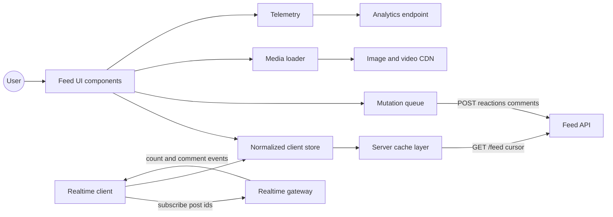

## 1. Requirements exploration

A news feed looks simple (a list of cards) but it is the single most performance-sensitive surface in a social
product: it is the first thing users see, they spend most of their time in it, and every millisecond of input delay
or layout shift is visible. Spend the first five minutes pinning scope down.

### Functional requirements

- **Browse the feed**: a ranked list of posts that loads more as the user scrolls ("infinite scroll").
- **Post types**: text, single image, multi-image gallery, link preview, video (autoplay muted), shared post.
- **Interact**: react (like, love, …), open comments inline, write a comment, share, hide/report a post.
- **Compose**: create a post with text, mentions, and up to N images; see it at the top of the feed immediately.
- **Freshness**: a "New posts" pill appears when fresher content is available; reaction/comment counts update while
  the post is on screen.

### Non-functional requirements

| Concern | Target |
| --- | --- |
| First load (LCP) | < 2.5 s at p75 on a mid-range phone over 4G |
| Interaction (INP) | < 200 ms at p75; reacting must feel instant (< 100 ms visual feedback) |
| Layout stability (CLS) | < 0.1, so no jumping posts while images load |
| Scroll | 60 fps on mid-range devices, even after 500+ posts |
| Memory | bounded; long sessions must not crash low-memory tabs |
| JS budget | < 200 KB gzipped critical JS for the feed route |
| Availability | degrade gracefully: cached feed if the network fails |

### Out of scope

- The ranking algorithm, ads auction, and backend fan-out (we consume a ranked endpoint).
- Stories, Reels, Marketplace, Messenger.
- Native apps (though the API should be shareable with them).

### Clarifying questions to ask

1. Is the feed **personalised and ranked** or chronological? (Ranked means the server owns order and the client must
   not re-sort.)
2. Do we need **SEO**? (A logged-in feed does not; public pages would.) This drives SSR vs CSR.
3. How "live" must counts be? Seconds-level fresh, or is refresh-on-focus acceptable?
4. Which **devices and networks** dominate? This sets the JS and image budgets.
5. Do ads appear inline? Ads come from a different service and have stricter viewability tracking.
6. Are there **accessibility or regulatory** constraints (e.g. EU accessibility act, reduced motion)?

State your assumptions out loud: ranked feed, logged-in only (no SEO), streaming SSR for first paint, near-real-time
counts via a subscription, ads are just another post type.

## 2. Architecture / high-level design

### Rendering strategy

For a logged-in feed I would **server-render the shell and the first 3–5 posts** (streaming SSR with React 18/19
`renderToPipeableStream` or a framework like Next.js App Router) and hydrate on the client. Trade-offs:

- **CSR only**: simplest, but LCP waits for JS download + parse + API call. Bad on slow phones.
- **SSR first page**: LCP is the first post image, which can be discovered in the HTML and preloaded. Costs server
  CPU and needs careful hydration so the first interaction is not blocked.
- **React Server Components**: posts rendered as server components ship less JS (the post body has no
  interactivity), while reaction bars and comment boxes are client components. Good fit, but mature tooling is
  framework-specific; mention it as the direction, not a requirement.

After the first page, everything else is client-side: pagination, interactions, live updates.

### Component tree

```
<FeedPage>
  <TopNav />
  <Composer />                     // create post, image picker, upload progress
  <NewPostsPill />                 // "12 new posts" -> scroll to top and merge
  <FeedList>                       // virtualization, pagination trigger
    <FeedItem kind="post">         // switch on post type
      <PostHeader />               // author, timestamp, menu
      <PostBody />                 // text with mentions/links, see more
      <PostMedia />                // image grid, video, link preview
      <ReactionBar />              // counts, react button, share
      <CommentsSection />          // lazy, collapsed by default
    </FeedItem>
    <FeedItem kind="ad" />
    <FeedSentinel />               // IntersectionObserver target for next page
  </FeedList>
</FeedPage>
```

### Responsibilities

- **Feed controller / data layer**: fetches pages, owns the cursor, dedupes posts, merges live updates into the
  normalized store. Implemented with a server-cache library (TanStack Query `useInfiniteQuery`, Relay, or Apollo).
- **Normalized entity store**: one copy of each post, user and comment, so a reaction on a shared post updates every
  place it is shown.
- **Real-time client**: a single multiplexed connection (WebSocket or SSE) that subscribes to the IDs currently on
  screen.
- **Media pipeline**: responsive images, lazy loading, video lifecycle (play when visible, pause when not).
- **Mutation queue**: reactions, comments and posts are optimistic and retried; failures roll back.
- **Telemetry**: impression logging (post was ≥ 50% visible for ≥ 1 s), Web Vitals, errors.



## 3. Data model

Separate **server state** (owned by the backend, cached on the client) from **client/UI state** (owned by the
browser).

| Data | Owner | Where it lives |
| --- | --- | --- |
| Feed page list and cursor | server | server cache (`useInfiniteQuery` / Relay connection) |
| Post, User, Comment entities | server | normalized entity store |
| Viewer's own reaction | server, optimistically patched | entity store + pending mutation |
| Composer draft text and attachments | client | component state, persisted to `sessionStorage` |
| Which comment sections are expanded | client | UI state keyed by post id |
| Scroll position and virtualization offsets | client | in memory; restored on back navigation |
| Upload progress | client | mutation state |

### Normalized shape

```ts
type ID = string;

interface User {
  id: ID;
  name: string;
  avatar: { url: string; width: number; height: number };
}

interface Media {
  id: ID;
  type: 'image' | 'video';
  width: number;            // intrinsic size so we can reserve space (CLS)
  height: number;
  blurhash?: string;        // tiny placeholder
  srcset: { url: string; w: number }[];
  videoManifestUrl?: string; // HLS/DASH for video
  alt?: string;
}

interface Post {
  id: ID;
  authorId: ID;
  createdAt: string;        // ISO 8601, format on the client per locale
  text: string;             // plain text + entity ranges, never HTML
  entities: { type: 'mention' | 'link' | 'hashtag'; offset: number; length: number; ref: string }[];
  media: Media[];
  reactionSummary: { total: number; top: ReactionType[] };
  viewerReaction: ReactionType | null;
  commentCount: number;
  previewCommentIds: ID[];
  version: number;          // monotonically increasing; reject stale updates
}

interface FeedState {
  entities: {
    posts: Record<ID, Post>;
    users: Record<ID, User>;
    comments: Record<ID, Comment>;
  };
  feed: {
    itemIds: ID[];           // order defined by the server
    endCursor: string | null;
    hasMore: boolean;
    pendingNewIds: ID[];     // buffered "new posts", not yet shown
  };
}
```

Key decisions:

- **Text is structured, not HTML.** The server sends plain text plus entity ranges; the client renders mentions and
  links as React elements. This removes a whole class of XSS bugs and makes it easy to render RTL text correctly.
- **Intrinsic media dimensions** come with the post so the card can reserve its exact height before the image loads.
- **`version` per entity** lets the store ignore a stale real-time event arriving after a fresher fetch.
- **Feed order is a list of IDs** separate from the entities, so the same post can appear in a different list (a
  profile page) without duplication.

## 4. Interface definition (API)

### Pagination: cursor, not offset

A ranked feed changes constantly. With `?offset=20`, a post inserted at the top shifts everything and the user sees
duplicates (or misses posts). A **cursor** is an opaque token encoding "where I stopped" (often a ranking session id
plus position), so the next page is stable regardless of inserts. Offset pagination is only acceptable for static,
seekable lists (search results with page numbers).

### REST shape

```http
GET /api/feed?cursor=eyJzZXNzIjoiYTEiLCJwb3MiOjIwfQ&limit=10
```

```json
{
  "items": [
    {
      "type": "post",
      "post": {
        "id": "p_981",
        "authorId": "u_12",
        "createdAt": "2025-03-02T10:15:00Z",
        "text": "Trail run this morning with @Ana",
        "entities": [{ "type": "mention", "offset": 23, "length": 4, "ref": "u_77" }],
        "media": [{ "id": "m_1", "type": "image", "width": 1080, "height": 1350,
                     "blurhash": "LKO2?U%2Tw=w]~RBVZRi};RPxuwH",
                     "srcset": [{ "url": "https://cdn.example.com/m_1_480.avif", "w": 480 },
                                { "url": "https://cdn.example.com/m_1_1080.avif", "w": 1080 }],
                     "alt": "Runner on a mountain trail" }],
        "reactionSummary": { "total": 42, "top": ["like", "love"] },
        "viewerReaction": null,
        "commentCount": 5,
        "previewCommentIds": ["c_1"],
        "version": 7
      }
    },
    { "type": "ad", "ad": { "id": "ad_5", "creativeUrl": "…", "impressionToken": "…" } }
  ],
  "users": { "u_12": { "id": "u_12", "name": "Sam", "avatar": { "url": "…", "width": 64, "height": 64 } } },
  "comments": { "c_1": { "id": "c_1", "authorId": "u_77", "text": "Nice!", "createdAt": "…" } },
  "pageInfo": { "endCursor": "eyJzZXNzIjoiYTEiLCJwb3MiOjMwfQ", "hasMore": true }
}
```

Side-loading `users` and `comments` at the top level keeps the payload deduplicated and maps directly onto the
normalized store. With GraphQL (Relay-style connections) you get the same thing via `edges { node }` + `pageInfo`
and fragment colocation: each component declares the fields it needs, which prevents over-fetching as the card
evolves. GraphQL is a strong fit here because the post card has many variants; REST is simpler to cache at the CDN.
Both are defensible.

### Mutations

```http
PUT /api/posts/p_981/reaction        { "type": "love", "clientMutationId": "m-7f3a" }
DELETE /api/posts/p_981/reaction
POST /api/posts/p_981/comments       { "text": "Looks great", "clientMutationId": "m-7f3b" }
POST /api/posts                      { "text": "…", "mediaIds": ["up_1"], "clientMutationId": "m-7f3c" }
```

`PUT` for a reaction is **idempotent** (setting "love" twice is the same state), which makes retries safe. The
`clientMutationId` lets the server dedupe retried POSTs and lets the client match a server echo to its optimistic
placeholder. Image uploads go first to `POST /api/uploads` (or a pre-signed URL direct to object storage), which
returns an `uploadId`; the post creation references it.

### Real-time

```json
// client -> server
{ "op": "subscribe", "topics": ["post:p_981:counts", "post:p_982:counts"] }
// server -> client
{ "op": "event", "topic": "post:p_981:counts", "data": { "reactionTotal": 43, "commentCount": 6, "version": 8 } }
{ "op": "event", "topic": "feed:new", "data": { "count": 3 } }
```

Subscribe only to posts currently in (or near) the viewport and unsubscribe as they scroll away; otherwise a long
session would subscribe to hundreds of topics. **SSE** is enough because the traffic is server-to-client (mutations
go over HTTP), works over HTTP/2 without connection-count issues, and reconnects automatically. A WebSocket is
fine if the product already has one (e.g. for chat) — reuse it rather than open a second connection.

### Component props

```ts
interface FeedListProps {
  itemIds: ID[];
  hasMore: boolean;
  isFetchingNext: boolean;
  onLoadMore: () => void;
  renderItem: (id: ID) => React.ReactNode;
  estimatedItemHeight?: number;
}

interface ReactionBarProps {
  postId: ID;                // reads summary + viewerReaction from the store
  onReact: (type: ReactionType | null) => void;
}

interface PostMediaProps {
  media: Media[];
  priority?: boolean;        // true for the first post: eager load + fetchpriority="high"
}
```

Components receive **IDs** and select from the store, so a count update re-renders only the affected `ReactionBar`,
not the whole list.

## 5. Optimizations and deep dives

### Infinite scroll and virtualization

- Load the next page when a **sentinel** element enters an `IntersectionObserver` with a generous `rootMargin`
  (e.g. `1500px 0px`), so data arrives before the user reaches the end. Do not use scroll listeners.
- Guard against duplicate fetches (`isFetchingNext`) and dedupe by post id when merging pages.
- After a few hundred posts, the DOM gets heavy: style recalc and memory grow linearly. Options:
  - **Windowing** (TanStack Virtual, react-window): render only visible items + overscan, with dynamic height
    measurement via `ResizeObserver`. Biggest win, but complicates find-in-page, anchor links and scroll
    restoration, and variable heights cause "scroll jumps" if estimates are poor.
  - **`content-visibility: auto`** with `contain-intrinsic-size: auto 600px`: the browser skips rendering
    off-screen cards but keeps them in the DOM, so find-in-page and accessibility still work. Cheaper to adopt,
    but DOM node count and React memory still grow.
  - **Hybrid**: `content-visibility` for the first ~100 posts, then unmount posts far above the viewport into
    fixed-height placeholders. This is roughly what large feeds do in practice.
- Restore scroll position on back navigation: cache the feed in memory (query cache) and store the anchor post id
  + offset rather than a pixel value, because heights may change.

### Rendering performance and INP

- Each `FeedItem` is memoized and subscribes to only its own entity (selector by id), so a real-time count change is
  an O(1) re-render. With the React Compiler (React 19), much of the manual `memo` work disappears.
- Mark appending a page as a **transition** (`startTransition`) so a large page render never blocks a tap.
- Defer below-the-fold work: comment sections, link-preview enrichment and video players hydrate lazily
  (`React.lazy` + intersection).
- Break up long tasks (e.g. impression logging, parsing a large page) with `scheduler.yield()` where supported,
  falling back to `setTimeout`.

### Network

- **Prefetch** the next page when the user is ~1.5 viewports from the end; cancel with `AbortController` if they
  navigate away.
- Use HTTP/2 or HTTP/3 multiplexing for many small image requests; keep the API and CDN on few origins and
  `preconnect` to the CDN.
- **Stale-while-revalidate** on return visits: render the cached first page instantly (from memory or IndexedDB),
  fetch fresh in the background, and show the "New posts" pill instead of reshuffling what the user is reading.
- **Never insert content above the reading position.** New posts are buffered in `pendingNewIds` until the user taps
  the pill or is already at the top.

### Optimistic updates

Reacting must feel instant:

1. Patch the store: set `viewerReaction`, adjust `reactionSummary.total`.
2. Send the request with a `clientMutationId`.
3. On success, reconcile with the server's returned post (version wins).
4. On failure, roll back and show a non-blocking toast.

In React 19, `useOptimistic` expresses this for a component; for cross-component consistency the store-level
patch (TanStack Query `onMutate`/`onError`, Relay `optimisticResponse`) is better. Debounce rapid toggles (like,
unlike, like) so only the final state is sent.

New posts and comments use temporary ids (`tmp_…`) and show a "Posting…" state; the server echo replaces them.

### Images and video

- `srcset` + `sizes`, AVIF/WebP with JPEG fallback via the CDN's content negotiation.
- First post image: `loading="eager"` and `fetchpriority="high"` (and a preload in SSR HTML); everything else
  `loading="lazy"` and `decoding="async"`.
- Reserve space with `width`/`height` attributes or `aspect-ratio`, plus a blurhash/LQIP placeholder: zero CLS.
- Video: render a poster image; mount the player only near the viewport; autoplay muted when ≥ 50% visible, pause
  when it leaves; respect `prefers-reduced-motion` and data saver (`navigator.connection.saveData` where
  available) by disabling autoplay. Use adaptive streaming (HLS/DASH) rather than MP4 for long clips.

### Offline and resilience

- Service worker caches the app shell; the last feed page lives in IndexedDB so a flaky network still shows
  content with an "Offline, showing saved posts" banner.
- Mutations made offline go to a persistent queue and replay on `online` (or via Background Sync where supported).
  Reactions are idempotent so replay is safe.
- Per-item **error boundaries**: one malformed post must not blank the whole feed.

### Accessibility

- The list is a `role="feed"` container whose children are `role="article"` with `aria-posinset` and
  `aria-setsize` (use `-1` when the total is unknown) and `aria-labelledby` the author/time. Set `aria-busy="true"`
  while loading more.
- Infinite scroll traps keyboard users from reaching the footer: provide a "Load more" button fallback or move
  footer links elsewhere, and support skipping between posts (e.g. `j`/`k` shortcuts, announced in help).
- The reaction picker is a menu that works with keyboard (not only hover/long-press), and buttons have pressed
  state (`aria-pressed`).
- Announce "3 new posts available" via a polite live region rather than moving focus.
- When virtualizing, never unmount the focused element; keep it rendered until focus leaves.

### Internationalization

- Format relative times and counts with `Intl.RelativeTimeFormat` and `Intl.NumberFormat` (compact notation
  "1.2K" is locale-aware).
- Use CSS logical properties (`margin-inline-start`) so RTL layouts flip for free; set `dir="auto"` on user text so
  a Hebrew post in an English UI renders correctly.
- Pluralization via ICU message format ("1 comment" vs "2 comments" vs languages with more plural forms).

### Security

- Render user text as text nodes; links are built from entity ranges and validated (`https:` only) with
  `rel="noopener noreferrer ugc"` on external links.
- Strict **CSP** (nonce-based `script-src`, `object-src 'none'`), Trusted Types if any HTML must be injected (e.g.
  sanitised link previews via DOMPurify).
- Session in an `HttpOnly`, `Secure`, `SameSite=Lax` cookie; CSRF token on mutations.
- Ads and embeds in sandboxed iframes.

### Observability

- RUM for LCP, INP, CLS (the `web-vitals` library) segmented by device class and connection type.
- Custom metrics: time to first post, scroll jank (long animation frames via the Long Animation Frames API),
  pagination latency, optimistic rollback rate, image error rate.
- Impression events batched and sent with `navigator.sendBeacon` or `fetch(..., { keepalive: true })` on
  `visibilitychange`.

### Testing strategy

- Unit: reducers/store merges (dedupe, version conflict, rollback).
- Component: post variants with Testing Library; a11y checks with axe.
- Integration: mock the API with MSW; test pagination, offline banner, optimistic rollback.
- E2E (Playwright): scroll 300 posts and assert memory/DOM count stays bounded; visual regression for post types.
- Performance budgets in CI (Lighthouse CI / bundle size checks) to stop regressions before they ship.

## What a lead-level answer adds

- **Frames trade-offs with data**: "virtualization vs `content-visibility` — let's measure DOM size and INP on a
  Moto G-class device before choosing" rather than picking a library by default.
- **Defines contracts across teams**: the post schema is shared by web, iOS and Android; a lead proposes a
  versioned schema (GraphQL fragments or typed REST with OpenAPI) and a deprecation process.
- **Thinks about the platform, not one screen**: post rendering components are reused in profile, groups and search,
  so they live in a shared package with a plugin model for new post types (e.g. polls) that teams can add without
  touching the feed core.
- **Owns quality gates**: performance budgets, Web Vitals SLOs with alerting, staged rollout behind feature flags
  and A/B tests on engagement metrics.
- **Plans for failure**: what happens when the ranking service is slow? Serve a cached or chronological fallback
  with a timeout budget rather than a spinner.

## Common follow-up questions

**How would you avoid showing the same post twice?** Dedupe by post id when merging pages, and let the server use
the cursor's ranking session to exclude already-served items. The client-side set is a cheap safety net.

**User scrolls 1,000 posts, then hits back from a post detail page. How do you restore position?** Keep the query
cache in memory (or `history.state` + IndexedDB for full reloads), restore the item list, then scroll to the
anchor post id plus offset after layout. The bfcache helps if you avoid `unload` handlers and `Cache-Control:
no-store`.

**How do you handle a post being deleted while on screen?** The real-time channel sends a `post:deleted` event;
replace the card with a collapsed "This post is no longer available" placeholder rather than removing it, which
would shift content under the user.

**Why not poll instead of SSE?** Polling every 30 s across hundreds of millions of tabs is expensive and adds
latency. Polling is a reasonable fallback when the streaming connection fails, and is fine for an MVP.

**How do you render 20 image variants without a huge bundle?** Code-split post-type renderers by type
(`React.lazy` keyed by `post.type`), with the common types in the main chunk and rare ones loaded on demand.

**How do you measure success?** Web Vitals at p75, time to first post, scroll FPS, and product metrics (session
length, posts viewed) in A/B tests. A performance change that does not move a user metric is still worth shipping
if it improves vitals, but you should know which one you are optimising.
