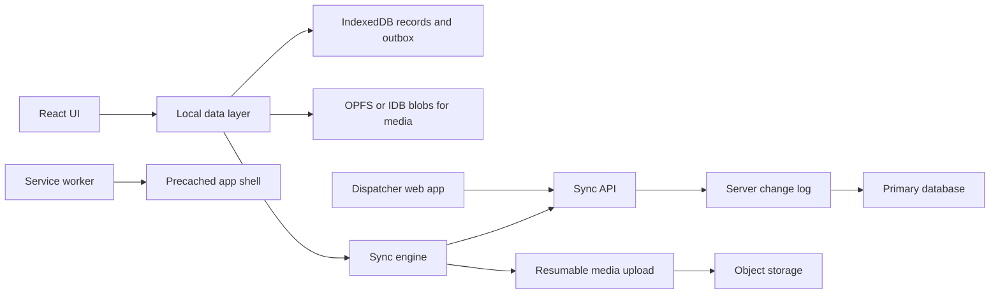

## Framing the problem

"Offline support" is often designed as a cache in front of an online app. **Offline-first** inverts that: the local
database is the app's source of truth for the UI, and the network is a background replication channel. Every user
action writes locally and succeeds immediately; sync happens later, possibly hours later, possibly in pieces.

That inversion moves the hard problems from rendering to **data**: what to download, how to store it durably in a
browser, how to send changes reliably exactly once, and what to do when the office and the field change the same
record. A lead-level answer spends most of its time there, and is honest about where the web platform is weaker than
native (iOS background execution, storage eviction).

## 1. Requirements exploration

### Stakeholders

- **Technicians**: fast, reliable app that never loses work; minimal sync anxiety.
- **Dispatchers**: see field progress as soon as possible; reassign work.
- **Form-owning teams** (inspection, safety, metering): build new form types on the platform without touching sync.
- **IT / MDM**: manage devices, push updates, wipe data on lost tablets.
- **Compliance**: tamper-evident audit trail of what was recorded, when and by whom.

### Functional requirements

- Shift download: assigned work orders plus related site data, diagrams and recent photos.
- Offline create, edit and delete of form submissions, photos, signatures and defect reports.
- Automatic, resumable sync of changes and media; visible per-item sync state.
- Server-to-client updates (reassignment, priority, notes) delivered when online.
- Conflict detection and resolution, with a human in the loop only when needed.
- Form definitions are data (schema-driven), so new form types do not need an app release.

### Non-functional requirements

- **Never lose user data**: a written change survives app crash, tab kill, OS restart and app update.
- **Offline duration**: at least 3 days without connectivity.
- **Storage**: about 200 work orders × (data + up to 20 photos) per device; plan for 2–4 GB.
- **Performance**: app usable within 2 s of launch offline; form interactions under 100 ms.
- **Sync**: changes reach the server within 1 minute of usable connectivity; media uploads resume rather than restart.
- **Scale**: 6,000 devices, about 100k form submissions and 1M photos per week.

### Constraints and clarifying questions

- Managed Android tablets (Chrome) are the majority; iPads run Safari, which **does not support the Background Sync API**
  and suspends PWAs aggressively in the background. Sync on iOS therefore only happens while the app is open. Is that
  acceptable, or do iPads need a native wrapper?
- Is there an existing back end with REST endpoints, or can we add a sync endpoint?
- What is the conflict policy the business wants for safety-critical fields (for example, a "hazard present" flag)?

## 2. Architecture



Layers:

1. **App shell** precached by a service worker (Workbox), so the app launches with no network.
2. **Local data layer**: IndexedDB as the source of truth for the UI. The UI reads through reactive queries
   (subscriptions to local tables), never directly from the network.
3. **Outbox**: every local mutation appends an operation to a durable outbox in the **same IndexedDB transaction** as
   the data change. This is the key to never losing work.
4. **Sync engine**: pushes outbox operations, pulls server changes since a cursor, applies them locally, resolves
   conflicts. Runs in a dedicated worker (or in the page with a Web Lock to ensure only one tab syncs).
5. **Media pipeline**: blobs stored separately (OPFS where available, IndexedDB blobs otherwise), uploaded in chunks
   with a resumable protocol.
6. **Server**: a sync API backed by a change log (monotonic sequence per tenant or per work-order scope).

## 3. Data model and contracts

### Local records

Every syncable record carries sync metadata:

```ts
interface SyncedRecord<T> {
  id: string;                 // client-generated UUID v7 (sortable), so offline creates need no server round trip
  type: 'workOrder' | 'submission' | 'defect' | 'note';
  data: T;
  serverVersion: number | null;     // last version acknowledged by server
  fieldVersions: Record<string, { v: number; by: string; at: string }>; // per-field for merge
  localState: 'synced' | 'pending' | 'conflict' | 'error';
  deleted?: boolean;               // tombstone
}
```

### Outbox operation

```ts
interface OutboxOp {
  opId: string;               // UUID; the server's idempotency key
  recordId: string;
  recordType: SyncedRecord<unknown>['type'];
  kind: 'create' | 'patch' | 'delete';
  baseVersion: number | null; // server version the edit was based on
  patch: Record<string, unknown>;   // only changed fields
  createdAt: string;
  deviceId: string;
  attempts: number;
}
```

Patches, not whole records: sending only changed fields shrinks payloads and makes field-level merges possible.

### Server change feed

```json
{
  "cursor": "c_000184223",
  "hasMore": false,
  "changes": [
    { "id": "wo_81", "type": "workOrder", "version": 14, "changedFields": { "priority": "high" },
      "by": "dispatcher:jlee", "at": "2025-06-02T09:12:00Z" },
    { "id": "wo_77", "type": "workOrder", "deleted": true, "reason": "reassigned" }
  ]
}
```

"Reassigned away" is delivered as a scoped delete so the device evicts data it is no longer allowed to hold.

### Form definitions

Forms are JSON schemas plus UI hints, versioned and downloaded with the shift. A submission records the
`formVersion` it was completed against, so the server can validate and migrate older submissions after a form change.

## 4. Interfaces

### Sync API

```http
POST /sync/push
{ "deviceId": "d_19", "ops": [ OutboxOp, ... ] }        // batches of up to 100 ops
200 { "results": [ { "opId": "...", "status": "applied", "version": 15 },
                   { "opId": "...", "status": "conflict", "server": { ...record, "version": 16 } },
                   { "opId": "...", "status": "rejected", "error": "VALIDATION", "details": {...} } ] }

GET /sync/pull?cursor=c_000184100&scope=technician:t_42
200 { "cursor": "...", "hasMore": true, "changes": [...] }
```

Push is **idempotent by `opId`**: the server stores applied op IDs, so a retry after a lost response is harmless.

Media: `POST /media` creates an upload session, chunks are `PUT` with byte ranges, and a final call commits. A tus-style
protocol works well here. The record references media by client-generated ID, so records can sync before photos do.

### Client platform API for form teams

```ts
interface OfflineStore {
  query<T>(type: string, where?: Partial<T>): LiveQuery<T[]>;    // reactive, local only
  get<T>(type: string, id: string): LiveQuery<SyncedRecord<T> | undefined>;
  create<T>(type: string, data: T): Promise<string>;             // writes record + outbox op atomically
  patch<T>(type: string, id: string, changes: Partial<T>): Promise<void>;
  remove(type: string, id: string): Promise<void>;
  attachMedia(recordId: string, file: Blob, meta: { kind: 'photo' | 'signature' }): Promise<string>;
}

interface SyncStatus {
  online: boolean;
  pendingOps: number;
  pendingMediaBytes: number;
  lastSuccessfulSync: string | null;
  conflicts: number;
}
declare function useSyncStatus(): SyncStatus;
declare function requestSync(reason: 'user' | 'online' | 'interval' | 'visibility'): void;
```

Form teams write UI against `OfflineStore`. They never call fetch, never manage the outbox, and get offline behaviour
for free.

## 5. Deep dives and trade-offs

### Durability in the browser

- Call `navigator.storage.persist()` on first run; on managed Android with an installed PWA this is normally granted,
  which protects data from best-effort eviction. Show storage usage via `navigator.storage.estimate()` and warn before
  quota is reached.
- Safari's 7-day cap on script-writable storage applies to sites in the browser, not to web apps added to the Home
  Screen, so the iPad deployment must be an installed PWA, enforced via MDM.
- Write record and outbox op in one IndexedDB transaction, so a crash leaves either both or neither.
- Never delete local data until the server has acknowledged it **and** the pull has confirmed the resulting version.

### When sync runs

Triggers: app start, `online` event, `visibilitychange` to visible, a periodic timer while open, and user "Sync now".
On Android Chrome, register a Background Sync (`sync` event) so the service worker can flush the outbox after the app
is closed. Periodic Background Sync exists in Chromium for installed apps but is opportunistic; do not depend on it.
On iOS, there is no background sync; the UI must make pending state visible and nudge users to open the app on
connectivity.

`navigator.onLine` is unreliable (true on captive portals and dead Wi-Fi), so treat it as a hint and judge
connectivity by actual request success, with exponential backoff and jitter.

### Ordering and partial failures

Ops are pushed in creation order per record. If op N for a record is rejected, later ops for the same record are held
(they may depend on it), but other records continue. A poison op (validation failure that will never succeed) is
moved to an error state and surfaced to the user rather than blocking the queue forever.

### Conflict resolution

Conflicts are inevitable: a dispatcher edits priority while a technician edits notes on the same work order. Options,
from simplest to most powerful:

| Strategy | How it works | Good for | Risk |
| --- | --- | --- | --- |
| Last-writer-wins (record) | Whole record overwritten by the latest timestamp | Nothing important | Silent data loss; device clocks drift |
| **Field-level merge with versions** | Server compares `baseVersion` and changed fields; non-overlapping fields merge automatically | Most form and work-order edits | Overlapping edits still need a rule |
| Domain rules | Per field policy: "server wins" for assignment, "max" for severity, "append" for notes, "client wins" for measurements taken on site | Business-meaningful fields | Must be designed with the business |
| Manual resolution | Conflict surfaced to a human with both values | Safety-critical overlapping edits | UX burden; must be rare |
| CRDTs (Yjs, Automerge) | Data types that merge automatically and deterministically | Collaborative free text, checklists edited by two technicians | More storage, harder server-side validation and querying |

**Recommendation:** field-level merge plus per-field domain rules, declared in the form or entity schema
(`"mergePolicy": "server-wins" | "client-wins" | "max" | "append" | "manual"`). Use a CRDT only for the shared
on-site notes field where two technicians type concurrently. Never rely on device clocks for ordering; the server
assigns versions, and per-field metadata records author and server sequence.

Example: technician sets `hazardPresent = true` offline; dispatcher meanwhile closes the work order. Policy says hazard
reports are never discarded: the server applies the hazard flag, re-opens the order, and alerts the dispatcher. That
is a product decision, which is why the platform makes policies declarative and visible to form owners.

### Deletes and reassignment

Use tombstones so a delete syncs like any other change. When a work order is reassigned, the original device receives a
scoped delete; if it holds unsynced edits, those are pushed first and then attributed to the original technician, and
the local copy is evicted only after acknowledgement.

### Schema and app updates

- Service worker updates must **never activate in the middle of a form**. Use the "update available" pattern: the new
  worker waits; the app shows a prompt at a safe moment (between jobs) and calls `skipWaiting` when the user accepts
  or at next cold start.
- Local IndexedDB schema migrations run on open with versioned upgrade functions; they must be tested with real
  databases from the previous two releases, because a failed migration on 6,000 devices is a disaster.
- The server must accept ops from app versions up to N-2 because devices may stay offline across a release.

### Media

Photos are the bulk of the data. Compress on device (resize to a max dimension, re-encode as JPEG or WebP with
`OffscreenCanvas` in a worker), compute a content hash for deduplication, upload in 1–5 MB chunks with resume, and
upload records before media so dispatchers see text immediately. Allow technicians to keep working while uploads
continue in the background.

### Security

Devices can be lost. Use short-lived access tokens with refresh tokens bound to the device, MDM remote wipe, and an
app-level PIN after inactivity. Encrypting IndexedDB contents with a key from WebCrypto helps only if the key is not
stored next to the data; on managed devices, rely on OS-level disk encryption and MDM, and say so honestly.

### Build vs buy

- **Build** with IndexedDB via Dexie.js plus a custom sync engine: full control, moderate effort, the most common
  choice for bespoke back ends.
- **Sync frameworks**: RxDB (replication plugins), PowerSync and ElectricSQL (Postgres-backed sync to local SQLite in
  the browser), Replicache/Zero-style approaches, or CouchDB/PouchDB replication. They save months but impose a back-end
  shape; evaluate against the existing systems of record.
- **Native wrapper** (Capacitor) if iOS background sync, larger storage or deep device integration becomes mandatory.

For this brief: Dexie plus a custom sync protocol on top of a server change log, keeping the option of PowerSync if
the back end is Postgres. The decisive factor is how much the existing back end can change.

## Org and people considerations

- **Platform vs form teams**: a core offline-platform team owns storage, sync, media, updates and the
  `OfflineStore` API; form teams own form schemas, merge policies for their fields and UI. Merge policies are reviewed
  with the business owner of each form.
- **RFC process** for changes to the sync protocol or record metadata; protocol versions are negotiated in the push
  request so old clients keep working.
- **Support tooling**: a diagnostics screen showing pending ops, errors and storage, plus an "export diagnostics"
  button that uploads a redacted sync log. Field support will need it on day one.
- **Training and trust**: technicians abandoned the previous tool because they did not trust it. Clear per-item sync
  badges and "last synced at" do more for adoption than any feature.
- **Deprecation of paper**: run paper and app in parallel for one region, then switch region by region.

### Rollout plan

1. Pilot with 50 technicians in one region, read-only work orders plus one form type.
2. Add offline create/edit and media; run chaos tests (airplane mode mid-upload, killing the app, clock skew).
3. Expand region by region with a support rota; add dispatcher-side conflict visibility.
4. Open the platform to other form teams with templates and documentation.

### Success metrics

- Data-loss incidents (target zero), sync failure rate, ops stuck longer than 24 h.
- Median time from field completion to server availability.
- Conflicts per 1,000 ops and percentage requiring manual resolution.
- Paper forms eliminated; time per inspection; technician satisfaction.
- Device storage usage distribution and eviction events.

## What a lead-level answer adds

- Treats the **local database as the source of truth** and the network as replication, with an atomic outbox.
- Is precise about **idempotency, ordering, poison messages and partial failure**, not just "retry when online".
- Chooses **conflict strategies per field with the business**, rather than defaulting to last-writer-wins or
  over-engineering everything with CRDTs.
- Knows **platform realities**: no Background Sync on Safari, storage persistence and eviction, service-worker update
  timing, and when a native wrapper is warranted.
- Designs a **platform API for other teams** so offline correctness is centralised, plus support tooling and a staged
  rollout grounded in user trust.

## Common follow-up questions

**Why not just cache API responses in the service worker?**
A response cache gives offline reads but not offline writes, merges, or queries across records. You would still need an
outbox and a local model, so the cache becomes an awkward partial database.

**How do you handle clock skew?**
Never use device time for ordering or conflict resolution. Device timestamps are recorded for audit only; the server
assigns versions and sequence numbers.

**What if a form schema changes while a technician has an old draft?**
The draft records its form version. The server validates against that version and runs a migration. Breaking form
changes publish as a new form version while the old one remains accepted for a grace period.

**How would you test this?**
Unit tests for merge policies with property-based tests; integration tests of the sync engine against a fake server
that drops, duplicates and reorders responses; end-to-end tests with Playwright toggling offline mode; and a fleet of
test devices running soak tests across app updates.

**Two tabs open on the same device?**
Use the Web Locks API so only one context runs sync, and BroadcastChannel (or IndexedDB observers in the data layer)
to keep live queries in both tabs up to date.
