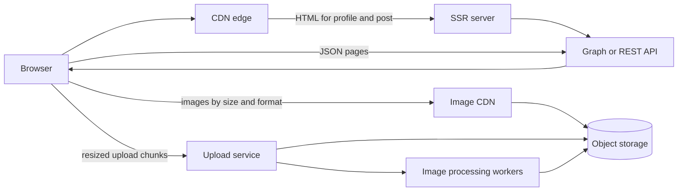

## 1. Requirements exploration

A photo app shares a lot with a generic news feed (pagination, reactions, optimistic updates). Don't repeat that
whole design; say so and spend the time where this product differs: **image delivery**, **the upload and
editing pipeline**, **public SEO-friendly profiles**, and **modal routing** between grid and detail.

### Functional requirements

- Home feed: posts with one or more photos (carousel), caption, like, comment, save, share.
- Profile: header (avatar, bio, counts, follow), 3-column grid of post thumbnails, infinite scroll.
- Post detail: opens as a modal over the current page (URL changes to `/p/:id`); direct visits render a full page.
- Create post: select up to 10 photos, crop to an allowed aspect ratio (1:1, 4:5, 1.91:1), apply a filter, add
  caption and alt text, publish with progress.
- Double-tap to like on touch devices, with a heart animation.

### Non-functional requirements

| Concern | Target |
| --- | --- |
| LCP | < 2.5 s p75 on mobile 4G; the LCP element is the first photo |
| CLS | < 0.05 — images must never shift the layout |
| Image bytes | first viewport ≤ ~300 KB of images on mobile |
| Upload | survives a network drop; 10 photos upload in parallel with per-file progress |
| Editing | crop/filter preview at 60 fps on mid-range phones |
| SEO | profile and post pages server-rendered with Open Graph tags |
| Scale | profile grids with 10k+ posts |

### Out of scope

Stories, Reels/video editing, DMs, explore ranking, server-side image processing internals (we specify what we need).

### Clarifying questions

1. Is the editor (crop + filters) client-side? (Yes: instant preview; server re-applies or trusts the output.)
2. Original photos stored at full resolution, or capped? (Cap at e.g. 2048 px long edge to save bandwidth.)
3. Do we need to strip EXIF location data? (Yes by default — privacy.)
4. Which browsers? (Evergreen + iOS Safari 16+ — affects AVIF and `OffscreenCanvas` availability.)
5. Logged-out viewing: what can anonymous users see?

## 2. Architecture / high-level design

### Rendering strategy per route

| Route | Strategy | Why |
| --- | --- | --- |
| `/:username` (profile) | SSR + CDN caching with short TTL, hydrate | SEO, link previews, fast LCP for shared links |
| `/p/:id` (post page) | SSR | SEO and OG tags (`og:image`) |
| `/` (home feed, logged in) | SSR shell + first posts streamed, CSR after | personalised, no SEO; fast first image |
| `/create` | CSR, code-split | heavy editor code only for creators |

The editor (canvas code, filters, crop gestures) can easily be 100+ KB; lazy-load it on "Create" intent (hover or
tap on the + button) so viewers never pay for it.

### Component tree

```
<AppShell>                      // nav, bottom tab bar on mobile
  <Routes>
    <HomeFeed>
      <PostCard>
        <PostHeader />
        <MediaCarousel />       // scroll-snap, dots, lazy neighbours
        <ActionBar />           // like, comment, share, save
        <LikesSummary /> <Caption /> <CommentPreview />
    <ProfilePage>
      <ProfileHeader />
      <ProfileTabs />           // posts, saved, tagged
      <PhotoGrid>               // virtualized rows of 3 thumbnails
        <GridTile />
    <PostModal />               // rendered over background route
    <CreateFlow>                // lazy
      <FilePicker /> <CropStep /> <FilterStep /> <DetailsStep /> <UploadProgress />
```

### Modal routing

Clicking a grid tile pushes `/p/:id` with `history.state.background = '/alice'`. The router renders the background
route (grid) **and** the modal. Closing the modal calls `history.back()`, so the grid's scroll position is intact.
Opening `/p/:id` directly (no background state) renders a full post page. Next.js parallel + intercepting routes
implement exactly this; in React Router you use a `backgroundLocation` in state.



## 3. Data model

```ts
type ID = string;

interface ImageAsset {
  id: ID;
  width: number;                 // original dimensions after crop
  height: number;
  dominantColor: string;         // e.g. "#d8c3a5" for placeholder background
  thumbhash?: string;            // ~25-byte placeholder rendered to a tiny image
  alt: string | null;            // user-provided or auto-generated
  // URL template rather than a list: the CDN resizes on demand
  urlTemplate: string;           // "https://img.example.com/{id}/{w}.{format}?v=3"
  availableWidths: number[];     // [150, 320, 640, 1080, 1440]
}

interface Post {
  id: ID;
  authorId: ID;
  media: ImageAsset[];           // carousel; 1..10
  caption: string;
  captionEntities: { type: 'mention' | 'hashtag'; offset: number; length: number }[];
  likeCount: number;
  viewerHasLiked: boolean;
  viewerHasSaved: boolean;
  commentCount: number;
  createdAt: string;
}

interface Profile {
  id: ID;
  username: string;
  fullName: string;
  bio: string;
  avatar: ImageAsset;
  counts: { posts: number; followers: number; following: number };
  viewerFollows: boolean;
  isPrivate: boolean;
}

interface ClientState {
  entities: { posts: Record<ID, Post>; profiles: Record<ID, Profile>; comments: Record<ID, Comment> };
  lists: {
    homeFeed: { ids: ID[]; cursor: string | null; hasMore: boolean };
    profileGrid: Record<ID, { ids: ID[]; cursor: string | null; hasMore: boolean }>; // by profile id
  };
  ui: {
    carouselIndex: Record<ID, number>;   // per post, so returning to a post keeps its slide
    composer: ComposerState | null;
  };
}

interface ComposerState {
  files: {
    localId: ID;
    file: File;                    // never stored in Redux devtools/serialised state
    previewUrl: string;            // object URL
    crop: { x: number; y: number; width: number; height: number; aspect: '1:1' | '4:5' | '1.91:1' };
    filter: 'none' | 'clarendon' | 'juno' | 'mono';
    upload: { status: 'idle' | 'uploading' | 'done' | 'error'; progress: number; uploadId?: ID };
  }[];
  caption: string;
  altTexts: Record<ID, string>;
}
```

Notes:

- Server data (posts, profiles, comments) lives in a normalized server cache (Relay/Apollo/TanStack Query); a like
  on a post updates both the feed card and the modal because there is one entity.
- `File` objects and object URLs live outside serializable state (a ref or module-level map keyed by `localId`).
- The **image URL template** lets the client choose sizes without the API enumerating every variant.
- The composer draft (caption + crop settings) is persisted to IndexedDB so a reload mid-creation doesn't lose work;
  `File` objects can be stored in IndexedDB too (they are structured-cloneable).

## 4. Interface definition (API)

### Reads

```http
GET /api/users/alice/posts?first=24&after=Y3Vyc29yOjI0
```

```json
{
  "posts": [
    { "id": "p_1", "media": [{ "id": "img_9", "width": 1080, "height": 1350, "dominantColor": "#c9b8a0",
       "thumbhash": "3OcRJYB4d3h/iIeHeEh3eIhw+j2w", "alt": "Sunset over the harbour",
       "urlTemplate": "https://img.example.com/img_9/{w}.{format}?v=1", "availableWidths": [150, 320, 640, 1080] }],
      "likeCount": 210, "commentCount": 14 }
  ],
  "pageInfo": { "endCursor": "Y3Vyc29yOjQ4", "hasNextPage": true }
}
```

The grid needs only thumbnails and counts; the detail view fetches caption, comments and full media. Separate
**list** and **detail** shapes (or GraphQL fragments per component) keep the grid payload tiny.

Pagination: **cursor-based** (keyset on `createdAt, id`). New posts are added to the top of a profile while
someone scrolls it; offsets would produce duplicates. Page size 24 = 8 rows of 3, a multiple of the column count
so rows are always full.

### Mutations

```http
PUT    /api/posts/p_1/like               -> 204   (idempotent)
DELETE /api/posts/p_1/like               -> 204
POST   /api/posts/p_1/comments  { "text": "Wow", "clientMutationId": "c-12" }
PUT    /api/users/alice/follow           -> { "status": "following" | "requested" }  // private accounts
```

### Upload protocol

```http
POST /api/uploads
{ "fileName": "IMG_2041.jpg", "size": 1834221, "mimeType": "image/jpeg", "sha256": "…" }
-> { "uploadId": "up_7", "chunkSize": 1048576, "uploadUrl": "https://upload.example.com/up_7" }

PATCH https://upload.example.com/up_7
Upload-Offset: 0
Content-Type: application/offset+octet-stream
<first 1 MiB of bytes>
-> 204 No Content, Upload-Offset: 1048576

HEAD https://upload.example.com/up_7   -> Upload-Offset: 1048576   // after a network drop, resume from here

POST /api/posts
{ "media": [{ "uploadId": "up_7", "crop": {...}, "filter": "juno", "alt": "Dog on a beach" }],
  "caption": "Saturday #beach", "clientMutationId": "post-55" }
-> { "post": { ...full post... } }
```

**Resumable, chunked uploads** (the tus protocol is an open standard for this) mean a 4G drop at 90% doesn't
restart the upload (the example above follows tus-style `PATCH` + `Upload-Offset`; Google-style resumable uploads
with `Content-Range` work the same way). Uploads start **as soon as photos are selected**, in the background, while the user crops and
writes a caption. By the time they hit "Share" the bytes are usually already on the server and publish is instant.

Whether to send the crop/filter as **parameters** (server renders) or as **baked pixels** (client renders) is a
trade-off: parameters keep the original for re-editing and consistent output, baked pixels save server CPU and
guarantee what-you-see-is-what-you-get. A common hybrid: upload the resized original + parameters; the server
renders the final variants.

### Component props

```ts
interface ResponsiveImageProps {
  asset: ImageAsset;
  sizes: string;                 // e.g. "(max-width: 600px) 100vw, 600px"
  priority?: boolean;            // LCP candidate
  className?: string;
}

interface PhotoGridProps {
  profileId: ID;
  columns?: 3;                   // fixed for Instagram-like layout
  onTileClick: (postId: ID) => void;
}

interface MediaCarouselProps {
  media: ImageAsset[];
  initialIndex?: number;
  onIndexChange?: (i: number) => void;
  onDoubleTap?: () => void;      // like gesture
}
```

## 5. Optimizations and deep dives

### Image delivery (the most important section)

1. **Right size**: `srcset` built from `availableWidths` and an accurate `sizes`. A 3-column grid tile on a 390 px
   phone needs ~130 CSS px × DPR 3 = 390 px, so the 320 or 640 variant; never the 1080.
2. **Right format**: AVIF (best compression) → WebP → JPEG. Either `<picture>` with `type` sources, or let the image
   CDN negotiate via the `Accept` header (fewer bytes of HTML; needs `Vary: Accept`).
3. **Right priority**:
   - The first feed image (or the first 3–6 grid tiles) is the LCP element: `fetchpriority="high"`, no
     `loading="lazy"`, and an SSR `<link rel="preload" as="image" imagesrcset="…" imagesizes="…">`.
   - Everything else: `loading="lazy"` + `decoding="async"`.
   - Carousels: load slide 1 eagerly, preload slide 2 when the post is in view, others on swipe.
4. **Zero CLS**: `width`/`height` attributes (or `aspect-ratio`) from the API dimensions. Paint `dominantColor` or a
   decoded thumbhash as the placeholder, fade in on `load`.
5. **Caching**: image URLs are immutable (versioned with `?v=`), served with
   `Cache-Control: public, max-age=31536000, immutable`. Re-edits produce a new version.
6. **Client hints / Save-Data**: when the user has data saver on, choose a lower width cap and skip preloading
   carousel neighbours.

### Profile grid at scale

- The grid is a list of **rows** (3 tiles each), each row the same height, which makes virtualization trivial (fixed
  row height = tile width + gap). Use a virtualizer or `content-visibility: auto` on rows.
- Prefetch the next page when the sentinel is 2 screens away.
- Hovering a tile (desktop) prefetches the post detail data, so the modal opens instantly; on touch devices,
  prefetch on `pointerdown`.

### Upload and editing pipeline

1. **Pick**: `<input type="file" accept="image/*" multiple>` plus drag-and-drop. HEIC from iPhones: Safari converts to
   JPEG when using the file input with `accept="image/*"` in most cases; otherwise convert server-side.
2. **Decode off the main thread**: `createImageBitmap(file, { imageOrientation: 'from-image' })` handles EXIF
   orientation; draw into an `OffscreenCanvas` in a Web Worker, resize to ≤ 2048 px long edge, encode with
   `convertToBlob({ type: 'image/jpeg', quality: 0.85 })`. A 6 MB photo becomes ~500 KB, a 10× upload speedup on
   mobile. Re-encoding through canvas strips EXIF (including GPS) as a side benefit.
3. **Edit**: crop is CSS transforms over the preview during gestures (cheap); filters are CSS `filter` for preview
   or a WebGL shader for exact parity with server output. Render a final pixel version only when needed.
4. **Upload** in parallel (2–3 concurrent with HTTP/2), chunked and resumable, with progress from `XMLHttpRequest`
   `upload.onprogress` (fetch upload progress is not yet broadly available).
5. **Publish** optimistically: insert the post at the top of the profile grid and home feed with local object URLs,
   swap to CDN URLs when the server responds, then revoke the object URLs.
6. **Failure**: keep the draft in IndexedDB; offer retry. Leaving the page during upload shows a `beforeunload`
   confirmation only while an upload is active.

### Interactions

- Likes, saves and follows are optimistic with rollback; debounce rapid toggles.
- Double-tap to like: handle via pointer events with a ~300 ms window; ensure `touch-action: manipulation` so the
  browser doesn't zoom. The heart animation uses `transform`/`opacity` only (compositor-friendly) and respects
  `prefers-reduced-motion`.
- Carousel uses CSS `scroll-snap-type: x mandatory` for native-feeling swipes without JS gesture code; JS only
  tracks the active index via `IntersectionObserver` or `scrollend`.

### SEO and sharing

- SSR profile and post pages with `<title>`, meta description, canonical URL, and Open Graph/Twitter tags
  (`og:image` pointing to a 1080 px JPEG — some crawlers don't handle AVIF).
- Structured data (`ImageObject`, `ProfilePage` schema.org types) where useful.
- Private accounts return a minimal page without media and `noindex`.

### Offline and PWA

- Installable PWA with a service worker: cache the app shell, cache recently viewed images with a size-capped
  cache (e.g. 50 MB, LRU) using a cache-first strategy because image URLs are immutable.
- Feed data uses stale-while-revalidate so the app opens to the last-seen feed offline.
- Queue likes/comments made offline and replay; queue drafts for posting when back online.

### Accessibility

- **Alt text** is a first-class field in the composer with a suggested auto-generated description that the user can
  edit. Grid tiles use the alt text, plus link text like "Post by alice, 210 likes".
- The grid is a list of links; the modal is a proper dialog (`<dialog>` with `showModal()`, focus trapped, `Escape`
  closes, focus returns to the tile).
- Carousel: previous/next buttons with labels, "Slide 2 of 5" announced; swipe is not the only way to navigate.
- Double-tap like must have a button equivalent. Don't rely on color alone for the liked state; use
  `aria-pressed`.

### i18n

- Counts in compact locale format (`Intl.NumberFormat(locale, { notation: 'compact' })` → "1.2M", "120万").
- Captions with `dir="auto"`; hashtags in non-Latin scripts must be supported by the entity parser
  (Unicode-aware regex with `\p{L}`).
- RTL mirrors the layout, but **not** the photos or carousel swipe direction semantics — test it.

### Security and privacy

- Strip EXIF metadata (location!) client-side and again server-side; never trust the client alone.
- Validate file type by sniffing magic bytes server-side; limit sizes; scan uploads.
- Captions/comments rendered as text with parsed entities, no HTML. CSP with `img-src` limited to the image CDN.
- Pre-signed upload URLs are short-lived and scoped to one upload.

### Observability

- LCP attribution (which image, its size, whether it was preloaded), image bytes per page view, cache hit ratio on
  the image CDN, upload success rate and time-to-publish, client-side resize duration by device class.
- Track `img` load errors per CDN region.

### Testing

- Visual regression tests for grid, carousel and modal routing (open/close/back/forward/deep link).
- Unit tests for `srcset` generation and `sizes` math.
- Upload tests with a fake server that drops connections mid-chunk to verify resume.
- Real-device performance tests on a mid-range Android (WebPageTest or Lighthouse with throttling) gated in CI.

## What a lead-level answer adds

- Quantifies the **image budget** and makes it enforceable (lint rule that `` must use the `ResponsiveImage`
  component; CI checks on LCP image size).
- Owns the **contract with the media platform team**: URL template, available widths, formats, immutability,
  placeholder data — so every client (web, native) gets the same pipeline.
- Discusses **cost**: on-the-fly resizing at the CDN vs pre-generated variants (storage vs compute), and egress
  savings from AVIF measured in real money.
- Treats privacy (EXIF stripping, private accounts) and accessibility (alt text adoption rate as a tracked metric)
  as product requirements, not afterthoughts.
- Plans incremental delivery: ship upload without filters first, measure completion, then add the editor.

## Common follow-up questions

**Why not just use `loading="lazy"` on all images?** Lazy-loading the LCP image delays it until layout, hurting LCP
significantly. The first visible images must be eager and high priority.

**How do you choose between thumbhash/blurhash and a dominant color?** Dominant color is free (one CSS value) and
looks clean; hashes look nicer but need a small decode step (do it once, cache as a data URL). Both avoid empty boxes.

**How would you support video posts?** Poster image as LCP, `preload="none"`, mount the player near the viewport,
autoplay muted when ≥ 50% visible, adaptive streaming (HLS/DASH via MSE). See the video streaming question.

**The modal and the full post page need the same data. How do you avoid fetching twice?** Normalized cache: the
grid already has a partial post; render that immediately and fetch the remaining fields (comments, full caption).

**How would you handle a user uploading 10 photos on a slow connection?** Resize client-side, upload 2–3 concurrently,
resumable chunks, start during editing, show per-photo progress, allow the user to leave the screen (upload continues
in the app; Background Fetch API is an option where supported).
