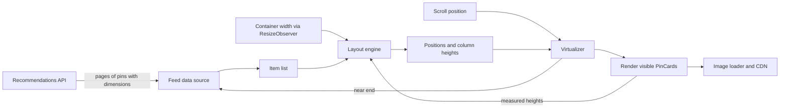

## 1. Requirements exploration

Pinterest is a feed question whose twist is **layout**. A normal feed is one column where each item's position
depends only on the items above it. In masonry, an item's position depends on *every column's* current height, so
layout, virtualization, resizing and scroll restoration all get harder. Make that the centre of the answer.

### Functional requirements

- Home feed of pins in a masonry grid; column count adapts to the viewport (2 on phones, up to 6–7 on wide screens).
- Each pin: image, optional title and author, hover overlay with "Save" and "More" on desktop.
- Infinite scroll with recommendations; no end in practice.
- Click a pin → close-up view (`/pin/:id`) with bigger image, description, comments and "More like this" (itself a
  masonry feed). Back returns to the exact position.
- Save a pin to a board (pick board in a popover, or quick-save to the last board).

### Non-functional requirements

| Concern | Target |
| --- | --- |
| LCP | < 2.5 s p75 mobile |
| CLS | ≈ 0: pins never move after they are placed |
| Scroll | 60 fps after 2,000+ pins loaded; INP < 200 ms |
| DOM size | bounded (e.g. < 150 pin nodes mounted at any time) |
| Memory | bounded image decoding; long sessions on low-end Android must not crash |
| Data | first page ≤ ~25 pins; image bytes matched to column width |

### Out of scope

Recommendation ranking, ads auction, creating pins, boards management UI beyond "save".

### Clarifying questions

1. Does the API give **image dimensions** up front? (If not, we can't lay out before images load — a hard
   requirement for stable masonry.)
2. Is item order significant (ranked) left-to-right, or just approximately? Masonry inherently reorders visually.
3. Is the close-up an overlay or a separate page? Both need correct URLs.
4. SEO: public pin pages need SSR; is the home feed logged-in only?
5. Do pins contain video or carousels? (Assume mostly images; some video with poster.)

## 2. Architecture / high-level design

### Layout options

| Approach | How | Pros | Cons |
| --- | --- | --- | --- |
| CSS multi-column (`column-count`) | browser flows items into columns | zero JS | order runs **down** each column, not across; appending items reshuffles everything |
| N flex columns | JS assigns items to column arrays | simple, no absolute positioning | resizing changes column count → full redistribution; hard to virtualize each column consistently |
| **JS absolute positioning** | compute `x, y` per item, position with `transform` | full control, stable, virtualizable | needs known heights; more code |
| Native CSS masonry | `grid` masonry proposal (syntax still being finalised in 2025) | browser does it | not shipped across browsers; no virtualization story |

I would choose **JS-computed absolute positioning** for production, with a note that native CSS masonry is a future
simplification for small lists. This is roughly how large masonry sites work: the layout engine is plain
TypeScript, independent of React, and the view renders only what's visible.

### Component tree

```
<HomePage>
  <Header />                       // search, profile
  <MasonryFeed>                    // owns layout engine + virtualization
    <PinCard style={{ transform: translate(x, y), width }}>
      <PinImage />                 // aspect-ratio box, placeholder color
      <PinOverlay />               // Save, More (desktop hover / focus)
      <PinFooter />                // title, author
    </PinCard>
    <LoadMoreSentinel />
  </MasonryFeed>
  <PinCloseupModal />              // rendered over the feed when navigated from it
  <SaveToBoardPopover />
```

### Modules

- **Feed data source**: paginates the recommendations API, dedupes pins.
- **Layout engine** (pure functions): given container width, gutter, column count and the list of items with
  aspect ratios (and estimated footer heights), produce positions.
- **Virtualizer**: given positions and the scroll window, return the visible index set.
- **Measurement**: `ResizeObserver` corrects heights for text footers that differ from estimates.
- **Image loader**: picks the right image size per column width and priority.
- **Scroll restoration**: stores layout snapshot + scroll offset per history entry.



## 3. Data model

```ts
type ID = string;

interface Pin {
  id: ID;
  title?: string;
  description?: string;
  link?: string;                       // outbound URL
  dominantColor: string;
  image: {
    width: number;                     // original dimensions: needed for layout
    height: number;
    urls: { w236: string; w474: string; w736: string; orig: string }; // fixed width buckets
    alt?: string;
  };
  pinner: { id: ID; name: string; avatarUrl: string };
  saveCount: number;
  viewerSavedBoardId: ID | null;
  type: 'image' | 'video' | 'ad';
}

interface LayoutItem {
  id: ID;
  column: number;
  x: number;
  y: number;
  width: number;
  height: number;                      // image height + footer height
  measured: boolean;                   // footer height verified by ResizeObserver
}

interface MasonryLayout {
  containerWidth: number;
  columnCount: number;
  columnWidth: number;
  gutter: number;
  items: LayoutItem[];                 // same order as pins
  columnHeights: number[];             // current bottom of each column
  columns: number[][];                 // item indices per column, sorted by y (for fast range queries)
}

interface FeedStore {
  pins: Record<ID, Pin>;               // normalized; a pin can appear in home and closeup feeds
  homeFeed: { ids: ID[]; cursor: string | null; hasMore: boolean; loading: boolean };
  closeupFeeds: Record<ID, { ids: ID[]; cursor: string | null; hasMore: boolean }>;
  layoutSnapshots: Record<string, { layout: MasonryLayout; scrollY: number }>; // keyed by history entry key
}
```

Layout is **derived state** (from pins + width), but it is cached incrementally: appending 25 pins only places 25
new items starting from the current `columnHeights`; it doesn't recompute existing positions. Full recomputation
happens only when the column count or column width changes.

## 4. Interface definition (API)

```http
GET /api/feed/home?bookmark=Y2JVSG...&page_size=25
```

```json
{
  "pins": [
    {
      "id": "pin_1001",
      "title": "Small balcony garden ideas",
      "dominantColor": "#6b8f5a",
      "image": { "width": 736, "height": 1104,
                 "urls": { "w236": "https://i.example.com/236x/ab/cd.jpg", "w474": "https://i.example.com/474x/ab/cd.jpg",
                           "w736": "https://i.example.com/736x/ab/cd.jpg", "orig": "https://i.example.com/originals/ab/cd.jpg" },
                 "alt": "Balcony with hanging planters" },
      "pinner": { "id": "u_5", "name": "Lena", "avatarUrl": "https://i.example.com/u5_30.jpg" },
      "saveCount": 1820,
      "viewerSavedBoardId": null,
      "type": "image"
    }
  ],
  "bookmark": "Y2JVSG...next",
  "hasMore": true
}
```

- **Cursor ("bookmark") pagination**: recommendations are generated per session and can't be addressed by offset;
  the bookmark encodes the session and position, and lets the server avoid repeats.
- **Dimensions are mandatory** in the contract. This is the single most important API requirement for masonry.
- **Fixed width buckets** (236/474/736) are good for CDN cache hit ratio: thousands of clients request the same few
  variants instead of arbitrary widths.

Save:

```http
POST /api/boards/b_9/pins   { "pinId": "pin_1001", "clientMutationId": "s-71" }
-> 201 { "boardPinId": "bp_88", "board": { "id": "b_9", "name": "Garden" } }
```

Optimistic: mark "Saved to Garden" immediately; roll back on error.

### Component props

```ts
interface MasonryFeedProps<T> {
  items: T[];
  getKey: (item: T) => string;
  getAspectRatio: (item: T) => number;          // height / width of the image
  estimateFooterHeight?: (item: T, columnWidth: number) => number;
  minColumnWidth?: number;                      // e.g. 236; column count derived from container width
  gutter?: number;                              // 16
  overscanPx?: number;                          // 1000
  renderItem: (item: T, layout: LayoutItem) => React.ReactNode;
  onEndReached: () => void;
  restoreKey?: string;                          // history entry key for scroll restoration
}

interface PinCardProps {
  pin: Pin;
  width: number;                                // column width chosen by layout
  priority?: boolean;                           // above-the-fold
  onOpen: (pinId: ID) => void;
  onQuickSave: (pinId: ID) => void;
}
```

The `MasonryFeed` is generic so the close-up's "More like this", search results and board pages reuse it.

## 5. Optimizations and deep dives

### The layout algorithm

```ts
function placeItems(layout: MasonryLayout, newItems: { id: ID; aspect: number; footer: number }[]) {
  const { columnWidth, gutter } = layout;
  for (const item of newItems) {
    // shortest column first; ties broken by lowest index to keep left-to-right reading order
    let col = 0;
    for (let c = 1; c < layout.columnCount; c++) {
      if (layout.columnHeights[c] < layout.columnHeights[col]) col = c;
    }
    const height = Math.round(columnWidth * item.aspect) + item.footer;
    const y = layout.columnHeights[col];
    const x = col * (columnWidth + gutter);
    layout.columns[col].push(layout.items.length);
    layout.items.push({ id: item.id, column: col, x, y, width: columnWidth, height, measured: false });
    layout.columnHeights[col] = y + height + gutter;
  }
}
```

- O(n × columns) to place n items; trivial for 25 items per page.
- **Shortest-column-first** keeps columns balanced and approximately preserves ranking order (higher-ranked pins
  appear higher on the page). A purely round-robin assignment would produce ragged columns.
- Container height = `max(columnHeights)`, set on the container so the scrollbar is right.

### Footer heights and measurement

Image height is known from the aspect ratio. The footer (title up to 2 lines, author row) is not. Options:

1. **Estimate** from text length and column width, render, measure with `ResizeObserver`, and if different,
   update that item's height and **shift only items below it in the same column**. Because pins below are often
   not yet visible, this causes no visible movement.
2. **Fixed footer height** with line clamping (`-webkit-line-clamp: 2`) — simplest and fully stable; Pinterest-like
   UIs commonly clamp titles. I'd start here.

### Virtualization

With absolute positions known, virtualization is a range query: render items whose `[y, y + height]` intersects
`[scrollTop - overscan, scrollTop + viewportHeight + overscan]`.

- Each column's items are sorted by `y`, so **binary search** per column finds the first visible item: O(columns ×
  log n) per scroll frame. A naive filter over 5,000 items every frame also works but wastes main-thread time.
- Read scroll position in a passive `scroll` listener, compute the range in `requestAnimationFrame`, and update state
  only when the visible **set** changes, not on every pixel.
- Overscan ~1 viewport (more in the scroll direction) so fast flings don't show blank space.
- Use `transform: translate3d(x, y, 0)` to position cards — layout-free moves. Keep stable keys so React reuses
  nodes as pins enter/leave.
- An alternative is window-level `content-visibility: auto` on each card; it's simpler but still keeps thousands of
  nodes and image elements in memory, which matters on low-end Android.

### Resizing

- Column count = `floor((width + gutter) / (minColumnWidth + gutter))`. Recompute only when width crosses a
  breakpoint or column width changes; debounce with `ResizeObserver` + rAF.
- On a column-count change, all positions change. Preserve the user's place by **anchoring**: find the first
  visible pin before relayout, then scroll so it stays at the same viewport offset afterwards.

### Infinite loading

- Trigger the next page when the **shortest** column's bottom is within ~2 viewports of the scroll bottom (gaps
  appear in the shortest column first).
- Request in flight → don't request again; failure → show a retry tile.
- Cap total in-memory items (e.g. 3,000); beyond that, drop the oldest pins' data but keep their layout boxes so
  scroll height is unchanged (or offer "Back to top"). In practice sessions rarely go that deep.

### Images

- Choose the image bucket by column width × DPR: a 236 px column at DPR 2 → `w474`. Use `srcset` with `w`
  descriptors and `sizes` set to the exact column width, so the browser picks correctly.
- Container has `aspect-ratio` from the API and `background: dominantColor`, so blank space looks intentional and
  nothing shifts.
- First ~8 pins: `fetchpriority="high"` for the first, eager for the rest of the first viewport; everything else
  `loading="lazy"`. Since cards are virtualized, unmounted images release decoded memory; that's a hidden benefit of
  windowing on mobile.
- WebP/AVIF via content negotiation at the CDN; immutable, long-lived cache headers.
- Animated GIF pins: serve as muted looping MP4/WebM video (far smaller) and only play when visible.

### Close-up view and scroll restoration

- Clicking a pin pushes `/pin/:id` with background state; the feed stays mounted (hidden or behind the overlay), so
  "Back" is instant and positions are untouched.
- If the feed was unmounted (full navigation, or a reload), restore from `layoutSnapshots[history.state.key]`:
  restore pins from the query cache, the layout snapshot (no relayout needed if the width is the same) and then
  `scrollTo(scrollY)`. Set `history.scrollRestoration = 'manual'` so the browser doesn't scroll before content
  exists.
- A shared-element transition (the pin image grows into the close-up) is possible with the **View Transitions API**
  (same-document transitions are widely supported in Chromium and Safari 18+); degrade to a fade elsewhere.
- Hover/press prefetch of close-up data makes opening feel instant.

### Rendering performance

- Pin cards are memoized; the layout engine runs outside React (plain TS object), and React just renders the
  visible slice.
- Hover overlays are CSS-only (`:hover`, `:focus-within`) — no state updates on mouse move.
- Defer non-critical work (impression logging, analytics) with `requestIdleCallback` / `scheduler.postTask` at
  background priority.

### Accessibility

- Masonry breaks the visual-vs-DOM order relationship. Keep **DOM order = ranking order** so screen reader and
  keyboard users get a logical sequence, even though visual placement is by column. Absolute positioning makes this
  possible (CSS columns would not).
- The feed is `role="feed"` with each pin an `article` labelled by its title/alt; `aria-busy` while loading;
  `aria-setsize="-1"` (unknown total).
- Save/More buttons are visible on keyboard focus (`:focus-within`), not only on hover; touch devices show a
  persistent save button or long-press menu with a visible alternative.
- Virtualization must not unmount the focused pin; when a user tabs to a pin that's offscreen-but-near, scroll it
  into view.
- Alt text from the pin; fall back to the title, never to the filename.

### i18n

- Titles and descriptions with `dir="auto"`; the grid itself places column 0 at the inline-start (right side in RTL)
  by computing `x` from the right when `dir="rtl"`.
- Compact counts with `Intl.NumberFormat`.

### Security

- Outbound pin links: validate scheme, `rel="nofollow ugc noopener"`, and show the destination domain. Consider a
  redirect service for malware checking.
- Text rendered as text; CSP restricts `img-src` to the image CDN.

### Observability and testing

- Metrics: time to first pin painted, blank-area ratio during fast scrolling (how often users see empty space),
  frames dropped while scrolling (Long Animation Frames API), images decoded per session, memory (where
  `performance.measureUserAgentSpecificMemory` is available).
- Unit-test the layout engine thoroughly (it's pure): column balance, deterministic output, incremental append equals
  full layout, resize anchoring.
- Visual regression at several widths; E2E scroll 1,000 pins and assert DOM node count stays under the budget.

## What a lead-level answer adds

- Identifies the **API contract requirement** (dimensions up front) as a cross-team dependency and negotiates it
  early; without it, no client-side cleverness gives zero CLS.
- Keeps the layout engine **framework-agnostic and pure**, shared by web feeds, boards, search, and testable without
  a DOM.
- Explicitly calls out the **accessibility trade-off** of masonry (visual vs reading order) and how the design
  preserves logical order.
- Defines measurable success: blank-area ratio, scroll jank, memory, alongside engagement metrics in A/B tests.
- Plans for native CSS masonry as a progressive enhancement once it ships, without rewriting consumers (the
  `MasonryFeed` API stays the same).

## Common follow-up questions

**Why not CSS `column-count`?** Items flow top-to-bottom per column, so the first row isn't the top-ranked items, and
appending items can move existing ones between columns, causing visible jumps.

**What if the API doesn't give image sizes?** Use a fixed aspect-ratio crop (e.g. all 2:3), or load images before
placing them (slow and janky), or have the server compute dimensions at ingestion time — the right fix.

**How do you handle window resize with 2,000 pins?** Recompute layout once per breakpoint change (fast — it's
arithmetic), anchor to the first visible pin, and only render the visible slice.

**How do you avoid a gap at the bottom of one column?** You can't fully, but shortest-column-first minimizes it,
and loading the next page early hides it. Some designs rebalance the last row; avoid moving already-visible pins.

**How would you test the layout engine?** Pure function snapshot tests with fixture aspect ratios, property tests
(no overlaps, columns within one item height of each other), and incremental-vs-full equivalence.
